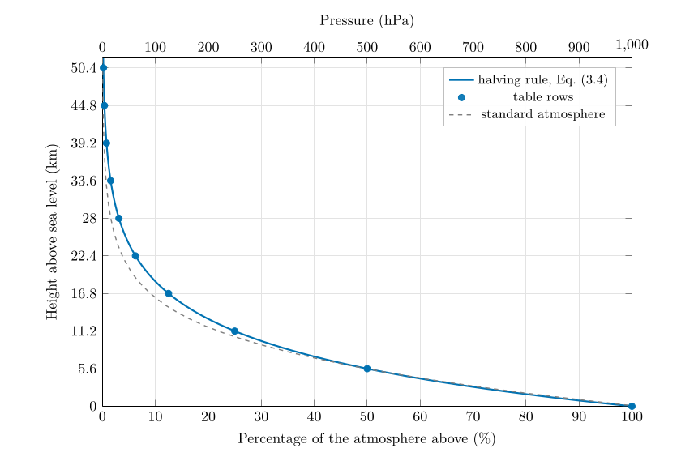

*This chapter answers Questions 1 and 2.*

## 3.1 Air has weight {#p1-sec:weight}

Air is matter: every cubic metre near the ground has a mass of about 1.2 kg. Gravity pulls all of it towards the Earth, so every layer of the atmosphere rests on the layers below. **Atmospheric pressure** at any height is the weight of all the air above, pressing on each square metre. At sea level it averages 1013.25 hPa (NOAA et al. 1976); this part rounds it to 1000 hPa.

Units of pressure

Pressure is force per unit area. The SI unit is the pascal, $1\ \mathrm{Pa}=1\ \mathrm{N\,m^{-2}}$. Meteorologists use the **hectopascal**, $1\ \ensuremath{\mathrm{hPa}}=100\ \mathrm{Pa}$, which is exactly the same as the older **millibar**: $1\ \ensuremath{\mathrm{hPa}}=1\ \ensuremath{\mathrm{mb}}$. Sea-level pressure is about 1000 hPa $=100\,000$ Pa.

How heavy is the air above you? A pressure of $100\,000$ Pa means a force of $100\,000$ N on every square metre. Dividing by the acceleration due to gravity, $g=9.81$ m s$^{-2}$, gives the mass that exerts it: $$\frac{100\,000\ \mathrm{N\,m^{-2}}}{9.81\ \mathrm{m\,s^{-2}}}=10\,200\ \mathrm{kg\,m^{-2}}.$$ About ten tonnes of air sit above every square metre of the ground. We do not feel it because the pressure acts equally in all directions and the air inside our bodies pushes back.

## 3.2 Air is squeezed by its own weight {#p1-sec:compress}

Water is almost incompressible: the bottom of the ocean is hardly denser than the top. Air is very compressible, and the air near the ground carries the weight of all the air above it, so it is squeezed the most. The lowest layers are therefore the densest, and density (and pressure) fall with height. How fast? Two physical laws answer that.

**The ideal gas law** links the pressure, density and temperature of a gas: $$
p=\rho R_d T .\tag{3.1}
$$ *where*

|  |  |  |
|:---|:---|:---|
| $p$ | pressure (Pa) |  |
| $\rho$ | density of the air (kg m$^{-3}$) | about 1.2 near the ground |
| $R_d$ | gas constant for dry air (J kg$^{-1}$ K$^{-1}$) | 287, Table [D.1](/teaching/atmosphere/app-constants/#tab:constants) |
| $T$ | absolute temperature (K) |  |

At a fixed temperature, pressure and density are proportional: squeeze the air to twice the density and its pressure doubles.

**Hydrostatic balance.** Picture a thin horizontal slab of air, one square metre in area and $\Delta z$ thick. Its weight is its mass times $g$, that is $\rho\,\Delta z\,g$. The slab stays where it is (it does not fall or fly upwards) because the pressure pushing up on its underside exceeds the pressure pushing down on its top by exactly its weight. So the pressure must fall by $\rho g\,\Delta z$ across the slab (Wallace and Hobbs 2006, ch. 1): $$
\frac{\Delta p}{\Delta z}=-\rho g .\tag{3.2}
$$ *where*

|            |                                              |                   |
|:-----------|:---------------------------------------------|:------------------|
| $\Delta p$ | change in pressure across the slab (Pa)      | negative going up |
| $\Delta z$ | thickness of the slab (m)                    |                   |
| $\rho$     | density of the air in the slab (kg m$^{-3}$) |                   |
| $g$        | acceleration due to gravity (m s$^{-2}$)     | 9.81              |

\

**Figure 3.1.** Hydrostatic balance. The slab neither rises nor falls, so the upward push of the pressure on its underside, $p$, exceeds the downward push on its top, $p+\Delta p$ (with $\Delta p$ negative), by exactly its weight: $-\Delta p=\rho g\,\Delta z$, Eq. ([3.2](/teaching/atmosphere/p1-ch02_pressure/#p1-eq:hydro)).

Near the ground $\rho g=1.2\times9.81=11.8$ Pa per metre, so the pressure falls by about 1 hPa for every 8.5 m you climb. You can feel this in your ears in a lift or on a hill.

## 3.3 Why the fall is exponential {#p1-sec:exponential}

Put the two laws together. By Eq. ([3.2](/teaching/atmosphere/p1-ch02_pressure/#p1-eq:hydro)) the pressure falls by an amount proportional to the density, and by Eq. ([3.1](/teaching/atmosphere/p1-ch02_pressure/#p1-eq:gaslaw)) the density is proportional to the pressure. So *the pressure falls by an amount proportional to the pressure itself*: where there is a lot of air, it falls fast; where there is little, it falls slowly. A quantity that shrinks in proportion to itself decays **exponentially**, like a radioactive substance or money losing value at a fixed rate of inflation. If the temperature is taken as constant, the result is (Appendix [A.2.1](/teaching/atmosphere/app-p1/#p1-sec:der-expo)) $$
p(z)=p_0\,e^{-z/H},\qquad H=\frac{R_dT}{g}.\tag{3.3}
$$ *where*

|  |  |  |
|:---|:---|:---|
| $p(z)$ | pressure at height $z$ (hPa) | calculated |
| $p_0$ | pressure at sea level (hPa) | 1000, rounded |
| $z$ | height above sea level (km) |  |
| $H$ | scale height: the height over which the pressure falls by a factor $e=2.718$ (km) | 8.1, for the halving rule |
| $T$ | a representative temperature of the air column (K) |  |

The **scale height** $H$ is about 7 to 8.5 km for the temperatures of the lower atmosphere.

### The halving rule is the same law {#the-halving-rule-is-the-same-law .unnumbered}

Any exponential decay has a fixed *halving distance*: the height over which the pressure halves is $z_{1/2}=H\ln2=0.693\,H$. The halving rule, “for every 5.6 km you go up, there is half the atmosphere above you”, is Eq. ([3.3](/teaching/atmosphere/p1-ch02_pressure/#p1-eq:expo)) with $z_{1/2}=5.6$ km, that is $H=5.6/0.693=8.08$ km. Written with halvings instead of powers of $e$, the fraction of the atmosphere above height $z$ is $$
f(z)=\left(\tfrac12\right)^{z/5.6}=2^{-z/5.6},\tag{3.4}
$$ *where*

|  |  |  |
|:---|:---|:---|
| $f(z)$ | fraction of the whole atmosphere that lies above height $z$ (0 to 1; multiply by 100 for %) | calculated |
| $z$ | height above sea level (km) |  |
| $5.6$ | the halving height (km) | given |

and after $n$ whole steps of 5.6 km (that is, at $z=5.6\,n$ km) it is simply $$
f_n=\frac{1}{2^{n}},\qquad\text{percentage above}=\frac{100\,\%}{2^{n}}.\tag{3.5}
$$

## 3.4 Question 1: the percentage of the atmosphere above you {#p1-sec:q1}

The question

“For every 5.6 km you go up, there is half the atmosphere above you as when you started.” Keeping this rule in mind, set out a table with a row for sea level and for every 5.6 km up to 50.4 km, calculate the percentage of the atmosphere above each height, and draw the result ($x$-axis: percentage of the atmosphere above (%); $y$-axis: height above sea level (km)).

**Method.**

1.  Start at sea level with 100 % of the atmosphere above you.

2.  Each row of the table is 5.6 km higher than the last, so add 5.6 km to the height and halve the percentage, Eq. ([3.5](/teaching/atmosphere/p1-ch02_pressure/#p1-eq:halving)): $100\to50\to25\to12.5\to\dots$

3.  Continue until the percentage is well below 1 %: ten rows take you to 50.4 km.

4.  Plot each row as a point, percentage across and height up, and join the points with a *smooth* curve (Figure [3.2](/teaching/atmosphere/p1-ch02_pressure/#p1-fig:q1graph)).

| **Step $n$** | **Height (km)** | **% above** | **Pressure (hPa)** | **Standard atmosphere (hPa)** |
|---:|---:|---:|---:|---:|
| 0 | sea level | 100 | 1000 | 1013 |
| 1 | 5.6 | 50 | 500 | 498 |
| 2 | 11.2 | 25 | 250 | 219 |
| 3 | 16.8 | 12.5 | 125 | 91 |
| 4 | 22.4 | 6.25 | 62.5 | 38 |
| 5 | 28.0 | 3.13 | 31.3 | 16 |
| 6 | 33.6 | 1.56 | 15.6 | 6.8 |
| 7 | 39.2 | 0.78 | 7.8 | 3.0 |
| 8 | 44.8 | 0.39 | 3.9 | 1.4 |
| 9 | 50.4 | 0.20 | 2.0 | 0.6 |

: Table 3.1. The halving rule, row by row (Questions 1 and 2). The last column is the U.S. Standard Atmosphere (NOAA et al. 1976), for comparison only.

\

**Figure 3.2.** Questions 1 and 2. The percentage of the atmosphere above each height (bottom axis) and the pressure (top axis) by the halving rule. Each step of 5.6 km up halves both. The dashed line is the U.S. Standard Atmosphere: the rule is very close near the ground and overestimates the pressure higher up (§ [3.6](/teaching/atmosphere/p1-ch02_pressure/#p1-sec:rulecheck)).

Answer to Question 1

100, 50, 25, 12.5, 6.25, 3.13, 1.56, 0.78, 0.39 and 0.20 % of the atmosphere is above sea level, 5.6, 11.2, 16.8, 22.4, 28.0, 33.6, 39.2, 44.8 and 50.4 km (Table [3.1](/teaching/atmosphere/p1-ch02_pressure/#p1-tab:table1)), drawn as the curve of Figure [3.2](/teaching/atmosphere/p1-ch02_pressure/#p1-fig:q1graph).

**Check.** Half the air is below 5.6 km and three-quarters below 11.2 km, which agrees with the common statement that about half the mass of the atmosphere lies within the lowest 5 km or so. The curve never reaches zero: each step halves what is left, so there is always a little air above you. That is why there is no sharp “top” to the atmosphere.

A question that comes up

**Why do I get a curve and not a straight line?**\
Because equal steps up remove equal *fractions*, not equal *amounts*. The first 5.6 km removes 50 percentage points; the next removes 25; the next 12.5. Plotted against height, that is a curve that is steep near the ground and flattens higher up, the shape of every exponential decay. Plotted with a logarithmic pressure axis it would become a straight line (Figure [8.1](/teaching/atmosphere/p1-ch07_stability/#p1-fig:q12)).

## 3.5 Question 2: adding a pressure axis {#p1-sec:q2}

The question

As the density of the atmosphere drops by 50 % when we go up 5.6 km, the pressure also drops by 50 %. At sea level the pressure is approximately 1000 hPa. Add the pressure for each of your heights as another column of your table and add a second $x$-axis to your graph to show atmospheric pressure.

**Why pressure follows the percentage.** Pressure is the weight of the air above (§ [3.1](/teaching/atmosphere/p1-ch02_pressure/#p1-sec:weight)). If only half the atmosphere is above you, only half its weight presses down, so the pressure is half the sea-level pressure. In general $$
p(z)=p_0\times f(z)=1000\ \ensuremath{\mathrm{hPa}}\times f(z).\tag{3.6}
$$ *where*

|  |  |  |
|:---|:---|:---|
| $p(z)$ | pressure at height $z$ (hPa) | calculated |
| $p_0$ | sea-level pressure (hPa) | 1000, rounded |
| $f(z)$ | fraction of the atmosphere above, Eq. ([3.4](/teaching/atmosphere/p1-ch02_pressure/#p1-eq:fraction)) | Question 1 |

With $p_0=1000$ hPa the pressure in hectopascals is simply ten times the percentage.

**The second axis.** Because the pressure is exactly ten times the percentage, the pressure axis is the percentage axis relabelled: 0 to 1000 hPa along the top where 0 to 100 % runs along the bottom (Figure [3.2](/teaching/atmosphere/p1-ch02_pressure/#p1-fig:q1graph)). The same curve then answers both questions.

Answer to Question 2

Pressure $=10\times$ the percentage above: **1000, 500, 250, 125, 62.5, 31.3, 15.6, 7.8, 3.9 and 2.0 hPa** at sea level, 5.6, 11.2, …, 50.4 km (Table [3.1](/teaching/atmosphere/p1-ch02_pressure/#p1-tab:table1)). The second axis runs from 0 to 1000 hPa above the 0 to 100 % axis.

## 3.6 How good is the halving rule? {#p1-sec:rulecheck}

The last column of Table [3.1](/teaching/atmosphere/p1-ch02_pressure/#p1-tab:table1) compares the rule with the U.S. Standard Atmosphere, an idealised but realistic average atmosphere (NOAA et al. 1976). Up to about 6 km the two agree within 1 %. Higher up the rule gives too much pressure: 250 against 219 hPa at 11.2 km, 125 against 91 hPa at 16.8 km.

The reason is the temperature in the scale height, $H=R_dT/g$, Eq. ([3.3](/teaching/atmosphere/p1-ch02_pressure/#p1-eq:expo)). The rule’s $H=8.08$ km corresponds to a constant temperature of $$T=\frac{gH}{R_d}=\frac{9.81\times8080}{287}=276\ \mathrm{K}\ (3\ \ensuremath{^{\circ}\mathrm{C}}),$$ a reasonable average for the lowest few kilometres. But above about 8 km the air is far colder (around 217 K, $-56$ $^{\circ}\mathrm{C}$, Chapter [5](/teaching/atmosphere/p1-ch04_temperature/#p1-ch:temperature)), its scale height is only about 6.3 km, and the pressure falls faster than the rule assumes. Cold air is denser at the same pressure, Eq. ([3.1](/teaching/atmosphere/p1-ch02_pressure/#p1-eq:gaslaw)), so a given weight of it is packed into a thinner layer. Question 12 lets you measure this from the soundings (§ [8.1](/teaching/atmosphere/p1-ch07_stability/#p1-sec:q12)).

A question that comes up

**Question 2 says the *density* halves every 5.6 km. Is that the same as the pressure halving?**\
Only if the temperature does not change with height, because by Eq. ([3.1](/teaching/atmosphere/p1-ch02_pressure/#p1-eq:gaslaw)) $\rho=p/(R_dT)$. In the real troposphere the temperature falls as you go up, so the density falls a little more slowly than the pressure (the cooler air is relatively denser). In the standard atmosphere the density at 5.6 km is 56 % of its sea-level value while the pressure is 49 %. The rule is about pressure, the weight of the air above; it is the right one to use for Questions 2 to 4.

A question that comes up

**Where does the atmosphere end?**\
It thins out gradually and has no top. By convention the edge of space is put at 100 km, the Kármán line, where by the rule only about $2^{-100/5.6}\approx0.0004\,\%$ of the atmosphere remains (the real figure is smaller still). Very few gas molecules remain beyond it.

## 3.7 Try it yourself: Practice Set 3

Practice Set 3: pressure and height

Use the halving rule unless told otherwise; $g=9.81$ m s$^{-2}$, $R_d=287$ J kg$^{-1}$ K$^{-1}$.

1.  What percentage of the atmosphere is above you at 16.8 km, and what is the pressure there?

2.  What fraction of the whole atmosphere lies between 5.6 and 11.2 km?

3.  At what height does the pressure fall to 100 hPa?

4.  What mass of air lies above each square metre at sea level, where the pressure is 1013 hPa?

5.  What would the halving height be in an atmosphere at a constant 250 K?

Answers to Practice Set 3

1.  Three halvings: 12.5 % and 125 hPa, Eqs. ([3.5](/teaching/atmosphere/p1-ch02_pressure/#p1-eq:halving)) and ([3.6](/teaching/atmosphere/p1-ch02_pressure/#p1-eq:pressure)).

2.  50 % is above 5.6 km and 25 % above 11.2 km, so $50-25=25\,\%$ lies between them.

3.  100 hPa is a tenth of 1000 hPa: $2^{-z/5.6}=0.1$, so $z/5.6=\log_2 10=3.32$ and $z=18.6$ km, Eq. ([3.4](/teaching/atmosphere/p1-ch02_pressure/#p1-eq:fraction)).

4.  $101\,300/9.81=10\,330$ kg: about 10.3 tonnes.

5.  $H=287\times250/9.81=7.31$ km, so $z_{1/2}=0.693\times7.31=5.07$ km. Colder air halves its pressure over a shorter distance.

## 3.8 The halving rule in Python

These functions compute the equations of this chapter, and the book’s tests check them against its answers.

    def fraction_above(z_km, halving_km=HALVING_KM):
        """Fraction of the atmosphere above height z_km: half for every halving_km."""
        return 2 ** (-z_km / halving_km)

    def pressure_halving(z_km, p0_hpa=1000.0):
        """Pressure (hPa) at z_km by the halving rule."""
        return p0_hpa * fraction_above(z_km)

`100 * fraction_above(11.2)` returns 25.0 and `pressure_halving(5.6)` returns 500.0.

NOAA, NASA and US Air Force (1976) U.S. Standard atmosphere, 1976. U.S. Government Printing Office, Washington, DC.

Wallace, J.M. and Hobbs, P.V. (2006) Atmospheric science: An introductory survey, 2nd ed. Elsevier Academic Press, Amsterdam.

