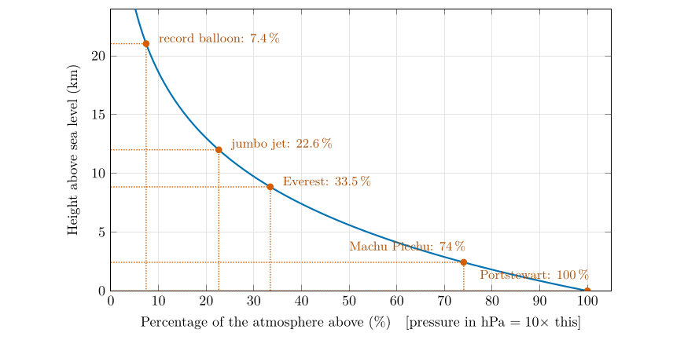
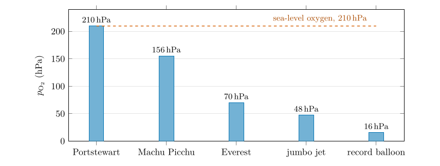

*This chapter answers Questions 3 and 4.*

## 4.1 Reading values from a graph, and checking them {#p1-sec:reading}

A graph turns a rule into a tool: once the curve of Figure [3.2](/teaching/atmosphere/p1-ch02_pressure/#p1-fig:q1graph) is drawn, any height can be looked up without calculation. To read a value:

1.  Find the height on the vertical axis (convert metres to kilometres first: 8848 m $=8.848$ km).

2.  Draw a horizontal line across to the curve.

3.  From the meeting point, draw a vertical line down to the percentage axis and up to the pressure axis, and read both.

A hand-drawn curve and a ruler give two significant figures at best. The exact value comes from Eq. ([3.4](/teaching/atmosphere/p1-ch02_pressure/#p1-eq:fraction)): divide the height by 5.6 km to get the number of halvings $x$, then $f=2^{-x}$. On a calculator, $2^{-x}$ is entered as `2 ^ (-x)` or computed as $e^{-0.6931\,x}$.

Worked example: the summit of Everest, 8848 m

Number of halvings: $x=8.848/5.6=1.580$. Fraction above: $f=2^{-1.580}=0.3345$, so **33.4 %** of the atmosphere is above the summit. Pressure: $1000\times0.3345=$ **334 hPa**, Eq. ([3.6](/teaching/atmosphere/p1-ch02_pressure/#p1-eq:pressure)). Graph check: 8.8 km lies between 5.6 km (50 %) and 11.2 km (25 %), closer to 11.2, so the answer must be between 25 and 50 %, nearer 25. It is.

## 4.2 Question 3: five heights {#p1-sec:q3}

The question

Using the graph you just drew, estimate the percentage of atmosphere above and the total pressure for the following heights: Portstewart strand (0 m); the top of Mount Everest (8848 m); the cruising altitude of a jumbo jet (12 km); Machu Picchu, Peru (2430 m); the world-record hot-air balloon (21 027 m).

| **Place** | **Height (km)** | **Halvings $x$** | **% above** | **Pressure (hPa)** | **Std. atm. (hPa)** |
|:---|---:|---:|---:|---:|---:|
| Portstewart strand | 0 | 0 | 100 | 1000 | 1013 |
| Machu Picchu | 2.430 | 0.434 | 74.0 | 740 | 753 |
| Everest summit | 8.848 | 1.580 | 33.4 | 334 | 314 |
| Jumbo jet | 12.000 | 2.143 | 22.6 | 226 | 193 |
| Record balloon | 21.027 | 3.755 | 7.4 | 74 | 47 |

: Table 4.1. Question 3 by the halving rule, Eqs. ([3.4](/teaching/atmosphere/p1-ch02_pressure/#p1-eq:fraction)) and ([3.6](/teaching/atmosphere/p1-ch02_pressure/#p1-eq:pressure)). The last column gives the U.S. Standard Atmosphere for comparison (NOAA et al. 1976).

\

**Figure 4.1.** Question 3 read from the graph. For each place, go across from its height to the curve and down to the percentage axis; the pressure is ten times the percentage.

Answer to Question 3

Portstewart strand: **100 %, 1000 hPa**. Everest: **33.4 %, 334 hPa**. Jumbo jet at 12 km: **22.6 %, 226 hPa**. Machu Picchu: **74.0 %, 740 hPa**. Record balloon: **7.4 %, 74 hPa**. (Values read from a hand-drawn graph within about $\pm2$ percentage points are fine.)

**Check against measurement.** On the summit of Everest the barometric pressure has been measured: 253 mmHg, which is 337 hPa (West et al. 1983), within 1 % of the rule’s 334 hPa. The standard atmosphere gives only 314 hPa there, because it describes a cooler, mid-latitude column; Everest stands at 28$^{\circ}$N, where the warm air column holds the pressure up at height (West 1996). For the jet and the balloon, high in the cold upper air, the rule overestimates the pressure, for the reason given in § [3.6](/teaching/atmosphere/p1-ch02_pressure/#p1-sec:rulecheck).

## 4.3 What “21 % oxygen” means {#p1-sec:composition}

Dry air is a mixture of gases: by volume about 78 % nitrogen, 21 % oxygen and 0.9 % argon, with carbon dioxide and other trace gases making up the rest; precise values are 78.08, 20.95 and 0.93 % (Wallace and Hobbs 2006, ch. 1). “By volume” means by number of molecules: of every hundred molecules of dry air, about 21 are oxygen. Up to about 80 km the air is stirred so thoroughly that these proportions stay the same at every height. So the air on Everest is still 21 % oxygen. What changes is how many molecules there are in each breath.

## 4.4 Partial pressure {#p1-sec:dalton}

In a mixture of gases each gas contributes to the total pressure in proportion to its share of the molecules. The contribution of one gas is its **partial pressure**, and the partial pressures add up to the total (Dalton’s law). For oxygen $$
p_{\mathrm{O_2}}=x_{\mathrm{O_2}}\,p=0.21\,p .\tag{4.1}
$$ *where*

|  |  |  |
|:---|:---|:---|
| $p_{\mathrm{O_2}}$ | partial pressure of oxygen (hPa) | calculated |
| $x_{\mathrm{O_2}}$ | fraction of the molecules that are oxygen | 0.21, rounded |
| $p$ | total air pressure (hPa) | from Question 3 |

At sea level $p_{\mathrm{O_2}}=0.21\times1000=210$ hPa and $p_{\mathrm{N_2}}=0.78\times1000=780$ hPa. The partial pressure of oxygen is what matters to the body: it pushes oxygen from the lungs into the blood. Halve the total pressure and you halve the oxygen partial pressure, even though the air is still 21 % oxygen. The same idea of a partial pressure returns for water vapour in Part III, as the vapour pressure $e$ (§ [21.2](/teaching/atmosphere/p3-ch02_moisture/#p3-sec:vp)).

## 4.5 Question 4: oxygen at five heights {#p1-sec:q4}

The question

The partial pressure of each gas drops at the same rate as the total atmospheric pressure. Use your answers to Question 3 to first calculate the partial pressure of oxygen at different elevations. Then use your answer to calculate the percentage of oxygen available compared to the atmosphere at sea level.

**Method.**

1.  Partial pressure: multiply each pressure from Question 3 by 0.21, Eq. ([4.1](/teaching/atmosphere/p1-ch03_oxygen/#p1-eq:dalton)).

2.  Percentage: the second part of the question can be read in two ways, and the two readings give different numbers (Table [4.2](/teaching/atmosphere/p1-ch03_oxygen/#p1-tab:q4)).

    - *(a) Oxygen as a percentage of the sea-level atmosphere:* divide the oxygen partial pressure by the sea-level *total* pressure, 1000 hPa.

    - *(b) Oxygen available compared with sea level:* divide the oxygen partial pressure by the sea-level *oxygen* partial pressure, 210 hPa. This says how much oxygen each breath brings compared with a breath at the coast.

| **Place** | **Pressure (hPa)** | **$p_{\mathrm{O_2}}$ (hPa)** | **(a) $p_{\mathrm{O_2}}/1000$** | **(b) $p_{\mathrm{O_2}}/210$** |
|:---|---:|---:|---:|---:|
| Portstewart strand | 1000 | 210 | 21.0 % | 100 % |
| Machu Picchu | 740 | 155.5 | 15.5 % | 74 % |
| Everest summit | 334 | 70.2 | 7.0 % | 33 % |
| Jumbo jet | 226 | 47.6 | 4.8 % | 23 % |
| Record balloon | 74 | 15.6 | 1.6 % | 7.4 % |

: Table 4.2. Question 4. Partial pressure of oxygen, Eq. ([4.1](/teaching/atmosphere/p1-ch03_oxygen/#p1-eq:dalton)), and the two percentages.

\

**Figure 4.2.** Question 4: the partial pressure of oxygen at the five places. The air is 21 % oxygen at all of them; what falls is the number of molecules in each breath, in step with the total pressure (Table [4.2](/teaching/atmosphere/p1-ch03_oxygen/#p1-tab:q4)).

Answer to Question 4

Partial pressure of oxygen: Portstewart **210 hPa**; Machu Picchu **155 hPa**; Everest **70 hPa**; jumbo jet **48 hPa**; record balloon **16 hPa**. As a percentage of the sea-level atmosphere: 21, 15.5, 7.0, 4.8 and 1.6 %. Compared with the oxygen available at sea level: 100, 74, 33, 23 and 7 %. On Everest each breath brings only a third of the oxygen it brings at sea level.

Two ways to give the percentage

The second reading answers “how much oxygen is available compared with sea level” and is the more useful for explaining breathlessness. It is simply the percentage of the atmosphere above you from Question 3: since the oxygen fraction does not change with height, the available oxygen falls in exactly the same proportion as the total pressure.

## 4.6 Why it matters {#p1-sec:altitude}

- **Machu Picchu** (about three-quarters of sea-level oxygen): most visitors notice breathlessness on climbing stairs; the body adjusts within days by breathing faster and making more red blood cells.

- **Everest** (a third): close to the limit of human survival without bottled oxygen. Climbers acclimatise for weeks, and most use supplementary oxygen near the summit (West et al. 1983).

- **A jet at 12 km** (under a quarter): a person would lose consciousness within minutes. Airliner cabins are therefore pressurised, to roughly the pressure found at about 2 km, and oxygen masks drop if the pressure is lost.

- **The record balloon at 21 km** (7 %): no human could breathe this air; balloonists wear pressure suits or ride in sealed gondolas.

A question that comes up

**If the air is still 21 % oxygen at the top of Everest, why is it harder to breathe?**\
Because “21 %” is a proportion, not an amount. At the summit each lungful of air contains only a third as many molecules of every gas as at sea level, so it delivers a third as much oxygen. The lungs move oxygen into the blood in proportion to its partial pressure, 70 hPa instead of 210.

## 4.7 Try it yourself: Practice Set 4

Practice Set 4: reading heights and partial pressures

Use the halving rule and an oxygen fraction of 0.21.

1.  Ben Nevis is 1345 m high. What are the pressure and the oxygen partial pressure at the summit?

2.  Kilimanjaro is 5895 m high. Find the pressure, the oxygen partial pressure, and the oxygen available compared with sea level.

3.  On a summit the pressure is 600 hPa. What percentage of the air molecules there are oxygen? What is the oxygen partial pressure? At what height is the summit, by the rule?

4.  What is the partial pressure of nitrogen on the summit of Everest?

Answers to Practice Set 4

1.  $x=1.345/5.6=0.240$; $f=2^{-0.240}=0.847$; pressure 847 hPa; $p_{\mathrm{O_2}}=0.21\times847=178$ hPa.

2.  $x=5.895/5.6=1.053$; $f=0.482$; pressure 482 hPa; $p_{\mathrm{O_2}}=101$ hPa; 48 % of the sea-level oxygen.

3.  Still 21 % (the proportion does not change). $p_{\mathrm{O_2}}=0.21\times600=126$ hPa. Height: $2^{-z/5.6}=0.6$, so $z=5.6\times\log_2(1/0.6)=5.6\times0.737=4.1$ km.

4.  $0.78\times334=261$ hPa.

## 4.8 Oxygen in Python

These functions compute the equations of this chapter, and the book’s tests check them against its answers.

    def partial_pressure(p_hpa, gas_fraction=0.21):
        """Partial pressure (hPa) of a gas that makes up gas_fraction of the molecules."""
        return gas_fraction * p_hpa

`partial_pressure(pressure_halving(12))` returns 47.6, the jet’s oxygen partial pressure in hPa.

## References

NOAA, NASA and US Air Force (1976) U.S. Standard atmosphere, 1976. U.S. Government Printing Office, Washington, DC.

Wallace, J.M. and Hobbs, P.V. (2006) Atmospheric science: An introductory survey, 2nd ed. Elsevier Academic Press, Amsterdam.

West, J.B. (1996) Prediction of barometric pressures at high altitudes with the use of model atmospheres. Journal of Applied Physiology 81, 1850–1854. <https://doi.org/10.1152/jappl.1996.81.4.1850>

West, J.B., Lahiri, S., Maret, K.H., Peters, R.M. and Pizzo, C.J. (1983) Barometric pressures at extreme altitudes on Mt. Everest: Physiological significance. Journal of Applied Physiology 54, 1188–1194. <https://doi.org/10.1152/jappl.1983.54.5.1188>

