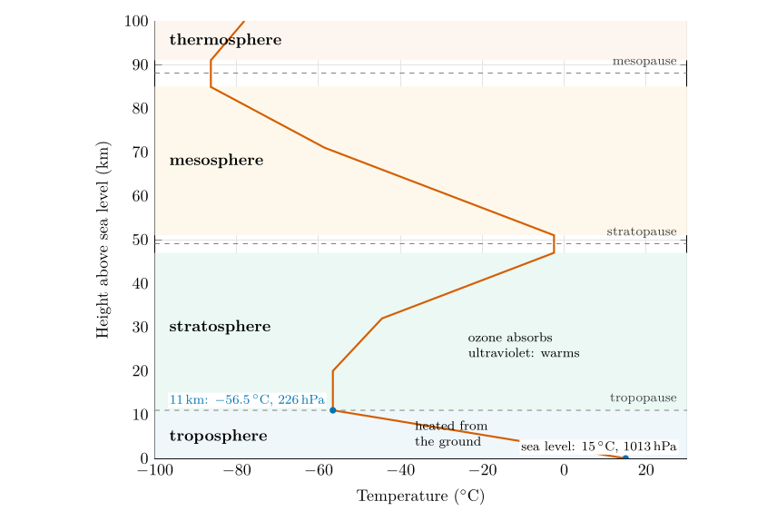

*This chapter answers Question 5 and introduces the layers of the atmosphere used in Questions 6 to 11.*

## 5.1 Temperature and the lapse rate {#p1-sec:lapse}

Temperature measures how fast the molecules of the air are moving: the warmer the air, the faster they move. Unlike pressure, temperature does not fall steadily all the way up. It falls, then rises, then falls and rises again, and those reversals divide the atmosphere into layers (§ [5.4](/teaching/atmosphere/p1-ch04_temperature/#p1-sec:layers)).

The rate at which the temperature falls with height is the **lapse rate**: $$
\Gamma=-\frac{\Delta T}{\Delta z}=\frac{T_{\text{lower}}-T_{\text{upper}}}{z_{\text{upper}}-z_{\text{lower}}}.\tag{5.1}
$$ *where*

|  |  |  |
|:---|:---|:---|
| $\Gamma$ | lapse rate ($^{\circ}\mathrm{C\,km^{-1}}$, the same as $\mathrm{K\,km^{-1}}$) | calculated |
| $\Delta T$ | change in temperature going up ($^{\circ}\mathrm{C}$) | from a table or graph |
| $\Delta z$ | change in height (km) | from a table or graph |

The minus sign makes the lapse rate *positive* when the temperature falls with height, which is the usual case in the lowest layer. A negative lapse rate means the temperature *rises* with height: an **inversion** (§ [6.3](/teaching/atmosphere/p1-ch05_soundings/#p1-sec:inversions)). A lapse rate of zero means the temperature does not change: an **isothermal** layer.

## 5.2 The standard atmosphere {#p1-sec:standard}

Real temperature profiles change from day to day and from place to place. For aircraft instruments, engineering and comparison, meteorologists use an agreed average: the **standard atmosphere**. Near the ground it is defined by (NOAA et al. 1976): $$
T(z)=\begin{cases}15-6.5\,z & 0\le z\le11\ \mathrm{km},\\[2pt] -56.5 & 11\le z\le20\ \mathrm{km},\end{cases}\tag{5.2}
$$ *where*

|  |  |  |
|:---|:---|:---|
| $T(z)$ | temperature at height $z$ ($^{\circ}\mathrm{C}$) | calculated |
| $z$ | height above sea level (km) |  |
| $15$ | sea-level temperature ($^{\circ}\mathrm{C}$) | 288.15 K |
| $6.5$ | the standard (“normal”) lapse rate ($^{\circ}\mathrm{C\,km^{-1}}$) | agreed value |

At sea level the standard pressure is 1013.25 hPa and the standard temperature 15 $^{\circ}\mathrm{C}$. The temperature falls by 6.5 $^{\circ}\mathrm{C}$ for every kilometre up to 11 km, the standard **tropopause**, where it reaches $-56.5$ $^{\circ}\mathrm{C}$, and then stays constant.

## 5.3 Question 5: the standard atmosphere {#p1-sec:q5}

The question

In the troposphere temperature decreases by 6.5 $^{\circ}\mathrm{C}$ per km in the lowest 11 km; this is called the average or normal lapse rate. Based on this average lapse rate, work out the temperature of the “standard atmosphere” at 2000, 4000, 6000, 8000 and 10 000 m. You are given 15 $^{\circ}\mathrm{C}$ at sea level, 8.5 $^{\circ}\mathrm{C}$ at 1000 m, and $-56.5$ $^{\circ}\mathrm{C}$ at 11 000, 14 000 and 16 000 m.

**Method.** Use Eq. ([5.2](/teaching/atmosphere/p1-ch04_temperature/#p1-eq:stdT)). For each height up to 11 km, convert to kilometres and subtract $6.5\times z$ from 15 $^{\circ}\mathrm{C}$. Above 11 km the temperature stays at $-56.5$ $^{\circ}\mathrm{C}$. $$T(2\ \mathrm{km})=15-6.5\times2=15-13=2\ \ensuremath{^{\circ}\mathrm{C}},\qquad T(8\ \mathrm{km})=15-6.5\times8=15-52=-37\ \ensuremath{^{\circ}\mathrm{C}}.$$

| Height (m) | 0 | 1000 | 2000 | 4000 | 6000 | 8000 | 10 000 | 11 000 | 14 000 | 16 000 |
|:---|---:|---:|---:|---:|---:|---:|---:|---:|---:|---:|
| $T$ ($^{\circ}\mathrm{C}$) | 15 | 8.5 | **2** | $\boldsymbol{-11}$ | $\boldsymbol{-24}$ | $\boldsymbol{-37}$ | $\boldsymbol{-50}$ | $-56.5$ | $-56.5$ | $-56.5$ |

: Table 5.1. The standard atmosphere. Values in bold are the answers to Question 5; the others are given in the question.

Answer to Question 5

At 2000, 4000, 6000, 8000 and 10 000 m the standard temperatures are **2, $-$<!-- -->11, $-$<!-- -->24, $-$<!-- -->37 and $-$<!-- -->50 $^{\circ}\mathrm{C}$**. At 11 000 m the temperature reaches $-56.5$ $^{\circ}\mathrm{C}$ and stays there to 16 000 m (Table [5.1](/teaching/atmosphere/p1-ch04_temperature/#p1-tab:table2)).

**Check.** The given values agree with the rule: $15-6.5\times1=8.5$ $^{\circ}\mathrm{C}$ at 1000 m and $15-6.5\times11=-56.5$ $^{\circ}\mathrm{C}$ at 11 000 m. Each 2 km step lowers the temperature by 13 $^{\circ}\mathrm{C}$.

## 5.4 The layers of the atmosphere {#p1-sec:layers}

Figure [5.1](/teaching/atmosphere/p1-ch04_temperature/#p1-fig:layers) extends the standard atmosphere to 100 km. The turning points of the temperature (the *pauses*) divide it into four layers.

\

**Figure 5.1.** The U.S. Standard Atmosphere from the ground to 100 km (NOAA et al. 1976). Temperature falls through the troposphere, is constant and then rises through the stratosphere, falls again through the mesosphere, and rises in the thermosphere. The shaded bands are the layers; the dashed lines are the pauses between them.  
  
  NOAA, NASA and US Air Force (1976) U.S. Standard atmosphere, 1976. U.S. Government Printing Office, Washington, DC.  
  

Troposphere (surface to about 11 km).

: Temperature falls with height, on average by 6.5 $^{\circ}\mathrm{C}$ per km. The air is heated mainly from below: sunlight passes largely through it and warms the ground, which then warms the air (Part II, § [17.7](/teaching/atmosphere/p2-ch07_balance/#p2-sec:q4e)). Rising air also cools as it expands (Chapter [8](/teaching/atmosphere/p1-ch07_stability/#p1-ch:stability)). About three-quarters of the air and nearly all the water vapour are here, and almost all weather happens here.

Stratosphere (about 11 to 50 km).

: Temperature is constant at first, then rises with height. The warming comes from ozone, which absorbs the Sun’s ultraviolet radiation (Part II, § [12.4](/teaching/atmosphere/p2-ch02_radiation/#p2-sec:spectrum)). Warm air sitting on cooler air is very stable, so the stratosphere is calm and layered.

Mesosphere (about 50 to 85 km).

: Temperature falls again, to the coldest values in the atmosphere, below $-85$ $^{\circ}\mathrm{C}$ at the mesopause.

Thermosphere (above about 90 km).

: Temperature rises steeply, as the few molecules there absorb the most energetic solar radiation.

A question that comes up

**Is the thermosphere really hot?**\
Its molecules move very fast, which is what a high temperature means, and in sunlight the upper thermosphere reaches several hundred degrees. But they are so few that they would hardly heat anything: an unprotected thermometer there would lose more by radiating than it gained from the rare collisions, and would read very cold. Temperature and heat are not the same thing.

A question that comes up

**Why does the troposphere get colder going up, when it is closer to the Sun?**\
The extra closeness is negligible (a few kilometres in 150 million). What matters is where the heating happens. Sunlight passes mostly through the air and is absorbed by the ground, so the troposphere is heated from below, like a pan of water on a hob, and is warmest at the bottom.

## 5.5 Try it yourself: Practice Set 5

Practice Set 5: lapse rates and the standard atmosphere

1.  The temperature falls from 20 $^{\circ}\mathrm{C}$ at the ground to $-10$ $^{\circ}\mathrm{C}$ at 5 km. What is the lapse rate?

2.  What is the standard-atmosphere temperature at 3 km? At the summit of Everest (8848 m)?

3.  At what height does the standard atmosphere reach 0 $^{\circ}\mathrm{C}$?

4.  Convert $-56.5$ $^{\circ}\mathrm{C}$ to kelvin.

5.  Over a layer from 1.2 to 1.6 km the temperature rises from $-2$ to 0 $^{\circ}\mathrm{C}$. What is its lapse rate, and what is such a layer called?

Answers to Practice Set 5

1.  $\Gamma=(20-(-10))/5=6\,\ensuremath{^{\circ}\mathrm{C\,km^{-1}}}$, Eq. ([5.1](/teaching/atmosphere/p1-ch04_temperature/#p1-eq:lapse)).

2.  $15-6.5\times3=-4.5$ $^{\circ}\mathrm{C}$; $15-6.5\times8.848=-42.5$ $^{\circ}\mathrm{C}$, Eq. ([5.2](/teaching/atmosphere/p1-ch04_temperature/#p1-eq:stdT)).

3.  $15-6.5\,z=0$ gives $z=15/6.5=2.31$ km.

4.  $-56.5+273.15=216.65$ K.

5.  $\Gamma=(-2-0)/(1.6-1.2)=-5\,\ensuremath{^{\circ}\mathrm{C\,km^{-1}}}$: negative, so the temperature rises with height. It is an inversion.

## 5.6 The standard atmosphere in Python

These functions compute the equations of this chapter, and the book’s tests check them against its answers.

    def standard_temperature(z_km):
        """Standard-atmosphere temperature (deg C): 15 - 6.5 z up to 11 km, then constant."""
        return 15.0 - 6.5 * min(z_km, 11.0)

`standard_temperature(8)` returns $-37.0$ and `standard_temperature(14)` returns $-56.5$.

NOAA, NASA and US Air Force (1976) U.S. Standard atmosphere, 1976. U.S. Government Printing Office, Washington, DC.

