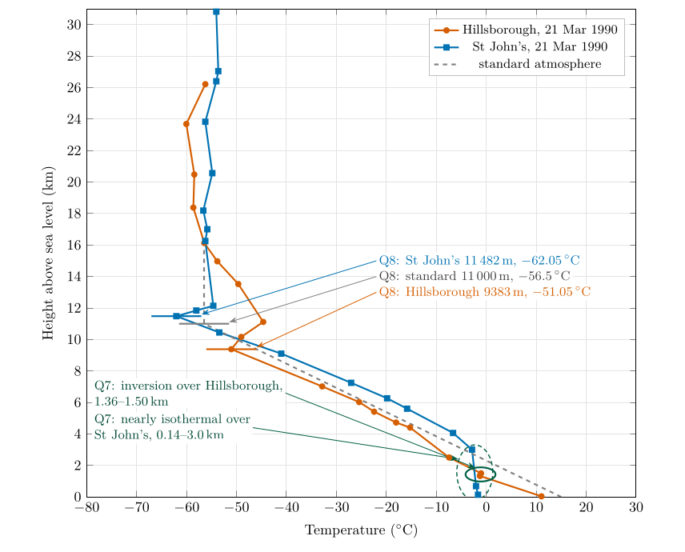

*This chapter answers Questions 6, 7 and 8.*

## 6.1 Measuring the atmosphere in the vertical {#p1-sec:radiosonde}

A **radiosonde** is a small instrument package carried up by a helium or hydrogen balloon. As it rises at about 5 m s$^{-1}$ it measures pressure, temperature and humidity and sends them to the ground by radio; tracking its drift gives the wind. The balloon expands as the pressure falls and bursts at around 30 km, which is why the soundings in this chapter stop near that height. Radiosondes are launched at hundreds of stations worldwide, at the same times each day, so that the measurements can be compared and fed into weather forecasts (World Meteorological Organization 2023). The record of one ascent is called a **sounding**.

## 6.2 Question 6: plotting the soundings {#p1-sec:q6}

+------------------------------------------------------------------+---+----------------------------------------------------+
| **Hillsborough, Northern Ireland**                               |   | **St John’s, Newfoundland**                        |
+=====================:+=============:+===========================:+:=:+==========:+==========:+===========================:+
| 1-3(lr)5-7 $p$ (hPa) | $z$ (m)      | $T$ ($^{\circ}\mathrm{C}$) |   | $p$ (hPa) | $z$ (m)   | $T$ ($^{\circ}\mathrm{C}$) |
+----------------------+--------------+----------------------------+---+-----------+-----------+----------------------------+
| 1001                 | 38           | 11.05                      |   | 1005      | 140       | $-1.65$                    |
+----------------------+--------------+----------------------------+---+-----------+-----------+----------------------------+
| 853                  | 1330         | $-1.25$                    |   | 938       | 687       | $-2.05$                    |
+----------------------+--------------+----------------------------+---+-----------+-----------+----------------------------+
| 850                  | 1358         | $-1.25$                    |   | 700       | 3006      | $-2.85$                    |
+----------------------+--------------+----------------------------+---+-----------+-----------+----------------------------+
| 835                  | 1503         | $-1.05$                    |   | 612       | 4062      | $-6.65$                    |
+----------------------+--------------+----------------------------+---+-----------+-----------+----------------------------+
| 735                  | 2504         | $-7.45$                    |   | 500       | 5604      | $-15.85$                   |
+----------------------+--------------+----------------------------+---+-----------+-----------+----------------------------+
| 573                  | 4405         | $-15.25$                   |   | 458       | 6263      | $-19.85$                   |
+----------------------+--------------+----------------------------+---+-----------+-----------+----------------------------+
| 549                  | 4725         | $-18.05$                   |   | 400       | 7248      | $-27.05$                   |
+----------------------+--------------+----------------------------+---+-----------+-----------+----------------------------+
| 500                  | 5414         | $-22.45$                   |   | 307       | 9103      | $-41.05$                   |
+----------------------+--------------+----------------------------+---+-----------+-----------+----------------------------+
| 460                  | 6025         | $-25.45$                   |   | 250       | 10 446    | $-53.45$                   |
+----------------------+--------------+----------------------------+---+-----------+-----------+----------------------------+
| 400                  | 7018         | $-32.85$                   |   | 212       | 11 482    | $-62.05$                   |
+----------------------+--------------+----------------------------+---+-----------+-----------+----------------------------+
| 282                  | 9383         | $-51.05$                   |   | 200       | 11 843    | $-58.05$                   |
+----------------------+--------------+----------------------------+---+-----------+-----------+----------------------------+
| 250                  | 10 164       | $-49.05$                   |   | 191       | 12 141    | $-54.65$                   |
+----------------------+--------------+----------------------------+---+-----------+-----------+----------------------------+
| 216                  | 11 116       | $-44.65$                   |   | 100       | 16 254    | $-56.25$                   |
+----------------------+--------------+----------------------------+---+-----------+-----------+----------------------------+
| 150                  | 13 524       | $-49.65$                   |   | 88.9      | 17 004    | $-55.85$                   |
+----------------------+--------------+----------------------------+---+-----------+-----------+----------------------------+
| 120                  | 14 969       | $-53.85$                   |   | 73.6      | 18 190    | $-56.65$                   |
+----------------------+--------------+----------------------------+---+-----------+-----------+----------------------------+
| 100                  | 16 126       | $-56.45$                   |   | 50.5      | 20 566    | $-54.85$                   |
+----------------------+--------------+----------------------------+---+-----------+-----------+----------------------------+
| 70                   | 18 379       | $-58.65$                   |   | 30        | 23 834    | $-56.25$                   |
+----------------------+--------------+----------------------------+---+-----------+-----------+----------------------------+
| 50                   | 20 482       | $-58.45$                   |   | 20        | 26 404    | $-54.05$                   |
+----------------------+--------------+----------------------------+---+-----------+-----------+----------------------------+
| 30                   | 23 691       | $-60.05$                   |   | 18.1      | 27 047    | $-53.65$                   |
+----------------------+--------------+----------------------------+---+-----------+-----------+----------------------------+
| 20                   | 26 218       | $-56.25$                   |   | 10        | 30 828    | $-54.05$                   |
+----------------------+--------------+----------------------------+---+-----------+-----------+----------------------------+

: Table 6.1. Radiosonde soundings of 21 March 1990. Heights in metres, temperatures in $^{\circ}\mathrm{C}$.

The question

Table [6.1](/teaching/atmosphere/p1-ch05_soundings/#p1-tab:soundings) gives the pressure, height and temperature from a radiosonde measurement taken on 21 March 1990 for Hillsborough (Northern Ireland) and St John’s, Newfoundland (Canada). Plot the temperature values against height for these stations and for the standard atmosphere (Table [5.1](/teaching/atmosphere/p1-ch04_temperature/#p1-tab:table2)) on one graph, using different colours for the different plots.

**Method.**

1.  **Axes.** Height (km) up the side, from 0 to 31 km; temperature ($^{\circ}\mathrm{C}$) along the bottom, from $-80$ to $+30$ $^{\circ}\mathrm{C}$. Height goes on the vertical axis even though it is the “input”: a profile drawn this way looks like the atmosphere it describes, with the ground at the bottom.

2.  **Convert heights to kilometres** (divide the metres by 1000): 1330 m is 1.33 km.

3.  **Plot each sounding with its own colour and symbol** (Table [6.1](/teaching/atmosphere/p1-ch05_soundings/#p1-tab:soundings)), and the standard atmosphere from Table [5.1](/teaching/atmosphere/p1-ch04_temperature/#p1-tab:table2).

4.  **Join the points of each sounding with straight lines.** A sounding is a set of measurements at separate levels; straight lines are the honest way to connect them.

5.  **Label** each line and give the graph a title and a key.

\

**Figure 6.1.** Questions 6 to 8: the two soundings of Table [6.1](/teaching/atmosphere/p1-ch05_soundings/#p1-tab:soundings) and the standard atmosphere (Table [5.1](/teaching/atmosphere/p1-ch04_temperature/#p1-tab:table2)), with the inversions in the troposphere circled (Question 7) and the tropopause of each profile marked (Question 8).

Answer to Question 6

The completed graph is Figure [6.1](/teaching/atmosphere/p1-ch05_soundings/#p1-fig:soundings). Both soundings cool with height up to a turning point near 9 to 11 km, above which the temperature stops falling and stays between about $-50$ and $-62$ $^{\circ}\mathrm{C}$ to 30 km. Near the ground Hillsborough is 12.7 $^{\circ}\mathrm{C}$ warmer than St John’s, but the two profiles cross at about 2 km, and between 3 and 7 km St John’s is the warmer, by about 7 $^{\circ}\mathrm{C}$: the contrast at the surface is confined to the lowest layer (Question 14, Chapter [9](/teaching/atmosphere/p1-ch08_climates/#p1-ch:climates)).

## 6.3 Inversions {#p1-sec:inversions}

An **inversion** is a layer in which the temperature *rises* with height: the lapse rate, Eq. ([5.1](/teaching/atmosphere/p1-ch04_temperature/#p1-eq:lapse)), is negative. It is called an inversion because it inverts the normal pattern of the troposphere. Inversions form in three common ways (Ahrens and Henson 2022, ch. 3):

- **Radiation inversions:** on clear, calm nights the ground cools by radiating to the sky (Part II, § [17.8](/teaching/atmosphere/p2-ch07_balance/#p2-sec:q4f)), and the air next to it cools most.

- **Subsidence inversions:** in an anticyclone, air sinking from above is compressed and warms, forming a warm layer above cooler air near the ground.

- **Frontal inversions:** warm air rides up over a wedge of colder air at a front (Part III, Chapter [29](/teaching/atmosphere/p3-ch10_fronts/#p3-ch:fronts)).

Inversions matter because they are very stable: they suppress rising air, trap pollution and fog beneath them, and cap the growth of clouds (Chapter [8](/teaching/atmosphere/p1-ch07_stability/#p1-ch:stability)).

## 6.4 Question 7: finding the inversions {#p1-sec:q7}

The question

You will see that in some situations the temperature increases with height in the troposphere. Such layers are called inversion layers. Circle these on the graph.

**Method.** Go up each sounding below its tropopause and look for any step in which the temperature at the higher level is warmer than at the level below. Table [6.2](/teaching/atmosphere/p1-ch05_soundings/#p1-tab:layers) lists the lapse rate of every layer of both soundings, Eq. ([5.1](/teaching/atmosphere/p1-ch04_temperature/#p1-eq:lapse)).

@lrrrl@

\
**Layer (m)** & **$T$ bottom ($^{\circ}\mathrm{C}$)** & **$T$ top ($^{\circ}\mathrm{C}$)** & **$\Gamma$ ($^{\circ}\mathrm{C\,km^{-1}}$)** &\
**Layer (m)** & **$T$ bottom ($^{\circ}\mathrm{C}$)** & **$T$ top ($^{\circ}\mathrm{C}$)** & **$\Gamma$ ($^{\circ}\mathrm{C\,km^{-1}}$)** &\
\
38–1330 & 11.05 & $-1.25$ & 9.52 &\
1330–1358 & $-1.25$ & $-1.25$ & 0.00 & isothermal\
1358–1503 & $-1.25$ & $-1.05$ & $-1.38$ & inversion\
1503–2504 & $-1.05$ & $-7.45$ & 6.39 &\
2504–4405 & $-7.45$ & $-15.25$ & 4.10 &\
4405–4725 & $-15.25$ & $-18.05$ & 8.75 &\
4725–5414 & $-18.05$ & $-22.45$ & 6.39 &\
5414–6025 & $-22.45$ & $-25.45$ & 4.91 &\
6025–7018 & $-25.45$ & $-32.85$ & 7.45 &\
7018–9383 & $-32.85$ & $-51.05$ & 7.70 &\
9383–10 164 & $-51.05$ & $-49.05$ & $-2.56$ & inversion\
10 164–11 116 & $-49.05$ & $-44.65$ & $-4.62$ & inversion\
11 116–13 524 & $-44.65$ & $-49.65$ & 2.08 &\
13 524–14 969 & $-49.65$ & $-53.85$ & 2.91 &\
14 969–16 126 & $-53.85$ & $-56.45$ & 2.25 &\
\
140–687 & $-1.65$ & $-2.05$ & 0.73 &\
687–3006 & $-2.05$ & $-2.85$ & 0.34 &\
3006–4062 & $-2.85$ & $-6.65$ & 3.60 &\
4062–5604 & $-6.65$ & $-15.85$ & 5.97 &\
5604–6263 & $-15.85$ & $-19.85$ & 6.07 &\
6263–7248 & $-19.85$ & $-27.05$ & 7.31 &\
7248–9103 & $-27.05$ & $-41.05$ & 7.55 &\
9103–10 446 & $-41.05$ & $-53.45$ & 9.23 &\
10 446–11 482 & $-53.45$ & $-62.05$ & 8.30 &\
11 482–11 843 & $-62.05$ & $-58.05$ & $-11.08$ & inversion\
11 843–12 141 & $-58.05$ & $-54.65$ & $-11.41$ & inversion\
12 141–16 254 & $-54.65$ & $-56.25$ & 0.39 &\

- **Hillsborough:** from 1358 m ($-1.25$ $^{\circ}\mathrm{C}$) to 1503 m ($-1.05$ $^{\circ}\mathrm{C}$) the temperature rises by 0.2 $^{\circ}\mathrm{C}$: a weak inversion, sitting on top of an isothermal step from 1330 to 1358 m. Below it the air cools fast, by 9.5 $^{\circ}\mathrm{C}$ per km.

- **St John’s:** no level in the troposphere is warmer than the one below, but from 140 m to 3006 m the temperature falls by only 1.2 $^{\circ}\mathrm{C}$ in almost 3 km (0.3 to 0.7 $^{\circ}\mathrm{C}$ per km). This deep, nearly isothermal layer is very stable and behaves like an inversion.

Answer to Question 7

**Hillsborough:** an inversion between about **1360 and 1500 m** ($-1.25$ to $-1.05$ $^{\circ}\mathrm{C}$), just above the steep cooling of the lowest 1.3 km. **St John’s:** no true inversion in the troposphere, but a deep, almost **isothermal layer from the ground to about 3 km**. Both are circled in Figure [6.1](/teaching/atmosphere/p1-ch05_soundings/#p1-fig:soundings).

A question that comes up

**Above the tropopause the temperature rises with height too. Are those inversions?**\
Strictly, yes: Hillsborough warms from $-51$ to $-45$ $^{\circ}\mathrm{C}$ between 9.4 and 11.1 km, and St John’s from $-62$ to $-55$ $^{\circ}\mathrm{C}$ between 11.5 and 12.1 km. But they are in the stratosphere, where warming with height is the normal state (Figure [5.1](/teaching/atmosphere/p1-ch04_temperature/#p1-fig:layers)). The question asks only about the troposphere.

## 6.5 The tropopause {#p1-sec:tropopause}

Question 8 defines the **tropopause** as the top of the troposphere, where the temperature ceases to decrease with height. The World Meteorological Organization makes this precise: it is the lowest level at which the lapse rate falls to 2 $^{\circ}\mathrm{C\,km^{-1}}$ or less, provided the average lapse rate over the 2 km above does not exceed 2 $^{\circ}\mathrm{C\,km^{-1}}$ (Reichler et al. 2003). The second condition stops a thin inversion in the troposphere, like the one at 1.4 km over Hillsborough, from being mistaken for the tropopause. Above the tropopause the stable stratosphere begins; weather, and the tops of most clouds, stop below it.

## 6.6 Question 8: marking the tropopause {#p1-sec:q8}

The question

The tropopause is defined as the top boundary of the troposphere where the temperature ceases to decrease with height. Mark this boundary on the graph and note the temperature and the height for the standard atmosphere, Hillsborough and St John’s.

**Method.** For each profile, follow the temperature up through the troposphere and find the level above which it no longer falls. Check the WMO condition: above that level the temperature must not keep falling by more than 2 $^{\circ}\mathrm{C}$ per km over the next 2 km.

- **Standard atmosphere:** by definition, 11 000 m and $-56.5$ $^{\circ}\mathrm{C}$ (Table [5.1](/teaching/atmosphere/p1-ch04_temperature/#p1-tab:table2)).

- **Hillsborough:** the temperature falls to $-51.05$ $^{\circ}\mathrm{C}$ at 9383 m and then *rises* to $-49.05$ $^{\circ}\mathrm{C}$ at 10 164 m and $-44.65$ $^{\circ}\mathrm{C}$ at 11 116 m.

- **St John’s:** the temperature falls to $-62.05$ $^{\circ}\mathrm{C}$ at 11 482 m and then rises to $-58.05$ $^{\circ}\mathrm{C}$ at 11 843 m.

Answer to Question 8

Standard atmosphere: **11 000 m, $-$<!-- -->56.5 $^{\circ}\mathrm{C}$**. Hillsborough: **9383 m, $-$<!-- -->51.05 $^{\circ}\mathrm{C}$**. St John’s: **11 482 m, $-$<!-- -->62.05 $^{\circ}\mathrm{C}$**. Marked in Figure [6.1](/teaching/atmosphere/p1-ch05_soundings/#p1-fig:soundings).

Applied by computer, the definition has to start its search above the lowest few kilometres. St John’s has a layer from 140 m to 3 km whose temperature barely changes, and taken from the ground it would meet both conditions. The function at the end of this chapter starts at 5 km and finds the three heights above.

**Check.** All three lie between 9 and 12 km, the usual range for the middle latitudes (Hoinka 1998). The higher tropopause (St John’s) is also the colder one: a tropopause that sits higher has had more kilometres of cooling below it. Chapter [7](/teaching/atmosphere/p1-ch06_lapse/#p1-ch:lapse) uses this to explain why the tropical tropopause is both the highest and the coldest of all.

## 6.7 Try it yourself: Practice Set 6

Practice Set 6: reading soundings

Use the soundings of Table [6.1](/teaching/atmosphere/p1-ch05_soundings/#p1-tab:soundings).

1.  What is the lapse rate over Hillsborough between 38 m and 1330 m? How does it compare with the standard 6.5 $^{\circ}\mathrm{C\,km^{-1}}$?

2.  Is the layer over St John’s from 9103 to 10 446 m an inversion? What is its lapse rate?

3.  At what pressure is the tropopause over Hillsborough? Over St John’s?

4.  A sounding shows $-40$ $^{\circ}\mathrm{C}$ at 9 km, $-55$ $^{\circ}\mathrm{C}$ at 11 km, $-54$ $^{\circ}\mathrm{C}$ at 12 km and $-53$ $^{\circ}\mathrm{C}$ at 13 km. Where is the tropopause?

Answers to Practice Set 6

1.  $(11.05-(-1.25))/(1.330-0.038)=12.30/1.292=9.5\,\ensuremath{^{\circ}\mathrm{C\,km^{-1}}}$: much steeper than the standard rate, and close to the rate at which rising dry air cools (§ [8.3](/teaching/atmosphere/p1-ch07_stability/#p1-sec:adiabatic)).

2.  No: the temperature falls from $-41.05$ to $-53.45$ $^{\circ}\mathrm{C}$, a lapse rate of $12.4/1.343=9.2\,\ensuremath{^{\circ}\mathrm{C\,km^{-1}}}$.

3.  Hillsborough 282 hPa; St John’s 212 hPa (Table [6.1](/teaching/atmosphere/p1-ch05_soundings/#p1-tab:soundings)).

4.  At 11 km ($-55$ $^{\circ}\mathrm{C}$): above it the temperature rises, so the lapse rate is negative, below 2 $^{\circ}\mathrm{C\,km^{-1}}$, over the 2 km above.

## 6.8 Lapse rates and the tropopause in Python

These functions compute the equations of this chapter, and the book’s tests check them against its answers.

    def lapse_rate(t_lower, t_upper, z_lower_m, z_upper_m):
        """Lapse rate (deg C per km). Positive: cooler with height. Negative: an inversion."""
        return (t_lower - t_upper) / ((z_upper_m - z_lower_m) / 1000.0)

    def tropopause(z_m, t_c, limit=2.0, depth_m=2000.0, start_m=5000.0):
        """WMO tropopause: the lowest level above start_m where the lapse rate falls to the limit
        or less and the mean lapse rate to every level within depth_m above stays at or below it."""
        for i in range(len(z_m) - 1):
            if z_m[i] < start_m:
                continue
            if lapse_rate(t_c[i], t_c[i + 1], z_m[i], z_m[i + 1]) > limit:
                continue
            above = [j for j in range(i + 1, len(z_m)) if z_m[j] - z_m[i] <= depth_m]
            if all(lapse_rate(t_c[i], t_c[j], z_m[i], z_m[j]) <= limit for j in above):
                return z_m[i], t_c[i]
        return None

`tropopause(z, t)` returns (9383, $-51.05$) for Hillsborough and (11482, $-62.05$) for St John’s.

Ahrens, C.D. and Henson, R. (2022) Meteorology today: An introduction to weather, climate, and the environment, 13th ed. Cengage Learning, Boston, MA.

Hoinka, K.P. (1998) Statistics of the global tropopause pressure. Monthly Weather Review 126, 3303–3325. [https://doi.org/10.1175/1520-0493(1998)126\<3303:SOTGTP\>2.0.CO;2](https://doi.org/10.1175/1520-0493(1998)126<3303:SOTGTP>2.0.CO;2)

Reichler, T., Dameris, M. and Sausen, R. (2003) Determining the tropopause height from gridded data. Geophysical Research Letters 30. <https://doi.org/10.1029/2003GL018240>

World Meteorological Organization (2023) Guide to instruments and methods of observation, volume I: Measurement of meteorological variables (WMO-No. 8). WMO, Geneva.

