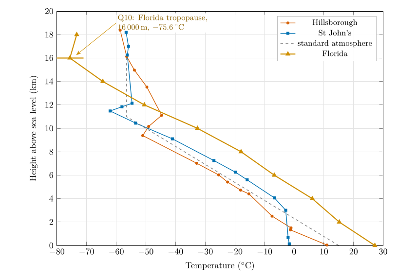
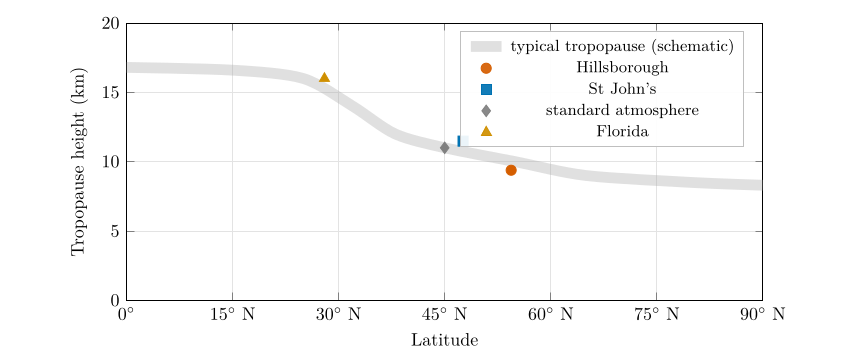

*This chapter answers Questions 9, 10 and 11.*

## 7.1 Average and local lapse rates {#p1-sec:avglapse}

The lapse rate of Eq. ([5.1](/teaching/atmosphere/p1-ch04_temperature/#p1-eq:lapse)) can be taken over any layer. Taken between the ground and the tropopause it gives the **average lapse rate** of the troposphere, one number for the whole layer. Taken between neighbouring levels of a sounding it gives the **local lapse rate**, which varies a great deal: in the Hillsborough sounding it ranges from $-1.4$ $^{\circ}\mathrm{C\,km^{-1}}$ (the inversion at 1.4 km) to $+9.5$ $^{\circ}\mathrm{C\,km^{-1}}$ (the lowest 1.3 km), as Table [6.2](/teaching/atmosphere/p1-ch05_soundings/#p1-tab:layers) shows. The standard 6.5 $^{\circ}\mathrm{C\,km^{-1}}$ is an average of averages: over many places and many days.

## 7.2 Question 9: the lapse rate over Hillsborough {#p1-sec:q9}

The question

Based on your graph and the Hillsborough sounding in Table [6.1](/teaching/atmosphere/p1-ch05_soundings/#p1-tab:soundings), calculate the lapse rate for the part of the atmosphere below the tropopause for Hillsborough (have another look at Question 5 to work out how to calculate the lapse rate).

**Method.** Take the lowest level of the sounding and the tropopause found in Question 8 (§ [6.6](/teaching/atmosphere/p1-ch05_soundings/#p1-sec:q8)), and apply Eq. ([5.1](/teaching/atmosphere/p1-ch04_temperature/#p1-eq:lapse)).

1.  Lowest level: 38 m, 11.05 $^{\circ}\mathrm{C}$. Tropopause: 9383 m, $-51.05$ $^{\circ}\mathrm{C}$.

2.  Fall in temperature: $11.05-(-51.05)=62.10$ $^{\circ}\mathrm{C}$.

3.  Rise in height: $9383-38=9345$ m $=9.345$ km.

4.  Lapse rate: $\Gamma=62.10/9.345=6.65\,\ensuremath{^{\circ}\mathrm{C\,km^{-1}}}$.

Answer to Question 9

$\Gamma=\dfrac{11.05-(-51.05)}{9.383-0.038}=\dfrac{62.10\ \ensuremath{^{\circ}\mathrm{C}}}{9.345\ \mathrm{km}}=\textbf{6.65 }^{\circ}\mathrm{C}\textbf{per km}$, very close to the standard lapse rate of 6.5 $^{\circ}\mathrm{C}$ per km.

**Check.** The value lies between the extremes of the local lapse rates in Table [6.2](/teaching/atmosphere/p1-ch05_soundings/#p1-tab:layers), and the straight line from the surface point to the tropopause point in Figure [6.1](/teaching/atmosphere/p1-ch05_soundings/#p1-fig:soundings) runs close to the dashed standard-atmosphere line. For comparison, the same calculation for St John’s gives $(-1.65-(-62.05))/(11.482-0.140)=5.33\,\ensuremath{^{\circ}\mathrm{C\,km^{-1}}}$: smaller, because its surface layer is so cold.

## 7.3 Question 10: a tropical profile {#p1-sec:q10}

| Height (m) | 0 | 2000 | 4000 | 6000 | 8000 | 10 000 | 12 000 | 14 000 | 16 000 | 18 000 |
|:---|---:|---:|---:|---:|---:|---:|---:|---:|---:|---:|
| $T$ ($^{\circ}\mathrm{C}$) | 27.2 | 15.2 | 6.1 | $-6.7$ | $-17.9$ | $-32.6$ | $-50.5$ | $-64.5$ | $-75.6$ | $-73.3$ |

: Table 7.1. Temperature profile for Florida.

The question

Add the temperature curve for Florida (Table [7.1](/teaching/atmosphere/p1-ch06_lapse/#p1-tab:florida)) to your graph. Where does the tropopause occur?

\

**Figure 7.1.** Question 10: the Florida profile (Table [7.1](/teaching/atmosphere/p1-ch06_lapse/#p1-tab:florida)) added to the graph, shown here to 20 km. Florida is warmest at the ground and coldest at its tropopause, which is 5 to 7 km higher than the others.

**Method.** Plot Table [7.1](/teaching/atmosphere/p1-ch06_lapse/#p1-tab:florida) on the same axes (Figure [7.1](/teaching/atmosphere/p1-ch06_lapse/#p1-fig:florida)) and look for the level above which the temperature stops falling: it falls all the way to $-75.6$ $^{\circ}\mathrm{C}$ at 16 000 m and then rises to $-73.3$ $^{\circ}\mathrm{C}$ at 18 000 m.

Answer to Question 10

Florida: the tropopause is at about **16 000 m**, at **$-$<!-- -->75.6 $^{\circ}\mathrm{C}$**. Its average lapse rate below the tropopause is $(27.2-(-75.6))/16=6.4\,\ensuremath{^{\circ}\mathrm{C\,km^{-1}}}$.

**Check.** The data are only every 2 km, so the true tropopause could be anywhere between about 15 and 17 km. That range is typical of the tropics and subtropics (Hoinka 1998).

## 7.4 Question 11: is the troposphere the same thickness everywhere? {#p1-sec:q11}

The question

Examining all your graphs, do you think the troposphere is the same thickness across the globe? Where do you think it is thickest and why is that?

**The evidence.** The four tropopauses are at 9.4 km (Hillsborough, 54$^{\circ}$N), 11.0 km (the standard atmosphere, which represents the middle latitudes), 11.5 km (St John’s, 48$^{\circ}$N) and 16 km (Florida, about 25 to 31$^{\circ}$N). The further from the pole, the higher the tropopause (Figure [7.2](/teaching/atmosphere/p1-ch06_lapse/#p1-fig:troplat)).

\

**Figure 7.2.** Question 11: the tropopause heights of the four profiles against latitude. The grey band shows the typical pattern (Hoinka 1998; Wallace and Hobbs 2006): about 16 to 17 km over the tropics, falling steeply across the subtropics and middle latitudes, to about 8 to 9 km near the poles. Florida is plotted at its middle latitude, 28$^{\circ}$N; the standard atmosphere at 45$^{\circ}$N.  
  
  Hoinka, K.P. (1998) Statistics of the global tropopause pressure. Monthly Weather Review 126, 3303–3325. [https://doi.org/10.1175/1520-0493(1998)126\<3303:SOTGTP\>2.0.CO;2](https://doi.org/10.1175/1520-0493(1998)126<3303:SOTGTP>2.0.CO;2)  
  
  Wallace, J.M. and Hobbs, P.V. (2006) Atmospheric science: An introductory survey, 2nd ed. Elsevier Academic Press, Amsterdam.  
  

**The reasons.** Three effects work together.

1.  **More heating at the surface.** The tropics receive the most solar energy per square metre, because the Sun is high in the sky all year (Part II, Chapter [18](/teaching/atmosphere/p2-ch08_sunangle/#p2-ch:sun)). The ground and the air above it are warm.

2.  **Warm air columns are taller.** Warm air is less dense than cold air at the same pressure, Eq. ([3.1](/teaching/atmosphere/p1-ch02_pressure/#p1-eq:gaslaw)), so the same weight of air (the same drop in pressure) occupies a greater depth: the scale height $H=R_dT/g$ is larger, Eq. ([3.3](/teaching/atmosphere/p1-ch02_pressure/#p1-eq:expo)). Every pressure level, and with them the whole troposphere, sits higher above a warm surface. The same effect makes pressure surfaces slope from the warm tropics down to the cold poles, which drives the winds of Part III ( Chapter [24](/teaching/atmosphere/p3-ch05_surfaces/#p3-ch:surfaces)).

3.  **Deep convection.** Strong heating makes air rise in towering thunderstorm clouds that carry heat and mix the troposphere up to 15 to 18 km. The tropopause sits where this stirring from below gives way to the stable, radiatively heated stratosphere, so where convection reaches higher, the tropopause is higher.

A taller troposphere also has a *colder* top: with a similar lapse rate, the temperature keeps falling over more kilometres. That is why Florida, the warmest at the ground (27 $^{\circ}\mathrm{C}$), has the coldest tropopause ($-75.6$ $^{\circ}\mathrm{C}$).

Answer to Question 11

**No.** The troposphere is **thickest over the tropics** (about 16 to 17 km; 16 km in the Florida profile) and **thinnest near the poles** (about 8 to 9 km), with middle latitudes in between (9.4 to 11.5 km in the soundings). The tropics receive the most solar heating; warm air is less dense, so a warm air column is taller; and strong convection mixes warm air to great heights before the stable stratosphere begins. The tropopause is also higher in summer than in winter, for the same reasons.

A question that comes up

**The coldest air in the troposphere is over the equator? That sounds backwards.**\
At the ground the tropics are the warmest places on Earth. But high up, at 16 to 17 km, the tropical tropopause is colder than the tropopause anywhere else, often below $-75$ $^{\circ}\mathrm{C}$, because it is so far above the surface. Near the poles the tropopause is low and so less cold: around $-50$ to $-60$ $^{\circ}\mathrm{C}$.

## 7.5 Try it yourself: Practice Set 7

Practice Set 7: lapse rates

1.  What is the lapse rate in the lowest 2 km of the Florida profile? Between 10 and 12 km?

2.  A tropical sounding has 28 $^{\circ}\mathrm{C}$ at the ground and an average lapse rate of 6.5 $^{\circ}\mathrm{C\,km^{-1}}$ up to its tropopause at 16 km. What is the tropopause temperature?

3.  A polar sounding has $-20$ $^{\circ}\mathrm{C}$ at the ground and the tropopause at 8.5 km with $-55$ $^{\circ}\mathrm{C}$. What is its average lapse rate?

4.  By how much is the scale height over Florida (mean tropospheric temperature about $-24$ $^{\circ}\mathrm{C}$) larger than over a polar station (about $-40$ $^{\circ}\mathrm{C}$)?

Answers to Practice Set 7

1.  $(27.2-15.2)/2=6.0\,\ensuremath{^{\circ}\mathrm{C\,km^{-1}}}$; $(-32.6-(-50.5))/2=8.95\,\ensuremath{^{\circ}\mathrm{C\,km^{-1}}}$.

2.  $28-6.5\times16=28-104=-76$ $^{\circ}\mathrm{C}$.

3.  $(-20-(-55))/8.5=35/8.5=4.1\,\ensuremath{^{\circ}\mathrm{C\,km^{-1}}}$.

4.  $H=R_dT/g$: $287\times249/9.81=7.29$ km against $287\times233/9.81=6.82$ km, about 0.47 km (7 %) larger. Every pressure level therefore sits about 7 % higher above the ground in the warm column: 500 hPa, for example, at about 5.1 km instead of 4.7 km.

Hoinka, K.P. (1998) Statistics of the global tropopause pressure. Monthly Weather Review 126, 3303–3325. [https://doi.org/10.1175/1520-0493(1998)126\<3303:SOTGTP\>2.0.CO;2](https://doi.org/10.1175/1520-0493(1998)126<3303:SOTGTP>2.0.CO;2)

