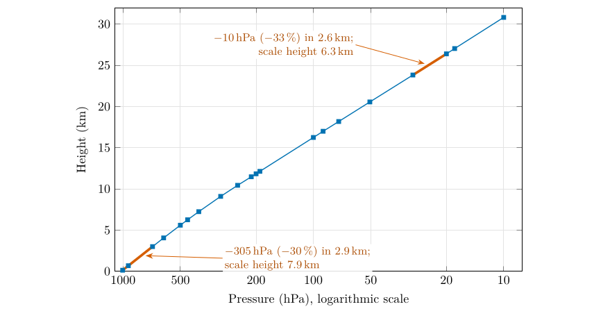
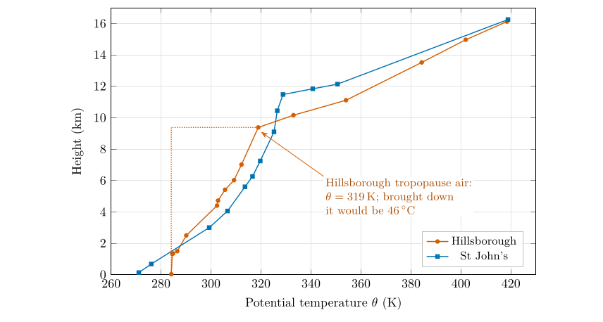

*This chapter answers Questions 12 and 13.*

## 8.1 Question 12: equal steps, unequal drops {#p1-sec:q12}

The question

In St John’s, how much is the pressure drop between 140 m and 3006 m? How much is the pressure drop between 23 834 m and 26 404 m? Seeing that the difference in altitude is almost the same, why is the difference in pressure so dissimilar?

**The two drops.** From Table [6.1](/teaching/atmosphere/p1-ch05_soundings/#p1-tab:soundings) (St John’s): $$\begin{align*}
\text{lower layer:}&\quad 1005-700=305\ \ensuremath{\mathrm{hPa}}\quad\text{over}\quad 3006-140=2866\ \mathrm{m},\\
\text{upper layer:}&\quad 30-20=10\ \ensuremath{\mathrm{hPa}}\quad\text{over}\quad 26\,404-23\,834=2570\ \mathrm{m}.
\end{align*}$$

**Look at fractions, not amounts.** In the lower layer the pressure falls to $700/1005=0.70$ of its starting value, a fall of 30 %; in the upper layer it falls to $20/30=0.67$, a fall of 33 %. The *fractional* drops over these similar depths are almost the same. That is exactly what exponential decay means (§ [3.3](/teaching/atmosphere/p1-ch02_pressure/#p1-sec:exponential)): each kilometre removes the same *fraction* of the air above, so where there is a lot of air (near the ground) the same fraction is a large amount, and where there is little (at 24 km, only 3 % of the atmosphere is above) it is a tiny amount. Plotted on a logarithmic pressure axis, an exponential becomes a straight line (Figure [8.1](/teaching/atmosphere/p1-ch07_stability/#p1-fig:q12)).

\

**Figure 8.1.** Question 12: the St John’s sounding with pressure on a logarithmic axis (decreasing to the right, so that height and falling pressure go the same way). An exponential decay is a straight line here; the slope is steeper (shorter scale height) where the air is colder.

**The data even measure the scale height.** Rearranging Eq. ([3.3](/teaching/atmosphere/p1-ch02_pressure/#p1-eq:expo)) for two levels gives the scale height of the layer between them (Appendix [A.2.1](/teaching/atmosphere/app-p1/#p1-sec:der-expo)): $$
H=\frac{z_2-z_1}{\ln(p_1/p_2)}.\tag{8.1}
$$ *where*

|  |  |  |
|:---|:---|:---|
| $H$ | scale height of the layer (km) | calculated |
| $z_1,\ z_2$ | heights of the bottom and top of the layer (km) | from the sounding |
| $p_1,\ p_2$ | pressures at those heights (hPa) | from the sounding |

For the lower layer $H=2.866/\ln(1005/700)=2.866/0.362=7.9$ km; for the upper layer $H=2.570/\ln(30/20)=2.570/0.405=6.3$ km. By Eq. ([3.3](/teaching/atmosphere/p1-ch02_pressure/#p1-eq:expo)), $H=R_dT/g$, so these correspond to temperatures of $gH/R_d=271$ K ($-2$ $^{\circ}\mathrm{C}$) and 218 K ($-55$ $^{\circ}\mathrm{C}$): exactly the temperatures measured in those layers. The upper layer is colder, so its air is denser for its pressure and its pressure falls off over a shorter distance.

Answer to Question 12

Between 140 and 3006 m the pressure drops by **305 hPa**; between 23 834 and 26 404 m by only **10 hPa**. Pressure decreases **exponentially** with height: each step up removes about the same *fraction* of the air above (30 % and 33 % here), not the same amount. Near the ground there is a great deal of air above, compressed by its own weight, so the same fraction is a large drop; at 24 km only about 3 % of the atmosphere remains above, so the drop is tiny.

## 8.2 “Cold air sinks”? Density depends on pressure too {#p1-sec:density}

Everyday experience says cold air sinks: cold draughts collect at the floor, frost forms in hollows. That is true when cold and warm air are side by side at the *same pressure*, because by the gas law, Eq. ([3.1](/teaching/atmosphere/p1-ch02_pressure/#p1-eq:gaslaw)), $\rho=p/(R_dT)$ and lower $T$ means higher $\rho$. But in the vertical the pressure changes enormously, and pressure wins. Using the Hillsborough sounding: $$\begin{align*}
\text{surface (1001 hPa, 11.05 }^{\circ}\mathrm{C}\text{):}\quad&\rho=\frac{100\,100}{287\times284.2}=1.23\ \mathrm{kg\,m^{-3}},\\
\text{tropopause (282 hPa, }-51.05\,\ensuremath{^{\circ}\mathrm{C}}):\quad&\rho=\frac{28\,200}{287\times222.1}=0.44\ \mathrm{kg\,m^{-3}}.
\end{align*}$$ The cold air at the tropopause is only a third as dense as the warm air at the ground: it is lighter, not heavier, and it does not “fall through” the air below it.

## 8.3 What happens to air that moves up or down {#p1-sec:adiabatic}

The full answer needs one more idea. Air that moves vertically changes its pressure, and so its temperature. A parcel of air brought *down* is squeezed by the rising pressure, and the work done in compressing it warms it; a parcel that rises expands and cools. If no heat is exchanged with its surroundings (the process is *adiabatic*), dry air warms or cools at a fixed rate, the **dry adiabatic lapse rate** (Wallace and Hobbs 2006, ch. 3): $$
\Gamma_d=\frac{g}{c_p}=\frac{9.81}{1004}\ \mathrm{K\,m^{-1}}=9.8\ \ensuremath{^{\circ}\mathrm{C\,km^{-1}}}.\tag{8.2}
$$ *where*

|  |  |  |
|:---|:---|:---|
| $\Gamma_d$ | dry adiabatic lapse rate ($^{\circ}\mathrm{C\,km^{-1}}$) | 9.8 |
| $g$ | acceleration due to gravity (m s$^{-2}$) | 9.81 |
| $c_p$ | specific heat of dry air at constant pressure (J kg$^{-1}$ K$^{-1}$) | 1004, Table [D.1](/teaching/atmosphere/app-constants/#tab:constants) |

The derivation is in Appendix [A.2.2](/teaching/atmosphere/app-p1/#p1-sec:der-dalr). The same rate decides the height of cloud base in Part III: rising air cools at 9.8 $^{\circ}\mathrm{C\,km^{-1}}$ until it reaches its dew point (Part III, § [22.8](/teaching/atmosphere/p3-ch03_dewpoint/#p3-sec:cloudbase)).

A convenient way to compare air at different heights is to ask what temperature each parcel would have if brought down adiabatically to the standard level of 1000 hPa. That temperature is the **potential temperature**: $$
\theta=T\left(\frac{1000\ \ensuremath{\mathrm{hPa}}}{p}\right)^{R_d/c_p}=T\left(\frac{1000}{p}\right)^{0.286}.\tag{8.3}
$$ *where*

|           |                                                |                   |
|:----------|:-----------------------------------------------|:------------------|
| $\theta$  | potential temperature (K)                      | calculated        |
| $T$       | temperature of the parcel (K)                  | from the sounding |
| $p$       | pressure of the parcel (hPa)                   | from the sounding |
| $R_d/c_p$ | ratio of the gas constant to the specific heat | $287/1004=0.286$  |

Potential temperature does not change when air moves up or down adiabatically, so it labels a parcel the way a name does: two parcels with the same $\theta$ would have the same temperature if brought to the same level.

\

**Figure 8.2.** Question 13: potential temperature, Eq. ([8.3](/teaching/atmosphere/p1-ch07_stability/#p1-eq:theta)), for both soundings up to 16 km. It increases with height everywhere, which means the atmosphere is stable: any parcel moved down arrives warmer, and so lighter, than the air around it. The increase is slow in the troposphere and fast in the stratosphere.

## 8.4 Question 13: why the cold air aloft does not sink {#p1-sec:q13}

The question

Thinking of your previous answer, if cold air is supposed to sink, why is the colder air of the upper troposphere not flowing down to the surface?

**Follow a parcel down.** Take the air at the Hillsborough tropopause, $-51.05$ $^{\circ}\mathrm{C}$ (222.1 K) at 282 hPa, and bring it down to the ground. As it sinks it is compressed and warms at 9.8 $^{\circ}\mathrm{C\,km^{-1}}$. Its potential temperature, Eq. ([8.3](/teaching/atmosphere/p1-ch07_stability/#p1-eq:theta)), tells us where it would end up: $$\theta=222.1\times\left(\frac{1000}{282}\right)^{0.286}=222.1\times1.436=318.9\ \mathrm{K}=45.8\ \ensuremath{^{\circ}\mathrm{C}}.$$ It would arrive at the surface at about 46 $^{\circ}\mathrm{C}$, some 35 $^{\circ}\mathrm{C}$ *warmer* than the 11 $^{\circ}\mathrm{C}$ air already there. Warmer air at the same pressure is less dense, so the parcel would be buoyant and would be pushed straight back up. The cold air aloft is not “waiting to fall”: it is held up because it would become warm, and light, on the way down.

This is general. Whenever the temperature in the atmosphere falls with height more slowly than 9.8 $^{\circ}\mathrm{C\,km^{-1}}$ (the standard 6.5 $^{\circ}\mathrm{C\,km^{-1}}$, or the 6.65 $^{\circ}\mathrm{C\,km^{-1}}$ of Question 9), the potential temperature increases with height (Figure [8.2](/teaching/atmosphere/p1-ch07_stability/#p1-fig:theta)) and the air is **stably stratified**: air displaced downwards comes back up, and air displaced upwards sinks back. The atmosphere is layered like oil on water, but the layers are sorted by potential temperature, not by temperature.

Answer to Question 13

The upper air is cold but it is at very low pressure, so it is **much less dense** than the air near the ground (0.44 against 1.23 kg m$^{-3}$ at Hillsborough): “cold air sinks” compares air at the same pressure. If the upper air did sink, it would be **compressed and warm up** at about 9.8 $^{\circ}\mathrm{C}$ per km; the tropopause air over Hillsborough would reach the ground at about **46 $^{\circ}\mathrm{C}$**, far warmer and lighter than the surface air, and would rise again. Because the temperature falls with height more slowly than air warms on descent, the atmosphere is **stably layered**: its potential temperature increases with height.

A question that comes up

**Then when does air overturn?**\
When the temperature falls with height *faster* than 9.8 $^{\circ}\mathrm{C\,km^{-1}}$, a rising parcel stays warmer than its surroundings and keeps rising: the air is unstable, and convection overturns it. This happens over ground heated strongly by the Sun, where the lowest layer can exceed the dry adiabatic rate. In the Hillsborough sounding the lowest 1.3 km cools at 9.5 $^{\circ}\mathrm{C\,km^{-1}}$, almost exactly the dry adiabatic rate: a well-mixed layer stirred by the wind and by heating from the ground.

## 8.5 Try it yourself: Practice Set 8

Practice Set 8: pressure and stability

Use $R_d=287$ J kg$^{-1}$ K$^{-1}$, $c_p=1004$ J kg$^{-1}$ K$^{-1}$, $g=9.81$ m s$^{-2}$ and kelvin $=\ensuremath{^{\circ}\mathrm{C}}+273.15$.

1.  What is the density of air at 500 hPa and $-20$ $^{\circ}\mathrm{C}$?

2.  What is the potential temperature of the tropopause air over St John’s (212 hPa, $-62.05$ $^{\circ}\mathrm{C}$)?

3.  From the Hillsborough sounding, find the scale height of the layer from 1001 hPa (38 m) to 500 hPa (5414 m), and the temperature it corresponds to.

4.  Air at 5414 m over Hillsborough ($-22.45$ $^{\circ}\mathrm{C}$) is brought down to the ground (38 m) without exchanging heat. Roughly what temperature would it have?

Answers to Practice Set 8

1.  $\rho=50\,000/(287\times253.15)=0.688$ kg m$^{-3}$, Eq. ([3.1](/teaching/atmosphere/p1-ch02_pressure/#p1-eq:gaslaw)): just over half the surface density.

2.  $\theta=211.1\times(1000/212)^{0.286}=328.8$ K (55.7 $^{\circ}\mathrm{C}$), Eq. ([8.3](/teaching/atmosphere/p1-ch07_stability/#p1-eq:theta)).

3.  $H=5.376/\ln(1001/500)=5.376/0.694=7.74$ km, Eq. ([8.1](/teaching/atmosphere/p1-ch07_stability/#p1-eq:Hdata)); $T=gH/R_d=9.81\times7744/287=265$ K ($-8$ $^{\circ}\mathrm{C}$), close to the average temperature of that layer.

4.  It warms by about $9.8\times5.4=53$ $^{\circ}\mathrm{C}$, to about 30 $^{\circ}\mathrm{C}$, Eq. ([8.2](/teaching/atmosphere/p1-ch07_stability/#p1-eq:dalr)): 19 $^{\circ}\mathrm{C}$ warmer than the surface air, so it would rise again.

## 8.6 Stability in Python

These functions compute the equations of this chapter, and the book’s tests check them against its answers.

    def scale_height_from_data(p1_hpa, p2_hpa, dz_km):
        """Scale height (km) from two pressures dz_km apart."""
        return dz_km / math.log(p1_hpa / p2_hpa)

    def dry_adiabatic_lapse_rate():
        """Dry adiabatic lapse rate (deg C per km): g / c_p."""
        return G / C_P * 1000.0

    def potential_temperature(t_c, p_hpa):
        """Potential temperature (K) of air at t_c (deg C) and p_hpa."""
        return (t_c + 273.15) * (1000.0 / p_hpa) ** (R_D / C_P)

`dry_adiabatic_lapse_rate()` returns 9.77, which rounds to the 9.8 $^{\circ}\mathrm{C\,km^{-1}}$ used in this chapter.

## References

Wallace, J.M. and Hobbs, P.V. (2006) Atmospheric science: An introductory survey, 2nd ed. Elsevier Academic Press, Amsterdam.

