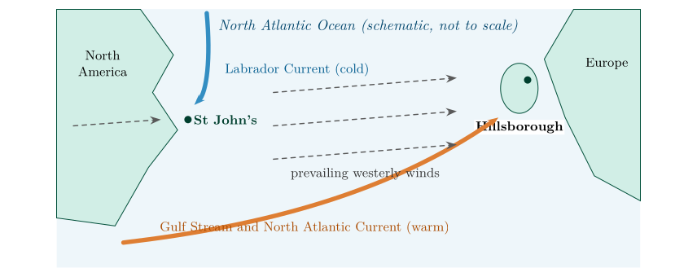

*This chapter answers Question 14.*

## 9.1 The puzzle {#p1-sec:puzzle}

On 21 March 1990 the air near the ground was at 11.05 $^{\circ}\mathrm{C}$ over Hillsborough and $-1.65$ $^{\circ}\mathrm{C}$ over St John’s (Table [6.1](/teaching/atmosphere/p1-ch05_soundings/#p1-tab:soundings)). Hillsborough is at about 54.4$^{\circ}$N; St John’s at about 47.6$^{\circ}$N, about 750 km closer to the equator. If latitude alone set the temperature, St John’s should be the warmer.

The Sun does not explain it either. The soundings were made at the March equinox, when the noon Sun is overhead at the equator and its angle above the horizon is $90^\circ$ minus the latitude (Part II, § [18.3](/teaching/atmosphere/p2-ch08_sunangle/#p2-sec:declination)). By Eq. ([18.3](/teaching/atmosphere/p2-ch08_sunangle/#p2-eq:intensity)), the noon solar intensity is $100\,\%\times\sin\beta$: $$\text{Hillsborough: }100\,\%\times\sin(35.6^\circ)=58\,\%;\qquad\text{St John's: }100\,\%\times\sin(42.4^\circ)=67\,\%.$$ St John’s received *more* solar energy per square metre at noon, yet was 12.7 $^{\circ}\mathrm{C}$ colder. Something other than sunshine controls the temperature of the air near the ground.

## 9.2 What the soundings show {#p1-sec:aloft}

The difference is confined to the lowest layer. The two profiles cross at about 2 km, and from 3 to 7 km St John’s is the warmer by about 7 $^{\circ}\mathrm{C}$ (Figure [6.1](/teaching/atmosphere/p1-ch05_soundings/#p1-fig:soundings)). Over St John’s the lowest 3 km is cold and almost isothermal (Question 7, § [6.4](/teaching/atmosphere/p1-ch05_soundings/#p1-sec:q7)); over Hillsborough the lowest 1.3 km is warm and well mixed, cooling at nearly the dry adiabatic rate (§ [8.3](/teaching/atmosphere/p1-ch07_stability/#p1-sec:adiabatic)). The warmth of Hillsborough, and the cold of St John’s, come from the surface beneath and the air that has flowed across it.

## 9.3 The ocean and the winds {#p1-sec:currents}

\

**Figure 9.1.** Why Hillsborough is milder than St John’s in late winter (schematic). Westerly winds reach Northern Ireland after crossing ocean warmed by the Gulf Stream and North Atlantic Current; they reach Newfoundland after crossing the cold continent, and its coast is bathed by the cold Labrador Current.

Two things decide the temperature of the air near the ground in winter and early spring: the temperature of the surface it lies over, and the surface it has just crossed (Lutgens et al. 2019, ch. 3).

1.  **Ocean currents.** The Gulf Stream carries warm water from the Gulf of Mexico along the coast of North America and, as the North Atlantic Current, across to north-west Europe. The seas around Ireland are therefore far warmer in winter than their latitude would suggest. Newfoundland is washed instead by the Labrador Current, which brings cold water (and, in late winter and spring, sea ice and icebergs) south from the Arctic.

2.  **Prevailing winds.** In the middle latitudes the winds blow mostly from the west. Air reaching Northern Ireland has crossed thousands of kilometres of relatively warm ocean and arrives mild and moist (maritime air). Air reaching St John’s has usually crossed the North American continent, which in winter is snow-covered and very cold (continental polar air).

3.  **Water stores heat.** Water heats and cools far more slowly than land, so the ocean keeps the air over it mild in winter and cool in summer. Downwind of an ocean, winters are mild; downwind of a continent, they are harsh.

## 9.4 Question 14: Hillsborough and St John’s {#p1-sec:q14}

The question

Compare the surface temperatures of St John’s and Hillsborough. Although Northern Ireland is located at a higher latitude, why do you think the surface temperature is higher? Do you think that this difference is the same throughout the year?

Answer to Question 14

On 21 March 1990 Hillsborough was at **11.05 $^{\circ}\mathrm{C}$** and St John’s at **$-$<!-- -->1.65 $^{\circ}\mathrm{C}$**: **12.7 $^{\circ}\mathrm{C}$ warmer** in Northern Ireland, although it is about 7$^{\circ}$ of latitude further north and received less sunshine at noon. Northern Ireland lies downwind of the North Atlantic, whose surface is kept warm by the **Gulf Stream and North Atlantic Current**, so the prevailing westerly winds bring it mild maritime air. St John’s is bathed by the cold **Labrador Current** and its westerly winds arrive from the frozen North American continent. **The difference is not the same all year:** it is largest in winter and early spring, when the ocean is much warmer than the land and the continent is coldest, and much smaller in summer, when the continent warms up (summer days in St John’s can be warmer than in Northern Ireland).

**Check.** The soundings agree with this explanation: the contrast is confined to the lowest kilometre or two, the layer in contact with the surface, while higher up St John’s is the warmer (§ [9.2](/teaching/atmosphere/p1-ch08_climates/#p1-sec:aloft)). A difference caused by latitude or by the Sun would extend through the whole troposphere.

A question that comes up

**Is one day’s sounding enough to say anything about climate?**\
No. One day shows weather; climate is the average over many years. But this day is typical of the pattern: north-west Europe has some of the mildest winters for its latitude anywhere in the world, and eastern Canada some of the coldest. The sounding illustrates a climatic contrast; the climate itself is established from long records.

## 9.5 Try it yourself: Practice Set 9

Practice Set 9: places and seasons

1.  At the June solstice, what are the noon solar intensities at Hillsborough (54.4$^{\circ}$N) and St John’s (47.6$^{\circ}$N)? Use Part II, Eqs. ([18.4](/teaching/atmosphere/p2-ch08_sunangle/#p2-eq:zenith)) and ([18.3](/teaching/atmosphere/p2-ch08_sunangle/#p2-eq:intensity)).

2.  Bergen in Norway (60.4$^{\circ}$N) has milder winters than many places 15$^{\circ}$ further south in eastern North America. Give two reasons.

3.  Which of the two soundings has the more stable lowest kilometre, and why does that fit the explanation of Question 14?

Answers to Practice Set 9

1.  Zenith angles $54.4-23.5=30.9^\circ$ and $47.6-23.5=24.1^\circ$; sun angles $59.1^\circ$ and $65.9^\circ$; intensities $\sin59.1^\circ=86\,\%$ and $\sin65.9^\circ=91\,\%$ per unit.

2.  The North Atlantic Current keeps the Norwegian Sea warm and ice-free in winter, and the prevailing westerly winds bring mild maritime air from the ocean, whereas eastern North America receives air from the cold continent.

3.  St John’s: its lowest 3 km is almost isothermal (a lapse rate under 1 $^{\circ}\mathrm{C\,km^{-1}}$), so cold air lies trapped beneath warmer air, as over a cold surface. Hillsborough’s lowest 1.3 km cools at 9.5 $^{\circ}\mathrm{C\,km^{-1}}$, a mixed layer over a relatively warm surface.

Lutgens, F.K., Tarbuck, E.J. and Herman, R.L. (2019) The atmosphere: An introduction to meteorology, 14th ed. Pearson, New York.

