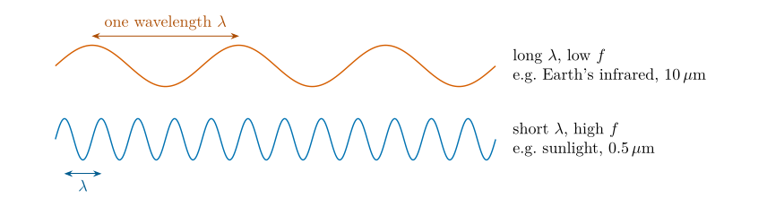
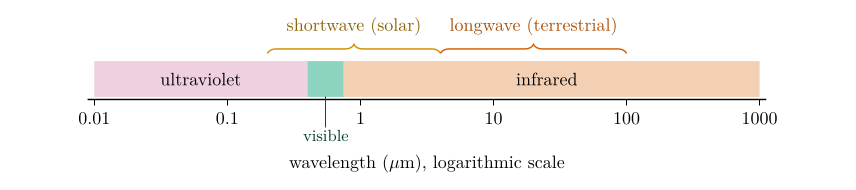
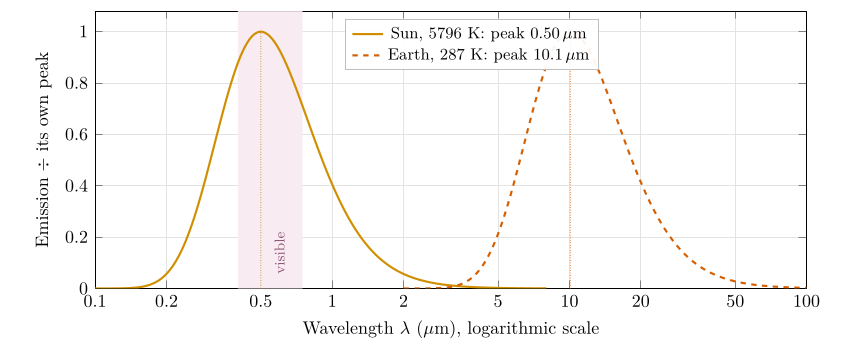

*This chapter builds the ideas that every question of this part uses. It answers no question directly; Chapters [13](/teaching/atmosphere/p2-ch03_wien/#p2-ch:wien) to [18](/teaching/atmosphere/p2-ch08_sunangle/#p2-ch:sun) refer back to it.*

## 12.1 Energy that needs no material to travel {#p2-sec:what}

Energy moves from place to place in three ways. *Conduction* passes it from molecule to molecule through contact (a spoon warming in hot tea). *Convection* carries it in a moving fluid (warm air rising from a radiator). *Radiation* needs no material at all: it is energy travelling as an electromagnetic wave, a ripple of electric and magnetic fields (Lutgens et al. 2019, ch. 2). Between the Sun and the Earth there are 150 million kilometres of almost empty space, so radiation is the only way the Sun’s energy can reach us.

Two properties of radiation matter here:

- **It carries energy.** The body that emits it loses energy; the body that absorbs it gains energy and warms.

- **It comes in many wavelengths.** Radio waves, microwaves, infrared, visible light, ultraviolet and X-rays are all the same kind of thing. They differ only in wavelength.

A question that comes up

**Is this the same as radioactivity?**\
No. In meteorology “radiation” always means electromagnetic radiation: sunlight, the infrared glow of the ground, and so on. Radioactivity is the decay of unstable atomic nuclei, an entirely different process. Only the word is shared.

## 12.2 Wavelength, frequency and speed {#p2-sec:wave}

A wave is a repeating pattern of crests and troughs. The **wavelength** $\lambda$ (the Greek letter lambda) is the distance from one crest to the next (Figure [12.1](/teaching/atmosphere/p2-ch02_radiation/#p2-fig:wave)). The **frequency** $f$ is the number of crests that pass a point each second. Shake one end of a rope slowly and the crests are far apart; shake it quickly and they bunch up.

All electromagnetic waves travel through space at the same speed, the speed of light $c$. In one second a source sends out $f$ crests, each $\lambda$ apart, and together they cover the distance the wave travels in one second: $$
c=f\lambda .\tag{12.1}
$$ *where*

|  |  |  |
|:---|:---|:---|
| $c$ | speed of light (m s$^{-1}$) | $3.00\times10^{8}$, Table [B.3](/teaching/atmosphere/app-p2/#p2-tab:constants) |
| $f$ | frequency: crests per second (s$^{-1}$, or hertz, Hz) | calculated |
| $\lambda$ | wavelength (m) | given or calculated |

Because $c$ is fixed, frequency and wavelength are tied together: a short wavelength means a high frequency, and a long wavelength a low one.

\

**Figure 12.1.** Wavelength and frequency. Both waves move at the speed of light, so the one whose source oscillates faster (blue) has its crests closer together, Eq. ([12.1](/teaching/atmosphere/p2-ch02_radiation/#p2-eq:cfl)). Not to scale: the crests of the Earth’s infrared are about 10 $\mu\mathrm{m}$ apart, a seventh of the width of a hair.

Worked example: the frequencies of sunlight and of the Earth’s glow

Rearranging Eq. ([12.1](/teaching/atmosphere/p2-ch02_radiation/#p2-eq:cfl)), $f=c/\lambda$. For the Sun’s peak wavelength of 0.5 $\mu\mathrm{m}$ $=0.5\times10^{-6}$ m: $$f_{\text{Sun}}=\frac{3.00\times10^{8}}{0.5\times10^{-6}}=6.0\times10^{14}\ \text{Hz}.$$ For the Earth’s peak near 10 $\mu\mathrm{m}$ $=10\times10^{-6}$ m: $$f_{\text{Earth}}=\frac{3.00\times10^{8}}{10\times10^{-6}}=3.0\times10^{13}\ \text{Hz}.$$ Sunlight oscillates twenty times faster than the Earth’s infrared, because its wavelength is twenty times shorter.

## 12.3 Photons: radiation comes in packets {#p2-sec:photons}

Radiation is emitted and absorbed in separate packets of energy called **photons**, much as rain arrives as separate drops. The energy of one photon depends only on its frequency (Planck 1901): $$
\varepsilon=hf=\frac{hc}{\lambda},\tag{12.2}
$$ *where*

|  |  |  |
|:---|:---|:---|
| $\varepsilon$ | energy of one photon (J) | calculated |
| $h$ | Planck’s constant (J s) | $6.626\times10^{-34}$, Table [B.3](/teaching/atmosphere/app-p2/#p2-tab:constants) |
| $f,\ c,\ \lambda$ | as in Eq. ([12.1](/teaching/atmosphere/p2-ch02_radiation/#p2-eq:cfl)) |  |

where the second form follows from substituting $f=c/\lambda$ from Eq. ([12.1](/teaching/atmosphere/p2-ch02_radiation/#p2-eq:cfl)). So **the shorter the wavelength, the more energy each photon carries**: $$\begin{align*}
\varepsilon_{0.5\,\ensuremath{\mu\mathrm{m}}}&=\frac{(6.626\times10^{-34})(3.00\times10^{8})}{0.5\times10^{-6}}=3.98\times10^{-19}\ \text{J},\\
\varepsilon_{10\,\ensuremath{\mu\mathrm{m}}}&=\frac{(6.626\times10^{-34})(3.00\times10^{8})}{10\times10^{-6}}=1.99\times10^{-20}\ \text{J}.
\end{align*}$$ A photon of sunlight carries twenty times the energy of a photon of the Earth’s infrared. This is why ultraviolet light, with even shorter wavelengths, can break chemical bonds and burn skin, while infrared only warms.

## 12.4 The electromagnetic spectrum {#p2-sec:spectrum}

Table [12.1](/teaching/atmosphere/p2-ch02_radiation/#p2-tab:spectrum) and Figure [12.2](/teaching/atmosphere/p2-ch02_radiation/#p2-fig:spectrum) arrange the kinds of radiation by wavelength. Two ranges matter for the atmosphere. The Sun emits mostly between about 0.2 and 4 $\mu\mathrm{m}$ (ultraviolet, visible and near infrared): this is called **shortwave** radiation. The Earth and its atmosphere emit mostly between about 4 and 100 $\mu\mathrm{m}$ (thermal infrared): this is **longwave** radiation. Most of the Sun’s ultraviolet never reaches the ground: ozone absorbs it, and that absorption is what warms the stratosphere in the temperature profiles of Part I ( § [5.4](/teaching/atmosphere/p1-ch04_temperature/#p1-sec:layers)).

| **Type** | **Wavelength** | **Energy per photon** | **Example source** |
|:---|:---|:---|:---|
| Radio | metres to kilometres | smallest | transmitters |
| Microwave | 1 mm to 1 m | very small | ovens; radar |
| Infrared | 0.75 to 1000 $\mu\mathrm{m}$ | small | the Earth, people, warm objects (peak near 10 $\mu\mathrm{m}$) |
| Visible | 0.4 to 0.75 $\mu\mathrm{m}$ | moderate | the Sun (peak near 0.5 $\mu\mathrm{m}$) |
| Ultraviolet | 0.01 to 0.4 $\mu\mathrm{m}$ | large | the Sun; mostly absorbed by ozone |
| X-ray, gamma | shorter still | largest | medical X-rays; radioactive decay |

: Table 12.1. The electromagnetic spectrum. All of these are photons; they differ only in wavelength and so in energy per photon, Eq. ([12.2](/teaching/atmosphere/p2-ch02_radiation/#p2-eq:photon)).

\

**Figure 12.2.** The part of the spectrum that matters for the atmosphere. Solar (shortwave) and terrestrial (longwave) radiation meet near 4 $\mu\mathrm{m}$.

## 12.5 Why everything above absolute zero radiates {#p2-sec:everything}

The first law of radiation says that *all objects continually radiate energy*. Why?

**Absolute zero** ($0$ K, or $-273.15$ $^{\circ}\mathrm{C}$) is the lowest possible temperature, at which the particles of a substance have the least possible motion. The kelvin scale starts there; that is why the radiation laws need temperatures in kelvin (§ [11.2](/teaching/atmosphere/p2-ch01_orientation/#p2-sec:conventions)).

All matter (rock, soil, sea, ice, cloud, air, people) is made of atoms that contain negative electrons and positive nuclei. Above absolute zero these particles are always vibrating and colliding, so their electric charges are always being jostled. Moving charges send out electromagnetic waves, just as a radio transmitter drives electrons up and down an aerial. So $$\text{above }0\text{ K}\ \Rightarrow\ \text{particles move}\ \Rightarrow\ \text{charges are jostled}\ \Rightarrow\ \text{radiation is emitted.}$$ Cold things radiate too, only less. An ice cube at $-10$ $^{\circ}\mathrm{C}$ gives off about 270 $\mathrm{W\,m^{-2}}$, and your skin about 500 $\mathrm{W\,m^{-2}}$ (you will be able to check both with Eq. ([14.1](/teaching/atmosphere/p2-ch04_stefan/#p2-eq:sb)) in Chapter [14](/teaching/atmosphere/p2-ch04_stefan/#p2-ch:stefan)). A thermal camera sees people in the dark for exactly this reason. Ordinary objects look dark only because almost all their emission is infrared, which our eyes cannot see.

## 12.6 Black bodies {#p2-sec:blackbody}

Definition

A **black body** is an ideal object that absorbs *all* the radiation falling on it, at every wavelength, and reflects none. At any given temperature it also *emits* the most radiation that any object at that temperature can emit, at every wavelength.

The last law, *good absorbers are good emitters*, is Kirchhoff’s law: at each wavelength, the fraction of incoming radiation a surface absorbs equals the fraction of black-body radiation it emits. That fraction is the **emissivity**, $\epsilon$, between 0 and 1; a black body has $\epsilon=1$ at all wavelengths (Wallace and Hobbs 2006, ch. 4).

No real object is a perfect black body, but many come close at some wavelengths. Snow is white (a poor absorber) in visible light but almost black in the thermal infrared, where its emissivity is close to 1; most natural surfaces, water and thick cloud behave nearly as black bodies in the infrared. The Sun is close to a black body over the whole spectrum. This is why the black-body laws work so well here.

## 12.7 The Planck curve {#p2-sec:planck}

How much energy does a black body emit at each wavelength? Imagine sorting all the radiation leaving a hot plate into wavelength “bins” and plotting how much energy lands in each bin. The result is a **spectrum**, and for a black body its shape was found by Planck (1901): $$
B_\lambda(T)=\frac{2hc^{2}}{\lambda^{5}}\;\frac{1}{\exp\!\left(\dfrac{hc}{\lambda k_{B}T}\right)-1}.\tag{12.3}
$$ *where*

|  |  |  |
|:---|:---|:---|
| $B_\lambda$ | spectral radiance: power per unit area, per unit solid angle, per unit wavelength (W m$^{-2}$ sr$^{-1}$ m$^{-1}$) | calculated |
| $h,\ c$ | as in Eqs. ([12.1](/teaching/atmosphere/p2-ch02_radiation/#p2-eq:cfl)) and ([12.2](/teaching/atmosphere/p2-ch02_radiation/#p2-eq:photon)) | Table [B.3](/teaching/atmosphere/app-p2/#p2-tab:constants) |
| $k_B$ | Boltzmann’s constant (J K$^{-1}$) | $1.381\times10^{-23}$, Table [B.3](/teaching/atmosphere/app-p2/#p2-tab:constants) |
| $\lambda$ | wavelength (m) | the horizontal axis |
| $T$ | absolute temperature of the body (K) | e.g. 5796 K for the Sun (Question 1) |

You will not need to calculate with Eq. ([12.3](/teaching/atmosphere/p2-ch02_radiation/#p2-eq:planck)). What matters is the shape it draws (Figure [12.3](/teaching/atmosphere/p2-ch02_radiation/#p2-fig:planck-sun-earth)) and the two laws that come out of it.

- **The curve rises steeply, peaks, then tails off slowly.** At short wavelengths each photon is expensive in energy, Eq. ([12.2](/teaching/atmosphere/p2-ch02_radiation/#p2-eq:photon)), and only the most energetic particles can make it, so emission falls off a cliff. At long wavelengths photons are cheap but each carries little, so the curve tails off gradually.

- **The position of the peak** says *what kind* of radiation the body mainly emits. Hotter bodies peak at shorter wavelengths. This is Wien’s law (Chapter [13](/teaching/atmosphere/p2-ch03_wien/#p2-ch:wien)).

- **The area under the curve** is the *total* radiation emitted. Hotter bodies have far larger areas. This is the Stefan–Boltzmann law (Chapter [14](/teaching/atmosphere/p2-ch04_stefan/#p2-ch:stefan)).

A geographer’s analogy is the storm hydrograph. Its peak tells you *when* discharge was greatest; the area under it tells you the total *volume* of water. The Planck curve is read in the same way, with energy in place of water and wavelength in place of time.

\

**Figure 12.3.** Black-body spectra of the Sun and the Earth from Eq. ([12.3](/teaching/atmosphere/p2-ch02_radiation/#p2-eq:planck)), each divided by its own peak value so that both can be seen on one graph. The two curves hardly overlap: the Sun’s radiation is shortwave and the Earth’s longwave. On a common scale the Earth curve would be invisible, because per square metre the Sun emits about 166 000 times more energy (Chapter [14](/teaching/atmosphere/p2-ch04_stefan/#p2-ch:stefan)).

Four laws of radiation, and where each is used

1.  *All objects continually radiate energy over a range of wavelengths* (§ [12.5](/teaching/atmosphere/p2-ch02_radiation/#p2-sec:everything); the spread is the Planck curve, Eq. ([12.3](/teaching/atmosphere/p2-ch02_radiation/#p2-eq:planck))).

2.  *Hotter objects radiate more total energy per unit area*: the Stefan–Boltzmann law, Eq. ([14.1](/teaching/atmosphere/p2-ch04_stefan/#p2-eq:sb)), used in Questions 2 and 4.

3.  *Hotter objects radiate more at short wavelengths*: Wien’s displacement law, Eq. ([13.1](/teaching/atmosphere/p2-ch03_wien/#p2-eq:wien)), used in Questions 1 and 3.

4.  *Good absorbers are good emitters*; the perfect one is a black body (§ [12.6](/teaching/atmosphere/p2-ch02_radiation/#p2-sec:blackbody)), the assumption behind Questions 3 and 4.

## 12.8 Questions that come up

A question that comes up

**If the air radiates too, why do we not feel it?**\
We do. On a clear night the ground cools quickly because it radiates to a cold sky; under cloud it stays warmer because the cloud radiates back to it. That downward infrared from cloud and air is part of the greenhouse effect of Chapter [17](/teaching/atmosphere/p2-ch07_balance/#p2-ch:balance).

A question that comes up

**When does an object start to glow visibly?**\
When enough of its Planck curve reaches into the visible. For a black body this begins at roughly 800 K, with a dull red glow, as in an electric hob ring. At the Sun’s temperature the peak is in the middle of the visible.

## 12.9 Try it yourself: Practice Set 12

Practice Set 12: waves and photons

Use $c=3.00\times10^{8}$ m s$^{-1}$ and $h=6.626\times10^{-34}$ J s.

1.  What is the frequency of light with a wavelength of 0.5 $\mu\mathrm{m}$?

2.  What is the energy of one photon of wavelength 10 $\mu\mathrm{m}$?

3.  A microwave oven works at a wavelength of 12.2 cm. What is its frequency?

4.  How many times more energy does a 0.3 $\mu\mathrm{m}$ ultraviolet photon carry than a 3 $\mu\mathrm{m}$ infrared photon?

5.  Name the part of the spectrum, and say whether it is shortwave or longwave, for radiation of 0.3, 0.55, 2 and 15 $\mu\mathrm{m}$.

Answers to Practice Set 12

1.  $f=c/\lambda=3.00\times10^{8}/0.5\times10^{-6}=6.0\times10^{14}$ Hz, Eq. ([12.1](/teaching/atmosphere/p2-ch02_radiation/#p2-eq:cfl)).

2.  $\varepsilon=hc/\lambda=(6.626\times10^{-34})(3.00\times10^{8})/(10\times10^{-6})=1.99\times10^{-20}$ J, Eq. ([12.2](/teaching/atmosphere/p2-ch02_radiation/#p2-eq:photon)).

3.  $f=3.00\times10^{8}/0.122=2.46\times10^{9}$ Hz (2.46 GHz).

4.  The energy is inversely proportional to the wavelength, so the ratio is $3/0.3=10$ times.

5.  0.3 $\mu\mathrm{m}$: ultraviolet, shortwave. 0.55 $\mu\mathrm{m}$: visible (green), shortwave. 2 $\mu\mathrm{m}$: near infrared, shortwave (still part of the solar spectrum). 15 $\mu\mathrm{m}$: thermal infrared, longwave.

## References

Lutgens, F.K., Tarbuck, E.J. and Herman, R.L. (2019) The atmosphere: An introduction to meteorology, 14th ed. Pearson, New York.

Planck, M. (1901) Ueber das Gesetz der Energieverteilung im Normalspectrum. Annalen der Physik 309, 553–563. <https://doi.org/10.1002/andp.19013090310>

Wallace, J.M. and Hobbs, P.V. (2006) Atmospheric science: An introductory survey, 2nd ed. Elsevier Academic Press, Amsterdam.

