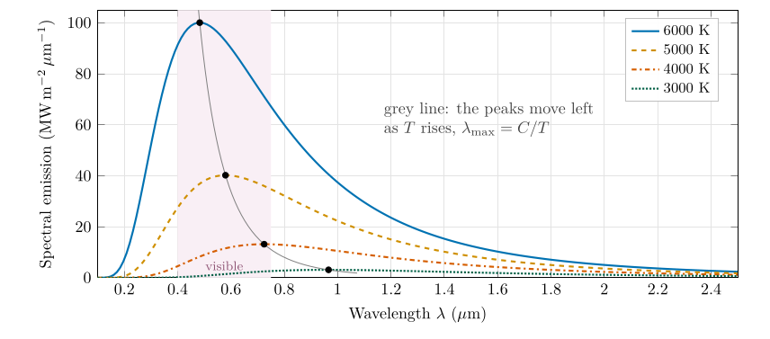

*This chapter answers Question 1.*

## 13.1 Hotter bodies peak at shorter wavelengths {#p2-sec:peakmoves}

Heat a piece of iron in a forge. At first it gives off only invisible infrared; then it glows dull red, then orange, then yellow-white. As it gets hotter, the colour of its glow moves towards shorter wavelengths. Figure [13.1](/teaching/atmosphere/p2-ch03_wien/#p2-fig:wienfamily) shows the same thing with Planck curves, Eq. ([12.3](/teaching/atmosphere/p2-ch02_radiation/#p2-eq:planck)): as the temperature rises, every curve gets taller, and its peak slides to the left.

\

**Figure 13.1.** Planck curves, Eq. ([12.3](/teaching/atmosphere/p2-ch02_radiation/#p2-eq:planck)), for four temperatures, drawn as the power emitted per square metre per micrometre of wavelength. The dots mark the peaks and the grey line joins them: the hotter the body, the shorter the wavelength of its peak (Wien’s law, Eq. ([13.1](/teaching/atmosphere/p2-ch03_wien/#p2-eq:wien))) and the larger the area under its curve (the Stefan–Boltzmann law, Eq. ([14.1](/teaching/atmosphere/p2-ch04_stefan/#p2-eq:sb))).

## 13.2 Wien’s displacement law {#p2-sec:wienlaw}

The wavelength of the peak is inversely proportional to the temperature: $$
\lambda_{\max}=\frac{C}{T}.\tag{13.1}
$$ *where*

|  |  |  |
|:---|:---|:---|
| $\lambda_{\max}$ | wavelength of peak emission ($\mu\mathrm{m}$) | read from a spectrum, or calculated |
| $C$ | Wien’s constant ($\mu\mathrm{m\,K}$) | 2898, rounded |
| $T$ | absolute temperature of the body (K) | calculated, or given |

“Inversely proportional” means that when one doubles the other halves: a body twice as hot peaks at half the wavelength. The constant $C$ is not arbitrary. It follows from finding the peak of the Planck curve, which is done step by step in Appendix [B.2.1](/teaching/atmosphere/app-p2/#p2-sec:der-wien); the result is $C=hc/(4.965\,k_B)=2897.8$ $\mu\mathrm{m\,K}$.

To find a temperature from a peak wavelength, multiply both sides of Eq. ([13.1](/teaching/atmosphere/p2-ch03_wien/#p2-eq:wien)) by $T$ and divide both sides by $\lambda_{\max}$: $$
T=\frac{C}{\lambda_{\max}}.\tag{13.2}
$$ *where*

|                          |                                          |     |
|:-------------------------|:-----------------------------------------|:----|
| $T,\ C,\ \lambda_{\max}$ | as in Eq. ([13.1](/teaching/atmosphere/p2-ch03_wien/#p2-eq:wien)) |     |

The units work out: $\mu\mathrm{m\,K}$ divided by $\mu\mathrm{m}$ leaves K. This is why $\lambda_{\max}$ must be in micrometres when $C=2898$ $\mu\mathrm{m\,K}$.

## 13.3 Question 1: the temperature of the Sun {#p2-sec:q1}

The question

If the wavelength emitted more than any other by the Sun is 0.5 $\mu\mathrm{m}$, what is the black-body temperature of the Sun in Celsius? Note the conversion from kelvin to Celsius is $\ensuremath{^{\circ}\mathrm{C}}=\mathrm{K}-273.16$.

**What the question asks, in plain words.** We know where the Sun’s spectrum peaks (0.5 $\mu\mathrm{m}$, in the blue-green part of the visible). Assuming the Sun is a black body, Wien’s law tells us what temperature produces a peak there.

**Method.**

1.  Write down the rearranged law, Eq. ([13.2](/teaching/atmosphere/p2-ch03_wien/#p2-eq:wienT)): $T=C/\lambda_{\max}$.

2.  Substitute $C=2898$ $\mu\mathrm{m\,K}$ and $\lambda_{\max}=0.5$ $\mu\mathrm{m}$: $$T_{\text{Sun}}=\frac{2898\ \ensuremath{\mu\mathrm{m\,K}}}{0.5\ \ensuremath{\mu\mathrm{m}}}=5796\ \mathrm{K}.$$

3.  Convert to Celsius with the offset the question gives: $$T_{\text{Sun}}=5796-273.16=5522.84\ \ensuremath{^{\circ}\mathrm{C}}\approx5523\ \ensuremath{^{\circ}\mathrm{C}}.$$

Answer to Question 1

$T_{\text{Sun}}=2898/0.5=\textbf{5796 K}$, which is $5796-273.16=\textbf{5522.8 }^{\circ}\mathrm{C}\textbf{}$ (about 5500 $^{\circ}\mathrm{C}$).

**Check.** Measurements give the Sun an effective temperature of 5772 K (Prša et al. 2016), within half a percent of our 5796 K: the small difference comes from rounding the peak to 0.5 $\mu\mathrm{m}$ (the exact value for 5772 K is 0.502 $\mu\mathrm{m}$). The order of magnitude is also sensible: a body of a few thousand kelvin glows white-hot, and the Sun’s peak lies in the visible, which is the light our eyes evolved to use.

**The 5796 K found here is used again** in Question 2a (§ [14.3](/teaching/atmosphere/p2-ch04_stefan/#p2-sec:q2a)) and Question 2c (§ [14.5](/teaching/atmosphere/p2-ch04_stefan/#p2-sec:q2c)).

A question that comes up

**Why does the answer say 5522.8 $^{\circ}\mathrm{C}$ and not 5522.85 $^{\circ}\mathrm{C}$?**\
The question subtracts 273.16; the exact offset between the kelvin and Celsius scales is 273.15 (Tiesinga et al. 2021). Either way the answer rounds to 5523 $^{\circ}\mathrm{C}$, and at the precision of a peak read as “0.5 $\mu\mathrm{m}$” the last digits mean nothing. Quote about 5500 $^{\circ}\mathrm{C}$ when you describe it in words.

A question that comes up

**If the Sun peaks in blue-green light, why does it look white, or yellow?**\
Because its spectrum is broad (Figure [12.3](/teaching/atmosphere/p2-ch02_radiation/#p2-fig:planck-sun-earth)): it emits strongly at all visible wavelengths, and the mixture looks white. Near the horizon, the long path through the air scatters blue light out of the beam, so the Sun looks yellow or red. The position of the peak also depends on how the spectrum is drawn (per unit wavelength, as here, or per unit frequency), so “the colour of the peak” is not the colour we see.

## 13.4 Wien’s law in practice {#p2-sec:wienuse}

- **Satellites.** A satellite cannot put a thermometer on the ground. It measures radiation in chosen wavelength bands and converts it to temperature with the radiation laws. Wien’s law tells the designer which band suits which target: about 10–12 $\mu\mathrm{m}$ for the land, sea and cloud tops (near 300 K and below), and about 4 $\mu\mathrm{m}$ for fires, which are far hotter.

- **Stars.** Astronomers read the temperature of a star from its colour: red stars are cool (around 3000 K) and blue-white stars hot (10 000 K or more).

- **Shortwave and longwave.** Because the Sun is about twenty times hotter than the Earth, Wien’s law puts its peak at a wavelength about twenty times shorter. This single fact separates solar from terrestrial radiation (Figure [12.3](/teaching/atmosphere/p2-ch02_radiation/#p2-fig:planck-sun-earth)) and makes the greenhouse effect possible (Chapter [17](/teaching/atmosphere/p2-ch07_balance/#p2-ch:balance)).

## 13.5 Try it yourself: Practice Set 13

Practice Set 13: Wien’s law

Use $C=2898$ $\mu\mathrm{m\,K}$ and $\ensuremath{^{\circ}\mathrm{C}}=\mathrm{K}-273.16$.

1.  The star Sirius has a surface temperature of about 9940 K. At what wavelength does it emit most, and in which part of the spectrum is that?

2.  Human skin is at about 33 $^{\circ}\mathrm{C}$. At what wavelength does it emit most?

3.  A star’s spectrum peaks at 1.0 $\mu\mathrm{m}$. What is its temperature in kelvin and in Celsius?

4.  A forest fire burns at about 1000 K. Where is its peak? Why do satellites look for fires near 4 $\mu\mathrm{m}$ rather than at 10 $\mu\mathrm{m}$?

5.  An ice cube at $-10$ $^{\circ}\mathrm{C}$ emits radiation. At what wavelength does it emit most?

Answers to Practice Set 13

1.  $\lambda_{\max}=2898/9940=0.29$ $\mu\mathrm{m}$: ultraviolet, Eq. ([13.1](/teaching/atmosphere/p2-ch03_wien/#p2-eq:wien)). Sirius looks blue-white.

2.  $T=33+273.16=306.16$ K, so $\lambda_{\max}=2898/306.16=9.47$ $\mu\mathrm{m}$, in the thermal infrared. Thermal cameras are built to see near this wavelength.

3.  $T=2898/1.0=2898$ K $=2624.8$ $^{\circ}\mathrm{C}$, Eq. ([13.2](/teaching/atmosphere/p2-ch03_wien/#p2-eq:wienT)). A cool, red star.

4.  $\lambda_{\max}=2898/1000=2.9$ $\mu\mathrm{m}$. Near 4 $\mu\mathrm{m}$ a fire emits far more than the cool ground around it (whose peak is near 10 $\mu\mathrm{m}$), so fires stand out clearly; at 10 $\mu\mathrm{m}$ the contrast is much smaller.

5.  $T=263.16$ K, so $\lambda_{\max}=2898/263.16=11.0$ $\mu\mathrm{m}$. Cold objects emit at longer wavelengths than warm ones.

## 13.6 Wien’s law in Python

These functions compute the equations of this chapter, and the book’s tests check them against its answers.

    def wien_temperature(peak_um):
        """Black-body temperature (K) from the wavelength of peak emission (micrometres)."""
        return WIEN_C / peak_um

`wien_temperature(0.5)` returns 5796.0.

## References

Prša, A., Harmanec, P., Torres, G., Mamajek, E. and others (2016) Nominal values for selected solar and planetary quantities: IAU 2015 Resolution B3. The Astronomical Journal 152, 41. <https://doi.org/10.3847/0004-6256/152/2/41>

Tiesinga, E., Mohr, P.J., Newell, D.B. and Taylor, B.N. (2021) CODATA recommended values of the fundamental physical constants: 2018. Reviews of Modern Physics 93, 025010. <https://doi.org/10.1103/RevModPhys.93.025010>

