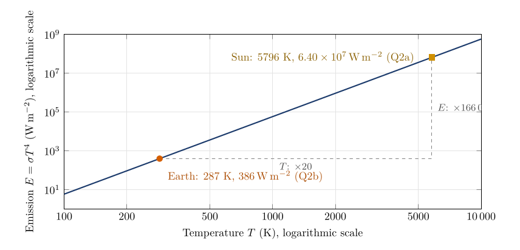

*This chapter answers Questions 2a to 2e.*

## 14.1 The total emission of a black body {#p2-sec:sblaw}

Wien’s law (Chapter [13](/teaching/atmosphere/p2-ch03_wien/#p2-ch:wien)) told us *where* a spectrum peaks. The Stefan–Boltzmann law tells us *how much* a body emits in total, adding up every wavelength: it is the area under the Planck curve: $$
E=\sigma T^{4}.\tag{14.1}
$$ *where*

|  |  |  |
|:---|:---|:---|
| $E$ | total radiation emitted per square metre of surface, the “intensity of radiation” ($\mathrm{W\,m^{-2}}$) | calculated |
| $\sigma$ | Stefan–Boltzmann constant ($\mathrm{W\,m^{-2}}$ K$^{-4}$) | $5.67\times10^{-8}$, rounded |
| $T$ | absolute temperature of the surface (K) | from Question 1, or given |

The law is derived from the Planck curve in Appendix [B.2.2](/teaching/atmosphere/app-p2/#p2-sec:der-sb): integrating Eq. ([12.3](/teaching/atmosphere/p2-ch02_radiation/#p2-eq:planck)) over all wavelengths gives exactly $T^{4}$ times a combination of constants, and that combination is $\sigma$.

It applies to a black body. A real surface emits a fraction $\epsilon$ (its emissivity, § [12.6](/teaching/atmosphere/p2-ch02_radiation/#p2-sec:blackbody)) of this: $E=\epsilon\sigma T^{4}$. For the Sun, and for most natural surfaces in the infrared, $\epsilon$ is close to 1, so Eq. ([14.1](/teaching/atmosphere/p2-ch04_stefan/#p2-eq:sb)) is a good approximation.

## 14.2 What a fourth power means {#p2-sec:fourth}

$T^{4}$ means $T\times T\times T\times T$. A fourth power grows very fast:

|                           |      |      |     |     |        |         |
|:--------------------------|:----:|:----:|:---:|:---:|:------:|:-------:|
| Temperature multiplied by | 1.1  | 1.5  |  2  |  3  |   10   |   20    |
| Emission multiplied by    | 1.46 | 5.06 | 16  | 81  | 10 000 | 160 000 |

A body only 10 % hotter emits 46 % more; a body twice as hot emits sixteen times as much. Figure [14.1](/teaching/atmosphere/p2-ch04_stefan/#p2-fig:sbcurve) shows this on a scale wide enough to hold both the Earth and the Sun.

\

**Figure 14.1.** The Stefan–Boltzmann law, Eq. ([14.1](/teaching/atmosphere/p2-ch04_stefan/#p2-eq:sb)), on logarithmic axes, where a power law becomes a straight line of slope 4. Going from the Earth to the Sun the temperature rises twenty-fold (Question 2c) but the emission rises 166 000-fold (Question 2d).

## 14.3 Question 2a: the emission of the Sun {#p2-sec:q2a}

The question

Using this equation, calculate how much radiation is emitted at the surface of the Sun.

**Method.** Use Eq. ([14.1](/teaching/atmosphere/p2-ch04_stefan/#p2-eq:sb)) with the Sun’s temperature from Question 1, $T=5796$ K (§ [13.3](/teaching/atmosphere/p2-ch03_wien/#p2-sec:q1)). Raise to the fourth power by squaring twice; this avoids slips on a calculator:

1.  $T^{2}=5796^{2}=3.3594\times10^{7}$.

2.  $T^{4}=(3.3594\times10^{7})^{2}=1.1285\times10^{15}$.

3.  $E_{\text{Sun}}=\sigma T^{4}=(5.67\times10^{-8})(1.1285\times10^{15})=6.399\times10^{7}$ $\mathrm{W\,m^{-2}}$.

When multiplying powers of ten, add the exponents: $10^{-8}\times10^{15}=10^{7}$.

Answer to Question 2a

$E_{\text{Sun}}=5.67\times10^{-8}\times5796^{4}=\textbf{6.40}\boldsymbol{\times}\textbf{10}^{\textbf{7}}$ $\mathrm{W\,m^{-2}}$: about 64 million watts from every square metre of the Sun’s surface.

**Check.** With the measured effective temperature of 5772 K (Prša et al. 2016) the same calculation gives $6.29\times10^{7}$ $\mathrm{W\,m^{-2}}$, within 2 %. Spread over the whole Sun, this emission is the Sun’s total power output, and diluted over the distance to the Earth it becomes the solar constant of Question 3c (see the worked example in § [14.8](/teaching/atmosphere/p2-ch04_stefan/#p2-sec:sunpower)).

## 14.4 Question 2b: the emission of the Earth {#p2-sec:q2b}

The question

If the Earth has a black-body temperature of 14 $^{\circ}\mathrm{C}$, what is its intensity of radiation?

**Method.**

1.  Convert to kelvin: $T=14+273.16=287.16$ K. The radiation laws need kelvin (§ [11.2](/teaching/atmosphere/p2-ch01_orientation/#p2-sec:conventions)).

2.  $T^{2}=287.16^{2}=82\,460.9$, and $T^{4}=82\,460.9^{2}=6.7998\times10^{9}$.

3.  $E_{\text{Earth}}=(5.67\times10^{-8})(6.7998\times10^{9})=385.5$ $\mathrm{W\,m^{-2}}$.

Answer to Question 2b

$E_{\text{Earth}}=5.67\times10^{-8}\times287.16^{4}=\textbf{385.5\,\ensuremath{\mathrm{W\,m^{-2}}}}$.

**Check.** Observed energy budgets put the emission of the Earth’s surface at about 396 $\mathrm{W\,m^{-2}}$ (Trenberth et al. 2009), close to our value (the real surface is a little warmer in places and the fourth power weights warm places heavily). Notice that 385.5 $\mathrm{W\,m^{-2}}$ is *more* than the Earth receives from the Sun on average (about 240 $\mathrm{W\,m^{-2}}$ absorbed, Question 4c). That surplus is supplied by the atmosphere radiating back down to the surface: the greenhouse effect of Chapter [17](/teaching/atmosphere/p2-ch07_balance/#p2-ch:balance).

Where the bracket goes

Only the temperature is raised to the fourth power: $E=5.67\times10^{-8}\times(287.16)^{4}$, not $(5.67\times10^{-8}\times287.16)^{4}$, which would give about $7\times10^{-20}$.

## 14.5 Question 2c: how many times hotter is the Sun? {#p2-sec:q2c}

The question

How many times warmer is the Sun than the Earth (solar temperature in kelvin / Earth temperature in kelvin)?

**Method.** Divide the two temperatures, both in kelvin, from Questions 1 and 2b: $$\frac{T_{\text{Sun}}}{T_{\text{Earth}}}=\frac{5796\ \mathrm{K}}{287.16\ \mathrm{K}}=20.18 .$$

Answer to Question 2c

The Sun is $5796/287.16\approx\textbf{20 times}$ hotter than the Earth (20.18), measured on the kelvin scale.

Kelvin, not Celsius

Ratios of temperatures only make sense on the kelvin scale, which starts at absolute zero. On the Celsius scale they are meaningless: 20 $^{\circ}\mathrm{C}$ is not “twice as hot” as 10 $^{\circ}\mathrm{C}$ (in kelvin it is $293.16/283.16=1.035$ times as hot), and nothing is “$-2$ times” as hot as $-10$ $^{\circ}\mathrm{C}$.

## 14.6 Question 2d: how many times more does the Sun emit? {#p2-sec:q2d}

The question

How many more times is the Sun’s radiation more intense than the Earth’s?

**Method.** Divide the emissions from Questions 2a and 2b: $$\frac{E_{\text{Sun}}}{E_{\text{Earth}}}=\frac{6.399\times10^{7}\ \ensuremath{\mathrm{W\,m^{-2}}}}{385.5\ \ensuremath{\mathrm{W\,m^{-2}}}}=1.660\times10^{5}.$$

Answer to Question 2d

Each square metre of the Sun emits about **166 000 times** as much radiation as a square metre of the Earth.

## 14.7 Question 2e: why the two ratios are so different {#p2-sec:q2e}

The question

How do you explain the difference between your answer to Question 2c and 2d?

**The idea.** Write Eq. ([14.1](/teaching/atmosphere/p2-ch04_stefan/#p2-eq:sb)) for both bodies and divide. The constant $\sigma$ cancels, and only the ratio of temperatures remains, raised to the fourth power: $$
\frac{E_{\text{Sun}}}{E_{\text{Earth}}}=\frac{\sigma T_{\text{Sun}}^{4}}{\sigma T_{\text{Earth}}^{4}}=\left(\frac{T_{\text{Sun}}}{T_{\text{Earth}}}\right)^{4}.\tag{14.2}
$$ *where*

|  |  |  |
|:---|:---|:---|
| $E_{\text{Sun}},\ E_{\text{Earth}}$ | emissions per square metre ($\mathrm{W\,m^{-2}}$) | Questions 2a and 2b |
| $T_{\text{Sun}},\ T_{\text{Earth}}$ | temperatures (K) | 5796 and 287.16 |

So the emission ratio is the temperature ratio of Question 2c raised to the fourth power: $20.18^{4}=20.18\times20.18\times20.18\times20.18=1.660\times10^{5}$, exactly the answer to Question 2d.

Answer to Question 2e

Emission depends on the **fourth power** of temperature, Eq. ([14.1](/teaching/atmosphere/p2-ch04_stefan/#p2-eq:sb)). The Sun is about 20 times hotter, so it emits about $20^{4}=160\,000$ times more per square metre (precisely $20.18^{4}=166\,000$). A modest difference in temperature becomes an enormous difference in emission.

A power law, not an exponential

If $T$ doubles, $E$ becomes 16 times greater, but that does not make the change exponential. In an *exponential* relationship, such as $E\propto e^{kT}$, the temperature sits in the exponent and every equal step in $T$ multiplies $E$ by the same factor. In the Stefan–Boltzmann law the exponent is fixed at 4 and the temperature is the base: this is a **power law**, $E\propto T^{4}$. An exponential eventually outgrows any power law, and on the log–log axes of Figure [14.1](/teaching/atmosphere/p2-ch04_stefan/#p2-fig:sbcurve) a power law is a straight line while an exponential is not. Say “$E$ is proportional to the fourth power of $T$”.

## 14.8 From the Sun’s surface to the Earth {#p2-sec:sunpower}

Questions 2a and 3c are linked. The Sun’s surface emits $\sigma T^{4}$ per square metre; this energy spreads out over ever larger spheres as it travels, so by the time it reaches the Earth it has been diluted to the solar constant $S$.

Worked example: the solar constant from the Sun’s temperature

The Sun’s radius is $R_\odot=6.957\times10^{8}$ m and the Earth–Sun distance is $d=1.496\times10^{11}$ m (Prša et al. 2016). The Sun’s total power is its emission per square metre times its surface area $4\pi R_\odot^{2}$: $$P=\sigma T^{4}\times4\pi R_\odot^{2}=(6.399\times10^{7})\times4\pi(6.957\times10^{8})^{2}=3.89\times10^{26}\ \text{W}.$$ At the Earth this power is spread over a sphere of radius $d$, so each square metre facing the Sun receives $$S=\frac{P}{4\pi d^{2}}=\frac{3.89\times10^{26}}{4\pi(1.496\times10^{11})^{2}}=1384\ \ensuremath{\mathrm{W\,m^{-2}}}.$$ With the measured 5772 K the same steps give 1361 $\mathrm{W\,m^{-2}}$, the value measured by satellites (Kopp and Lean 2011). The 1368 $\mathrm{W\,m^{-2}}$ used in this part is an older measurement of the same quantity. The dilution with distance, $S\propto1/d^{2}$, is the inverse-square law used for the planets in Chapter [16](/teaching/atmosphere/p2-ch06_planets/#p2-ch:planets), Eq. ([16.1](/teaching/atmosphere/p2-ch06_planets/#p2-eq:invsq)).

## 14.9 Questions that come up

A question that comes up

**Question 2b calls 14 $^{\circ}\mathrm{C}$ the Earth’s “black-body temperature”. Later the Earth’s black-body temperature is 255 K ($-18$ $^{\circ}\mathrm{C}$). Which is right?**\
They are two different things. 14 $^{\circ}\mathrm{C}$ (287 K) is the average temperature of the Earth’s *surface*, and Question 2b treats that surface as a black body. 255 K is the temperature the *planet as a whole* must have to send back to space as much energy as it absorbs (Questions 3c and 4d). The 33 K difference between them is the greenhouse effect (§ [17.7](/teaching/atmosphere/p2-ch07_balance/#p2-sec:q4e)).

A question that comes up

**My calculator shows 6.3988E7. How do I write that?**\
“E7” means “times ten to the power 7”: $6.3988\times10^{7}$ $\mathrm{W\,m^{-2}}$, or 63 988 000 $\mathrm{W\,m^{-2}}$. Round to three or four significant figures, $6.40\times10^{7}$ $\mathrm{W\,m^{-2}}$.

## 14.10 Try it yourself: Practice Set 14

Practice Set 14: the Stefan–Boltzmann law

Use $\sigma=5.67\times10^{-8}$ $\mathrm{W\,m^{-2}}$ K$^{-4}$ and $\ensuremath{^{\circ}\mathrm{C}}=\mathrm{K}-273.16$.

1.  How much does a black body at 0 $^{\circ}\mathrm{C}$ emit?

2.  By what percentage does the emission rise if the temperature rises by 10 %?

3.  What temperature must a black body have to emit 1000 $\mathrm{W\,m^{-2}}$? Give kelvin and Celsius.

4.  The Earth’s surface warms from 287.16 K to 288.16 K. By how much does its emission increase?

5.  Using the worked example in § [14.8](/teaching/atmosphere/p2-ch04_stefan/#p2-sec:sunpower), explain in one sentence why the Earth receives only about 1368 $\mathrm{W\,m^{-2}}$ from a Sun that emits $6.4\times10^{7}$ $\mathrm{W\,m^{-2}}$.

Answers to Practice Set 14

1.  $E=5.67\times10^{-8}\times273.16^{4}=315.7$ $\mathrm{W\,m^{-2}}$, Eq. ([14.1](/teaching/atmosphere/p2-ch04_stefan/#p2-eq:sb)).

2.  $1.1^{4}=1.464$, so the emission rises by 46 %, Eq. ([14.2](/teaching/atmosphere/p2-ch04_stefan/#p2-eq:ratio4)).

3.  $T=(E/\sigma)^{1/4}=(1000/5.67\times10^{-8})^{1/4}=364.4$ K $=91.3$ $^{\circ}\mathrm{C}$. The rearrangement is Eq. ([17.3](/teaching/atmosphere/p2-ch07_balance/#p2-eq:Tinv)).

4.  $5.67\times10^{-8}\times(288.16^{4}-287.16^{4})=5.40$ $\mathrm{W\,m^{-2}}$. One kelvin of warming adds about 5.4 $\mathrm{W\,m^{-2}}$ of emission; this is why warming is a strong brake on further warming.

5.  The Sun’s energy spreads over a sphere whose area grows with the square of the distance; at 150 million kilometres each square metre receives only $(R_\odot/d)^{2}=1/46\,000$ of what each square metre of the Sun emits.

## 14.11 Emission in Python

These functions compute the equations of this chapter, and the book’s tests check them against its answers.

    def wien_peak(t_k):
        """Wavelength of peak emission (micrometres) at temperature t_k."""
        return WIEN_C / t_k

    def emission(t_k):
        """Stefan-Boltzmann law: emission (W per square metre) at temperature t_k."""
        return SIGMA * t_k ** 4

`emission(5796)` returns about $6.399\times10^{7}$ and `emission(287.16)` about 385.5.

Kopp, G. and Lean, J.L. (2011) A new, lower value of total solar irradiance: Evidence and climate significance. Geophysical Research Letters 38, L01706. <https://doi.org/10.1029/2010GL045777>

Prša, A., Harmanec, P., Torres, G., Mamajek, E. and others (2016) Nominal values for selected solar and planetary quantities: IAU 2015 Resolution B3. The Astronomical Journal 152, 41. <https://doi.org/10.3847/0004-6256/152/2/41>

Trenberth, K.E., Fasullo, J.T. and Kiehl, J. (2009) Earth’s global energy budget. Bulletin of the American Meteorological Society 90, 311–324. <https://doi.org/10.1175/2008BAMS2634.1>

