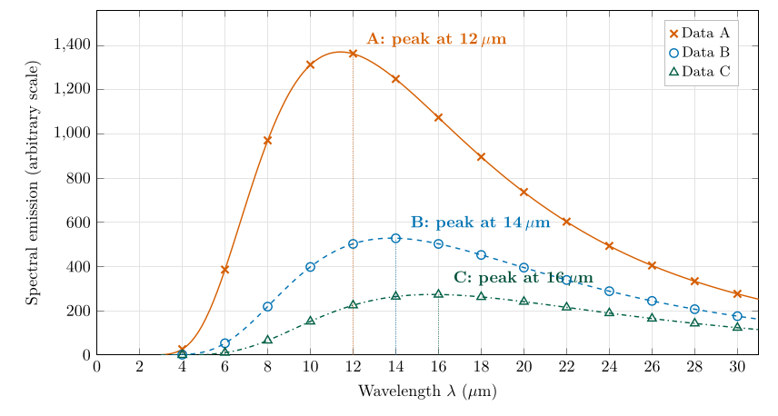

*This chapter answers the graph of Question 3 and Questions 3a and 3b.*

## 15.1 The data {#p2-sec:q3data}

Table [15.1](/teaching/atmosphere/p2-ch05_spectra/#p2-tab:q3data) gives the spectral emission of three black bodies, labelled Data A, B and C, at fourteen wavelengths from 4 to 30 $\mu\mathrm{m}$Ėach column is one planet; the task is to plot all three on one graph, read off where each peaks, and use Wien’s law to find each planet’s temperature.

| **Wavelength ($\mu\mathrm{m}$)** | **Data A** | **Data B** | **Data C** |
|---------------------------------:|-----------:|-----------:|-----------:|
|                                4 |     26.199 |     1.3338 |    0.11992 |
|                                6 |     386.28 |     53.056 |     10.648 |
|                                8 |     970.65 |     218.86 |     65.619 |
|                               10 |     1313.3 |     398.14 |      151.8 |
|                               12 | **1363.5** |     502.49 |      224.7 |
|                               14 |     1248.6 | **527.86** |     264.23 |
|                               16 |     1074.3 |     502.41 | **273.39** |
|                               18 |     896.25 |     452.58 |     262.51 |
|                               20 |      737.1 |     395.22 |     241.03 |
|                               22 |      603.1 |     339.25 |     215.38 |
|                               24 |     493.45 |     288.62 |     189.36 |
|                               26 |     404.91 |     244.61 |     164.92 |
|                               28 |     333.76 |     207.16 |      142.9 |
|                               30 |     276.58 |     175.67 |     123.56 |

: Table 15.1. The data of Question 3. The largest value in each column is in bold. The same table, with the values computed from the Planck curve, is in Appendix [B.3](/teaching/atmosphere/app-p2/#p2-app:data).

A note on the units of the data

The columns are headed “Irradiance, W m$^{-2}$”. Strictly these are *spectral* values: emission per square metre *per micrometre of wavelength* ($\mathrm{W\,m^{-2}\,\mu m^{-1}}$), on an arbitrary scale. Recomputing them shows that each column is a Planck curve, Eq. ([12.3](/teaching/atmosphere/p2-ch02_radiation/#p2-eq:planck)), multiplied by the same constant (about 316) for all three (Appendix [B.3](/teaching/atmosphere/app-p2/#p2-app:data)). The units do not affect any answer, because the questions only use *where* each curve peaks and how the curves compare.

## 15.2 How to plot the graph {#p2-sec:howplot}

1.  **Axes.** Wavelength ($\mu\mathrm{m}$) along the bottom, from 0 to 30. Emission up the side, from 0 to at least 1400, since the largest value is 1363.5.

2.  **Scale.** Choose round steps that use most of the paper: for example 2 $\mu\mathrm{m}$ per major division across and 100 or 200 per division up.

3.  **Plot each data set with its own symbol** (for example crosses for A, circles for B and triangles for C), so that the graph still reads correctly in black and white.

4.  **Join the points with a smooth curve**, not with straight lines. The underlying spectrum is smooth (§ [12.7](/teaching/atmosphere/p2-ch02_radiation/#p2-sec:planck)); straight segments would put the peak exactly on a data point, which hides the fact that the true peak may lie between two points.

5.  **Label** each curve (A, B, C), the axes with quantity and unit, and give the graph a title.

\

**Figure 15.1.** The graph of Question 3. Symbols are the values of the table; the smooth lines are the Planck curves that pass through them (254.1, 210.0 and 184.1 K; Appendix [B.3](/teaching/atmosphere/app-p2/#p2-app:data)). The dotted lines mark the highest data point of each set, which is the answer to Question 3a.

## 15.3 Question 3a: the wavelength of the peak {#p2-sec:q3a}

The question

At what wavelength does the maximum intensity occur for each data set?

**Method.** Find the largest number in each column of Table [15.1](/teaching/atmosphere/p2-ch05_spectra/#p2-tab:q3data) (in bold), or the highest point of each curve in Figure [15.1](/teaching/atmosphere/p2-ch05_spectra/#p2-fig:q3plot), and read its wavelength.

Answer to Question 3a

Data A: $\lambda_{\max}=\textbf{12 }\mu\mathrm{m}\textbf{}$ (1363.5). Data B: $\lambda_{\max}=\textbf{14 }\mu\mathrm{m}\textbf{}$ (527.86). Data C: $\lambda_{\max}=\textbf{16 }\mu\mathrm{m}\textbf{}$ (273.39).

**Check.** The curve with the highest peak (A) peaks furthest to the left, and the lowest (C) furthest to the right. That is what Wien’s law and the Stefan–Boltzmann law together predict (Figure [13.1](/teaching/atmosphere/p2-ch03_wien/#p2-fig:wienfamily)): the hottest body is both the brightest and the shortest in wavelength. All three peaks lie in the thermal infrared, as they must for planets far cooler than the Sun.

## 15.4 Question 3b: the temperatures of the three planets {#p2-sec:q3b}

The question

Using Wien’s law, calculate the black-body temperature for the three planets.

**Method.** Use the rearranged Wien’s law, Eq. ([13.2](/teaching/atmosphere/p2-ch03_wien/#p2-eq:wienT)), $T=C/\lambda_{\max}$, with $C=2898$ $\mu\mathrm{m\,K}$ and the peaks from Question 3a: $$\begin{align*}
T_A&=\frac{2898}{12}=241.5\ \mathrm{K},\\
T_B&=\frac{2898}{14}=207.0\ \mathrm{K},\\
T_C&=\frac{2898}{16}=181.1\ \mathrm{K}.
\end{align*}$$

Answer to Question 3b

$T_A=\textbf{241.5 K}$ ($-31.7$ $^{\circ}\mathrm{C}$), $T_B=\textbf{207.0 K}$ ($-66.2$ $^{\circ}\mathrm{C}$), $T_C=\textbf{181.1 K}$ ($-92.0$ $^{\circ}\mathrm{C}$).

**Check.** The order is right: A is the warmest and C the coldest, matching the heights of the curves. The values are cold, which is reasonable for planets heated by a distant Sun; Chapter [16](/teaching/atmosphere/p2-ch06_planets/#p2-ch:planets) identifies which planet each curve belongs to.

Why these temperatures are a little too low

The data are given only every 2 $\mu\mathrm{m}$, so the highest *data point* is not exactly the *peak* of the curve. Fitting the Planck curve to each column (Appendix [B.3](/teaching/atmosphere/app-p2/#p2-app:data)) shows that the true peaks are at 11.4, 13.8 and 15.7 $\mu\mathrm{m}$, and the true temperatures are **254.1, 210.0 and 184.1 K**. Reading the nearest point puts every peak slightly too far to the right, and so every temperature slightly too low; the error is largest for A (12 instead of 11.4 $\mu\mathrm{m}$, so 241.5 instead of 254 K). The answers above are the right answers to the question as set; the true values matter in Chapter [16](/teaching/atmosphere/p2-ch06_planets/#p2-ch:planets), where they match the calculated planetary temperatures almost exactly.

A question that comes up

**Could I find the peak more accurately from the data?**\
Partly. Fitting a parabola through the three highest points of a column and taking its top moves the A peak from 12 to 11.6 $\mu\mathrm{m}$ (249.7 K), closer to the truth. It does much less for B and C, because a Planck curve is lopsided (steep on the short-wave side, with a long tail) while a parabola is symmetric. The reliable way is to fit the Planck curve itself, as in Appendix [B.3](/teaching/atmosphere/app-p2/#p2-app:data), or to take readings closer together near the peak.

## 15.5 What the graph shows {#p2-sec:q3meaning}

- **The curves never cross.** At every wavelength the warmer body emits more. This is a property of all Planck curves: heating a black body raises its emission at every wavelength.

- **The area under each curve** is the total emission, which grows as $T^{4}$, Eq. ([14.1](/teaching/atmosphere/p2-ch04_stefan/#p2-eq:sb)). With the true temperatures, A emits $(254.1/184.1)^{4}=3.6$ times as much in total as C.

- **The gap between the curves is largest on the short-wave side.** At 10 $\mu\mathrm{m}$ A emits 8.7 times as much as C; at 30 $\mu\mathrm{m}$ only 2.2 times. Short wavelengths are the most sensitive to temperature, which is why the peak moves (Wien’s law) and why satellites measuring fires use short infrared bands (§ [13.4](/teaching/atmosphere/p2-ch03_wien/#p2-sec:wienuse)).

## 15.6 Try it yourself: Practice Set 15

Practice Set 15: reading spectra

1.  If you had readings every 0.2 $\mu\mathrm{m}$ near the top of curve A, you would find its peak at 11.4 $\mu\mathrm{m}$. What temperature does that give?

2.  Using Table [15.1](/teaching/atmosphere/p2-ch05_spectra/#p2-tab:q3data), how many times more does A emit than C at 10 $\mu\mathrm{m}$? At 30 $\mu\mathrm{m}$? Why are the two ratios different?

3.  A fourth planet’s spectrum peaks near 25 $\mu\mathrm{m}$. What is its temperature, and which planet of Table [16.1](/teaching/atmosphere/p2-ch06_planets/#p2-tab:planets) might it be?

4.  Explain in one sentence why two Planck curves for different temperatures can never cross.

Answers to Practice Set 15

1.  $T=2898/11.4=254.2$ K, Eq. ([13.2](/teaching/atmosphere/p2-ch03_wien/#p2-eq:wienT)). That is the Earth’s calculated black-body temperature (Question 3c).

2.  $1313.3/151.8=8.7$ at 10 $\mu\mathrm{m}$; $276.58/123.56=2.2$ at 30 $\mu\mathrm{m}$. Emission on the short-wave side of the peak depends far more strongly on temperature than on the long-wave tail, Eq. ([12.3](/teaching/atmosphere/p2-ch02_radiation/#p2-eq:planck)).

3.  $T=2898/25=116$ K: Jupiter, whose calculated black-body temperature is 110 K (Question 3c).

4.  Raising $T$ in Eq. ([12.3](/teaching/atmosphere/p2-ch02_radiation/#p2-eq:planck)) makes the exponential in the denominator smaller at every wavelength, so the emission rises at every wavelength and the warmer curve lies above the cooler one everywhere.

