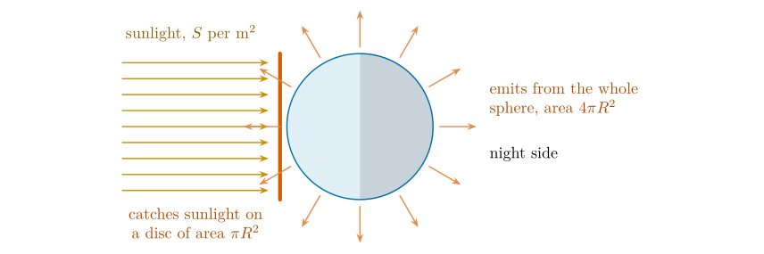
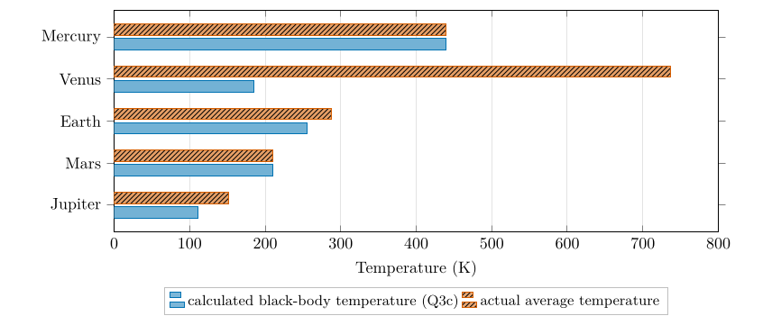

*This chapter answers Questions 3c, 3d and 3e.*

## 16.1 A planet in balance {#p2-sec:balanceidea}

A planet is heated by the Sun and cools by radiating to space. If it absorbed more than it emitted it would warm up; warming raises its emission as $T^{4}$, Eq. ([14.1](/teaching/atmosphere/p2-ch04_stefan/#p2-eq:sb)), until the two are equal. A planet that has settled is therefore **in radiative balance**: $$\text{solar energy absorbed}=\text{infrared energy emitted}.$$ The temperature at which this happens is the planet’s **equilibrium** or **black-body temperature**. To calculate it we need three things: how much sunlight arrives (the solar constant $S$), how much of it is reflected (the albedo $a$), and the geometry of a sphere.

## 16.2 Sunlight at each planet: the inverse-square law {#p2-sec:invsq}

Sunlight spreads out over ever larger spheres as it travels from the Sun (§ [14.8](/teaching/atmosphere/p2-ch04_stefan/#p2-sec:sunpower)). The area of a sphere grows with the square of its radius, so the energy reaching each square metre falls with the square of the distance: $$
S=\frac{S_{E}}{d^{2}}.\tag{16.1}
$$ *where*

|  |  |  |
|:---|:---|:---|
| $S$ | solar constant at the planet: sunlight per square metre facing the Sun, at the top of the atmosphere ($\mathrm{W\,m^{-2}}$) | calculated; listed in the table |
| $S_{E}$ | solar constant at the Earth ($\mathrm{W\,m^{-2}}$) | 1368, an older measurement |
| $d$ | planet’s distance from the Sun, in astronomical units (AU; Earth–Sun $=1$) | listed in the table |

The values in the table follow this law exactly. For Mars, $d=1.52$ AU, so $S=1368/1.52^{2}=1368/2.310=592$ $\mathrm{W\,m^{-2}}$: at one and a half times the distance, Mars receives only 43 % of the Earth’s sunlight. For Mercury, $1368/0.39^{2}=8994$ $\mathrm{W\,m^{-2}}$, six and a half times the Earth’s.

## 16.3 Albedo {#p2-sec:albedo}

Definition

The **albedo** $a$ of a surface or a planet is the fraction of the sunlight falling on it that is reflected, from 0 (absorbs everything) to 1 (reflects everything). The fraction absorbed is $1-a$.

Fresh snow and thick cloud reflect most sunlight (albedo up to 0.8–0.9); forests, soils and especially open water reflect little (water below about 0.1 with the Sun high in the sky) (Ahrens and Henson 2022, ch. 2). A planet’s overall albedo, called its *Bond albedo*, is the average over its whole sunlit side, cloud included: about 0.3 for the Earth (Forster et al. 2021).

## 16.4 The black-body temperature of a planet {#p2-sec:Tp}

\

**Figure 16.1.** Why the solar constant is divided by four. A planet intercepts sunlight over a disc of area $\pi R^{2}$ (its shadow) but radiates from its whole surface, $4\pi R^{2}$, day and night side alike. Averaged over the sphere, each square metre receives $S/4$.

Set the energy absorbed equal to the energy emitted, for a planet of radius $R$ (Figure [16.1](/teaching/atmosphere/p2-ch06_planets/#p2-fig:disc)): $$\begin{align*}
\text{absorbed}&=S\,(1-a)\times\pi R^{2}, &&\text{(sunlight on the disc, minus what is reflected)}\\
\text{emitted}&=\sigma T^{4}\times4\pi R^{2}. &&\text{(Stefan--Boltzmann law, Eq.~([14.1](/teaching/atmosphere/p2-ch04_stefan/#p2-eq:sb)), over the whole sphere)}
\end{align*}$$ Setting them equal and cancelling $\pi R^{2}$ from both sides, the size of the planet drops out: $$S\,(1-a)=4\sigma T^{4}\quad\Longrightarrow\quad T^{4}=\frac{S\,(1-a)}{4\sigma},$$ and taking the fourth root of both sides gives the formula in the hint to Question 3c: $$
T=\left[\frac{S\,(1-a)}{4\sigma}\right]^{1/4}.\tag{16.2}
$$ *where*

|  |  |  |
|:---|:---|:---|
| $T$ | black-body (equilibrium) temperature of the planet (K) | calculated |
| $S$ | solar constant at the planet ($\mathrm{W\,m^{-2}}$) | in the table; Eq. ([16.1](/teaching/atmosphere/p2-ch06_planets/#p2-eq:invsq)) |
| $a$ | planet’s albedo (0 to 1) | in the table |
| $\sigma$ | Stefan–Boltzmann constant | $5.67\times10^{-8}$ $\mathrm{W\,m^{-2}}$ K$^{-4}$ |
| $4$ | ratio of the sphere’s area to the disc’s, Figure [16.1](/teaching/atmosphere/p2-ch06_planets/#p2-fig:disc) | geometry |

A fourth root is a square root taken twice; on a calculator use $x^{0.25}$ or press $\sqrt{\ }$ twice.

## 16.5 Question 3c: calculating the temperatures {#p2-sec:q3c}

The question

Using the table below, calculate the black-body temperatures $T$ for the following planets (hint: $T=[S(1-a)/(4\sigma)]^{1/4}$).

Worked example: the Earth, step by step

1.  Absorbed sunlight per square metre of disc: $S(1-a)=1368\times(1-0.3)=1368\times0.7=957.6$ $\mathrm{W\,m^{-2}}$.

2.  Divide by $4\sigma=4\times5.67\times10^{-8}=2.268\times10^{-7}$: $957.6/2.268\times10^{-7}=4.2222\times10^{9}$ K$^{4}$.

3.  Square root: $\sqrt{4.2222\times10^{9}}=64\,979$.

4.  Square root again: $\sqrt{64\,979}=254.9$ K.

So $T_{\text{Earth}}=254.9$ K, or $254.9-273.16=-18.3$ $^{\circ}\mathrm{C}$.

The same four steps for every planet give Table [16.1](/teaching/atmosphere/p2-ch06_planets/#p2-tab:planets).

| **Planet** | **$d$ (AU)** | **$S$ ($\mathrm{W\,m^{-2}}$)** | **$a$** | **$S(1-a)$** | **$T$ calc. (K)** | **actual (K)** | **difference** |
|:---|---:|---:|---:|---:|---:|---:|---:|
| Mercury | 0.39 | 8994 | 0.06 | 8454.4 | **439.4** | 440 | $+0.6$ |
| Venus | 0.72 | 2639 | 0.90 | 263.9 | **184.7** | 737 | $+552.3$ |
| Earth | 1.00 | 1368 | 0.30 | 957.6 | **254.9** | 288 | $+33.1$ |
| Mars | 1.52 | 592 | 0.25 | 444.0 | **210.3** | 210 | $-0.3$ |
| Jupiter | 5.18 | 51 | 0.34 | 33.7 | **110.4** | 152 | $+41.6$ |

: Table 16.1. Question 3c completed. The first four columns and the last but one are given; $S(1-a)$ and $T$ are calculated with Eq. ([16.2](/teaching/atmosphere/p2-ch06_planets/#p2-eq:Tp)); the last column is the actual minus the calculated temperature.

Answer to Question 3c

Mercury **439 K**, Venus **185 K**, Earth **255 K**, Mars **210 K**, Jupiter **110 K** (to the nearest kelvin; Table [16.1](/teaching/atmosphere/p2-ch06_planets/#p2-tab:planets)).

**Check.** The temperatures fall with distance from the Sun, as expected, with one exception: Venus is calculated colder than the Earth although it is closer to the Sun. Question 3e asks why. NASA’s fact sheets, which use slightly different solar constants and albedos, give black-body temperatures of 439.6 K for Mercury, 254.0 K for the Earth, 209.8 K for Mars and 109.9 K for Jupiter (Williams 2024), all within a kelvin or so of ours.

## 16.6 Question 3d: which spectrum belongs to which planet? {#p2-sec:q3d}

The question

Using the temperatures from the table above, link the data sets you plotted previously with the planet.

**Method.** Compare the temperatures from the spectra (Question 3b, § [15.4](/teaching/atmosphere/p2-ch05_spectra/#p2-sec:q3b)) with the calculated temperatures in Table [16.1](/teaching/atmosphere/p2-ch06_planets/#p2-tab:planets), and pair each data set with the closest planet.

|  | **From the peak (Q3b)** | **From the full curve (§ [15.4](/teaching/atmosphere/p2-ch05_spectra/#p2-sec:q3b))** | **Closest planet (Q3c)** |
|:---|:--:|:--:|:--:|
| Data A | 241.5 K | 254.1 K | Earth, 254.9 K |
| Data B | 207.0 K | 210.0 K | Mars, 210.3 K |
| Data C | 181.1 K | 184.1 K | Venus, 184.7 K |

Answer to Question 3d

Data A: **Earth**. Data B: **Mars**. Data C: **Venus**.

**Check.** No other pairing works: Mercury (439 K) would peak near 6.6 $\mu\mathrm{m}$ and Jupiter (110 K) near 26 $\mu\mathrm{m}$, Eq. ([13.1](/teaching/atmosphere/p2-ch03_wien/#p2-eq:wien)), both outside the three peaks we found. Fitted to the full curves, the three data sets match the calculated temperatures to within one kelvin: the spectra of Table [15.1](/teaching/atmosphere/p2-ch05_spectra/#p2-tab:q3data) correspond to exactly these planetary temperatures.

## 16.7 Question 3e: why the real temperatures differ {#p2-sec:q3e}

The question

Using the table you constructed, explain: (i) why Mars is theoretically colder than Earth; (ii) why Venus is theoretically colder than Earth; (iii) what the actual surface temperature of Venus is, how you explain the difference between the theoretical and actual temperature, and which process could be causing this; (iv) of all these planets, Mercury is the only one that has an actual average temperature which is the same as its black-body temperature. Why is that?

\

**Figure 16.2.** Calculated and actual temperatures from Table [16.1](/teaching/atmosphere/p2-ch06_planets/#p2-tab:planets). Where the bars match (Mercury, Mars) there is little or no atmosphere; where the actual temperature is higher, an atmosphere traps heat (Venus, Earth) or the planet has an internal source of heat (Jupiter).

### (i) Why Mars is theoretically colder than the Earth {#i-why-mars-is-theoretically-colder-than-the-earth .unnumbered}

Mars is 1.52 times as far from the Sun, so by the inverse-square law, Eq. ([16.1](/teaching/atmosphere/p2-ch06_planets/#p2-eq:invsq)), it receives only $1/1.52^{2}=43\,\%$ of the Earth’s sunlight: 592 against 1368 $\mathrm{W\,m^{-2}}$. Its albedo is a little lower (0.25 against 0.30), so it absorbs a slightly larger fraction, but that cannot make up for receiving less than half as much. It absorbs 444 $\mathrm{W\,m^{-2}}$ (per square metre of disc) against the Earth’s 957.6, and $T$ scales as the fourth root of that: $(444/957.6)^{1/4}=0.825$, so $0.825\times254.9=210$ K.

### (ii) Why Venus is theoretically colder than the Earth {#ii-why-venus-is-theoretically-colder-than-the-earth .unnumbered}

Venus is closer to the Sun and receives almost twice the Earth’s sunlight (2639 $\mathrm{W\,m^{-2}}$). But it is wrapped in a permanent, bright cloud deck that reflects most of that light: with an albedo of 0.9 it absorbs only 10 %, which is $263.9$ $\mathrm{W\,m^{-2}}$, less than a third of what the Earth absorbs and even less than Mars. **Albedo, not distance, controls its black-body temperature.**

### (iii) The actual surface temperature of Venus {#iii-the-actual-surface-temperature-of-venus .unnumbered}

The actual average surface temperature of Venus is about **737 K (464 $^{\circ}\mathrm{C}$)** (Williams 2024), hot enough to melt lead, and almost the same by day and by night. That is 552 K hotter than its black-body temperature. The process responsible is the **greenhouse effect**. Venus has a very thick atmosphere (a surface pressure of 92 bar, about ninety times the Earth’s), made almost entirely of carbon dioxide, which absorbs the infrared radiation emitted by the surface (Chapter [17](/teaching/atmosphere/p2-ch07_balance/#p2-ch:balance)). Only the cold upper atmosphere can radiate freely to space, and it does so at roughly the black-body temperature; to push the energy up through such a thick, opaque atmosphere, the surface must be extremely hot (Pierrehumbert 2011).

### (iv) Why Mercury’s actual and black-body temperatures agree {#iv-why-mercurys-actual-and-black-body-temperatures-agree .unnumbered}

Mercury has practically no atmosphere (a surface pressure of less than $10^{-14}$ bar; (Williams 2024)). With no gases to absorb its infrared emission, nothing traps heat, so the surface radiates straight to space exactly as the black-body calculation assumes. Its *average* temperature therefore matches: 440 against 439 K. (The average hides a huge range: with no atmosphere to carry heat around, the sunlit side reaches 590–725 K and the night side is far colder.)

Answer to Question 3e

1.  Mars is further from the Sun (1.52 AU) and receives only 43 % of the Earth’s sunlight (inverse-square law), so it absorbs less and is colder, despite its slightly lower albedo.

2.  Venus has a very high albedo (0.9 in the table): its bright clouds reflect most sunlight, so it absorbs less than a third of what the Earth absorbs, although it is closer to the Sun.

3.  About **737 K (464 $^{\circ}\mathrm{C}$)**, some 550 K above its black-body temperature. Its dense carbon dioxide atmosphere produces an intense **greenhouse effect**: the surface emission is absorbed by the atmosphere, and the surface must become very hot before the planet can emit to space as much as it absorbs. The black-body calculation leaves the atmosphere out.

4.  Mercury has almost no atmosphere and so no greenhouse effect: it absorbs and re-radiates directly to space, exactly as Eq. ([16.2](/teaching/atmosphere/p2-ch06_planets/#p2-eq:Tp)) assumes.

Three points on Question 3

1.  **Mars matches too.** In the table Mars also matches (210 against 210 K). Mars has a very thin atmosphere (about 6 mb, under 1 % of the Earth’s) and so only a small greenhouse effect: its measured average is about 214 K (Williams 2024), a few kelvin above its black-body temperature. Thin or absent atmospheres give a match; thick ones do not.

2.  **Venus’s albedo.** The 0.9 in the table is high: the measured Bond albedo is 0.77 (Williams 2024), which gives a black-body temperature of 227 K. Venus is then still colder than the Earth in theory, and the answers to (ii) and (iii) are unchanged.

3.  **“Runaway heating”.** Venus today is not heating up: it is in balance, absorbing as much as it emits, at a very high surface temperature. The *runaway greenhouse* describes how Venus probably reached that state long ago, as rising temperatures evaporated any oceans and the water vapour trapped still more heat (Kasting 1988). Use “an intense greenhouse effect” for the present.

A question that comes up

**Why is Jupiter 42 K warmer than its black-body temperature, if it is so far from the Sun?**\
Because the Sun is not its only source of heat. Jupiter still releases heat left over from its formation and from slow contraction, and Voyager measurements showed that it emits about 1.7 times as much energy as it absorbs from the Sun (Hanel et al. 1981). Equation ([16.2](/teaching/atmosphere/p2-ch06_planets/#p2-eq:Tp)) assumes the Sun is the only heat source, so it underestimates Jupiter. The Earth has an internal source too, but it is tiny: the flow of heat from the Earth’s interior averages under 0.1 $\mathrm{W\,m^{-2}}$ (Davies and Davies 2010), less than one two-thousandth of the 238.7 $\mathrm{W\,m^{-2}}$ of sunlight absorbed (Question 4c).

A question that comes up

**The Earth is 33 K warmer than its black-body temperature. Is that also the greenhouse effect?**\
Yes, and Question 4 measures it directly (§ [17.7](/teaching/atmosphere/p2-ch07_balance/#p2-sec:q4e)).

## 16.8 Try it yourself: Practice Set 16

Practice Set 16: planetary temperatures

Use $\sigma=5.67\times10^{-8}$ $\mathrm{W\,m^{-2}}$ K$^{-4}$ and $S_{E}=1368$ $\mathrm{W\,m^{-2}}$.

1.  Saturn is 9.54 AU from the Sun and has an albedo of 0.34. Find its solar constant and its black-body temperature.

2.  What would the Earth’s black-body temperature be with an albedo of 0.25? Of 0.35?

3.  The Moon is at the same distance from the Sun as the Earth and has an albedo of about 0.11. What is its black-body temperature?

4.  What albedo would give the Earth a black-body temperature of 288 K, its actual average? What does your answer tell you?

5.  If the Earth were moved to half its present distance from the Sun, keeping its albedo of 0.3, what would its black-body temperature be? Find it two ways.

Answers to Practice Set 16

1.  $S=1368/9.54^{2}=15.0$ $\mathrm{W\,m^{-2}}$, Eq. ([16.1](/teaching/atmosphere/p2-ch06_planets/#p2-eq:invsq)); $T=[15.0\times0.66/(4\times5.67\times10^{-8})]^{1/4}=81.3$ K, Eq. ([16.2](/teaching/atmosphere/p2-ch06_planets/#p2-eq:Tp)).

2.  $a=0.25$: 259.3 K. $a=0.35$: 250.2 K. A change of 0.1 in albedo changes the temperature by about 9 K.

3.  $T=[1368\times0.89/(2.268\times10^{-7})]^{1/4}=270.7$ K. With no atmosphere, the Moon’s average is close to this, but its days are scorching and its nights extremely cold (§ [17.8](/teaching/atmosphere/p2-ch07_balance/#p2-sec:q4f)).

4.  From Eq. ([16.2](/teaching/atmosphere/p2-ch06_planets/#p2-eq:Tp)), $a=1-4\sigma T^{4}/S=1-(2.268\times10^{-7}\times288^{4})/1368=-0.14$. A negative albedo is impossible (no planet can absorb more than all the light falling on it). So no albedo can explain the Earth’s 288 K: something other than sunlight absorption, the greenhouse effect, must be keeping the surface warmer.

5.  At half the distance $S=4\times1368=5472$ $\mathrm{W\,m^{-2}}$, so $T=[5472\times0.7/(2.268\times10^{-7})]^{1/4}=360.5$ K. Second way: $S$ is four times larger and $T\propto S^{1/4}$, so $T$ is $4^{1/4}=\sqrt2=1.414$ times larger: $1.414\times254.9=360.5$ K.

## 16.9 Planetary temperatures in Python

These functions compute the equations of this chapter, and the book’s tests check them against its answers.

    def solar_constant(d_au):
        """Inverse-square law: sunlight at d_au from the Sun (W per square metre)."""
        return S_EARTH / d_au ** 2

    def planet_temperature(s_wm2, albedo):
        """Black-body temperature (K) of a planet: incoming sunlight balances its emission."""
        return (s_wm2 * (1 - albedo) / (4 * SIGMA)) ** 0.25

`solar_constant(1.52)` returns about 592, the sunlight reaching Mars.

## References

Ahrens, C.D. and Henson, R. (2022) Meteorology today: An introduction to weather, climate, and the environment, 13th ed. Cengage Learning, Boston, MA.

Davies, J.H. and Davies, D.R. (2010) Earth’s surface heat flux. Solid Earth 1, 5–24. <https://doi.org/10.5194/se-1-5-2010>

Forster, P., Storelvmo, T., Armour, K. and others (2021) The Earth’s energy budget, climate feedbacks, and climate sensitivity, in: Masson-Delmotte, V. and others (Eds), Climate Change 2021: The Physical Science Basis. Contribution of Working Group i to the Sixth Assessment Report of the Intergovernmental Panel on Climate Change. Cambridge University Press, Cambridge, pp. 923–1054. <https://doi.org/10.1017/9781009157896.009>

Hanel, R.A., Conrath, B.J., Herath, L.W., Kunde, V.G. and Pirraglia, J.A. (1981) Albedo, internal heat, and energy balance of Jupiter: Preliminary results of the Voyager infrared investigation. Journal of Geophysical Research: Space Physics 86, 8705–8712. <https://doi.org/10.1029/JA086iA10p08705>

Kasting, J.F. (1988) Runaway and moist greenhouse atmospheres and the evolution of Earth and Venus. Icarus 74, 472–494. <https://doi.org/10.1016/0019-1035(88)90116-9>

Pierrehumbert, R.T. (2011) Infrared radiation and planetary temperature. Physics Today 64, 33–38. <https://doi.org/10.1063/1.3541943>

Williams, D.R. (2024) [Planetary fact sheets: Mercury, Venus, Earth, Mars, Jupiter](https://nssdc.gsfc.nasa.gov/planetary/factsheet/).

