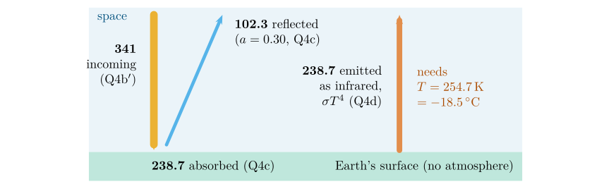
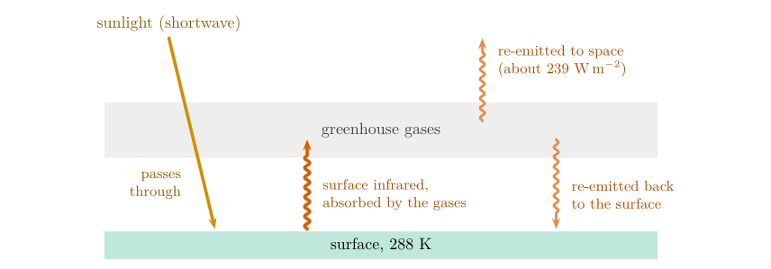

*This chapter answers Questions 4a to 4g.*

## 17.1 What Question 4 sets out to do {#p2-sec:q4intro}

If the Earth had no atmosphere there would be no greenhouse effect, and the planet would be colder. Question 4 estimates *how much* colder, by working out the temperature an airless Earth would need to send back to space all the sunlight it absorbs, and comparing it with the temperature actually observed. It is the calculation of Question 3c for the Earth (§ [16.5](/teaching/atmosphere/p2-ch06_planets/#p2-sec:q3c)), taken one step at a time, with the energy flows made explicit (Figure [17.1](/teaching/atmosphere/p2-ch07_balance/#p2-fig:flow)).

## 17.2 Question 4a: how much is absorbed? {#p2-sec:q4a}

The question

If the global albedo of the Earth is 30 %, how much solar radiation is absorbed by the Earth?

Whatever is not reflected is absorbed (§ [16.3](/teaching/atmosphere/p2-ch06_planets/#p2-sec:albedo)). As a fraction of the incoming sunlight, $$
\text{fraction absorbed}=1-a,\qquad\text{fraction reflected}=a.\tag{17.1}
$$ *where*

|     |                       |                    |
|:----|:----------------------|:-------------------|
| $a$ | albedo, as a fraction | 0.30 (30 %), given |

Answer to Question 4a

$1-0.30=0.70$: the Earth absorbs **70 %** of the solar radiation it receives.

## 17.3 Question 4b: sunlight facing the Sun {#p2-sec:q4b}

The question

If the Earth receives 1368 $\mathrm{W\,m^{-2}}$ solar radiation at the equator, how much is reflected back into space, and how much is absorbed by the Earth?

**Method.** Multiply the incoming radiation by the fractions of Eq. ([17.1](/teaching/atmosphere/p2-ch07_balance/#p2-eq:absorbed)): $$\begin{align*}
\text{reflected}&=a\times S=0.30\times1368=410.4\ \ensuremath{\mathrm{W\,m^{-2}}},\\
\text{absorbed}&=(1-a)\times S=0.70\times1368=957.6\ \ensuremath{\mathrm{W\,m^{-2}}}.
\end{align*}$$ **Check:** $410.4+957.6=1368$ $\mathrm{W\,m^{-2}}$. Every watt is accounted for.

Answer to Question 4b

Reflected: $0.3\times1368=\textbf{410.4\,\ensuremath{\mathrm{W\,m^{-2}}}}$. Absorbed: $0.7\times1368=\textbf{957.6\,\ensuremath{\mathrm{W\,m^{-2}}}}$.

A question that comes up

**Is 1368 $\mathrm{W\,m^{-2}}$ really what arrives “at the equator”?**\
Not quite. The solar constant is the sunlight falling on a surface *at right angles to the Sun’s rays, at the top of the atmosphere*, at the Earth’s average distance from the Sun (Kopp and Lean 2011). It arrives at the equator only at noon when the Sun is overhead there (around the equinoxes), and then only above the atmosphere: some is absorbed and scattered on the way down. Today’s satellite value is 1361 $\mathrm{W\,m^{-2}}$; the 1368 is an older figure, and the difference changes no conclusion.

## 17.4 Question 4b$'$: why the average is only 341 $\mathrm{W\,m^{-2}}$ {#p2-sec:q4b2}

The question

The average incoming solar radiation for planet Earth is only 341 $\mathrm{W\,m^{-2}}$. Why do you think that is?

The 1368 $\mathrm{W\,m^{-2}}$ is for a surface squarely facing the Sun. Averaged over the whole Earth and over day and night, each square metre receives a quarter of that, for two reasons that each contribute a factor of two:

1.  **Night.** At any moment half the Earth faces away from the Sun and receives nothing.

2.  **Slanting rays.** On the day side, only the point directly under the Sun receives the full beam. Everywhere else the Sun is lower in the sky and its rays strike the ground at a slant, spreading the same energy over a larger area (this is Question 5, Chapter [18](/teaching/atmosphere/p2-ch08_sunangle/#p2-ch:sun)). Averaged over the sunlit hemisphere, this halves the energy per square metre.

Together: the Earth intercepts sunlight over a disc of area $\pi R^{2}$ but has a surface area of $4\pi R^{2}$ (Figure [16.1](/teaching/atmosphere/p2-ch06_planets/#p2-fig:disc)), so $$
\bar S=\frac{S}{4}=\frac{1368}{4}=342\ \ensuremath{\mathrm{W\,m^{-2}}}.\tag{17.2}
$$ *where*

|  |  |  |
|:---|:---|:---|
| $\bar S$ | incoming solar radiation averaged over the whole Earth and over day and night ($\mathrm{W\,m^{-2}}$) | calculated |
| $S$ | solar constant ($\mathrm{W\,m^{-2}}$) | 1368, given |

Answer to Question 4b\('\)

The 1368 $\mathrm{W\,m^{-2}}$ falls only on a surface facing the Sun directly. At any time **half the Earth is in darkness**, and over the sunlit half **the Sun’s rays arrive at a slant** except where the Sun is overhead, spreading the energy over a larger area. The Earth catches sunlight on a disc ($\pi R^{2}$) but spreads it over a sphere ($4\pi R^{2}$), so the global average is a quarter: $1368/4=342$ $\mathrm{W\,m^{-2}}$, about 341 $\mathrm{W\,m^{-2}}$.

**Why 341 and not 342?** Global energy budgets built from satellite measurements give 341.3 $\mathrm{W\,m^{-2}}$ (Trenberth et al. 2009), a quarter of the solar constant they used (1365 $\mathrm{W\,m^{-2}}$). The difference from 342 is only in the value of the solar constant.

## 17.5 Question 4c: the global average {#p2-sec:q4c}

The question

If we take the average incoming solar radiation, then how much is reflected back into space, and how much is absorbed by the Earth?

**Method.** The same fractions, Eq. ([17.1](/teaching/atmosphere/p2-ch07_balance/#p2-eq:absorbed)), applied to the average of 341 $\mathrm{W\,m^{-2}}$: $$\begin{align*}
\text{reflected}&=0.30\times341=102.3\ \ensuremath{\mathrm{W\,m^{-2}}},\\
\text{absorbed}&=0.70\times341=238.7\ \ensuremath{\mathrm{W\,m^{-2}}}.
\end{align*}$$

Answer to Question 4c

Reflected: $0.3\times341=\textbf{102.3\,\ensuremath{\mathrm{W\,m^{-2}}}}$. Absorbed: $0.7\times341=\textbf{238.7\,\ensuremath{\mathrm{W\,m^{-2}}}}$.

**Check.** Satellite-based budgets give about 102 $\mathrm{W\,m^{-2}}$ reflected and 239 $\mathrm{W\,m^{-2}}$ absorbed (Trenberth et al. 2009): these simple numbers reproduce the measured global budget.

\

**Figure 17.1.** The energy flows of Question 4, in $\mathrm{W\,m^{-2}}$ averaged over the whole Earth, for an Earth without an atmosphere. Arrow widths are proportional to the flows. In balance, the infrared emitted equals the sunlight absorbed; the temperature needed to emit it is the answer to Question 4d.

## 17.6 Question 4d: the temperature of an airless Earth {#p2-sec:q4d}

The question

Earth must lose exactly as much energy as it gains, therefore the Earth must emit all the solar radiation it absorbs. However, if there is no atmosphere this happens very quickly (there is no greenhouse effect). First reorganise the Stefan–Boltzmann equation so that you can calculate the temperature in terms of the intensity of radiation ($T=\dots$). Now calculate what the temperature of the Earth would be if all the radiation it absorbed from the Sun was released at the same time (use the data you calculated in 4c). Convert your answer from kelvin to Celsius.

**Rearranging the law.** Start from Eq. ([14.1](/teaching/atmosphere/p2-ch04_stefan/#p2-eq:sb)), $E=\sigma T^{4}$, and isolate $T$ in two moves:

1.  Divide both sides by $\sigma$: $T^{4}=E/\sigma$.

2.  Take the fourth root of both sides (the inverse of raising to the fourth power):

$$
T=\left(\frac{E}{\sigma}\right)^{1/4}.\tag{17.3}
$$ *where*

|  |  |  |
|:---|:---|:---|
| $T$ | temperature of the emitting surface (K) | calculated |
| $E$ | radiation emitted per square metre ($\mathrm{W\,m^{-2}}$) | 238.7, from Question 4c |
| $\sigma$ | Stefan–Boltzmann constant | $5.67\times10^{-8}$ $\mathrm{W\,m^{-2}}$ K$^{-4}$ |

**Calculation.** In balance the Earth emits exactly what it absorbs, so $E=238.7$ $\mathrm{W\,m^{-2}}$:

1.  $E/\sigma=238.7/5.67\times10^{-8}=4.2099\times10^{9}$ K$^{4}$.

2.  First square root: $\sqrt{4.2099\times10^{9}}=64\,884$; second square root: $\sqrt{64\,884}=254.7$ K.

3.  In Celsius: $254.7-273.16=-18.5$ $^{\circ}\mathrm{C}$.

Answer to Question 4d

$T=(E/\sigma)^{1/4}$. $T=(238.7/5.67\times10^{-8})^{1/4}=\textbf{254.7 K}$, which is **$-$<!-- -->18.5 $^{\circ}\mathrm{C}$**.

**Check.** This is the same calculation as the Earth’s row of Question 3c, written differently: there $T=[1368\times0.7/(4\sigma)]^{1/4}=254.9$ K. The 0.2 K difference comes only from using 341 instead of $1368/4=342$ $\mathrm{W\,m^{-2}}$. And it is the temperature of curve A in Question 3 (254.1 K): curve A is the spectrum of an Earth without a greenhouse effect.

## 17.7 Question 4e: what the atmosphere does {#p2-sec:q4e}

The question

The actual average global temperature of the Earth between 1961 and 1990 is 14.0 $^{\circ}\mathrm{C}$ (World Meteorological Organization). What difference does the atmosphere make to the global temperature of the Earth?

**The size of the effect.** The difference between the actual and the airless temperature is $$14.0-(-18.5)=32.5\ \ensuremath{^{\circ}\mathrm{C}},$$ which is also a difference of 32.5 K, since a step of one degree is the same size on both scales. The atmosphere keeps the Earth’s surface about **33 $^{\circ}\mathrm{C}$ warmer** than it would otherwise be: above the freezing point of water instead of well below it.

**How it does it.** The atmosphere treats the two kinds of radiation differently (Figure [17.2](/teaching/atmosphere/p2-ch07_balance/#p2-fig:greenhouse)):

1.  **Sunlight (shortwave) passes through** largely unabsorbed and warms the surface.

2.  **The surface emits infrared (longwave)**, Chapter [13](/teaching/atmosphere/p2-ch03_wien/#p2-ch:wien), peaking near 10 $\mu\mathrm{m}$.

3.  **Greenhouse gases absorb much of that infrared**: water vapour, carbon dioxide, methane, nitrous oxide and ozone. These are molecules made of three or more atoms (or of two different atoms) whose vibrations and rotations can absorb and emit infrared; the main gases of the air, nitrogen and oxygen, cannot.

4.  **The warmed atmosphere radiates in all directions**, including back down to the surface. The surface therefore receives the sunlight *plus* this downward infrared, about 333 $\mathrm{W\,m^{-2}}$ on average (Trenberth et al. 2009), and settles at a higher temperature.

5.  **The planet as a whole still balances.** What escapes to space comes mostly from the cold upper atmosphere, and it still totals about 239 $\mathrm{W\,m^{-2}}$: the Earth seen from space radiates like a body at 255 K, even though its surface is at 288 K.

\

**Figure 17.2.** The greenhouse effect. Sunlight passes through the atmosphere and warms the surface; the surface’s infrared is absorbed by greenhouse gases, which radiate both to space and back down. The extra downward infrared keeps the surface warmer than the 255 K the planet radiates at from space.

Answer to Question 4e

Without an atmosphere the Earth would average $-18.5$ $^{\circ}\mathrm{C}$; with it, 14.0 $^{\circ}\mathrm{C}$. The atmosphere’s **greenhouse effect** raises the average surface temperature by about **32.5 $^{\circ}\mathrm{C}$** (about 33 K). Greenhouse gases absorb the infrared emitted by the surface and radiate part of it back down, so the surface receives more energy than sunlight alone provides and stays at a habitable temperature, above the freezing point of water.

What greenhouse gases trap

Greenhouse gases act mainly on the *infrared* emitted by the Earth, not on incoming sunlight, which passes through largely unabsorbed. And they do not stop energy escaping: in balance the Earth still sends to space exactly as much as it absorbs (238.7 $\mathrm{W\,m^{-2}}$). What they change is *where* it is emitted from: from the cold upper atmosphere instead of the warm surface. Say: “greenhouse gases absorb the infrared emitted by the surface and re-emit part of it back down, warming the surface by about 33 K”.

Worked example: a one-layer greenhouse

Model the atmosphere as a single layer that lets all sunlight through and absorbs all the surface’s infrared. In balance, the layer must emit 238.7 $\mathrm{W\,m^{-2}}$ to space; it emits the same amount downward, so the surface receives $238.7+238.7=477.4$ $\mathrm{W\,m^{-2}}$ and must emit that: $$T_{\text{surface}}=\left(\frac{2\times238.7}{5.67\times10^{-8}}\right)^{1/4}=2^{1/4}\times254.7=303\ \mathrm{K}\ (30\ \ensuremath{^{\circ}\mathrm{C}}).$$ This overshoots the real 288 K, because the real atmosphere lets some infrared escape directly through the “atmospheric window” near 8–12 $\mu\mathrm{m}$ and because rising air and evaporation carry heat up from the surface. But it shows the mechanism, and why a thicker greenhouse atmosphere, like that of Venus (§ [16.7](/teaching/atmosphere/p2-ch06_planets/#p2-sec:q3e)), makes the surface hotter still.

A question that comes up

**Why is it called a “greenhouse” effect?**\
By analogy, and the analogy is loose. A real greenhouse stays warm mainly because its glass stops the warm air inside from rising away and mixing with cooler air. The atmosphere warms the surface by radiation, as described above.

## 17.8 Question 4f: day and night without an atmosphere {#p2-sec:q4f}

The question

What effect would no atmosphere have on the variation in temperature on the Earth over the course of a day, compared with an Earth with an atmosphere?

Without an atmosphere, nothing would slow the loss of heat at night or soften the heating by day.

- **At night** the surface would radiate straight to space, with no downward infrared from greenhouse gases and cloud to replace part of the loss (§ [17.7](/teaching/atmosphere/p2-ch07_balance/#p2-sec:q4e)), so it would cool very quickly and very far.

- **By day** there would be no cloud to reflect sunlight and no air to absorb part of it, and no winds to carry heat away, so the sunlit surface would heat strongly.

- **The atmosphere (and the ocean beneath it) also stores and moves heat**: from day to night and from warm regions to cold ones. Without it, each place would respond only to its own sunshine.

The Moon shows the result: at the same distance from the Sun but with no atmosphere, its equatorial surface swings from near 390 K at midday to below 100 K before dawn (Williams et al. 2017), while the Earth’s global average daily range is only about 10 K (Williams 2024).

Answer to Question 4f

The **daily range of temperature would be far larger**: very hot days and very cold nights. The atmosphere reduces the range by radiating infrared back to the surface at night (and through cloud), by reflecting and absorbing part of the sunlight by day, and by storing and moving heat. The airless Moon swings by about 300 K between day and night.

## 17.9 Question 4g: the assumptions {#p2-sec:q4g}

The question

What assumption have we made about the solid Earth for this calculation?

Every model rests on assumptions; naming them is part of using it well. For Question 4d we assumed that the Earth:

1.  **has no source of heat of its own**: all its energy comes from the Sun. The heat flowing from the Earth’s interior is real but tiny, under 0.1 $\mathrm{W\,m^{-2}}$ on average (Davies and Davies 2010), so this assumption costs almost nothing (compare Jupiter, § [16.7](/teaching/atmosphere/p2-ch06_planets/#p2-sec:q3e));

2.  **is a perfect black body**, emitting $\sigma T^{4}$ with an emissivity of 1 (§ [12.6](/teaching/atmosphere/p2-ch02_radiation/#p2-sec:blackbody));

3.  **has one uniform temperature** everywhere, by day and by night (in reality the equator and the poles differ by tens of degrees);

4.  **is in equilibrium**, emitting at once all it absorbs and storing nothing (the question’s “released at the same time”);

5.  **keeps an albedo of 0.30** even without an atmosphere. In fact much of that reflection is by cloud, which an airless Earth would not have; with a Moon-like albedo of about 0.1 the airless Earth would be nearer 270 K (Practice Set [16](/teaching/atmosphere/p2-ch06_planets/#p2-ch:planets), item [16](/teaching/atmosphere/p2-ch06_planets/#p2-ch:planets).3).

Answer to Question 4g

That the solid Earth has **no internal source of heat**, so that all the energy it radiates comes from the Sun; and that it behaves as a **black body at a single, uniform temperature in equilibrium**, radiating away immediately everything it absorbs.

The Earth does radiate

The assumption is that the Earth has no internal heat *source*: it radiates only energy that came from the Sun. It does not mean the Earth gives off no radiation: in this calculation it radiates 238.7 $\mathrm{W\,m^{-2}}$.

## 17.10 Try it yourself: Practice Set 17

Practice Set 17: the energy balance

Use $\sigma=5.67\times10^{-8}$ $\mathrm{W\,m^{-2}}$ K$^{-4}$ and $\ensuremath{^{\circ}\mathrm{C}}=\mathrm{K}-273.16$.

1.  Repeat Questions 4b$'$ to 4d with today’s solar constant, 1361 $\mathrm{W\,m^{-2}}$, and an albedo of 0.30.

2.  If the Earth’s albedo rose from 0.30 to 0.32 (more cloud, or more ice), what would its black-body temperature become?

3.  The Earth’s surface at 14 $^{\circ}\mathrm{C}$ emits 385.5 $\mathrm{W\,m^{-2}}$ (Question 2b), but only 238.7 $\mathrm{W\,m^{-2}}$ leaves the planet. How large is the difference, and what is it a measure of?

4.  Using the one-layer greenhouse of § [17.7](/teaching/atmosphere/p2-ch07_balance/#p2-sec:q4e), what would the surface temperature be? Why is the real surface cooler than this?

Answers to Practice Set 17

1.  $\bar S=1361/4=340.25$ $\mathrm{W\,m^{-2}}$; absorbed $0.7\times340.25=238.2$ $\mathrm{W\,m^{-2}}$; $T=(238.2/5.67\times10^{-8})^{1/4}=254.6$ K $=-18.6$ $^{\circ}\mathrm{C}$, Eqs. ([17.2](/teaching/atmosphere/p2-ch07_balance/#p2-eq:Sbar)) and ([17.3](/teaching/atmosphere/p2-ch07_balance/#p2-eq:Tinv)).

2.  $T=[1368\times0.68/(4\times5.67\times10^{-8})]^{1/4}=253.1$ K, about 1.8 K colder. Small changes in albedo matter, which is why cloud and ice feedbacks are important in climate change.

3.  $385.5-238.7=146.8$ $\mathrm{W\,m^{-2}}$. This is the infrared emitted by the surface that does not escape to space: a measure of the greenhouse effect in energy terms.

4.  $2^{1/4}\times254.7=303$ K (30 $^{\circ}\mathrm{C}$). The real atmosphere is not opaque at all infrared wavelengths (the atmospheric window lets some escape directly), and convection and evaporation carry heat upwards from the surface.

## 17.11 The energy balance in Python

These functions compute the equations of this chapter, and the book’s tests check them against its answers.

    def absorbed(incoming_wm2, albedo):
        """The part of the incoming radiation that is not reflected (W per square metre)."""
        return incoming_wm2 * (1 - albedo)

    def temperature_from_emission(e_wm2):
        """Stefan-Boltzmann law turned round: temperature (K) from emission."""
        return (e_wm2 / SIGMA) ** 0.25

`absorbed(341, 0.3)` returns 238.7.

Davies, J.H. and Davies, D.R. (2010) Earth’s surface heat flux. Solid Earth 1, 5–24. <https://doi.org/10.5194/se-1-5-2010>

Kopp, G. and Lean, J.L. (2011) A new, lower value of total solar irradiance: Evidence and climate significance. Geophysical Research Letters 38, L01706. <https://doi.org/10.1029/2010GL045777>

Trenberth, K.E., Fasullo, J.T. and Kiehl, J. (2009) Earth’s global energy budget. Bulletin of the American Meteorological Society 90, 311–324. <https://doi.org/10.1175/2008BAMS2634.1>

Williams, D.R. (2024) [Planetary fact sheets: Mercury, Venus, Earth, Mars, Jupiter](https://nssdc.gsfc.nasa.gov/planetary/factsheet/).

Williams, J.-P., Paige, D.A., Greenhagen, B.T. and Sefton-Nash, E. (2017) The global surface temperatures of the Moon as measured by the Diviner Lunar Radiometer Experiment. Icarus 283, 300–325. <https://doi.org/10.1016/j.icarus.2016.08.012>

