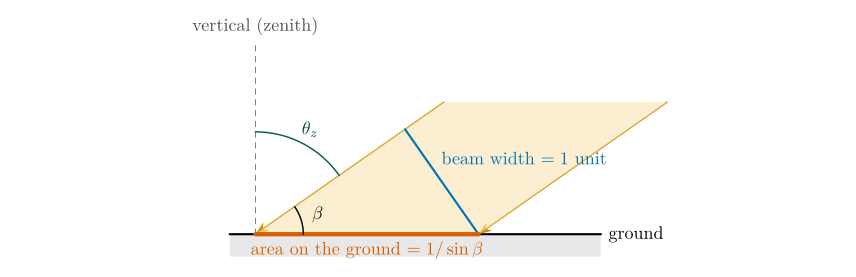
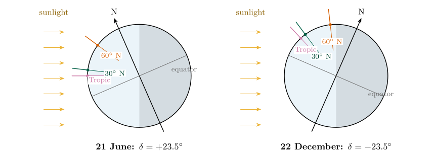
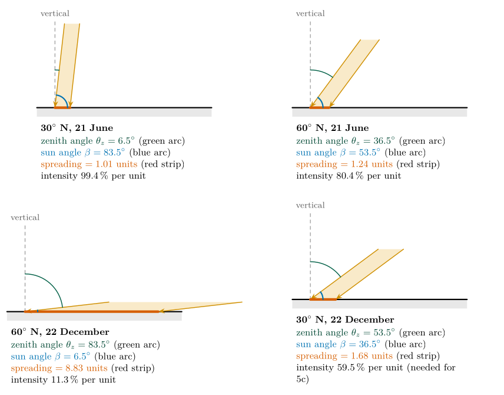
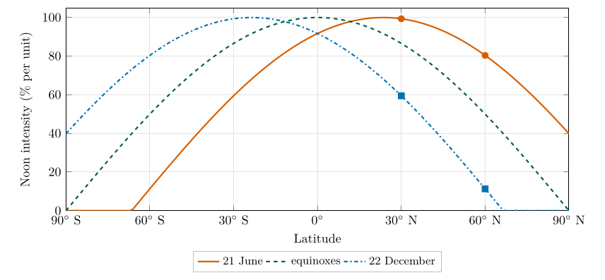

*This chapter answers Questions 5a, 5b and 5c.*

## 18.1 A spread beam is a weaker beam {#p2-sec:spreadidea}

Shine a torch straight down at a table: it makes a small, bright circle. Tilt it, and the same light spreads into a long, dim oval. The torch gives out the same energy; it is spread over more table, so each square centimetre receives less. Sunlight does the same. When the Sun is overhead its rays strike the ground squarely and their energy is concentrated; when it is low they strike at a slant and the same energy is spread over a larger area. The **solar intensity**, the energy received per unit area of ground, therefore depends on the angle of the Sun.

## 18.2 Measuring the spreading {#p2-sec:spreadmath}

Two angles describe the Sun’s position (Figure [18.1](/teaching/atmosphere/p2-ch08_sunangle/#p2-fig:spreadgeom)):

- the **sun angle** $\beta$ (also called the solar elevation or altitude), measured up from the horizon: $90^\circ$ when the Sun is overhead, $0^\circ$ when it is on the horizon;

- the **zenith angle** $\theta_z$, measured from the vertical (the zenith, the point straight overhead): $0^\circ$ when the Sun is overhead.

They add up to a right angle: $$
\beta=90^\circ-\theta_z .\tag{18.1}
$$ *where*

|  |  |  |
|:---|:---|:---|
| $\beta$ | sun angle: height of the Sun above the horizon (degrees) | calculated |
| $\theta_z$ | zenith angle: angle of the Sun from the vertical (degrees) | Eq. ([18.4](/teaching/atmosphere/p2-ch08_sunangle/#p2-eq:zenith)) |

\

**Figure 18.1.** Beam spreading. A beam one unit wide, arriving at sun angle $\beta$, covers a strip of ground of length $1/\sin\beta$: the hypotenuse of a right-angled triangle whose side opposite the angle $\beta$ is the beam width (Appendix [B.2.4](/teaching/atmosphere/app-p2/#p2-sec:der-spread)). Drawn here for $\beta=35^\circ$, where the beam covers 1.74 units.

The length of ground covered by a beam one unit wide is called here the “surface area”. From the right-angled triangle in Figure [18.1](/teaching/atmosphere/p2-ch08_sunangle/#p2-fig:spreadgeom) (derived in Appendix [B.2.4](/teaching/atmosphere/app-p2/#p2-sec:der-spread)): $$
A=\frac{1}{\sin\beta}.\tag{18.2}
$$ *where*

|  |  |  |
|:---|:---|:---|
| $A$ | area over which a beam of unit width spreads (“surface area”, “beam spreading”; units) | calculated |
| $\beta$ | sun angle (degrees) | Eq. ([18.1](/teaching/atmosphere/p2-ch08_sunangle/#p2-eq:beta)) |

When the Sun is overhead, $\beta=90^\circ$, $\sin90^\circ=1$ and $A=1$ unit: the beam’s full energy, 100 %, falls on one unit. In general the energy falling on each unit of ground is $$
I=\frac{100\,\%}{A}=100\,\%\times\sin\beta .\tag{18.3}
$$ *where*

|  |  |  |
|:---|:---|:---|
| $I$ | solar intensity, as a percentage of the overhead value, per unit of ground (% per unit) | calculated |
| $A$ | beam spreading from Eq. ([18.2](/teaching/atmosphere/p2-ch08_sunangle/#p2-eq:spread)) |  |

Make sure your calculator is in **degree** mode: $\sin(83.5)$ should give 0.9936.

## 18.3 Where the noon Sun is overhead {#p2-sec:declination}

Because the Earth’s axis is tilted by $23.5^\circ$ to its orbit, the latitude at which the noon Sun is directly overhead moves through the year (Figure [18.2](/teaching/atmosphere/p2-ch08_sunangle/#p2-fig:solstice)). That latitude is the Sun’s **declination** $\delta$: $+23.5^\circ$ (the Tropic of Cancer) at the June solstice, $0^\circ$ (the equator) at the equinoxes, and $-23.5^\circ$ (the Tropic of Capricorn) at the December solstice. At solar noon, the Sun’s zenith angle at latitude $\varphi$ is the difference between the two latitudes: $$
\theta_z=|\varphi-\delta| .\tag{18.4}
$$ *where*

|  |  |  |
|:---|:---|:---|
| $\theta_z$ | noon zenith angle (degrees) | calculated |
| $\varphi$ | latitude of the site (degrees, positive north) | 30 or 60, given |
| $\delta$ | declination: latitude where the noon Sun is overhead (degrees) | $+23.5$ in June, $-23.5$ in December |

For a site north of the Tropic of Cancer this gives two simple rules: $$\text{June 21 (summer solstice):}\ \ \theta_z=\varphi-23.5^\circ;\qquad\text{December 22 (winter solstice):}\ \ \theta_z=\varphi+23.5^\circ.$$ The reason is geometric: walking north by one degree of latitude tilts your local vertical one degree further from the Sun’s direction (Appendix [B.2.5](/teaching/atmosphere/app-p2/#p2-sec:der-zenith)).

\

**Figure 18.2.** The Earth at the two solstices, with sunlight arriving from the left. The short coloured lines are the local verticals at the Tropic of Cancer, 30$^{\circ}$N and 60$^{\circ}$N. In June (left) the northern hemisphere is tilted towards the Sun, the Sun is overhead at the Tropic, and the verticals at 30$^{\circ}$N and 60$^{\circ}$N are only 6.5$^{\circ}$ and 36.5$^{\circ}$ from the Sun’s direction. In December (right) they are 53.5$^{\circ}$ and 83.5$^{\circ}$ from it, Eq. ([18.4](/teaching/atmosphere/p2-ch08_sunangle/#p2-eq:zenith)).

## 18.4 Question 5a: sketches of the noon Sun {#p2-sec:q5a}

The question

Using this information, draw a simple series of sketches for solar noon on June 21st at a site at 30$^{\circ}$N, and on December 22nd and June 21st for a site at 60$^{\circ}$N. Indicate the zenith angle, sun angle and beam spreading in each diagram.

**Method.** For each site and date, apply Eqs. ([18.4](/teaching/atmosphere/p2-ch08_sunangle/#p2-eq:zenith)), ([18.1](/teaching/atmosphere/p2-ch08_sunangle/#p2-eq:beta)), ([18.2](/teaching/atmosphere/p2-ch08_sunangle/#p2-eq:spread)) and ([18.3](/teaching/atmosphere/p2-ch08_sunangle/#p2-eq:intensity)) in turn. The calculations are collected in Table [18.1](/teaching/atmosphere/p2-ch08_sunangle/#p2-tab:q5); the 30$^{\circ}$N December case is not asked for in 5a but is needed for 5c, so it is included.

@llcccc@ **Site** & **Date** & **Zenith $\theta_z$** & **Sun angle $\beta$** & **Spread $1/\sin\beta$** & **Intensity**\
$^{\circ}$N & 21 June & $30-23.5=6.5^\circ$ & $83.5^\circ$ & $1/0.9936=1.006$ & 99.4 %\
60$^{\circ}$N & 21 June & $60-23.5=36.5^\circ$ & $53.5^\circ$ & $1/0.8039=1.244$ & 80.4 %\
60$^{\circ}$N & 22 Dec & $60+23.5=83.5^\circ$ & $6.5^\circ$ & $1/0.1132=8.834$ & 11.3 %\
30$^{\circ}$N & 22 Dec & $30+23.5=53.5^\circ$ & $36.5^\circ$ & $1/0.5948=1.681$ & 59.5 %\
\

\

**Figure 18.3.** Question 5a: the noon Sun at each site, drawn to the correct angles and to one scale. Each beam (orange) is one unit wide and the red strip is the ground it covers. The sun angle $\beta$ (blue arc) is measured from the ground, and the zenith angle $\theta_z$ (green arc) from the vertical.

Answer to Question 5a

**30$^{\circ}$N, 21 June:** zenith angle $6.5^\circ$, sun angle $83.5^\circ$, beam spreading $1/\sin83.5^\circ=\textbf{1.006 units}$.\
**60$^{\circ}$N, 21 June:** zenith angle $36.5^\circ$, sun angle $53.5^\circ$, beam spreading $1/\sin53.5^\circ=\textbf{1.24 units}$.\
**60$^{\circ}$N, 22 December:** zenith angle $83.5^\circ$, sun angle $6.5^\circ$, beam spreading $1/\sin6.5^\circ=\textbf{8.83 units}$.\
Sketches as in Figure [18.3](/teaching/atmosphere/p2-ch08_sunangle/#p2-fig:q5sketches).

**Check.** The higher the Sun, the closer the spreading is to 1 unit; with the Sun just $6.5^\circ$ above the horizon, a beam one unit wide is smeared across almost nine units of ground. In each case $\theta_z+\beta=90^\circ$.

## 18.5 Question 5b: why the sun angle makes the seasons {#p2-sec:q5b}

The question

Given these sketches, explain why the sun angle causes seasonal temperature changes in the mid-latitudes.

As the Earth orbits the Sun with its axis tilted, the latitude where the noon Sun is overhead moves between the tropics (Figure [18.2](/teaching/atmosphere/p2-ch08_sunangle/#p2-fig:solstice)). At a mid-latitude site the noon Sun is therefore high in summer and low in winter: at 60$^{\circ}$N, $53.5^\circ$ in June and only $6.5^\circ$ in December. A high Sun concentrates its beam on a small area and a low Sun spreads it over a large one, so each square metre of ground receives far more energy in summer (80 % per unit) than in winter (11 % per unit). More energy absorbed means warmer ground and air.

Answer to Question 5b

Because the Earth’s axis is tilted, the noon **sun angle** at a mid-latitude site **rises in spring and summer and falls in autumn and winter**. A high sun angle concentrates the beam on a small area (little beam spreading, high intensity); a low sun angle spreads the same energy over a large area (much spreading, low intensity). So the ground receives more energy per square metre in summer and warms, and less in winter and cools. At 60$^{\circ}$N the noon intensity in June is about seven times that in December.

A question that comes up

**Is the sun angle the only reason summers are warmer?**\
No; it is the main one, and two others work with it. **Day length:** at 60$^{\circ}$N the Sun is up for about 18 hours at the June solstice and about 6 in December, so summer days add up much more energy. **Path through the atmosphere:** a low Sun’s rays cross far more air, so more is scattered and absorbed before reaching the ground. All three effects point the same way. The distance from the Sun is *not* a reason: the Earth is closest to the Sun in early January, in the northern winter (Lutgens et al. 2019, ch. 2).

\

**Figure 18.4.** Noon solar intensity, Eq. ([18.3](/teaching/atmosphere/p2-ch08_sunangle/#p2-eq:intensity)), against latitude at the solstices and equinoxes. The dots are the four cases of Table [18.1](/teaching/atmosphere/p2-ch08_sunangle/#p2-tab:q5). The peak follows the overhead Sun between the tropics; north of the Arctic Circle (66.5$^{\circ}$N) the December curve reaches zero: the noon Sun does not rise.

## 18.6 Question 5c: comparing solar intensities {#p2-sec:q5c}

The question

Given your answers: (i) what is the percentage difference in solar intensity between a site at 30$^{\circ}$N and 60$^{\circ}$N during the winter solstice? (Hint: calculate the solar intensity as % per unit for each site first.) (ii) What is the percentage difference in solar intensity between a site at 60$^{\circ}$N for the winter solstice compared to the summer solstice?

**Step 1: the intensities**, from Eq. ([18.3](/teaching/atmosphere/p2-ch08_sunangle/#p2-eq:intensity)) and Table [18.1](/teaching/atmosphere/p2-ch08_sunangle/#p2-tab:q5): $$\begin{align*}
I_{30\text{N, Dec}}&=100/1.681=59.5\ \%\ \text{per unit},\\
I_{60\text{N, Dec}}&=100/8.834=11.3\ \%\ \text{per unit},\\
I_{60\text{N, Jun}}&=100/1.244=80.4\ \%\ \text{per unit}.
\end{align*}$$

**Step 2: compare them.** “Percentage difference” between two percentages can mean two things, and it is worth giving both:

- the difference in **percentage points**: subtract one percentage from the other;

- the **relative** difference: divide one by the other.

**(i) 30$^{\circ}$N against 60$^{\circ}$N in December:** $$59.5-11.3=48.2\ \text{percentage points};\qquad \frac{59.5}{11.3}=5.25\ \text{times};\qquad \frac{59.5-11.3}{59.5}=81\,\%\ \text{less at }60^\circ\text{N}.$$ **(ii) 60$^{\circ}$N, December against June:** $$80.4-11.3=69.1\ \text{percentage points};\quad \frac{80.4}{11.3}=7.10\ \text{times};\quad \frac{80.4-11.3}{11.3}=610\,\%\ \text{more in June}.$$

Answer to Question 5c

**(i)** At the winter solstice 30$^{\circ}$N receives **59.5 %** per unit and 60$^{\circ}$N **11.3 %** per unit: a difference of **48.2 percentage points**. 30$^{\circ}$N receives about **5.3 times** as much as 60$^{\circ}$N (60$^{\circ}$N receives 81 % less).\
**(ii)** At 60$^{\circ}$N the winter solstice gives **11.3 %** per unit and the summer solstice **80.4 %** per unit: a difference of **69.1 percentage points**. The summer noon intensity is about **7.1 times** the winter one.

**Check.** Both comparisons agree with Figure [18.4](/teaching/atmosphere/p2-ch08_sunangle/#p2-fig:latprofile): the December curve falls steeply between 30$^{\circ}$N and 60$^{\circ}$N, and at 60$^{\circ}$N the June and December curves are far apart.

Percentage points

A difference between two percentages is in *percentage points*. The summer and winter intensities at 60$^{\circ}$N differ by 69.1 points; in relative terms the summer intensity is 7.1 times the winter one, which is 610 % more, not 69 %.

## 18.7 Try it yourself: Practice Set 18

Practice Set 18: sun angle

1.  Coleraine is at 55.1$^{\circ}$N. Find the noon zenith angle, sun angle, beam spreading and intensity at the June and December solstices.

2.  What is the noon intensity at the equator at either solstice? And at the equinoxes?

3.  What is the noon intensity at 60$^{\circ}$N at the equinoxes, when the Sun is overhead at the equator?

4.  What happens at the Arctic Circle (66.5$^{\circ}$N) at noon on 22 December?

5.  At which latitude is the noon intensity 100 % on 21 June, and why?

Answers to Practice Set 18

1.  June: $\theta_z=55.1-23.5=31.6^\circ$, $\beta=58.4^\circ$, $A=1/\sin58.4^\circ=1.174$ units, $I=85.2\,\%$ per unit. December: $\theta_z=55.1+23.5=78.6^\circ$, $\beta=11.4^\circ$, $A=5.06$ units, $I=19.8\,\%$ per unit. The June noon Sun gives Coleraine 4.3 times the December intensity.

2.  At either solstice $\theta_z=23.5^\circ$, $\beta=66.5^\circ$, $A=1.090$, $I=91.7\,\%$ per unit. At the equinoxes the Sun is overhead: 100 %. The equator’s noon intensity hardly changes through the year, which is why the tropics have little temperature seasonality.

3.  $\theta_z=60^\circ$, $\beta=30^\circ$, $A=1/\sin30^\circ=2$ units, $I=50\,\%$ per unit.

4.  $\theta_z=66.5+23.5=90^\circ$, so $\beta=0^\circ$: the noon Sun is on the horizon, the beam spreading is infinite and the intensity is zero. North of this, the Sun does not rise at all on that day: the polar night.

5.  At the Tropic of Cancer, 23.5$^{\circ}$N, where $\theta_z=0^\circ$ and the Sun is directly overhead: the declination on 21 June is $+23.5^\circ$, Eq. ([18.4](/teaching/atmosphere/p2-ch08_sunangle/#p2-eq:zenith)).

## 18.8 Sun angle in Python

These functions compute the equations of this chapter, and the book’s tests check them against its answers.

    def zenith_angle(latitude_deg, declination_deg):
        """Noon zenith angle (degrees) at a latitude for a solar declination."""
        return abs(latitude_deg - declination_deg)

    def sun_angle(zenith_deg):
        """Sun angle above the horizon (degrees)."""
        return 90.0 - zenith_deg

    def beam_spreading(sun_deg):
        """Length of ground covered by a beam one unit wide."""
        return 1.0 / math.sin(math.radians(sun_deg))

    def intensity_percent(sun_deg):
        """Solar intensity as a percentage per unit of ground."""
        return 100.0 / beam_spreading(sun_deg)

`intensity_percent(sun_angle(zenith_angle(60, -23.5)))` returns about 11.3.

Lutgens, F.K., Tarbuck, E.J. and Herman, R.L. (2019) The atmosphere: An introduction to meteorology, 14th ed. Pearson, New York.

