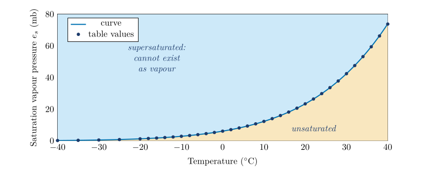
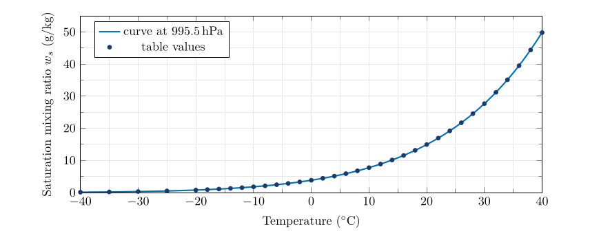
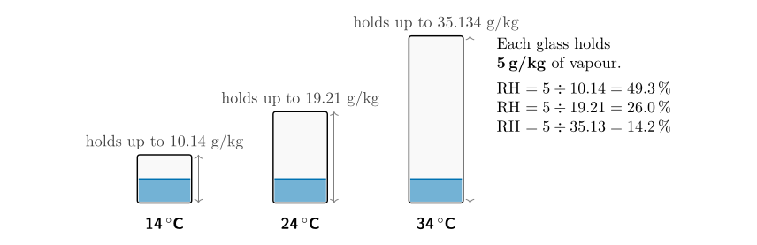
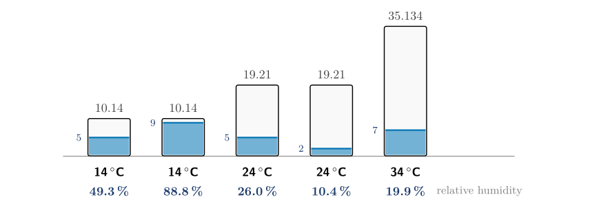
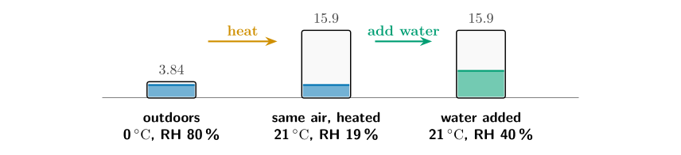
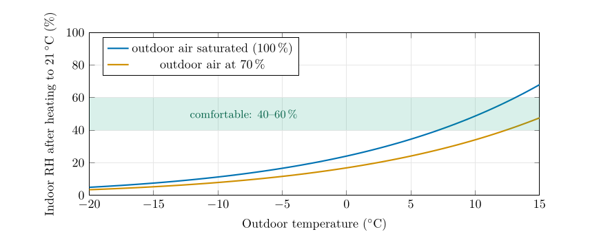

*This chapter answers Moisture Q1 to Q4.*

## 21.1 Why water vapour matters

Water vapour is the invisible, gaseous form of water. It makes up between a fraction of a percent and about four percent of the air by volume, yet it is the ingredient of every cloud, every shower and every fog. It also sets how comfortable a day feels, because sweat evaporates slowly into air that is already moist. To talk about weather precisely we need a way to say *how much* vapour the air contains. There are four common measures. This chapter covers the first three; the fourth, the dew point, has its own chapter.

## 21.2 Vapour pressure and saturation {#p3-sec:vp}

Air is a mixture of gases, and each gas contributes a share of the total pressure, in proportion to how many of its molecules are present: the partial pressure met for oxygen in Part I ( § [4.4](/teaching/atmosphere/p1-ch03_oxygen/#p1-sec:dalton)). The share due to water vapour is the **vapour pressure**, written $e$. In the lowest kilometres it is about 1 to 30 hPa, out of a total pressure of roughly 1000 hPa.

Imagine a closed dish of water with air above it. Molecules leave the water surface (evaporation) and return to it (condensation). At first more leave than return, so the vapour pressure above the water rises. It stops rising when the two flows are equal. The air is then **saturated**, and the vapour pressure has reached its upper limit for that temperature: the **saturation vapour pressure**, $e_s$.

The warmer the water, the more energetic its molecules and the more easily they escape, so $e_s$ rises with temperature, and it rises steeply. Table [21.1](/teaching/atmosphere/p3-ch02_moisture/#p3-tab:table1) gives it as the “mb” column: 6.1 mb at 0 $^{\circ}\mathrm{C}$, 23.4 mb at 20 $^{\circ}\mathrm{C}$and 73.8 mb at 40 $^{\circ}\mathrm{C}$. Plotted, it is the curve of Figure [21.1](/teaching/atmosphere/p3-ch02_moisture/#p3-fig:es) (the Clausius–Clapeyron curve).

\

**Figure 21.1.** Saturation vapour pressure against temperature. The dots are the values of Table [21.1](/teaching/atmosphere/p3-ch02_moisture/#p3-tab:table1). Air whose vapour pressure and temperature fall below the curve is unsaturated; points above it are not possible for long, because the surplus vapour condenses.

A question that comes up

**Why does warm air “hold” more water than cold air?**\
Air does not really hold water the way a sponge does. The saturation vapour pressure is a property of water itself, how readily it evaporates at a given temperature, and the other gases hardly affect it. “Holding capacity” is a convenient picture, and this part uses it, but it is the temperature that sets the limit.

## 21.3 Mixing ratio

Vapour pressure is not the only way to measure moisture. The **mixing ratio**, $w$, compares the *mass* of vapour with the mass of the *dry air* that goes with it: $$
w=\frac{\text{mass of water vapour}}{\text{mass of dry air}}.\tag{21.1}
$$ *where*

|  |  |  |
|:---|:---|:---|
| $w$ | mixing ratio ($\mathrm{g\,kg^{-1}}$: grams of vapour per kilogram of dry air) | calculated |

Typical values run from 0.1 $\mathrm{g\,kg^{-1}}$ in the polar winter to 20 $\mathrm{g\,kg^{-1}}$ in the humid tropics. When the air is saturated the ratio is the **saturation mixing ratio**, $w_s$, the second column of numbers in Table [21.1](/teaching/atmosphere/p3-ch02_moisture/#p3-tab:table1) (the “g/kg” column).

The two measures are linked. For a total pressure $p$ and a vapour pressure $e$, $$
w \approx 622\,\frac{e}{p-e}.\tag{21.2}
$$ *where*

|  |  |  |
|:---|:---|:---|
| $w$ | mixing ratio ($\mathrm{g\,kg^{-1}}$) | calculated |
| $e$ | vapour pressure (hPa) |  |
| $p$ | total air pressure (hPa) | 995.5 for Table [21.1](/teaching/atmosphere/p3-ch02_moisture/#p3-tab:table1) |
| $622$ | ratio of the molar masses of water and dry air, $18/29$, times 1000 (to give $\mathrm{g\,kg^{-1}}$) |  |

The factor 0.622 is the ratio of the molar masses of water (18) and dry air (29): a molecule of vapour is lighter than the average molecule of dry air.

\

**Figure 21.2.** Saturation mixing ratio against temperature. The curve is computed from the saturation vapour pressure at a pressure of 995.5 hPa, the pressure of Table [21.1](/teaching/atmosphere/p3-ch02_moisture/#p3-tab:table1).

A question that comes up

**Why use the mass of *dry* air, and why grams per kilogram?**\
The mass of dry air in a rising or sinking parcel stays fixed, while the total mass of moist air does not, as soon as vapour condenses or evaporates. Dividing by the dry mass gives a number that stays constant for a parcel until water is added or removed. Grams per kilogram simply keeps the numbers handy: a few units to a few tens.

A question that comes up

**Table [21.1](/teaching/atmosphere/p3-ch02_moisture/#p3-tab:table1) is for sea level. Which pressure is that?**\
Working backwards from the table, $p = e_s + 622\,e_s/w_s$ comes out at about 995.5 hPa for every row from $-20$ to 40 $^{\circ}\mathrm{C}$. That is a typical low-ish sea-level pressure, not the standard 1013.25 hPa. At 1013.25 hPa the mixing ratios would be about 1.8 % smaller. The difference never matters for these questions; the calculations here use 995.5 hPa so that every answer agrees with the table.

## 21.4 Relative humidity

**Relative humidity** (RH) says how close the air is to saturation. It is defined in two equivalent ways: $$
\mathrm{RH}=\frac{e}{e_s}\times100\,\%=\frac{w}{w_s}\times100\,\%.\tag{21.3}
$$ *where*

|  |  |  |
|:---|:---|:---|
| $\mathrm{RH}$ | relative humidity (%) | calculated |
| $e,\ e_s$ | vapour pressure and saturation vapour pressure (hPa) | Table [21.1](/teaching/atmosphere/p3-ch02_moisture/#p3-tab:table1) |
| $w,\ w_s$ | mixing ratio and saturation mixing ratio ($\mathrm{g\,kg^{-1}}$) | Table [21.1](/teaching/atmosphere/p3-ch02_moisture/#p3-tab:table1) |

An RH of 50 % means the air holds half of what it could hold at its present temperature; 100 % means saturated. Because $e_s$ and $w_s$ both depend strongly on temperature, *the same air has a different relative humidity at a different temperature*. That fact is behind most of the puzzles in this chapter.

Relative humidity in one line

Relative humidity = (how much vapour is there) $\div$ (how much there could be at this temperature) $\times100$.

## 21.5 A picture to hold on to: the glass {#p3-sec:glass}

Picture the air as a glass. The **size of the glass** is the saturation mixing ratio at the air’s temperature. The **water in the glass** is the actual mixing ratio. Relative humidity is how full the glass is. Warm air has a big glass, cold air a small one.

\

**Figure 21.3.** The glass picture. The same 5 g of vapour per kilogram of air fills the glass of 14 $^{\circ}\mathrm{C}$ air to 49 %, the glass of 24 $^{\circ}\mathrm{C}$ air to 26 %, and the big glass of 34 $^{\circ}\mathrm{C}$ air to only 14 %. The amount of water is identical; only the size of the glass changes.

## 21.6 Reading the table

Three skills with Table [21.1](/teaching/atmosphere/p3-ch02_moisture/#p3-tab:table1) carry you through all the moisture questions.

| **Temp. ($^{\circ}\mathrm{C}$)** | $\boldsymbol{e_s}$ **(mb)** | $\boldsymbol{w_s}$ **($\mathrm{g\,kg^{-1}}$)** |
|---:|---:|---:|
| **Temp. ($^{\circ}\mathrm{C}$)** | $\boldsymbol{e_s}$ **(mb)** | $\boldsymbol{w_s}$ **($\mathrm{g\,kg^{-1}}$)** |
| $-$<!-- -->40 | 0.189 | 0.118 |
| $-$<!-- -->35 | 0.314 | 0.195 |
| $-$<!-- -->30 | 0.519 | 0.318 |
| $-$<!-- -->25 | 0.807 | 0.510 |
| $-$<!-- -->20 | 1.254 | 0.784 |
| $-$<!-- -->18 | 1.488 | 0.931 |
| $-$<!-- -->16 | 1.760 | 1.102 |
| $-$<!-- -->14 | 2.076 | 1.300 |
| $-$<!-- -->12 | 2.441 | 1.529 |
| $-$<!-- -->10 | 2.863 | 1.794 |
| $-$<!-- -->8 | 3.348 | 2.099 |
| $-$<!-- -->6 | 3.906 | 2.450 |
| $-$<!-- -->4 | 4.545 | 2.852 |
| $-$<!-- -->2 | 5.275 | 3.313 |
| 0 | 6.108 | 3.840 |
| 2 | 7.055 | 4.439 |
| 4 | 8.129 | 5.120 |
| 6 | 9.347 | 5.894 |
| 8 | 10.722 | 6.771 |
| 10 | 12.272 | 7.762 |
| 12 | 14.017 | 8.882 |
| 14 | 15.977 | 10.140 |
| 16 | 18.173 | 11.560 |
| 18 | 20.630 | 13.162 |
| 20 | 23.373 | 14.956 |
| 22 | 26.430 | 16.963 |
| 24 | 29.831 | 19.210 |
| 26 | 33.608 | 21.734 |
| 28 | 37.796 | 24.557 |
| 30 | 42.430 | 27.694 |
| 32 | 47.551 | 31.213 |
| 34 | 53.200 | 35.134 |
| 36 | 59.422 | 39.502 |
| 38 | 66.264 | 44.381 |
| 40 | 73.777 | 49.815 |

: Table 21.1. Saturation vapour pressure $e_s$ and saturation mixing ratio $w_s$ against temperature, at a sea-level pressure of 995.5 hPa.

**Using the table.** (1) To look up, read across from the temperature. (2) To interpolate, take the proportion of the way between two rows. (3) To look up backwards (for a dew point), find the two rows whose $w_s$ bracket the value and interpolate for the temperature. Linear interpolation over a 2-degree step is accurate to about 0.1 %.

1.  **Look up** a value at a temperature that is listed, for example $w_s(24\,\ensuremath{^{\circ}\mathrm{C}})=19.21\,\ensuremath{\mathrm{g\,kg^{-1}}}$.

2.  **Interpolate** between two rows for a temperature that is not listed.

3.  **Look up backwards**: given a mixing ratio, find the temperature at which it is the saturation value. This is how you find a dew point (Chapter [22](/teaching/atmosphere/p3-ch03_dewpoint/#p3-ch:dew)).

Worked example: interpolating in the table

**Find $w_s$ at 25 $^{\circ}\mathrm{C}$.** The table lists 24 $^{\circ}\mathrm{C}$ (19.21) and 26 $^{\circ}\mathrm{C}$ (21.734). 25 $^{\circ}\mathrm{C}$ is half way between, so take the half-way value: $$w_s(25)\approx\frac{19.21+21.734}{2}=20.47\ \ensuremath{\mathrm{g\,kg^{-1}}}.$$ The exact value from the formula is 20.44 $\mathrm{g\,kg^{-1}}$. Because the curve is convex (it bends upwards), straight-line interpolation overestimates slightly, by about 0.1 % over a 2-degree step. That is far smaller than the precision of the question.

## 21.7 Question 1: relative humidity of five samples {#p3-sec:q1}

The question

Using Table [21.1](/teaching/atmosphere/p3-ch02_moisture/#p3-tab:table1), determine the saturation mixing ratio and calculate the relative humidity of five air samples at the temperatures and mixing ratios shown.

**Method.**

1.  For each sample read the saturation mixing ratio $w_s$ from Table [21.1](/teaching/atmosphere/p3-ch02_moisture/#p3-tab:table1) at the sample’s temperature.

2.  Divide the sample’s mixing ratio $w$ by $w_s$ and multiply by 100.

3.  Check: more vapour at the same temperature must give a higher RH; the same vapour in warmer air must give a lower RH.

Answer to Moisture Q1

| **Temp.** | **Sat. mixing ratio ($\mathrm{g\,kg^{-1}}$)** | **Mixing ratio ($\mathrm{g\,kg^{-1}}$)** | **RH (%)** |
|:--:|:--:|:--:|:--:|
| 14 $^{\circ}\mathrm{C}$ | 10.14 | 5 | $5/10.14=\mathbf{49.3}$ |
| 14 $^{\circ}\mathrm{C}$ | 10.14 | 9 | $9/10.14=\mathbf{88.8}$ |
| 24 $^{\circ}\mathrm{C}$ | 19.21 | 5 | $5/19.21=\mathbf{26.0}$ |
| 24 $^{\circ}\mathrm{C}$ | 19.21 | 2 | $2/19.21=\mathbf{10.4}$ |
| 34 $^{\circ}\mathrm{C}$ | 35.134 | 7 | $7/35.134=\mathbf{19.9}$ |

\

The five samples of Question 1 drawn as glasses on the same scale. The number at the top of each glass is its capacity (the saturation mixing ratio); the number just above the water is the sample’s mixing ratio; the percentage below is the relative humidity.

**Check.** The two 14 $^{\circ}\mathrm{C}$ samples have 5 and 9 $\mathrm{g\,kg^{-1}}$; the one with more vapour (49.3 % against 88.8 %) has the higher RH. The two 24 $^{\circ}\mathrm{C}$ samples likewise. The 34 $^{\circ}\mathrm{C}$ sample, with 7 $\mathrm{g\,kg^{-1}}$ in a huge glass, has the lowest RH of the five bar the 2 $\mathrm{g\,kg^{-1}}$ sample, as it should.

## 21.8 Question 2: cold air heated in a house {#p3-sec:q2}

The question

In winter, cold air is brought into homes and heated. How does this change the humidity in the house?

**Method.** Follow one parcel of air. Heating changes its temperature, so it changes the size of the glass, but it adds no water, so the amount of vapour stays fixed.

Worked example: a cold day in Belfast

Outside, the air is at 0 $^{\circ}\mathrm{C}$ with a relative humidity of 80 %. From Table [21.1](/teaching/atmosphere/p3-ch02_moisture/#p3-tab:table1) $w_s(0\,\ensuremath{^{\circ}\mathrm{C}})=3.84\,\ensuremath{\mathrm{g\,kg^{-1}}}$, so the air holds $$w=0.80\times3.84=3.07\ \ensuremath{\mathrm{g\,kg^{-1}}}.$$ Bring it indoors and heat it to 21 $^{\circ}\mathrm{C}$. The saturation mixing ratio at 21 $^{\circ}\mathrm{C}$ is about 15.9 $\mathrm{g\,kg^{-1}}$ (half way between the 16.0 of 20 $^{\circ}\mathrm{C}$ and 17.0 of 22 $^{\circ}\mathrm{C}$; the exact value is 15.93). Nothing has been added, so $w$ is still 3.07 $\mathrm{g\,kg^{-1}}$ and $$\mathrm{RH}=\frac{3.07}{15.9}\times100=19\,\%.$$ To reach a comfortable 40 % the air would need $0.40\times15.9=6.4\,\ensuremath{\mathrm{g\,kg^{-1}}}$, which means adding $6.4-3.07=3.3\,\ensuremath{\mathrm{g\,kg^{-1}}}$ of water.

\

Question 2. Heating leaves the amount of vapour untouched but makes the glass four times bigger, so the relative humidity falls from 80 % to 19 %.

\

How dry the indoor air becomes. Outdoor air at $-10$ $^{\circ}\mathrm{C}$ and 70 % humidity gives only about 6 % when heated to 21 $^{\circ}\mathrm{C}$ with no water added; on a mild 10 $^{\circ}\mathrm{C}$ day the same calculation gives 28 %.

Answer to Moisture Q2

The humidity in the house will **drop significantly**. Cold air holds little vapour, so the outside air has a low mixing ratio. Heating it without adding water leaves the mixing ratio unchanged but increases the saturation mixing ratio a great deal, so the relative humidity becomes very low.

## 21.9 Question 3: who holds the most water? {#p3-sec:q3}

The question

Five samples are described by temperature and relative humidity. Complete the mixing ratios and rank them from 1 (most vapour) to 5 (least).

**Method.** Turn each relative humidity back into an amount of vapour: $$
w=w_s\times\frac{\mathrm{RH}}{100}.\tag{21.4}
$$ *where*

|  |  |  |
|:---|:---|:---|
| $w$ | actual mixing ratio ($\mathrm{g\,kg^{-1}}$) | calculated |
| $w_s$ | saturation mixing ratio at the air temperature ($\mathrm{g\,kg^{-1}}$) | Table [21.1](/teaching/atmosphere/p3-ch02_moisture/#p3-tab:table1) |
| $\mathrm{RH}$ | relative humidity (%) | given |

1.  Read $w_s$ from Table [21.1](/teaching/atmosphere/p3-ch02_moisture/#p3-tab:table1) for each temperature.

2.  Multiply by the relative humidity written as a fraction (90 % is 0.90).

3.  Rank the results from the largest to the smallest.

Answer to Moisture Q3

| **Temp.** | **$w_s$ ($\mathrm{g\,kg^{-1}}$)** | **RH** | **$w=w_s\times$RH ($\mathrm{g\,kg^{-1}}$)** | **Rank** |
|:--:|:--:|:--:|:--:|:--:|
| 14 $^{\circ}\mathrm{C}$ | 10.14 | 90 % | $10.14\times0.90=9.126$ | 3 |
| 20 $^{\circ}\mathrm{C}$ | 14.956 | 60 % | $14.956\times0.60=8.974$ | 4 |
| 24 $^{\circ}\mathrm{C}$ | 19.21 | 40 % | $19.21\times0.40=7.684$ | 5 |
| 30 $^{\circ}\mathrm{C}$ | 27.694 | 40 % | $27.694\times0.40=11.078$ | 1 |
| 34 $^{\circ}\mathrm{C}$ | 35.134 | 30 % | $35.134\times0.30=10.54$ | 2 |

\

Question 3 ranked (rank 1 at the top). The 14 $^{\circ}\mathrm{C}$ sample is the “dampest” at 90 % but is only third in actual water; the 30 $^{\circ}\mathrm{C}$ sample, which feels “dry” at 40 %, holds the most.

**Check.** Make sure the ranking depends on the amount of vapour, not on the humidity. If you had ranked by RH you would have put 14 $^{\circ}\mathrm{C}$ first. The glass picture shows why that is wrong: a small glass 90 % full holds less than a big glass 40 % full.

## 21.10 Question 4: the disadvantage of relative humidity {#p3-sec:q4}

Answer to Moisture Q4

Relative humidity does not tell you how much water vapour is actually in the air.

That is the short answer. The fuller explanation is worth knowing, because it recurs in weather forecasting.

1.  **It depends on temperature as well as on the vapour.** The same air has an RH of 49 % at 14 $^{\circ}\mathrm{C}$ and 26 % at 24 $^{\circ}\mathrm{C}$ (Question 1). Nothing was added or removed.

2.  **It changes through the day for no reason connected with moisture.** On a calm day the vapour content hardly changes, but the temperature rises by several degrees after dawn, so the RH falls.

3.  **It cannot be used to compare two places.** The most humid-feeling sample in Question 3 (90 %) held less vapour than three drier-feeling ones.

**Better measures.** The mixing ratio and the dew point measure the vapour itself. Neither changes when air is heated or cooled, as long as nothing condenses. For that reason forecasters watch the dew point more closely than the relative humidity, and so do the station models you meet in Chapter [27](/teaching/atmosphere/p3-ch08_station/#p3-ch:station).

## 21.11 Try it yourself: Practice Set 21

Practice Set 21: relative humidity and vapour amounts

1.  Air at 28 $^{\circ}\mathrm{C}$ has a mixing ratio of 15 $\mathrm{g\,kg^{-1}}$. What is its relative humidity?

2.  Air at 10 $^{\circ}\mathrm{C}$ has a relative humidity of 70 %. How much water vapour does a kilogram of it contain?

3.  Sample P: 32 $^{\circ}\mathrm{C}$, RH 25 %. Sample Q: 20 $^{\circ}\mathrm{C}$, RH 85 %. Which holds more water vapour, and how much more?

4.  Air at 0 $^{\circ}\mathrm{C}$ and RH 90 % is heated to 20 $^{\circ}\mathrm{C}$ with no water added. What is its relative humidity now?

5.  Air at 24 $^{\circ}\mathrm{C}$ and RH 50 % is cooled to 14 $^{\circ}\mathrm{C}$ with no water added (and no condensation). What is its RH now?

6.  Use interpolation to find $w_s$ at 31 $^{\circ}\mathrm{C}$, and hence the mixing ratio of air at 31 $^{\circ}\mathrm{C}$ with RH 55 %.

Answers to Practice Set 21

1.  $w_s(28)=24.557$, so RH $=15/24.557=61\,\%$.

2.  $w_s(10)=7.762$, so $w=0.70\times7.762=5.43\,\ensuremath{\mathrm{g\,kg^{-1}}}$.

3.  P: $31.213\times0.25=7.80\,\ensuremath{\mathrm{g\,kg^{-1}}}$. Q: $14.956\times0.85=12.71\,\ensuremath{\mathrm{g\,kg^{-1}}}$. Q holds more, by $4.91\,\ensuremath{\mathrm{g\,kg^{-1}}}$, although its temperature is 12 $^{\circ}\mathrm{C}$ lower.

4.  $w=0.90\times3.84=3.456\,\ensuremath{\mathrm{g\,kg^{-1}}}$; $w_s(20)=14.956$; RH $=3.456/14.956=23\,\%$.

5.  $w=0.50\times19.21=9.605\,\ensuremath{\mathrm{g\,kg^{-1}}}$; $w_s(14)=10.14$; RH $=9.605/10.14=94.7\,\%$. The air is almost saturated: another degree or so of cooling brings the dew point.

6.  $w_s(31)\approx(27.694+31.213)/2=29.45\,\ensuremath{\mathrm{g\,kg^{-1}}}$; $w=0.55\times29.45=16.2\,\ensuremath{\mathrm{g\,kg^{-1}}}$.

## 21.12 Humidity in Python

These functions compute the equations of this chapter, and the book’s tests check them against its answers.

    def saturation_vapour_pressure(t_c):
        """Saturation vapour pressure (hPa) over water at t_c (deg C)."""
        return 6.112 * math.exp(17.67 * t_c / (t_c + 243.5))

    def saturation_mixing_ratio(t_c, p_hpa=TABLE_PRESSURE_HPA):
        """Saturation mixing ratio (g/kg) at t_c and p_hpa."""
        e_s = saturation_vapour_pressure(t_c)
        return 622.0 * e_s / (p_hpa - e_s)

    def relative_humidity(w, w_s):
        """Relative humidity (%) from the mixing ratio and the saturation mixing ratio."""
        return 100.0 * w / w_s

    def mixing_ratio_from_rh(w_s, rh):
        """Mixing ratio (g/kg) from the saturation mixing ratio and the relative humidity (%)."""
        return w_s * rh / 100.0

`saturation_mixing_ratio(10)` returns about 7.76, the table’s value at 10 $^{\circ}\mathrm{C}$.

