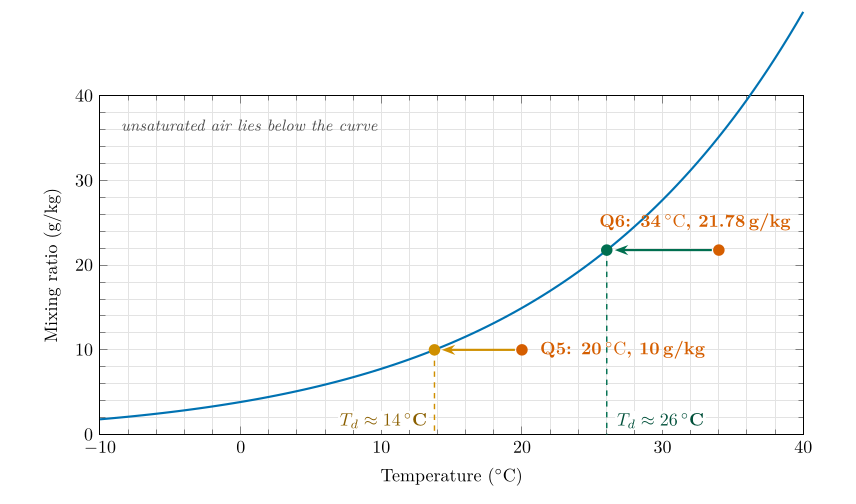
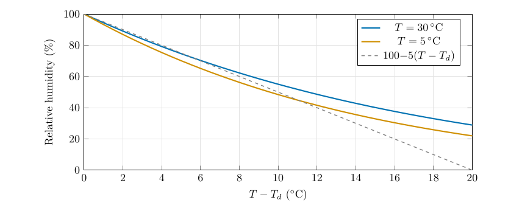
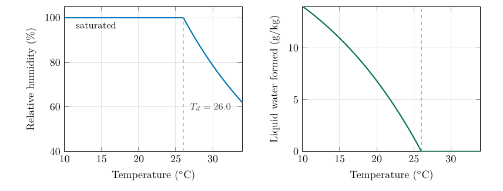
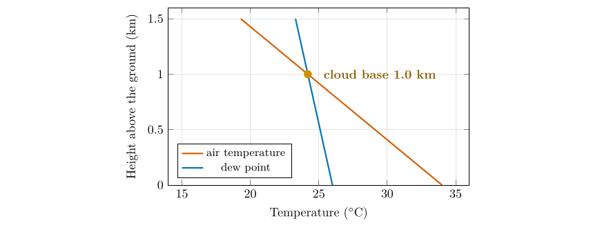

*This chapter answers Moisture Q5 and Q6.*

## 22.1 Cooling the glass

Take a sample of air and cool it, taking nothing away and adding nothing. Two things happen. The vapour in the air stays the same, because no water has gone in or out. The glass (the saturation mixing ratio) shrinks, because colder air can hold less. So the glass gets fuller and the relative humidity rises. At one particular temperature the glass is exactly full. That temperature is the **dew point**, $T_d$.

Definition

The **dew point** is the temperature to which an air sample must be cooled, at constant pressure and without adding or removing water, to reach saturation. At that temperature the saturation mixing ratio equals the sample’s actual mixing ratio, $w_s(T_d)=w$.

If you cool the air below its dew point the surplus vapour cannot stay as vapour. It condenses: into dew on cold grass, into fog near the ground, into cloud higher up. A cold can of drink on a summer day is covered with water for exactly this reason: the air against the can is cooled below its dew point.

## 22.2 Three ways to find a dew point

All three give the same answer. Question 5 asks for the first; the others are checks.

1.  **Graph.** Plot the air as a point (temperature across, mixing ratio up). Cooling moves the point horizontally to the left, because only the temperature changes. Stop where the point meets the saturation curve. Read the temperature underneath.

2.  **The table, backwards.** Find the two rows whose mixing ratios bracket the sample’s, and interpolate for the temperature.

3.  **Formula.** Compute the vapour pressure $e=wp/(622+w)$ and invert the saturation formula (Appendix [C.1](/teaching/atmosphere/app-p3/#p3-app:formulas)).

## 22.3 Question 5: 20 $^{\circ}\mathrm{C}$ and 10 $\mathrm{g\,kg^{-1}}$ {#p3-sec:q5}

The question

Consider a sample of air with a temperature of 20 $^{\circ}\mathrm{C}$ and a mixing ratio of 10 $\mathrm{g\,kg^{-1}}$. Plot the point on a graph of saturation mixing ratio against temperature (Figure [21.2](/teaching/atmosphere/p3-ch02_moisture/#p3-fig:ws)), and show on the graph to which temperature the sample must cool before it reaches saturation.

**Method A: the graph.**

1.  Mark the point: 20 $^{\circ}\mathrm{C}$ on the horizontal axis, 10 $\mathrm{g\,kg^{-1}}$ on the vertical axis.

2.  Cooling moves the point to the left along the horizontal line at 10 $\mathrm{g\,kg^{-1}}$. Draw an arrow in that direction.

3.  The arrow meets the curve where the air is saturated. (At that point the curve’s height, $w_s$, equals 10 $\mathrm{g\,kg^{-1}}$.)

4.  Draw a vertical line down from the meeting point to the temperature axis and read the value.

\

**Figure 22.1.** The graph solved for both questions. Each air sample is a red dot; cooling moves it horizontally to the curve; the dew point is read on the temperature axis. For Question 5 it is 13.8 $^{\circ}\mathrm{C}$ (about 14 $^{\circ}\mathrm{C}$); for Question 6 it is 26.0 $^{\circ}\mathrm{C}$.

**Method B: the table backwards.** The sample holds 10 $\mathrm{g\,kg^{-1}}$. Table [21.1](/teaching/atmosphere/p3-ch02_moisture/#p3-tab:table1) gives 8.882 $\mathrm{g\,kg^{-1}}$ at 12 $^{\circ}\mathrm{C}$ and 10.14 $\mathrm{g\,kg^{-1}}$ at 14 $^{\circ}\mathrm{C}$, so the dew point is between 12 and 14 $^{\circ}\mathrm{C}$. The fraction of the way from 12 to 14 is $$\frac{10-8.882}{10.14-8.882}=\frac{1.118}{1.258}=0.89,
\qquad\text{so}\qquad T_d\approx12+0.89\times2=13.8\ \ensuremath{^{\circ}\mathrm{C}}.$$

**Method C: formula.** The vapour pressure is $e=\dfrac{10\times995.5}{622+10}=15.75$ hPa, and inverting $e_s(T)=6.112\exp[17.67T/(T+243.5)]$ (Bolton 1980) gives $T_d=13.78$ $^{\circ}\mathrm{C}$.

Answer to Moisture Q5

The sample cools along the horizontal line at 10 $\mathrm{g\,kg^{-1}}$ and meets the curve at about **14 $^{\circ}\mathrm{C}$** (13.8 $^{\circ}\mathrm{C}$). That is its dew point.

**Check.** The dew point must be lower than the air temperature (20 $^{\circ}\mathrm{C}$), and 14 $^{\circ}\mathrm{C}$ is. At 14 $^{\circ}\mathrm{C}$ Table [21.1](/teaching/atmosphere/p3-ch02_moisture/#p3-tab:table1) says the air could hold 10.14 $\mathrm{g\,kg^{-1}}$, only a little more than the 10 $\mathrm{g\,kg^{-1}}$ it has: so the air is just short of saturated at 14 $^{\circ}\mathrm{C}$, as it should be.

## 22.4 Question 6: 34 $^{\circ}\mathrm{C}$ and 62 % humidity {#p3-sec:q6}

The question

A sample of air has a temperature of 34 $^{\circ}\mathrm{C}$ and a relative humidity of 62 %. What is its saturation mixing ratio, its mixing ratio and its dew point?

**Method.**

1.  Saturation mixing ratio at 34 $^{\circ}\mathrm{C}$, from Table [21.1](/teaching/atmosphere/p3-ch02_moisture/#p3-tab:table1): $35.134\ \ensuremath{\mathrm{g\,kg^{-1}}}$.

2.  Mixing ratio: $w=w_s\times\mathrm{RH}/100=35.134\times0.62=21.78\ \ensuremath{\mathrm{g\,kg^{-1}}}$.

3.  Dew point: find the temperature at which $w_s=21.78\ \ensuremath{\mathrm{g\,kg^{-1}}}$. Table [21.1](/teaching/atmosphere/p3-ch02_moisture/#p3-tab:table1) has 21.734 at 26 $^{\circ}\mathrm{C}$ and 24.557 at 28 $^{\circ}\mathrm{C}$. The value 21.78 is just above the 26 $^{\circ}\mathrm{C}$ entry: $$\frac{21.78-21.734}{24.557-21.734}=\frac{0.046}{2.823}=0.016,\qquad T_d\approx26+0.016\times2=26.03\ \ensuremath{^{\circ}\mathrm{C}}.$$

Answer to Moisture Q6

Saturation mixing ratio: **35.134 $\mathrm{g\,kg^{-1}}$**. Mixing ratio: **35.134 $\times$ 0.62 $=$ 21.78 $\mathrm{g\,kg^{-1}}$**. Dew point: about **26 $^{\circ}\mathrm{C}$**.

Why 26 °C, not 25 °C

A dew point of 25 $^{\circ}\mathrm{C}$ is an easy slip here, but it cannot be right, and there are three independent ways to see it.

1.  **The table.** At 25 $^{\circ}\mathrm{C}$ air can hold at most about 20.4 $\mathrm{g\,kg^{-1}}$ (half way between 19.21 and 21.734, which is 20.47). The sample holds 21.78 $\mathrm{g\,kg^{-1}}$, *more* than that. At 25 $^{\circ}\mathrm{C}$ it would be oversaturated: a relative humidity of $21.78/20.44=107\,\%$.

2.  **The graph.** In Figure [22.1](/teaching/atmosphere/p3-ch03_dewpoint/#p3-fig:dewgraph) the horizontal line at 21.78 $\mathrm{g\,kg^{-1}}$ meets the curve at 26 $^{\circ}\mathrm{C}$. At 25 $^{\circ}\mathrm{C}$ the line lies above the curve, in the supersaturated region.

3.  **The rule of thumb** (next section): $\mathrm{RH}\approx100-5\times(T-T_d)$. A dew point of 26 $^{\circ}\mathrm{C}$ gives $100-5\times8=60\,\%$, close to the 62 % we started with. A dew point of 25 $^{\circ}\mathrm{C}$ would give 55 %.

## 22.5 A quick check by rule of thumb

Each degree by which the dew point lies below the temperature lowers the relative humidity by about 5 %. Written as a formula, $$
\mathrm{RH}\approx100-5\,(T-T_d),\tag{22.1}
$$ *where*

|  |  |  |
|:---|:---|:---|
| $\mathrm{RH}$ | relative humidity (%) | estimated |
| $T,\ T_d$ | air temperature and dew point ($^{\circ}\mathrm{C}$) |  |

good to within a few percent for RH above about 50 %. Turned round, $T-T_d\approx(100-\mathrm{RH})/5$: air at 80 % is about 4 $^{\circ}\mathrm{C}$ above its dew point; at 50 % about 10 $^{\circ}\mathrm{C}$.

\

The rule of thumb against the exact relationship. For ordinary temperatures the exact curves stay close to the straight line.

## 22.6 What happens below the dew point

Continue cooling the Question 6 sample below 26 $^{\circ}\mathrm{C}$. The air can no longer hold all its vapour, so the surplus condenses. At each temperature the vapour left is $w_s(T)$, and the difference is liquid water: $$
\text{condensed water}=w-w_s(T).\tag{22.2}
$$ *where*

|  |  |  |
|:---|:---|:---|
| $w$ | mixing ratio of the air before cooling ($\mathrm{g\,kg^{-1}}$) |  |
| $w_s(T)$ | saturation mixing ratio at the new, lower temperature ($\mathrm{g\,kg^{-1}}$) | Table [21.1](/teaching/atmosphere/p3-ch02_moisture/#p3-tab:table1) |

Cooled to 20 $^{\circ}\mathrm{C}$, the sample holds only $14.956\,\ensuremath{\mathrm{g\,kg^{-1}}}$ as vapour, so $21.78-14.956=6.8\,\ensuremath{\mathrm{g\,kg^{-1}}}$ has turned to liquid. That is dew on the ground, or fog, or cloud droplets. Condensation also releases latent heat, which is why cloud keeps air warmer than it would otherwise be as it cools.

\

The Question 6 sample cooled from 34 $^{\circ}\mathrm{C}$. Above 26 $^{\circ}\mathrm{C}$ nothing condenses and the relative humidity rises as the glass shrinks. Below 26 $^{\circ}\mathrm{C}$ the air stays at 100 % and the surplus vapour condenses: 6.8 $\mathrm{g\,kg^{-1}}$ by the time it reaches 20 $^{\circ}\mathrm{C}$.

## 22.7 Why meteorologists prefer the dew point

- **It measures the vapour itself.** Heating or cooling the air leaves the dew point unchanged (until condensation), unlike the relative humidity.

- **It is a temperature,** so it is easy to compare with the air temperature: the gap $T-T_d$ tells you at a glance how close the air is to making dew, fog or cloud.

- **It describes comfort.** Most people find a dew point below about 10 $^{\circ}\mathrm{C}$ dry and comfortable and one above about 20 $^{\circ}\mathrm{C}$ oppressive.

- **It appears on every station model** at the bottom left of the circle, as you will see in Chapter [27](/teaching/atmosphere/p3-ch08_station/#p3-ch:station).

## 22.8 The dew point and the height of cloud base {#p3-sec:cloudbase}

Air that rises expands and cools at about 9.8 K per kilometre (the dry adiabatic lapse rate, derived in Part I, Eq. ([8.2](/teaching/atmosphere/p1-ch07_stability/#p1-eq:dalr))). Its dew point falls more slowly, by about 1.8 K per kilometre, because the pressure falls as it rises. The temperature and the dew point therefore approach each other by 8 K per kilometre, and when they meet the air is saturated and cloud forms. Starting with a gap of $T-T_d$ degrees, they meet after rising $$
z\approx\frac{T-T_d}{8}\ \mathrm{km}\approx125\,(T-T_d)\ \mathrm{m}.\tag{22.3}
$$ *where*

|  |  |  |
|:---|:---|:---|
| $z$ | height of cloud base above the ground | calculated |
| $T,\ T_d$ | surface temperature and dew point ($^{\circ}\mathrm{C}$) |  |
| $8$ | rate at which $T$ and $T_d$ approach in rising air ($9.8-1.8$, $\mathrm{K\,km^{-1}}$) |  |

Worked example: where will cloud form?

The air of Question 6 has $T-T_d=34-26=8$ $^{\circ}\mathrm{C}$. If it is lifted (by a hill or by convection), cloud forms after $125\times8=1000$ m: the cloud base is about one kilometre above the surface. A day with $T=30$ $^{\circ}\mathrm{C}$ and $T_d=18$ $^{\circ}\mathrm{C}$ has a gap of 12 $^{\circ}\mathrm{C}$ and a cloud base near 1500 m.

\

Rising air, starting at 34 $^{\circ}\mathrm{C}$ with a dew point of 26 $^{\circ}\mathrm{C}$. The temperature falls 9.8 K per kilometre and the dew point 1.8 K per kilometre. They meet at a height of 1.0 km.

## 22.9 Questions that come up

A question that comes up

**Does the dew point change when the day warms up?**\
Not because of the warming. If no water is added or removed, the mixing ratio is fixed, and so is the dew point. In the afternoon the *relative humidity* falls because the temperature rises. The dew point changes only when the air gains moisture (evaporation from soil and plants, an incoming sea breeze) or loses it (rain, a dry wind).

A question that comes up

**Can the dew point be higher than the temperature?**\
Not in the open air for more than a moment: it would mean the air is oversaturated, and the surplus vapour would condense at once, lowering the dew point. At most the two are equal (RH $=100\,\%$), as in fog.

A question that comes up

**What if the dew point is below freezing?**\
Then the vapour deposits directly as ice (frost) when the air is cooled to it. Strictly the temperature of deposition is the *frost point*, which is a degree or two above the dew point. Table [21.1](/teaching/atmosphere/p3-ch02_moisture/#p3-tab:table1) is for saturation over liquid water; the questions here never need the ice case.

## 22.10 Try it yourself: Practice Set 22

Practice Set 22: the dew point

1.  Air at 30 $^{\circ}\mathrm{C}$ has a mixing ratio of 12 $\mathrm{g\,kg^{-1}}$. Find its dew point (a) from Table [21.1](/teaching/atmosphere/p3-ch02_moisture/#p3-tab:table1) by interpolation and (b) with the rule of thumb after finding its RH.

2.  Air at 20 $^{\circ}\mathrm{C}$ has a relative humidity of 50 %. What is its dew point?

3.  On an afternoon the air is at 28 $^{\circ}\mathrm{C}$ with a relative humidity of 40 %. Overnight the temperature falls to 12 $^{\circ}\mathrm{C}$ with no change in the amount of vapour. Will dew form?

4.  Find the cloud base for air with $T=30$ $^{\circ}\mathrm{C}$ and $T_d=18$ $^{\circ}\mathrm{C}$.

5.  Air at 25 $^{\circ}\mathrm{C}$ has a dew point of 15 $^{\circ}\mathrm{C}$. What are its mixing ratio and relative humidity?

6.  Cool the Question 6 sample (34 $^{\circ}\mathrm{C}$, 21.78 $\mathrm{g\,kg^{-1}}$) to 20 $^{\circ}\mathrm{C}$: how much liquid water forms per kilogram of air?

Answers to Practice Set 22

1.  \(a\) Table [21.1](/teaching/atmosphere/p3-ch02_moisture/#p3-tab:table1): 16 $^{\circ}\mathrm{C}$ holds 11.56 and 18 $^{\circ}\mathrm{C}$ holds 13.162, so $T_d=16+2\times(12-11.56)/(13.162-11.56)=16.55\approx16.6$ $^{\circ}\mathrm{C}$. (b) $w_s(30)=27.694$, RH $=12/27.694=43\,\%$; the rule gives $T-T_d=(100-43)/5=11.4$, so $T_d\approx18.6$ $^{\circ}\mathrm{C}$. The rule is only rough at low humidity; the table answer is better.

2.  $w=0.50\times14.956=7.478$ $\mathrm{g\,kg^{-1}}$. Table [21.1](/teaching/atmosphere/p3-ch02_moisture/#p3-tab:table1): 8 $^{\circ}\mathrm{C}$ holds 6.771 and 10 $^{\circ}\mathrm{C}$ holds 7.762, so $T_d=8+2\times(7.478-6.771)/(7.762-6.771)=9.4$ $^{\circ}\mathrm{C}$. (The rule of thumb gives 10 $^{\circ}\mathrm{C}$.)

3.  $w=0.40\times24.557=9.82$ $\mathrm{g\,kg^{-1}}$. At 12 $^{\circ}\mathrm{C}$ the air can hold only 8.882 $\mathrm{g\,kg^{-1}}$, which is less: so yes, dew (or fog) forms. The dew point is 13.5 $^{\circ}\mathrm{C}$, so dew begins when the air cools through 13.5 $^{\circ}\mathrm{C}$.

4.  $125\times(30-18)=1500$ m.

5.  $w=w_s(15\,\ensuremath{^{\circ}\mathrm{C}})$ (the air is just saturated at its dew point) $=10.83$ $\mathrm{g\,kg^{-1}}$. $w_s(25)=20.44$, so RH $=10.83/20.44=53\,\%$. (Rule: $100-5\times10=50\,\%$.)

6.  $21.78-14.956=6.8$ $\mathrm{g\,kg^{-1}}$ of liquid water.

## 22.11 The dew point in Python

These functions compute the equations of this chapter, and the book’s tests check them against its answers.

    def vapour_pressure(w, p_hpa=TABLE_PRESSURE_HPA):
        """Vapour pressure (hPa) from the mixing ratio (g/kg)."""
        return w * p_hpa / (622.0 + w)

    def dew_point(w, p_hpa=TABLE_PRESSURE_HPA):
        """Dew point (deg C) from the mixing ratio (g/kg)."""
        x = math.log(vapour_pressure(w, p_hpa) / 6.112)
        return 243.5 * x / (17.67 - x)

    def rh_rule_of_thumb(t_c, t_d):
        """Approximate relative humidity (%) from the temperature and the dew point."""
        return 100.0 - 5.0 * (t_c - t_d)

    def cloud_base(t_c, t_d):
        """Approximate height of the cloud base (m)."""
        return 125.0 * (t_c - t_d)

`dew_point(10)` returns about 13.8, the answer to Moisture Q5.

Bolton, D. (1980) The computation of equivalent potential temperature. Monthly Weather Review 108, 1046–1053. [https://doi.org/10.1175/1520-0493(1980)108\<1046:TCOEPT\>2.0.CO;2](https://doi.org/10.1175/1520-0493(1980)108<1046:TCOEPT>2.0.CO;2)

