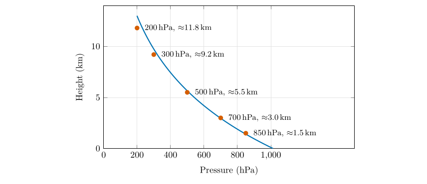
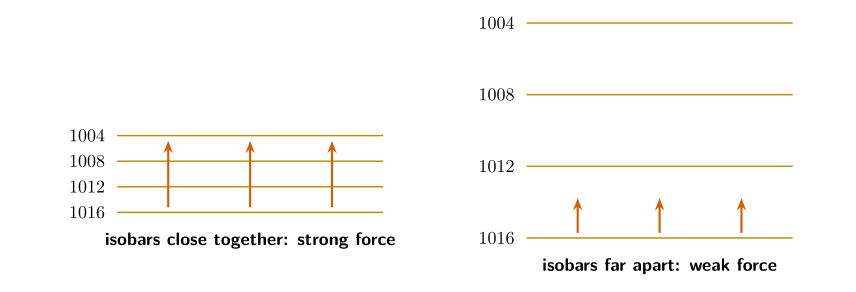
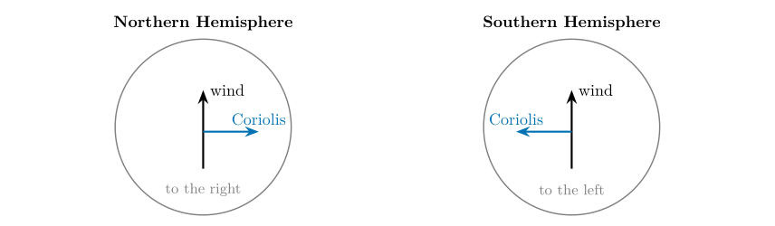
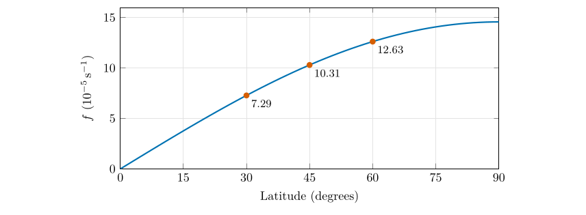
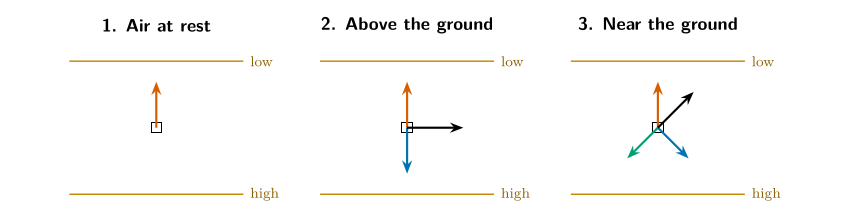

*This chapter is the background for the motion questions.*

## 23.1 Newton’s law for a parcel of air

Wind is air that is moving, and air moves for the same reason anything moves: forces act on it. Newton’s second law says that the acceleration of a parcel equals the total force on it divided by its mass. It is convenient to talk about the force *per unit mass* (that is, as an acceleration, in m s$^{-2}$), so we never need the mass of the parcel.

For large-scale winds only three horizontal forces matter:

1.  the **pressure gradient force**, which starts the air moving;

2.  the **Coriolis force**, which steers it once it is moving;

3.  **friction**, which slows it near the ground.

If the three add up to zero the wind is steady, and the whole of Part II is about what happens when they do.

## 23.2 Pressure, and why it falls with height

The pressure at any level is the weight of the air above it, spread over one square metre. At sea level that weight is about 10 tonnes per square metre, which is a pressure of about 1013 hPa. Climb, and there is less air above you, so the pressure drops. Half the atmosphere’s mass lies below about 5.5 km, so the pressure there is about 500 hPa; at the cruising height of airliners it is about 250 hPa.

\

Pressure falls roughly exponentially with height, by a factor of $e$ every 8 km or so: the halving rule of Part I (Chapter [3](/teaching/atmosphere/p1-ch02_pressure/#p1-ch:pressure)). The red dots mark the standard pressure levels used on upper-air charts; those used here (850, 500 and 300 hPa) are at about 1.5, 5.5 and 9 km.

## 23.3 The pressure gradient force

Pressure also varies from place to place at the same height. Air is pushed from where the pressure is higher towards where it is lower, just as water runs downhill. The push is the **pressure gradient force** (PGF). Per unit mass it is $$
\text{PGF}=-\frac{1}{\rho}\,\frac{\Delta p}{\Delta n},\tag{23.1}
$$ *where*

|  |  |  |
|:---|:---|:---|
| $\text{PGF}$ | pressure gradient force per unit mass (m s$^{-2}$) | calculated |
| $\rho$ | air density (kg m$^{-3}$) | about 1.2 near the ground |
| $\Delta p/\Delta n$ | pressure change per unit distance measured *across* the isobars (Pa m$^{-1}$) | from the map |

The minus sign means that the force points down the gradient, from high to low pressure (Holton and Hakim 2013, ch. 1).

- **Direction:** from higher to lower pressure, at right angles to the isobars.

- **Magnitude:** proportional to the pressure difference between two points, and inversely proportional to the distance between them. Closely spaced isobars mean a strong force and a strong wind.

\

The same pressure difference (here 12 hPa) squeezed into a short distance (left) and spread over a long one (right). The force, shown by the red arrows, is proportional to the gradient.

Worked example: how big is the pressure gradient force?

The isobars of Figure [26.1](/teaching/atmosphere/p3-ch07_friction/#p3-fig:fig5) are 1012 and 1016 mb, that is 4 hPa $=400$ Pa apart. Suppose they are 200 km apart ($2\times10^5$ m). Then $$\text{PGF}=\frac{1}{1.2}\times\frac{400}{2\times10^{5}}=1.7\times10^{-3}\ \mathrm{m\,s^{-2}}.$$ That looks tiny, but acting for an hour (3600 s) with nothing to oppose it, it would add 6 m s$^{-1}$ to the wind speed. That is how quickly a pressure difference sets the air going.

## 23.4 The Coriolis force

The Earth turns once a day, and we live on its surface, so we measure motion from a spinning frame. An object that moves freely in a straight line (as seen from space) appears to us to curve. We describe the curving with a force, the **Coriolis force**, which has three properties you must remember.

1.  **Direction:** at right angles to the motion. It acts to the **right** in the Northern Hemisphere and to the **left** in the Southern Hemisphere.

2.  **Magnitude:** it increases with the wind speed $V$ and with latitude: $\text{Coriolis}=f\,V$, where $f=2\Omega\sin\varphi$ is the Coriolis parameter and $\Omega=7.292\times10^{-5}$ s$^{-1}$ is the Earth’s rotation rate.

3.  **It does no work.** Being at right angles to the motion, it changes the direction of the wind but never its speed.

\

The Coriolis force always acts at right angles to the motion: to the right in the north and to the left in the south.

\

The Coriolis parameter against latitude. It is zero at the equator, where the force vanishes, and largest at the poles.

| **Latitude** | $f$ **(s$^{-1}$)** | **Coriolis acceleration for 10 $\mathrm{m\,s^{-1}}$ (m s$^{-2}$)** |
|---:|---:|---:|
| 0$^{\circ}$ | 0 | 0 |
| 10$^{\circ}$ | $2.5\times10^{-5}$ | $2.5\times10^{-4}$ |
| 30$^{\circ}$ | $7.3\times10^{-5}$ | $7.3\times10^{-4}$ |
| 45$^{\circ}$ | $1.03\times10^{-4}$ | $1.03\times10^{-3}$ |
| 60$^{\circ}$ | $1.26\times10^{-4}$ | $1.26\times10^{-3}$ |
| 90$^{\circ}$ | $1.46\times10^{-4}$ | $1.46\times10^{-3}$ |

: The Coriolis parameter $f=2\Omega\sin\varphi$ and the acceleration it gives to a wind of 10 m s$^{-1}$.

A question that comes up

**Does the Coriolis force make water spin the opposite way in a bath in the two hemispheres?**\
No. For a bath or a sink the force is minute compared with the shape of the basin and the way the water was stirred. The Coriolis force matters for motions that last hours and cover hundreds of kilometres: winds, ocean currents, storms.

A question that comes up

**Why is the Coriolis force zero at the equator?**\
It depends on the *vertical* component of the Earth’s rotation, which is $\Omega\sin\varphi$. At the equator the rotation axis is horizontal, so that component is zero.

## 23.5 Friction

Near the ground the air rubs against the surface: grass, trees, buildings, hills, waves. The result is a **frictional force** that always acts **opposite to the wind**, slowing it. Its strength depends on how rough the surface is (a forest or a city is much rougher than a calm sea) and increases with the wind speed. Friction is important only in the lowest kilometre or two of the atmosphere, the *boundary layer*. Above that the air is nearly free of it, which is why the winds at 500 or 300 hPa are so much simpler than those at the surface.

## 23.6 The three forces side by side

| **Force** | **Direction** | **Magnitude** |
|:---|:---|:---|
| Pressure gradient | From higher to lower pressure, at right angles to the isobars | Proportional to the pressure difference between two points (and inversely to their distance) |
| Coriolis | At right angles to the airflow: to the **right** in the Northern Hemisphere, to the **left** in the Southern Hemisphere | Increases with wind strength and with latitude ($fV$ with $f=2\Omega\sin\varphi$) |
| Friction | Opposite to the direction of the airflow | Depends on the surface characteristics that obstruct the airflow (and increases with speed) |

: The three forces.

## 23.7 Three situations to hold in your head

\

\(1\) At rest only the pressure gradient force acts. (2) High above the ground the Coriolis force balances it and the wind blows along the isobars: the geostrophic wind (Chapter [25](/teaching/atmosphere/p3-ch06_geostrophic/#p3-ch:geo)). (3) Near the ground friction joins in, the three forces cancel, and the wind crosses the isobars towards low pressure (Chapter [26](/teaching/atmosphere/p3-ch07_friction/#p3-ch:fric)). Red: pressure gradient force; blue: Coriolis; green: friction; black: the wind.

## 23.8 Try it yourself: Practice Set 23

Practice Set 23: forces

1.  Two isobars are 4 hPa apart and 100 km from each other. Find the pressure gradient force per unit mass, taking $\rho=1.2$ kg m$^{-3}$. How does it compare with the 200 km case in the worked example?

2.  Find the Coriolis parameter at 60$^{\circ}$N and the Coriolis acceleration on a wind of 15 $\mathrm{m\,s^{-1}}$.

3.  A wind is blowing northward in the Southern Hemisphere. Which way does the Coriolis force push it?

4.  Why are strong winds found where the isobars are close together?

Answers to Practice Set 23

1.  $\mathrm{PGF}=\dfrac{1}{1.2}\times\dfrac{400}{10^{5}}=3.3\times10^{-3}\ \mathrm{m\,s^{-2}}$: exactly *twice* the 200 km value, because the distance is halved.

2.  $f=2\times7.292\times10^{-5}\times\sin60\ensuremath{^{\circ}}=1.26\times10^{-4}\ \mathrm{s^{-1}}$; $fV=1.26\times10^{-4}\times15=1.9\times10^{-3}\ \mathrm{m\,s^{-2}}$.

3.  To the left of its motion, which is **west**.

4.  Close isobars mean a steep pressure gradient, so the pressure gradient force is large; the Coriolis force (and, near the ground, friction) must grow to balance it, which needs a faster wind.

Holton, J.R. and Hakim, G.J. (2013) An introduction to dynamic meteorology, 5th ed. Academic Press, Amsterdam.

