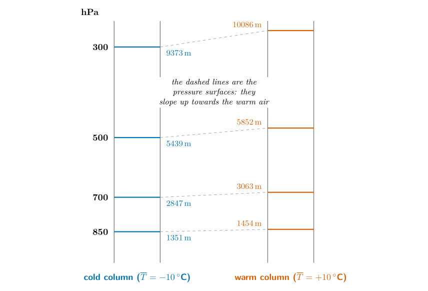
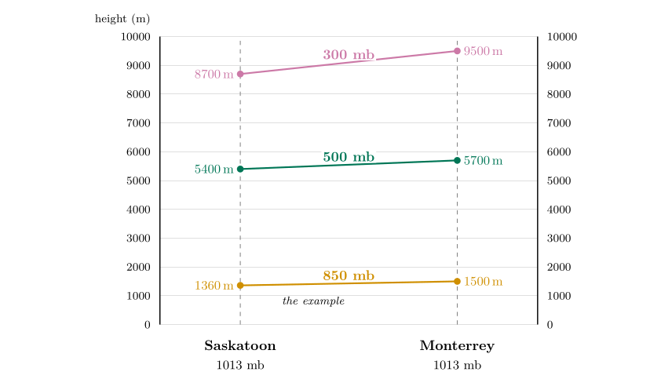
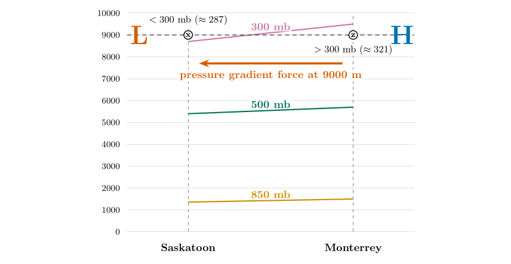
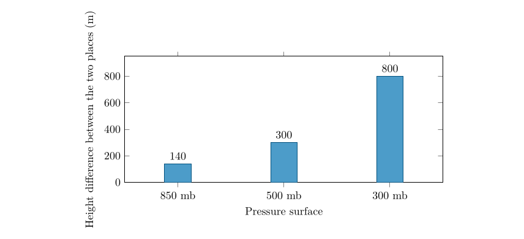
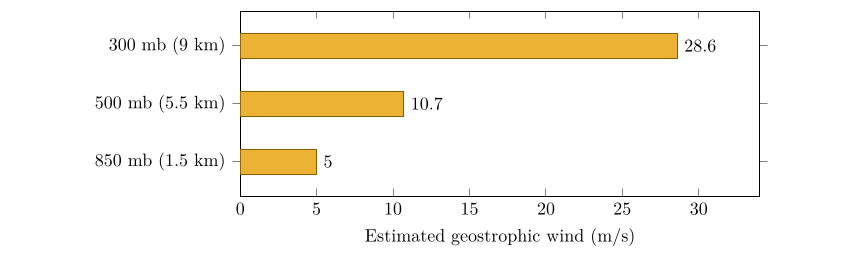

*This chapter answers Motion Q1 to Q6.*

## 24.1 What a pressure surface is

Upper-air charts do not show pressure at a fixed height; they show the *height at which the pressure has a chosen value*. The chart for 500 hPa, for example, is a map of the height of the surface on which the pressure is 500 hPa. Such a surface is called a **pressure surface** (or isobaric surface). Where the pressure surface is high, the pressure at a fixed level nearby is high; where it is low, the pressure is low. The height contours on the chart therefore play the part of isobars, and the wind blows along them (Chapter [25](/teaching/atmosphere/p3-ch06_geostrophic/#p3-ch:geo)).

Pressure surfaces are not flat. They are high over warm air and low over cold air, and that single fact explains Questions 1 to 6.

## 24.2 Why cold air gives low pressure surfaces

Pressure at a point is the weight of the air above it. A column of cold air is denser, so a given amount of air (a given pressure drop) occupies less height. A column of warm air is less dense, so the same pressure drop is spread over a greater height: the warm column is thicker. Start both columns with the same pressure at the ground and the 500 hPa surface will be lower over the cold one than over the warm one, and the difference grows with height.

The exact relationship is the **hypsometric equation** (Wallace and Hobbs 2006, ch. 3). It is the exponential law of Part I, $p=p_0e^{-z/H}$ with $H=R_dT/g$ (Part I, Eq. ([3.3](/teaching/atmosphere/p1-ch02_pressure/#p1-eq:expo))), written for a layer: for the layer between pressures $p_1$ (lower) and $p_2$ (upper), $$
\Delta z = z_2-z_1=\frac{R_d\,\overline{T}}{g}\,\ln\frac{p_1}{p_2},\tag{24.1}
$$ *where*

|  |  |  |
|:---|:---|:---|
| $\Delta z$ | thickness of the layer (m) | calculated |
| $\overline{T}$ | mean temperature of the layer (K) |  |
| $R_d$ | gas constant for dry air (J kg$^{-1}$ K$^{-1}$) | 287 |
| $g$ | acceleration due to gravity (m s$^{-2}$) | 9.81 |
| $p_1,\ p_2$ | pressures at the bottom and top of the layer (hPa) |  |

The thickness $\Delta z$ is directly proportional to the mean temperature. Part I used the same law the other way round, to find the scale height of a layer from a sounding (Part I, Eq. ([8.1](/teaching/atmosphere/p1-ch07_stability/#p1-eq:Hdata))), and to explain why the troposphere is thickest over the warm tropics (Part I, § [7.4](/teaching/atmosphere/p1-ch06_lapse/#p1-sec:q11)).

Worked example: thickness of the 1000 to 500 hPa layer

For a cold layer with $\overline{T}=-10$ $^{\circ}\mathrm{C}$ $=263.15$ K, $$\Delta z=\frac{287\times263.15}{9.81}\ln\frac{1000}{500}=7699\times0.693=5339\ \mathrm{m}.$$ For a warm layer with $\overline{T}=+10$ $^{\circ}\mathrm{C}$ $=283.15$ K the result is 5745 m. A 20-degree difference in mean temperature makes the layer 406 m thicker, about 20 m per degree.

\

**Figure 24.1.** Two columns of air that start with the same pressure at the ground (1013 hPa). Each pressure level sits higher over the warm column, and the difference (the slope of the surface) grows with height: 103 m at 850 hPa, 216 m at 700 hPa, 413 m at 500 hPa and 712 m at 300 hPa. (The heights come from the hypsometric equation with a constant mean temperature.)

## 24.3 The data

Table [24.1](/teaching/atmosphere/p3-ch05_surfaces/#p3-tab:twoplaces) gives the pressure level, the height and the temperature at two places, Saskatoon in Canada and Monterrey in Mexico (about 2 990 km apart, Monterrey to the south):

+-------------------------+-----------------------------------------+-----------------------------------------+
|                         | **Saskatoon**                           | **Monterrey**                           |
+========================:+===========:+===========================:+===========:+===========================:+
| 2-3(lr)4-5 **Pressure** | **Height** | **Temp.**                  | **Height** | **Temp.**                  |
+-------------------------+------------+----------------------------+------------+----------------------------+
| 300 mb                  | 8700 m     | $-47$ $^{\circ}\mathrm{C}$ | 9500 m     | $-38$ $^{\circ}\mathrm{C}$ |
+-------------------------+------------+----------------------------+------------+----------------------------+
| 500 mb                  | 5400 m     | $-25$ $^{\circ}\mathrm{C}$ | 5700 m     | $-12$ $^{\circ}\mathrm{C}$ |
+-------------------------+------------+----------------------------+------------+----------------------------+
| 850 mb                  | 1360 m     | $-1$ $^{\circ}\mathrm{C}$  | 1500 m     | 15 $^{\circ}\mathrm{C}$    |
+-------------------------+------------+----------------------------+------------+----------------------------+

: Table 24.1. Pressure levels over Saskatoon and Monterrey.

Notice that Monterrey is warmer at every level, and every one of its pressure surfaces is higher.

## 24.4 Question 1: plot the pressure surfaces {#p3-sec:s1q1}

The question

Following the example of 850 mb, plot the heights of the 500 and 300 mb levels on a diagram with Saskatoon on the left and Monterrey on the right, draw lines connecting the two points for each level, and label each line.

**Method.**

1.  The diagram has Saskatoon on the left and Monterrey on the right, with height up the sides (0 to 10 000 m). The 850 mb line, from 1360 m to 1500 m, is the example: from 1360 m to 1500 m.

2.  For 500 mb put a dot at 5400 m above Saskatoon and a dot at 5700 m above Monterrey. Join them with a straight line and label it “500 mb”.

3.  For 300 mb put dots at 8700 m (Saskatoon) and 9500 m (Monterrey), join them, and label the line “300 mb”.

\

**Figure 24.2.** The diagram completed for Question 1. The 500 and 300 mb lines slope up towards Monterrey, and the slope is greater for the higher level.

Answer to Motion Q1

Two lines are added to the diagram: 500 mb from 5400 m (Saskatoon) to 5700 m (Monterrey), and 300 mb from 8700 m to 9500 m. Each rises to the right, more steeply than the one below it.

## 24.5 Questions 2 and 3: where does pressure fall fastest?

Answer to Motion Q2

**Saskatoon.** Its pressure surfaces are lower: the 500 mb surface is reached at 5400 m instead of 5700 m, the 300 mb surface at 8700 m instead of 9500 m. Less height is needed to use up the same pressure, so pressure falls faster with height.

Answer to Motion Q3

**Saskatoon is colder at each height** ($-1$ against 15 $^{\circ}\mathrm{C}$ at 850 mb, $-25$ against $-12$ $^{\circ}\mathrm{C}$ at 500 mb, $-47$ against $-38$ $^{\circ}\mathrm{C}$ at 300 mb). Cold air is denser, so a column of it is thinner: the pressure falls faster with height.

**Check with the hypsometric equation.** Use the mean of the two temperatures that bound each layer. $$\begin{align*}
\text{Saskatoon:}\ \Delta z_{850\to300}&=29.27\,[\,260.15\ln\tfrac{850}{500}+237.15\ln\tfrac{500}{300}\,]=29.27\,[138.0+121.1]=7587\ \mathrm{m},\\
\text{Monterrey:}\ \Delta z_{850\to300}&=29.27\,[\,274.65\ln\tfrac{850}{500}+248.15\ln\tfrac{500}{300}\,]=29.27\,[145.7+126.8]=7976\ \mathrm{m}.
\end{align*}$$ The rounded heights give $8700-1360=7340$ m and $9500-1500=8000$ m. Monterrey agrees to 0.3 %; Saskatoon is 3 % off, because the figure’s numbers are rounded. The warmer column is thicker, as predicted.

## 24.6 Question 4: which point has the higher pressure?

The question

Both points x and z are at 9000 m. Which has the highest pressure? At 9000 m write H where the pressure is higher and L where it is lower, then draw an arrow between them showing the direction of the horizontal pressure gradient force.

**Method.**

1.  Pressure decreases with height. At a given height, being *below* a pressure surface means a *higher* pressure than the surface’s value, and being *above* it means a lower pressure.

2.  Point x is above Saskatoon at 9000 m. The 300 mb surface there is at 8700 m, so x is above it: its pressure is *less than* 300 mb.

3.  Point z is above Monterrey at 9000 m. The 300 mb surface there is at 9500 m, so z is below it: its pressure is *more than* 300 mb.

4.  So z has the higher pressure: write H at z (the Monterrey side) and L at x (the Saskatoon side).

5.  The pressure gradient force points from high to low: draw the arrow from z towards x, that is towards Saskatoon.

\

Question 4. At 9000 m x is above the 300 mb line (pressure below 300 mb, L) and z is below it (pressure above 300 mb, H). The pressure gradient force points from z to x: from Monterrey towards Saskatoon.

Answer to Motion Q4

**z** has the higher pressure, because it lies below the 300 mb line at 9000 m. Write **H at z** and **L at x**, and draw the pressure gradient force from z towards x (towards Saskatoon).

**How big are the pressures?** You can estimate them. Above the 300 mb level at Saskatoon, pressure falls about 1 % every 66 m, so 300 m above the 8700 m level it is about $300\,e^{-0.045}=287$ mb. At Monterrey, 9000 m is 500 m below the 9500 m level of 300 mb, so the pressure is higher, about 321 mb. The difference between the two places is therefore about 34 mb, over 2 990 km.

## 24.7 Question 5: where is the pressure gradient greater?

Answer to Motion Q5

The pressure gradient is greater at **9000 m**. The pressure surfaces differ in height by $9500-8700=800$ m between the two places at the 300 mb level, but only by $1500-1360=140$ m at the 850 mb level (about 1500 m).

The slope of the surfaces is what drives the wind. The slope grows with height: 140 m at 850 mb, 300 m at 500 mb and 800 m at 300 mb. If you compare pressures at a fixed height instead, you find the same thing: about 15 mb between the two places at 1500 m, but about 34 mb at 9000 m.

\

The slope of the pressure surfaces between Saskatoon and Monterrey increases with height.

A question that comes up

**The pressure itself is smaller at 9000 m. How can the gradient be greater?**\
Because what drives the wind is the *change* of pressure from place to place, and that depends on the temperature difference accumulated in the whole layer below. On a pressure surface the force per unit mass is $-g\,\Delta z/\Delta n$, and it does not depend on the air density at all. The slope $\Delta z/\Delta n$ grows with height as the colder column’s thickness deficit adds up, so the force does too.

## 24.8 Question 6: what this means for the wind

Answer to Motion Q6

Wind speeds at **9000 m should be greater**, because the pressure gradient force is greater there.

You can put numbers on this. The geostrophic wind (Chapter [25](/teaching/atmosphere/p3-ch06_geostrophic/#p3-ch:geo)) is $V_g=(g/f)\,\Delta z/\Delta n$, Eq. ([25.1](/teaching/atmosphere/p3-ch06_geostrophic/#p3-eq:geo)), where $\Delta z$ is the difference in height of a pressure surface over a distance $\Delta n$. The two places are $\Delta n=2\,990$ km apart, at a mean latitude of $39^\circ$, where $f=2\times7.292\times10^{-5}\times\sin39^\circ=9.16\times10^{-5}$ s$^{-1}$.

Worked example: wind estimates from the slopes

$$\begin{align*}
\text{850 mb:}\quad V_g&=\frac{9.81}{9.16\times10^{-5}}\times\frac{140}{2.99\times10^{6}}=5.0\ \ensuremath{\mathrm{m\,s^{-1}}},\\
\text{500 mb:}\quad V_g&=\frac{9.81}{9.16\times10^{-5}}\times\frac{300}{2.99\times10^{6}}=10.7\ \ensuremath{\mathrm{m\,s^{-1}}},\\
\text{300 mb:}\quad V_g&=\frac{9.81}{9.16\times10^{-5}}\times\frac{800}{2.99\times10^{6}}=28.6\ \ensuremath{\mathrm{m\,s^{-1}}}.
\end{align*}$$ The wind blows from west to east (Monterrey, with the higher surfaces, is to the south, on the right of the wind in the Northern Hemisphere).

\

Geostrophic wind estimated from the slope of the pressure surfaces between the two places. The wind speeds up fivefold from 850 to 300 mb.

These numbers are rough: the heights are rounded, and only two places are used. Real winds at 300 mb are often 50 to 80 $\mathrm{m\,s^{-1}}$. The lesson is nevertheless exact. **The faster the temperature falls towards the pole, the faster the westerly winds aloft, and they strengthen with height.** This is the **thermal wind**, and it is why the jet streams sit near 10 km above the zone where the temperature contrast is greatest.

## 24.9 An experiment: change the temperatures

Replace Saskatoon and Monterrey by two columns that both start at 1013 hPa and have constant mean temperatures $T_1$ and $T_2$. The hypsometric equation then gives the height of each surface. If $T_1=T_2$ every surface is flat: there is no horizontal pressure gradient and no wind, however cold the air. Increase the contrast and the surfaces tilt, increasingly steeply with height.

| **Level** | **Height, cold column** | **Height, warm column** | **Slope** / **wind** |
|---:|---:|---:|---:|
| 850 hPa | 1274 m | 1403 m | 128 m / 6 $\mathrm{m\,s^{-1}}$ |
| 700 hPa | 2685 m | 2955 m | 270 m / 13 $\mathrm{m\,s^{-1}}$ |
| 500 hPa | 5129 m | 5645 m | 517 m / 25 $\mathrm{m\,s^{-1}}$ |
| 300 hPa | 8839 m | 9729 m | 890 m / 42 $\mathrm{m\,s^{-1}}$ |

: Surface slopes and geostrophic winds for two columns with mean temperatures of $-25$ $^{\circ}\mathrm{C}$ and 0 $^{\circ}\mathrm{C}$, 2 000 km apart at 45$^{\circ}$ latitude.

## 24.10 Try it yourself: Practice Set 24

Practice Set 24: pressure surfaces

1.  Find the thickness of the 1000 to 500 hPa layer for mean temperatures of $-10$ $^{\circ}\mathrm{C}$ and $+10$ $^{\circ}\mathrm{C}$, and the difference.

2.  At 40$^{\circ}$N the 500 hPa surface is at 5520 m over town A and 5640 m over town B, which lies 800 km due south of A. Estimate the geostrophic wind and say from which direction it blows.

3.  The 500 mb heights over two stations are 5400 m (P) and 5600 m (Q). Which has the colder air beneath it?

4.  The 500 hPa surface slopes up from north to south. Which way does the wind blow in the Northern Hemisphere?

Answers to Practice Set 24

1.  $5339$ m and $5745$ m (see the worked example); the warm layer is $406$ m thicker.

2.  $f=2\times7.292\times10^{-5}\sin40\ensuremath{^{\circ}}=9.37\times10^{-5}$ s$^{-1}$; $V_g=\dfrac{9.81}{9.37\times10^{-5}}\times\dfrac{120}{8\times10^{5}}=15.7\ \ensuremath{\mathrm{m\,s^{-1}}}$ (about 30 kt). B is to the south and has the higher surface, so the wind has high pressure on its right: it is a **westerly** (blowing from west to east).

3.  P, because a column that is colder is thinner and has lower pressure surfaces.

4.  With the low heights to the north (on the left of the wind), the wind blows from west to east, a westerly. Pressure surfaces that rise towards the equator give westerly winds, which is the pattern over mid-latitudes.

## 24.11 Thickness in Python

These functions compute the equations of this chapter, and the book’s tests check them against its answers.

    def thickness(mean_t_k, p1_hpa, p2_hpa):
        """Hypsometric equation: thickness (m) of the layer between two pressures."""
        return R_D * mean_t_k / G * math.log(p1_hpa / p2_hpa)

A warmer mean temperature gives a larger result: the warmer column is thicker.

## References

Wallace, J.M. and Hobbs, P.V. (2006) Atmospheric science: An introductory survey, 2nd ed. Elsevier Academic Press, Amsterdam.

