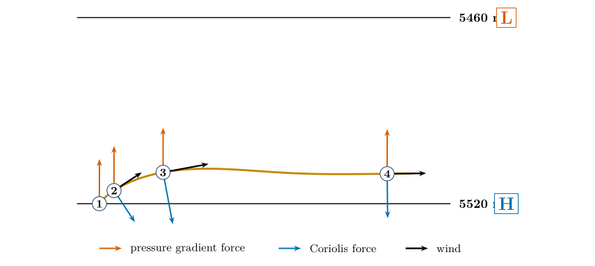
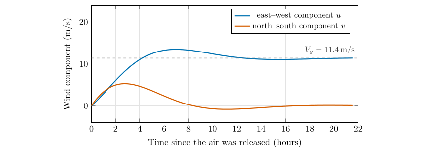
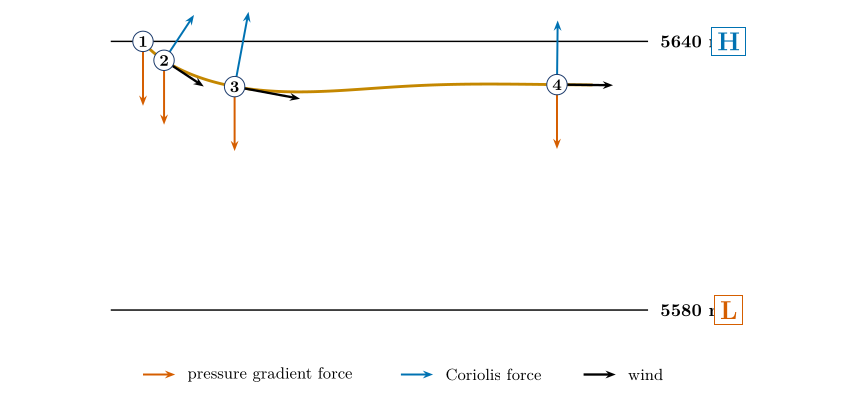
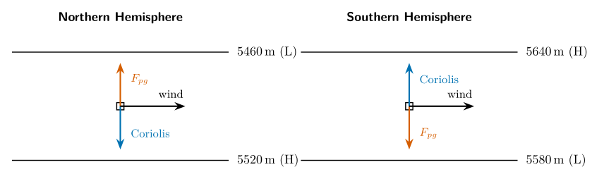
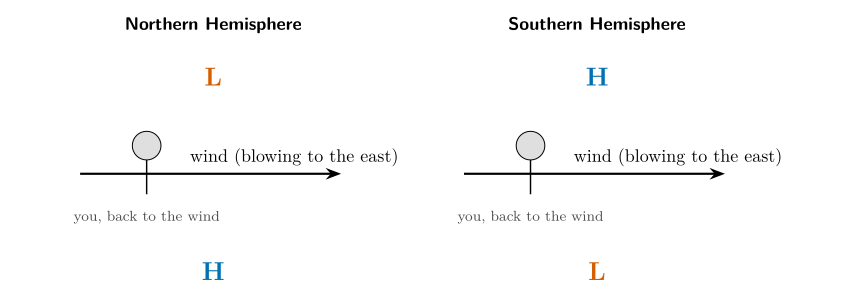
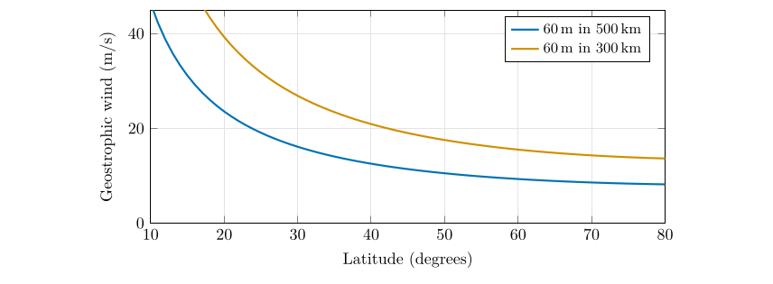

*This chapter answers Motion Q7.*

## 25.1 Two forces in balance

High above the ground, friction can be ignored. Only the pressure gradient force and the Coriolis force act. Suppose they are equal in size and opposite in direction. Then the total force is zero, the air does not accelerate, and the wind is steady. That wind is the **geostrophic wind** (“earth-turning” wind).

The geostrophic wind

The geostrophic wind is the wind for which the pressure gradient force and the Coriolis force exactly balance. It blows *along* the isobars (or the height contours on a pressure-surface chart), with low pressure on its left in the Northern Hemisphere and on its right in the Southern Hemisphere.

Writing the two forces per unit mass, the balance is $$\underbrace{\frac{1}{\rho}\,\frac{\Delta p}{\Delta n}}_{\text{pressure gradient force}}=\underbrace{f\,V_g}_{\text{Coriolis force}},$$ so that the geostrophic wind speed is (Holton and Hakim 2013, ch. 3) $$
V_g=\frac{1}{\rho f}\frac{\Delta p}{\Delta n}=\frac{g}{f}\,\frac{\Delta z}{\Delta n}.\tag{25.1}
$$ *where*

|  |  |  |
|:---|:---|:---|
| $V_g$ | geostrophic wind speed ($\mathrm{m\,s^{-1}}$) | calculated |
| $\rho$ | air density (kg m$^{-3}$) | about 1.2 near the ground |
| $f$ | Coriolis parameter, $2\Omega\sin\varphi$ (s$^{-1}$) | $\Omega=7.292\times10^{-5}$ s$^{-1}$ |
| $\Delta p/\Delta n$ | pressure gradient across the isobars (Pa m$^{-1}$) | from a surface map |
| $\Delta z/\Delta n$ | slope of a pressure surface (m m$^{-1}$) | from an upper-air chart |
| $g$ | acceleration due to gravity (m s$^{-2}$) | 9.81 |

The last form is for a pressure surface, where $\Delta z$ is the difference in height of the surface over the distance $\Delta n$. It is the form used with the 500 hPa heights in this part.

## 25.2 How the balance comes about: the four stages

Figure [25.1](/teaching/atmosphere/p3-ch06_geostrophic/#p3-fig:adjN) follows a parcel of air as the balance is established. Think of a parcel of air that is at rest between a region of higher pressure (south) and lower pressure (north) in the Northern Hemisphere.

1.  **At rest.** The parcel is on the high-pressure side. No motion means no Coriolis force, so only the pressure gradient force acts, pointing north, towards low pressure. The parcel starts to move northward.

2.  **Moving northward.** As soon as it moves, the Coriolis force appears, at right angles and to the right of the motion: towards the east. The parcel’s path bends to the right.

3.  **Moving north-east.** The speed has grown, so the Coriolis force is larger, and since it is at right angles to the motion it now points partly south, against the pressure force. The path keeps bending.

4.  **Moving east.** The parcel is now moving along the isobars. The Coriolis force points exactly south, equal and opposite to the pressure gradient force pointing north. The forces balance, the speed stops growing, and the wind blows steadily to the east.

\

**Figure 25.1.** The four stages of the adjustment, computed for two 500 hPa height lines 60 m and 500 km apart at 45$^{\circ}$N. The parcel starts at rest on the high side. At each numbered position the red arrow is the pressure gradient force, the blue arrow is the Coriolis force and the black arrow is the wind. The path bends to the right until the wind is along the isobars and the forces balance (stage 4).

A question that comes up

**Why does the parcel not just keep accelerating towards low pressure?**\
Because as soon as it speeds up, the Coriolis force grows in proportion, and it turns the motion aside. Without any damping the parcel would overshoot and loop around the balance state (an *inertial oscillation* with a period of $2\pi/f$, about 17 hours at 45$^{\circ}$). In the real atmosphere the oscillations are damped as the adjustment radiates energy away in waves, and the air settles to the balance. The figure above includes a little damping, which pulls the velocity towards the geostrophic wind, so that the settling is visible. Its final state is the geostrophic wind.

\

The two components of the parcel’s velocity against time. The eastward component rises to the geostrophic value (dashed) and the northward component dies away to zero: the air ends up blowing along the isobars.

## 25.3 Question 7: the Northern Hemisphere

The question

Mark the side with the higher pressure with an H and the side with the lower pressure with an L.

**Method.**

1.  The lines are labelled with the *height* of the 500 hPa surface: 5460 m on the upper line and 5520 m on the lower line.

2.  A pressure surface is higher where the pressure is higher. So the line with the larger height, 5520 m, is on the high-pressure side. Write **H** at the 5520 m line (bottom).

3.  Write **L** at the 5460 m line (top).

4.  Check with the arrows: the pressure gradient force $F_{pg}$ is drawn pointing up, from H to L, as it should.

Answer to Motion Q7, part 1

**H at the 5520 m line (south, bottom); L at the 5460 m line (north, top).** The pressure gradient force points from H to L (north); the Coriolis force points to the right of the wind, south; the geostrophic wind blows to the east, with low pressure on its left.

## 25.4 Question 7: the Southern Hemisphere

The question

Now consider the Southern Hemisphere. Mark H and L, and draw the pressure gradient force, the Coriolis force and the resulting geostrophic wind.

**What changes.** In the Southern Hemisphere the Coriolis force acts to the **left** of the motion. Everything else is the same: the pressure gradient force still points from high to low, and the balance must still be between two opposite forces. The result is a mirror image of Figure [25.1](/teaching/atmosphere/p3-ch06_geostrophic/#p3-fig:adjN).

1.  The two lines are 5640 m (top) and 5580 m (bottom). The larger height is the high-pressure side: **H** at the 5640 m line (top), **L** at the 5580 m line (bottom).

2.  Draw the pressure gradient force $F_{pg}$ from H to L: **downwards**.

3.  The Coriolis force must be equal and opposite, so it points **upwards**, towards H. (To check: an eastward wind has its left-hand side to the north, which is up the page. The Coriolis force acts to the left, so it points up. $\checkmark$)

4.  The wind blows between them, to the **east**, with the low pressure on its right.

\

**Figure 25.3.** The Southern Hemisphere. The Coriolis force turns the parcel to the left. At the end (stage 4) the pressure gradient force points down towards L, the Coriolis force points up towards H, and the wind blows to the east with the low pressure on its right.

Answer to Motion Q7, part 2

**H at the 5640 m line (top); L at the 5580 m line (bottom).** Draw $F_{pg}$ **down** (towards L) and the Coriolis force **up** (towards H), of equal length; the geostrophic wind **W** points **east** between them.

\

The two answers side by side. In both figures the wind blows east. In the north the low pressure (5460 m) is on its left; in the south the low pressure (5580 m) is on its right.

## 25.5 Buys-Ballot’s law

You can find where the low pressure lies, without a map, from the wind alone:

- **Northern Hemisphere:** stand with your back to the wind; low pressure is on your **left**.

- **Southern Hemisphere:** stand with your back to the wind; low pressure is on your **right**.

This is Buys-Ballot’s law. It follows directly from the balance: the pressure gradient force points towards low pressure and the Coriolis force (to the right in the north) points away from it, so low pressure is on the left of the wind.

\

Buys-Ballot’s law. With your back to the wind, low pressure is on the left in the north and on the right in the south.

## 25.6 How fast is the geostrophic wind?

Worked example: the wind implied by the lines of Figure [25.1](/teaching/atmosphere/p3-ch06_geostrophic/#p3-fig:adjN)

Suppose the two height lines, 60 m apart, are 500 km apart on the chart, at 45$^{\circ}$N. Then $$\begin{align*}
f&=2\times7.292\times10^{-5}\sin45\ensuremath{^{\circ}}=1.03\times10^{-4}\ \mathrm{s^{-1}},\
V_g&=\frac{g\,\Delta z}{f\,\Delta n}=\frac{9.81\times60}{1.03\times10^{-4}\times5\times10^{5}}=11.4\ \ensuremath{\mathrm{m\,s^{-1}}}
\end{align*}$$ which is 22 knots or 41 km h$^{-1}$. If the lines were closer, 300 km apart, the wind would be 19 $\mathrm{m\,s^{-1}}$; at the same spacing but 60$^{\circ}$N it would be 9.3 $\mathrm{m\,s^{-1}}$; at 30$^{\circ}$N, 16.1 $\mathrm{m\,s^{-1}}$.

\

The geostrophic wind for a given height difference rises as the lines get closer together and as the latitude decreases (because $f$ falls). Near the equator $f\to0$ and the formula breaks down.

## 25.7 When is the wind not geostrophic?

The balance is an excellent approximation for the winds a kilometre or more above the ground at middle and high latitudes, but not always.

- **Near the ground,** friction acts, and the balance changes (Chapter [26](/teaching/atmosphere/p3-ch07_friction/#p3-ch:fric)).

- **Near the equator,** $f$ is so small that the balance fails.

- **Where the isobars curve strongly,** as round a hurricane or a tight low, the centrifugal force matters; the result is the *gradient wind*.

- **When the pattern changes quickly,** the air accelerates, as in a developing storm.

## 25.8 Questions that come up

A question that comes up

**Is the geostrophic wind along or across the isobars?**\
Along. Because the two forces are at right angles to the wind, and the pressure gradient force is at right angles to the isobars, the wind must be parallel to the isobars. This is a much better description of upper-air winds than the picture of air flowing “from high to low”.

A question that comes up

**On Figure [25.1](/teaching/atmosphere/p3-ch06_geostrophic/#p3-fig:adjN), why is H at the bottom? Surely high pressure is up?**\
“Up” on the page is north, not height. The H and L mark the pressure on a horizontal map at the 500 hPa level: higher pressure to the south (bottom of the page), lower to the north (top).

## 25.9 Try it yourself: Practice Set 25

Practice Set 25: geostrophic wind

1.  The 500 hPa height lines 5460 m and 5520 m are 400 km apart at 50$^{\circ}$N. Find the geostrophic wind.

2.  In the Southern Hemisphere the 500 hPa heights are 5600 m at 40$^{\circ}$S and 5500 m at 50$^{\circ}$S. Which way does the wind blow?

3.  At what latitude would the lines of Figure [25.1](/teaching/atmosphere/p3-ch06_geostrophic/#p3-fig:adjN) (60 m in 500 km) give a geostrophic wind of 20 $\mathrm{m\,s^{-1}}$?

4.  In the Northern Hemisphere a pilot flying with the wind directly behind notes that the low pressure is on the pilot’s left. Is this consistent with Buys-Ballot’s law?

Answers to Practice Set 25

1.  $f=2\times7.292\times10^{-5}\sin50\ensuremath{^{\circ}}=1.117\times10^{-4}$; $V_g=\dfrac{9.81\times60}{1.117\times10^{-4}\times4\times10^{5}}=13.2\ \ensuremath{\mathrm{m\,s^{-1}}}$ (26 kt).

2.  The heights fall towards the pole, so the low is to the south. In the Southern Hemisphere low pressure is on the right of the wind, so the wind blows from **west to east** (a westerly), as in the Southern Ocean.

3.  $\sin\varphi=\dfrac{g\Delta z}{2\Omega V_g\Delta n}=\dfrac{588.6}{1458}=0.404$, so $\varphi=23.8\ensuremath{^{\circ}}$.

4.  Yes: with your back to the wind, low pressure on the left is exactly Buys-Ballot’s law for the Northern Hemisphere.

## 25.10 The geostrophic wind in Python

These functions compute the equations of this chapter, and the book’s tests check them against its answers.

    def coriolis_parameter(lat_deg):
        """Coriolis parameter (per second) at a latitude."""
        return 2.0 * OMEGA * math.sin(math.radians(lat_deg))

    def geostrophic_wind(dz_m, dn_m, lat_deg):
        """Geostrophic wind (m/s) from the height change of a pressure surface over a distance."""
        return G / coriolis_parameter(lat_deg) * dz_m / dn_m

`geostrophic_wind(60, 5e5, 45)` returns about 11.4 $\mathrm{m\,s^{-1}}$.

Holton, J.R. and Hakim, G.J. (2013) An introduction to dynamic meteorology, 5th ed. Academic Press, Amsterdam.

