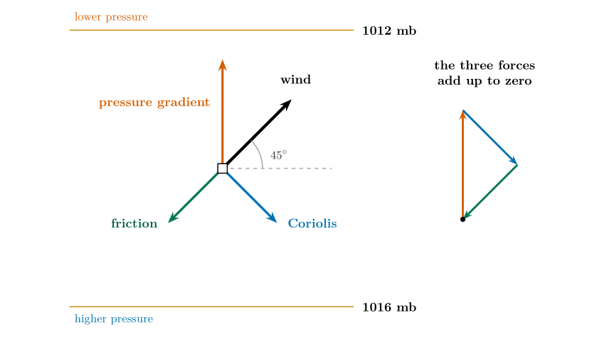
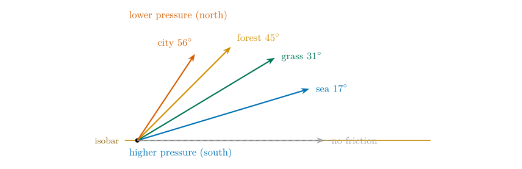
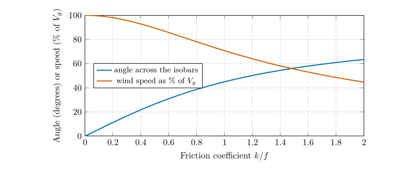
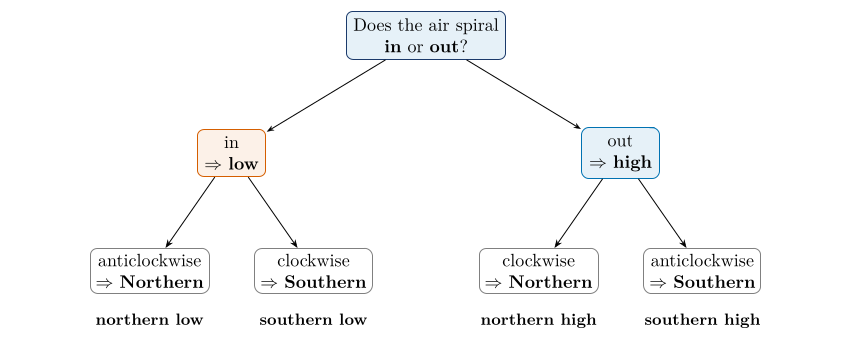
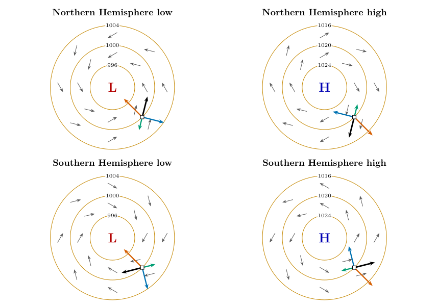
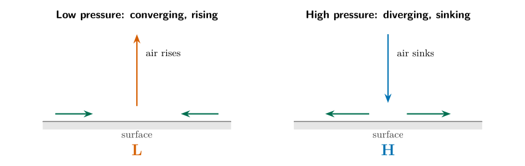

*This chapter answers Motion Q8 to Q11.*

## 26.1 Question 8: what does a slower wind do to the Coriolis force?

Close to the ground friction acts on the air, always against the wind, slowing it. The first question about it is: *what effect will a reduction in surface wind speed have on the Coriolis force?*

Answer to Motion Q8

The Coriolis force becomes **weaker**, because it depends on the wind speed. A slower wind means a smaller Coriolis force; a faster wind a larger one.

The reason is that the Coriolis force per unit mass is $fV$, proportional to the wind speed $V$. If friction cuts the speed to 70 % of the geostrophic value, the Coriolis force falls to 70 % as well. But the pressure gradient force does not depend on the wind at all. So at the surface the Coriolis force can no longer balance the pressure gradient force on its own. Something has to make up the difference, and that is where the three-force balance comes from.

## 26.2 The balance of three forces

Near the ground three forces act on the air. If the wind is steady they add up to zero.

- the **pressure gradient force**, from high to low pressure;

- the **Coriolis force**, at right angles to the wind (to its right in the Northern Hemisphere);

- **friction**, directly against the wind.

Picture one box of air with these arrows. To see why the balance forces the wind to cross the isobars, imagine that the wind were parallel to the isobars as in Chapter [25](/teaching/atmosphere/p3-ch06_geostrophic/#p3-ch:geo). Then the Coriolis force would point directly against the pressure force, and friction (against the wind, along the isobars) would be left with nothing to balance it. The only way out is for the wind to turn a little *towards low pressure*, so that the pressure force has a component along the wind that cancels friction, and the Coriolis force (now pointing partly backwards) cancels the rest.

## 26.3 Question 9: the forces on a box {#p3-sec:fig5}

The question

Indicate with arrows the three forces acting on the Northern Hemisphere box (pressure gradient in red, Coriolis in blue, friction in green); the black arrow shows the result.

Picture two isobars, 1012 mb at the top and 1016 mb at the bottom. The pressure is lower at the top, so the pressure gradient force points *up*.

**Method: draw the arrows in this order.**

1.  **Red: the pressure gradient force.** From the box, straight towards the lower pressure (up the page), at right angles to the isobars.

2.  **Black: the wind.** It blows across the isobars, towards low pressure but turned to the right, so draw it up and to the right (north-east). Its angle to the isobars is typically 20 to 45 degrees; this example uses 45$^{\circ}$.

3.  **Blue: the Coriolis force.** At right angles to the wind, on its right-hand side. For a north-east wind that is to the south-east (down and to the right).

4.  **Green: friction.** Opposite to the wind: pointing south-west (down and to the left).

5.  **Check.** Join the three coloured arrows tip to tail: they should make a closed triangle. If they do, the forces cancel and the wind is steady.

\

**Figure 26.1.** The box completed. Red: pressure gradient force; blue: Coriolis force; green: friction; black: the wind. The three forces, joined tip to tail on the right, close into a triangle: they cancel. The black arrow is the *wind*, the direction in which the air actually moves.

Answer to Motion Q9

Pressure gradient force (red): up, towards 1012 mb. Wind (black): up and to the right. Coriolis force (blue): at right angles to the wind, down and to the right. Friction (green): opposite to the wind, down and to the left.

A question that comes up

**Is the black arrow, the result, a force?**\
In a steady wind the three forces add up to zero, so there is *no* resultant force: that is exactly why the wind is steady. What the black arrow shows is the resulting wind: the direction the air moves when the forces balance. It is the right arrow to draw; just do not think of it as a fourth force.

## 26.4 The numbers: how much does friction turn the wind?

Represent friction as a drag proportional to the wind, with coefficient $k$. The balance of the three forces then gives, for a pressure gradient force $P$, $$
\alpha=\arctan\frac{k}{f},\qquad V=V_g\cos\alpha,\qquad V_g=\frac{P}{|f|}.\tag{26.1}
$$ *where*

|  |  |  |
|:---|:---|:---|
| $\alpha$ | angle at which the wind crosses the isobars, towards low pressure (degrees) | calculated |
| $k$ | friction coefficient (s$^{-1}$) | larger over land than sea |
| $f$ | Coriolis parameter (s$^{-1}$) |  |
| $V,\ V_g$ | wind speed with friction, and geostrophic wind speed ($\mathrm{m\,s^{-1}}$) |  |
| $P$ | pressure gradient force per unit mass (m s$^{-2}$) | Eq. ([23.1](/teaching/atmosphere/p3-ch04_forces/#p3-eq:pgf)) |

The ratio $k/f$ measures how strong friction is compared with the Coriolis force. Figure [26.1](/teaching/atmosphere/p3-ch07_friction/#p3-fig:fig5) corresponds to $k/f=1$.

| **Surface** | $\boldsymbol{k/f}$ | **Angle across isobars** | **Speed** $\boldsymbol{V/V_g}$ | **Coriolis force (relative)** |
|:---|---:|---:|---:|---:|
| No friction (high above the ground) | 0 | 0$^{\circ}$ | 100 % | 100 % |
| Open sea | 0.3 | 17$^{\circ}$ | 96 % | 96 % |
| Flat grassland | 0.6 | 31$^{\circ}$ | 86 % | 86 % |
| Forest or suburb | 1.0 | 45$^{\circ}$ | 71 % | 71 % |
| Tall city | 1.5 | 56$^{\circ}$ | 55 % | 55 % |

: Friction and the surface wind (the ratio $k/f$ is a guide; real values depend on the surface and the weather).

\

The surface wind for different surfaces, for the same pressure gradient force (in the Northern Hemisphere, with low pressure to the north). The rougher the surface, the slower the wind and the greater its angle across the isobars towards low pressure. The length of each arrow is proportional to the wind speed.

\

The angle across the isobars (blue) and the speed (red) against the friction coefficient. The speed is $V_g\cos\alpha$.

## 26.5 Question 10: which system is which?

The question

Winds circulate round surface high and low pressure centres in both hemispheres. Name the hemisphere and pressure system for each of four examples: (a) spiralling inwards, anticlockwise; (b) spiralling outwards, clockwise; (c) spiralling inwards, clockwise; (d) spiralling outwards, anticlockwise.

Two observations identify each system.

1.  **Does the air spiral inwards or outwards?** Friction makes it cross the isobars towards low pressure, so it spirals *in* towards a low and *out* from a high.

2.  **Which way does it turn?** In the Northern Hemisphere the Coriolis force deflects the air to the right, so the circulation round a low is *anticlockwise* and round a high *clockwise*. In the Southern Hemisphere it is the other way round.

| **System**    | **Rotation**  | **Air spirals** | **Pressure gradient force** |
|:--------------|:--------------|:---------------:|:---------------------------:|
| Northern low  | anticlockwise |       in        |     towards the centre      |
| Northern high | clockwise     |       out       |    away from the centre     |
| Southern low  | clockwise     |       in        |     towards the centre      |
| Southern high | anticlockwise |       out       |    away from the centre     |

: The four systems.

\

A two-question key to the four systems: in or out first, then the sense of rotation.

Answer to Motion Q10

\(a\) **Northern Hemisphere low**; (b) **Northern Hemisphere high**; (c) **Southern Hemisphere low**; (d) **Southern Hemisphere high**.

## 26.6 Question 11: the forces on one box in each system

The question

Choose one box on each example and draw the pressure gradient force in red, the Coriolis force in blue, and the frictional force in green. The black arrow shows the result.

**Method.** For the box you choose:

1.  Draw the pressure gradient force (red): towards the centre for a low, away from it for a high.

2.  Draw the wind (black): follow the arrows already on the figure, spiralling in for a low and out for a high.

3.  Draw the Coriolis force (blue) at right angles to the wind: to its right in the Northern Hemisphere, to its left in the Southern Hemisphere.

4.  Draw friction (green) directly opposite to the wind.

5.  Check that the three arrows could be joined tip to tail into a triangle.

\

**Figure 26.5.** The four systems with their forces. In each panel the grey arrows show the surface wind, spiralling in (low) or out (high), and the circles are isobars. On the box at the south-east of each system: red, the pressure gradient force (always along the line to the centre); blue, the Coriolis force (right of the wind in the north, left of the wind in the south); green, friction (against the wind); black, the wind. Any other box would show the same pattern turned round the system.

Answer to Motion Q11

On every box the red arrow points from high to low pressure; the black wind arrow is turned from it, to the right in the north and the left in the south, and pulled towards low pressure by friction; the blue arrow is at right angles to the wind on the same side as the turn; the green arrow is exactly opposite to the wind. The pattern is identical at every position round the system, so any box gives the same picture rotated.

## 26.7 Why this matters for weather

Because the air spirals in towards a low, more air flows in at the bottom than flows out sideways, so the surplus must rise: surface **convergence** gives rising air, cloud and rain. In a high the air spirals out, so air sinks from above to replace it, which warms and dries it and gives clear skies. This is why lows (depressions) bring cloud and rain and highs bring settled weather, and it is the link between this chapter and the weather map you analyse in Chapter [29](/teaching/atmosphere/p3-ch10_fronts/#p3-ch:fronts).

\

Cross-sections. Near the surface the winds converge into a low and diverge from a high; the continuity of air then requires rising motion over the low and sinking over the high.

## 26.8 Questions that come up

A question that comes up

**Why does the wind cross the isobars *towards* low pressure and not away from it?**\
Because friction removes some of the Coriolis balance. The pressure gradient force is now larger than the Coriolis force, and the surplus pushes the air down the pressure gradient. The result is a wind with a component towards low pressure.

A question that comes up

**Why is the angle bigger over land than over the sea?**\
Land is rougher (trees, buildings, hills), so friction is stronger and $k/f$ is larger. Over the open sea the angle is only 10 to 20 degrees; over land it can be 30 to 45 degrees or more.

## 26.9 Try it yourself: Practice Set 26

Practice Set 26: friction

1.  Over a flat grassy plain ($k/f=0.6$) the geostrophic wind is 15 $\mathrm{m\,s^{-1}}$. Find the surface wind speed and its angle to the isobars.

2.  In a Southern Hemisphere low, in which direction does the air circulate, and does it spiral in or out?

3.  Describe the winds round a system in which the air spirals outwards in an anticlockwise sense. Which hemisphere and which kind of system is it?

4.  Over a city the surface wind is 6 $\mathrm{m\,s^{-1}}$ and the geostrophic wind above it is 11 $\mathrm{m\,s^{-1}}$. Roughly what is $k/f$?

Answers to Practice Set 26

1.  $\alpha=\arctan0.6=31\ensuremath{^{\circ}}$; $V=15\cos31\ensuremath{^{\circ}}=12.9\ \ensuremath{\mathrm{m\,s^{-1}}}$.

2.  Clockwise, spiralling **in**.

3.  Anticlockwise and outward is a **Southern Hemisphere high** (Table above).

4.  $V/V_g=6/11=0.55=\cos\alpha$, so $\alpha\approx57\ensuremath{^{\circ}}$ and $k/f=\tan57\ensuremath{^{\circ}}\approx1.5$: a tall-city value.

