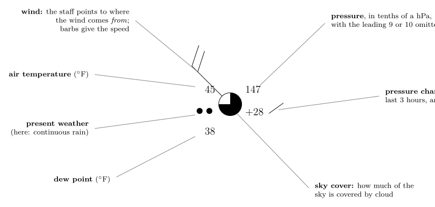
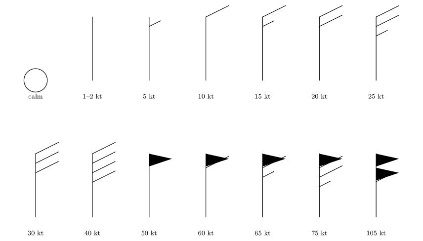
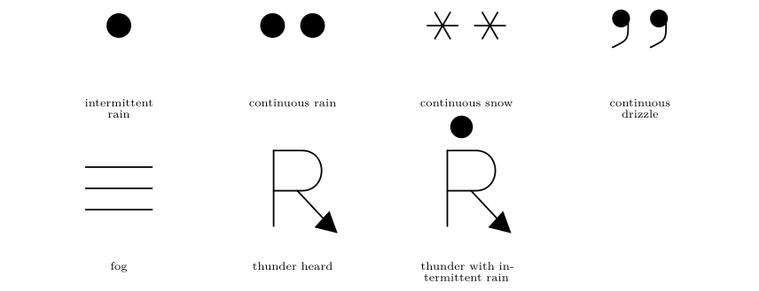
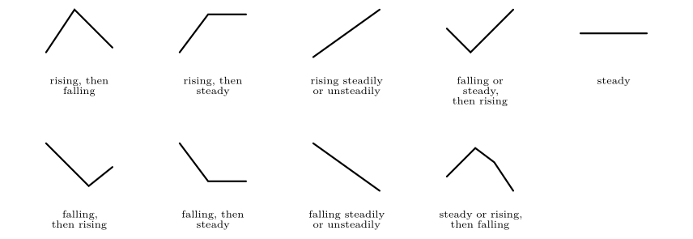
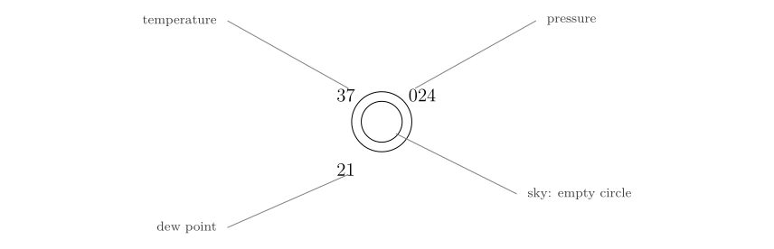
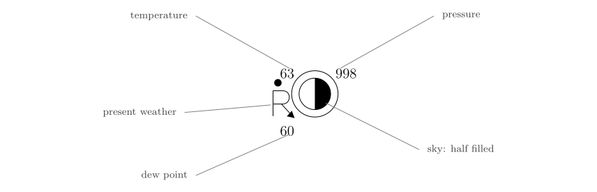
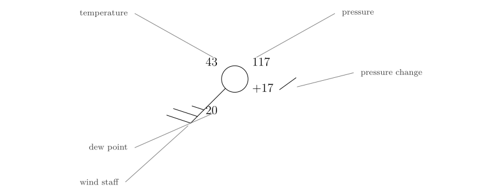
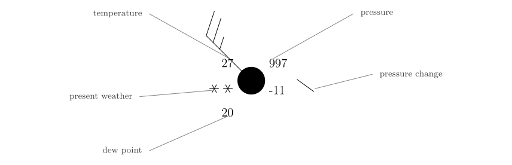
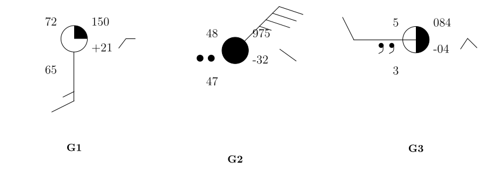

*This chapter answers Map Q12.*

## 27.1 Why a station model?

About 10 000 weather stations around the world measure as many as 18 quantities at each observation: temperature, dew point, pressure, wind, cloud, weather, and more. To show all that on one map the World Meteorological Organization (WMO) fixed a compact way of drawing an observation, the **station model**. Every number and symbol has a fixed position around a small circle that marks the station. Once you know the positions, a map becomes a table you can read at a glance.

## 27.2 The anatomy of a station model

\

**Figure 27.1.** A station model with every field labelled. This example reads: temperature 45 $^{\circ}\mathrm{F}$, dew point 38 $^{\circ}\mathrm{F}$, pressure 1014.7 hPa, rising by 2.8 hPa in the last three hours, three-quarters of the sky covered, continuous rain, and a wind of 20 knots from the north-west.

| **Position** | **What it shows** |
|:---|:---|
| Top left | air temperature, in $^{\circ}\mathrm{F}$ here |
| Bottom left | dew-point temperature |
| Top right | pressure: three digits (tenths of a hectopascal) |
| Right, below the pressure | pressure change over the last 3 hours (with a symbol for its pattern) |
| Left of the circle | present weather symbol |
| The circle itself | sky cover (how much is filled) |
| A line from the circle | wind: the staff points **from** where the wind blows, barbs give the speed |

: Where each quantity sits around the circle.

## 27.3 Decoding the pressure

Only three digits are plotted, in tenths of a hectopascal, and the leading digits are left off. Sea-level pressure almost always lies between about 950 and 1050 hPa, so the missing digits can be restored without doubt.

The pressure rule

1.  Put a decimal point before the last digit: $117\to11.7$.

2.  If the three-digit number is **less than 500**, put **10** in front: $11.7\to1011.7$ hPa.

3.  If it is **500 or more**, put **9** in front: $998\to99.8\to999.8$ hPa.

| **Code** | **Decimal point** | **$<500$ or $\ge500$?** | **Prefix** | **Pressure**   |
|:--------:|:-----------------:|:-----------------------:|:----------:|:---------------|
|   024    |       02.4        |         $<500$          |     10     | **1002.4 hPa** |
|   998    |       99.8        |        $\ge500$         |     9      | **999.8 hPa**  |
|   117    |       11.7        |         $<500$          |     10     | **1011.7 hPa** |
|   997    |       99.7        |        $\ge500$         |     9      | **999.7 hPa**  |
|   147    |       14.7        |         $<500$          |     10     | 1014.7 hPa     |

: Examples of the pressure rule (the first four are the models of Question 12).

## 27.4 Temperature and dew point

Both are in degrees Fahrenheit here. To convert to Celsius, subtract 32 and multiply by 5/9: $$
T(\ensuremath{^{\circ}\mathrm{C}})=\tfrac{5}{9}\,[T(\ensuremath{^{\circ}\mathrm{F}})-32].\tag{27.1}
$$ *where*

|  |  |  |
|:---|:---|:---|
| $T(\ensuremath{^{\circ}\mathrm{C}}),\ T(\ensuremath{^{\circ}\mathrm{F}})$ | the same temperature in Celsius and in Fahrenheit | $^{\circ}\mathrm{F}$ from the station model |

So 37 $^{\circ}\mathrm{F}$ is 2.8 $^{\circ}\mathrm{C}$, 63 $^{\circ}\mathrm{F}$ is 17.2 $^{\circ}\mathrm{C}$, and 21 $^{\circ}\mathrm{F}$ is $-6.1$ $^{\circ}\mathrm{C}$.

The **dew point is the water-vapour measure of Chapter [22](/teaching/atmosphere/p3-ch03_dewpoint/#p3-ch:dew)**, and the gap between the two, $T-T_d$, tells you how close the air is to saturation. A gap of 3 $^{\circ}\mathrm{F}$ means nearly saturated air (fog, rain or thick cloud likely); a gap of 20 $^{\circ}\mathrm{F}$ means dry air. You can turn the pair into a relative humidity with the formula $\mathrm{RH}=100\,e_s(T_d)/e_s(T)$.

## 27.5 Sky cover

The circle is filled in proportion to the cloud cover. Here it is in tenths. The shading grows clockwise from the top, as in Figure [27.2](/teaching/atmosphere/p3-ch08_station/#p3-fig:sky).

\

**Figure 27.2.** The sky-cover symbols: from clear (empty) through half (right half filled) to overcast (filled), and an obscured sky (a cross). The “9/10” symbol is filled with a vertical gap: overcast with small openings.

## 27.6 Wind: the barbs

The wind is drawn as a straight line, the **staff**, that starts at the circle and points **towards the direction the wind comes from**, as a weather vane does. At the free end are short lines, the **barbs**, that tell you the speed in knots.

- a **half barb**: 5 knots;

- a **full barb**: 10 knots;

- a **pennant** (a filled triangle): 50 knots;

- no barb but a staff: 1 to 2 knots; a circle round the station and no staff: calm.

\

Wind barbs for the Northern Hemisphere, drawn with the staff pointing up (a north wind) and the barbs on the right. Add the barbs: 10 + 10 + 5 = 25 knots.

**To read a barb.**

1.  Find the staff and follow it from the circle to its free end. The wind comes *from* that direction: a staff pointing to the lower left is a wind from the south-west.

2.  Count the barbs at the free end: pennants (50), full barbs (10), half barbs (5). Add them.

3.  Convert if you wish: 1 knot $=0.514\ \ensuremath{\mathrm{m\,s^{-1}}}$, so 25 knots $=12.9\ \ensuremath{\mathrm{m\,s^{-1}}}$.

A question that comes up

**The staff points where the wind comes from, but the air is moving the other way. Which way do I draw a streamline?**\
Away from the barbs, i.e. in the direction *opposite* to the staff. A staff pointing to the south-west means the air is heading north-east. Keep that in mind in Chapter [28](/teaching/atmosphere/p3-ch09_streamlines/#p3-ch:stream).

## 27.7 Present weather and pressure tendency

\

The present-weather symbols used here.

\

The barometric tendency symbols: how the pressure has changed in the last three hours. A line rising to the right means rising pressure, one falling to the right means falling pressure.

The number next to the symbol, for example $+17$ or $-11$, is the pressure change in tenths of a hectopascal: $+17$ is a rise of 1.7 hPa in three hours, $-11$ a fall of 1.1 hPa. Rapid falls often warn of a storm approaching; rising pressure usually brings improving weather.

## 27.8 Question 12: the four station models {#p3-sec:sheetmodels}

The question

Decode the information from each of the following station models.

**Method.** For each model work down this list: pressure; temperature; dew point; sky cover; and, where shown, current weather, wind speed, wind direction, pressure change and tendency.

### Model 1 {#model-1 .unnumbered}

\

Model 1

**Pressure:** 024 $\to$ 02.4 $\to$ **1002.4 hPa**\
**Temperature:** **37 $^{\circ}\mathrm{F}$** (2.8 $^{\circ}\mathrm{C}$)**Dew point:** **21 $^{\circ}\mathrm{F}$** ($-6.1$ $^{\circ}\mathrm{C}$)\
**Sky cover:** empty circle: **0 %** (clear). No staff, only a ring round the circle: **calm**. RH $\approx52\,\%$.

### Model 2 {#model-2 .unnumbered}

\

Model 2

**Pressure:** 998 $\to$ 99.8 $\to$ **999.8 hPa**\
**Temperature:** **63 $^{\circ}\mathrm{F}$** (17.2 $^{\circ}\mathrm{C}$)**Dew point:** **60 $^{\circ}\mathrm{F}$** (15.6 $^{\circ}\mathrm{C}$)\
**Current weather:** **thunder with intermittent rain**. Sky half filled (5/10); no staff: calm. RH $\approx90\,\%$.

### Model 3 {#model-3 .unnumbered}

\

Model 3

**Pressure:** 117 $\to$ 11.7 $\to$ **1011.7 hPa**\
**Temperature:** **43 $^{\circ}\mathrm{F}$** (6.1 $^{\circ}\mathrm{C}$)**Dew point:** **20 $^{\circ}\mathrm{F}$** ($-6.7$ $^{\circ}\mathrm{C}$)**Sky cover:** empty circle, **0 %**\
**Wind:** staff to the lower left: **from the south-west**; two full barbs and a half barb: **25 knots**\
**Pressure change:** $+17$: **$+1.7$ mb**, **rising**

### Model 4 {#model-4 .unnumbered}

\

Model 4

**Pressure:** 997 $\to$ 99.7 $\to$ **999.7 mb**\
**Temperature:** **27 $^{\circ}\mathrm{F}$** ($-2.8$ $^{\circ}\mathrm{C}$)**Dew point:** **20 $^{\circ}\mathrm{F}$** ($-6.7$ $^{\circ}\mathrm{C}$)\
**Sky cover:** filled circle, **100 %Current weather:** **continuous snow**\
**Wind:** staff to the upper left: **from the north-west**, **25 knots**\
**Pressure change:** $-11$: **$-1.1$ mb**, **falling**

|  | **Model 1** | **Model 2** | **Model 3** | **Model 4** |
|:---|:--:|:--:|:--:|:--:|
| Barometric pressure (mb) | 1002.4 | 999.8 | 1011.7 | 999.7 |
| Temperature ($^{\circ}\mathrm{F}$) | 37 | 63 | 43 | 27 |
| Dew point ($^{\circ}\mathrm{F}$) | **21** | 60 | 20 | 20 |
| Sky coverage (%) | 0 | 50 | 0 | 100 |
| Current weather | — | thunder, interm. rain | — | continuous snow |
| Wind speed (knots) | calm | calm | 25 | 25 |
| Wind direction (from) | — | — | south-west | north-west |
| Pressure change in 3 h (mb) | — | — | $+1.7$ | $-1.1$ |
| Tendency | — | — | rising | falling |

: All four models decoded.

## 27.9 What the models tell you

Putting the numbers together gives each station a story.

- **Model 1:** cold, dry (the dew point is 16 $^{\circ}\mathrm{F}$ below the temperature), clear and calm: a cold, high-pressure night.

- **Model 2:** warm and very humid (the dew point only 3 $^{\circ}\mathrm{F}$ below the temperature), with thunder and rain: unstable, thundery air.

- **Model 3:** clear and windy with rising pressure: air moving away from a low towards a high, after a front has passed.

- **Model 4:** overcast, snowing, 27 $^{\circ}\mathrm{F}$, wind 25 knots and falling pressure: a depression is arriving or overhead.

## 27.10 Try it yourself: Practice Set 27

Decode each of the three models in Figure [27.6](/teaching/atmosphere/p3-ch08_station/#p3-fig:practiceG) (pressure, temperature and dew point in $^{\circ}\mathrm{F}$ and $^{\circ}\mathrm{C}$, relative humidity, sky cover, weather, wind speed and direction, pressure change and tendency), then check against the answers below.

\

**Figure 27.6.** Three station models to decode.

Answers to Practice Set 27

1.  **150** $\to$ 15.0 $\to$ **1015.0 hPa**. $T=72$ $^{\circ}\mathrm{F}$ (22.2 $^{\circ}\mathrm{C}$), $T_d=65$ $^{\circ}\mathrm{F}$ (18.3 $^{\circ}\mathrm{C}$), RH $\approx79\,\%$. Sky: 2–3/10 (about 25 %). Wind: staff pointing straight down: **from the south**, one full barb and a half barb: **15 knots**. Tendency: $+21$ $\to$ up 2.1 hPa, rising then steady. No weather symbol: fair, warm and humid.

2.  **975** ($\ge500$) $\to$ 97.5 $\to$ **997.5 hPa**. $T=48$ $^{\circ}\mathrm{F}$ (8.9 $^{\circ}\mathrm{C}$), $T_d=47$ $^{\circ}\mathrm{F}$ (8.3 $^{\circ}\mathrm{C}$); RH $\approx96\,\%$. Overcast (100 %). Continuous rain. Wind from the **north-east**, three full barbs and a half barb: **35 knots**. Pressure $-32$: down 3.2 hPa, falling steadily.

3.  **084** ($<500$) $\to$ 08.4 $\to$ **1008.4 hPa**. $T=5$ $^{\circ}\mathrm{F}$ ($-15$ $^{\circ}\mathrm{C}$), $T_d=3$ $^{\circ}\mathrm{F}$; RH $\approx91\,\%$. Sky: 6/10. Continuous drizzle. Wind from the **west**, one full barb: **10 knots**. Pressure $-4$: down 0.4 hPa, rising then falling.

## 27.11 Station models in Python

These functions compute the equations of this chapter, and the book’s tests check them against its answers.

    def fahrenheit_to_celsius(t_f):
        """Temperature in deg C from deg F."""
        return (t_f - 32.0) * 5.0 / 9.0

    def decode_pressure(code):
        """Sea-level pressure (hPa) from a three-digit station-model code."""
        return (1000.0 if code < 500 else 900.0) + code / 10.0

    def knots_to_ms(knots):
        """Wind speed in m/s from knots."""
        return 0.514 * knots

`decode_pressure(247)` returns 1024.7 and `decode_pressure(987)` returns 998.7.

