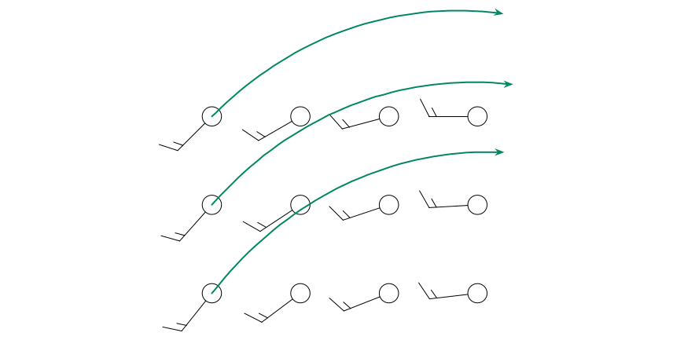
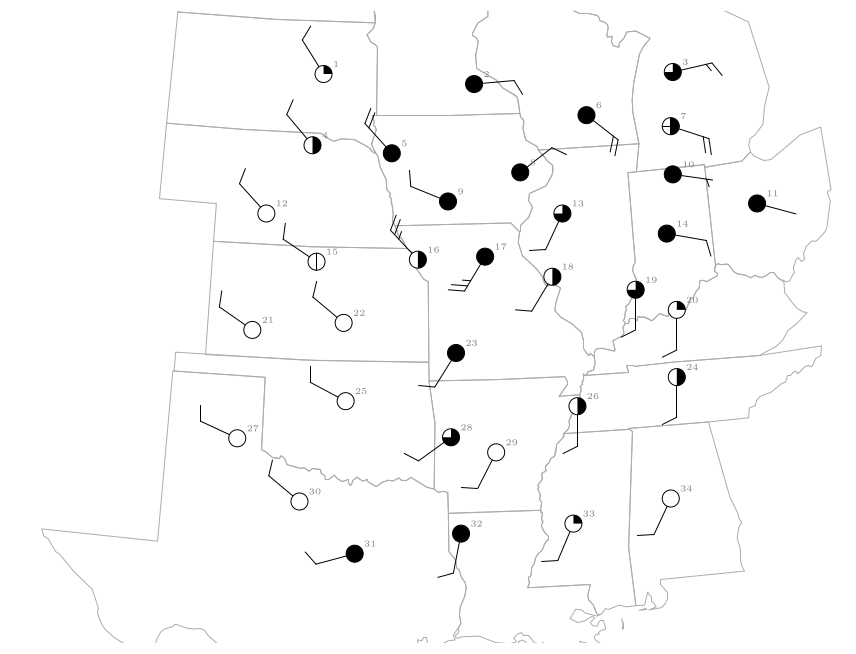
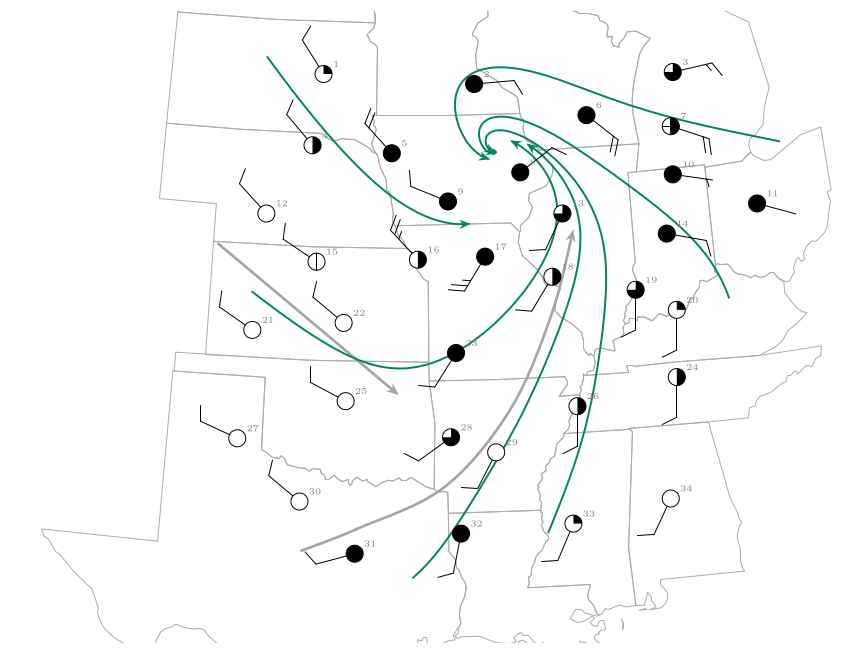

*This chapter answers Map Q13.*

## 28.1 What a streamline is

A wind barb tells you the wind at one station. A **streamline** joins the stations: it is a line that is everywhere **parallel to the wind**. If you could photograph a river with a long exposure, the streaks of floating leaves would be streamlines. On a map they show at a glance where the air is coming from, where it is going, and where it swirls, converges or spreads out.

- At every point of a streamline, the line is tangent to the wind there.

- Streamlines **never cross**, because the wind has only one direction at one place.

- They begin at an **upwind** station and carry an **arrow head** downwind, usually where the flow changes direction.

- They show direction only. Their spacing does not show speed unless you choose to draw them that way.

## 28.2 The method

1.  **Pick a starting point** at an upwind station: one where the wind is blowing towards the area you want to follow.

2.  **Read the barb correctly.** The staff points to where the wind comes *from*. The air moves the other way, *away* from the staff. A barb with its staff pointing to the lower left is a south-west wind and the streamline there runs towards the upper right.

3.  **Draw a short line in that direction** and move downwind until you are near the next station.

4.  **Bend the line smoothly** so that it follows the direction of the barb at the next station, then the next.

5.  **Continue** until the stations run out or the flow leaves the map, then draw an **arrow head** at the downwind end.

6.  **Repeat from another starting point** until you have the five or six streamlines the question asks for. Keep them smooth and make sure no two cross.

Worked example: a small flow

Twelve stations report winds from the south-west on the left of the map and from the west on the right (the staffs point lower-left on the left and to the left on the right). Starting at a left-hand station the air moves towards the north-east. As you move east the barbs rotate clockwise, so the streamline bends to the right and ends up heading east. Each line starts at a station and stays parallel to the barbs it passes.

\

A question that comes up

**How do I know whether to draw the arrow at the start or the end?**\
At the *downwind* end: the end towards which the air is moving, that is, away from the stations’ barbs. A good test: put your pencil on the station, look at the barb, and ask “which way is this air going next?”

## 28.3 The stations

Figure [28.1](/teaching/atmosphere/p3-ch09_streamlines/#p3-fig:fig8) shows 34 stations in the central United States, plotted with only the sky cover and the wind barb. Each station numbered so that you can refer to it. Look at the barbs before you draw anything: where does the wind blow from in each part of the map?

\

**Figure 28.1.** The stations (circle for the sky cover, staff and barbs for the wind; station numbers in grey). The state outlines are real boundaries drawn in a Lambert conformal conic projection.

| **Region** | **Stations** | **Wind from** |
|:---|:---|:---|
| Dakotas, Nebraska, Kansas, Oklahoma, north Texas | 1, 4, 12, 15, 21, 22, 25, 27, 30 | north-west (WNW–NW), about 10 knots |
| Iowa, Missouri (west of the low) | 5, 9, 16 | north-west to west-north-west, 10–25 knots |
| Southern Missouri, Arkansas, Texas (east), Mississippi, Alabama | 23, 28, 29, 31, 32, 33, 34 | south-south-west to west-south-west, about 10 knots |
| Illinois, Kentucky, Tennessee, Indiana (south) | 13, 17, 18, 19, 20, 24, 26 | south-south-west to south, 10–25 knots |
| Wisconsin, Michigan, Ohio, Indiana (north), northern Illinois | 2, 3, 6, 7, 8, 10, 11, 14 | north-east to south-east, 2–20 knots |

: The wind by region (the staff points to where the wind comes from).

## 28.4 Question 13: the streamlines

The question

Streamlines begin at an upwind location and are drawn as long lines with an arrow where the wind shifts abruptly. Complete the analysis by drawing 5 to 6 streamlines to illustrate the general wind flow.

Two streamlines are drawn as examples. One runs south-east from near the Nebraska–Kansas border across Kansas into Oklahoma, in the north-westerly wind. The other starts in north Texas and curves north and then north-east through Arkansas and Missouri into Illinois, in the southerly wind.

\

**Figure 28.2.** The map completed. The two grey streamlines are the examples. The six green streamlines were drawn through the barbs of all 34 stations, starting upwind in the Dakotas, Kansas, Texas, Mississippi, Indiana and Michigan. They curve round a centre in Iowa and northern Illinois.

Answer to Map Q13

Five or six smooth lines, each starting upwind and ending with an arrow, such as those in Figure [28.2](/teaching/atmosphere/p3-ch09_streamlines/#p3-fig:streams): north-westerly flow in the west curving south-east then east; southerly flow in the south curving north and then north-west; easterly flow in the north curving south-west. They all swirl **anticlockwise** and inwards towards one centre in Iowa and northern Illinois.

## 28.5 What the streamlines show

The pattern is the signature of a Northern Hemisphere low-pressure system (Chapter [26](/teaching/atmosphere/p3-ch07_friction/#p3-ch:fric)).

- The wind is **north-westerly** to the west of the centre, **southerly** to the south and east of it, and **easterly** to the north: an anticlockwise circulation.

- The streamlines curve **inwards**, because friction makes the air cross the isobars towards low pressure. They converge near the centre, so air must rise there: this is where the cloud and rain of Question 14 are.

- The streamlines from the south carry warm, humid air northwards; those from the north-west carry cold, dry air southwards. Where the two meet are the fronts.

- The centre of the swirl is where the pressure is lowest. The station reports confirm it: the lowest pressures on the map, 1002.4 and 1002.6 hPa, are at stations 8 and 9, next to the centre of the swirl.

## 28.6 Common mistakes

- **Drawing the arrow the wrong way round,** along the staff rather than away from it. Always ask where the air is going.

- **Joining stations with straight segments** instead of a smooth curve that follows every barb.

- **Letting streamlines cross.** If two lines are about to cross you have misread a barb.

- **Starting downwind.** A streamline needs a clear upwind start.

- **Forgetting the arrow heads.** Put an arrow on every line.

## 28.7 Try it yourself: Practice Set 28

Practice Set 28: reading wind barbs

1.  A station has its staff pointing to the right (east) with one full barb and a half barb. From which direction does the wind blow, how strong is it, and in which direction does a streamline through the station run?

2.  The staff points to the top of the page (north) with two full barbs. State the wind and the direction of the streamline.

3.  A station near the centre of a low shows a wind from the north-east, another to its east shows a wind from the south-east and another to its south a wind from the south-west. Is the circulation clockwise or anticlockwise?

4.  In Figure [28.2](/teaching/atmosphere/p3-ch09_streamlines/#p3-fig:streams) what is the wind at station 31 (south-west Texas)? What is the direction of the streamline there?

Answers to Practice Set 28

1.  From the **east**, 15 knots; the streamline runs **towards the west**.

2.  From the **north**, 20 knots; the streamline runs **towards the south**.

3.  Going from the north-east side, to the east, to the south the winds are from NE, SE, SW. A wind from the NE blows to the SW, from the SE to the NW, from the SW to the NE: the air circles anticlockwise, as round a Northern Hemisphere low.

4.  Station 31 shows a wind from the west-south-west (255$^{\circ}$) of about 10 knots. The streamline there runs towards the east-north-east (it is the start of the north-easterly curve in the figure).

