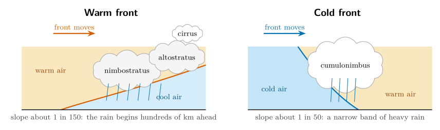
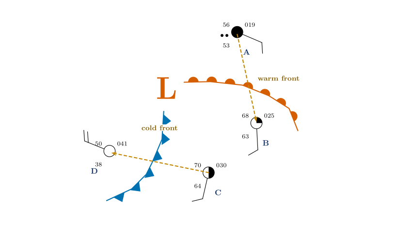
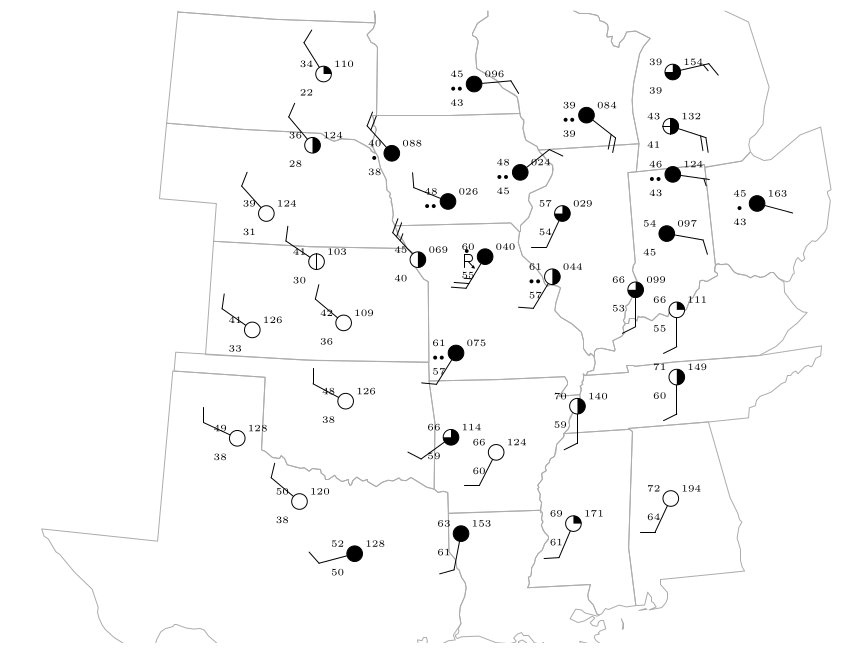
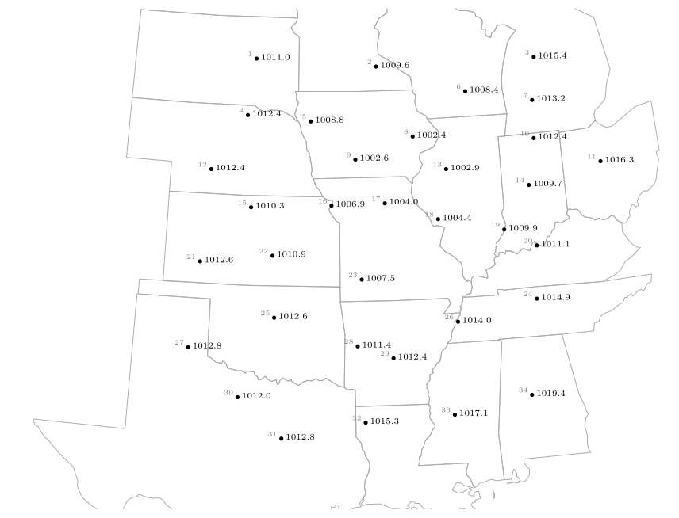
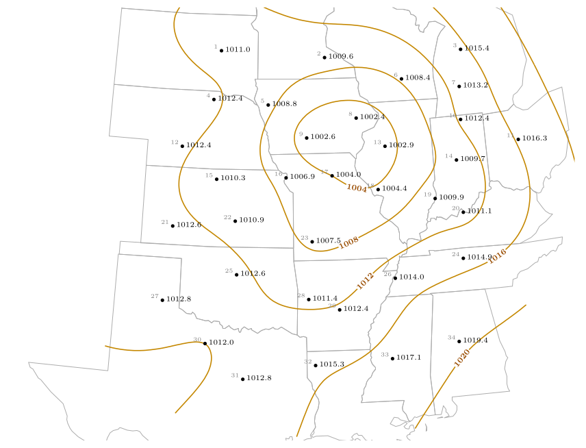
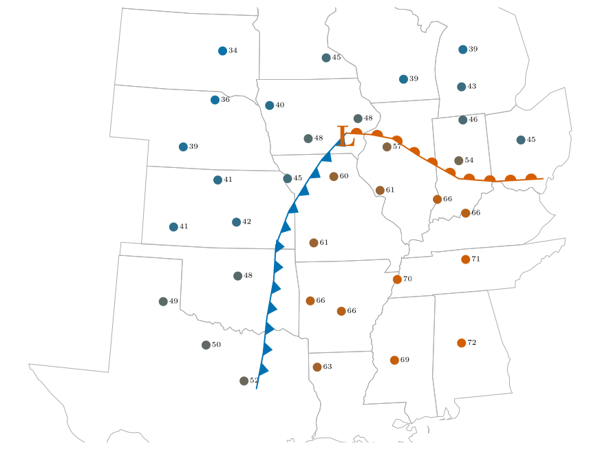
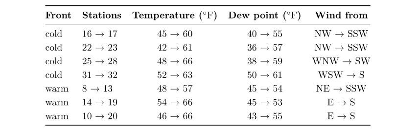
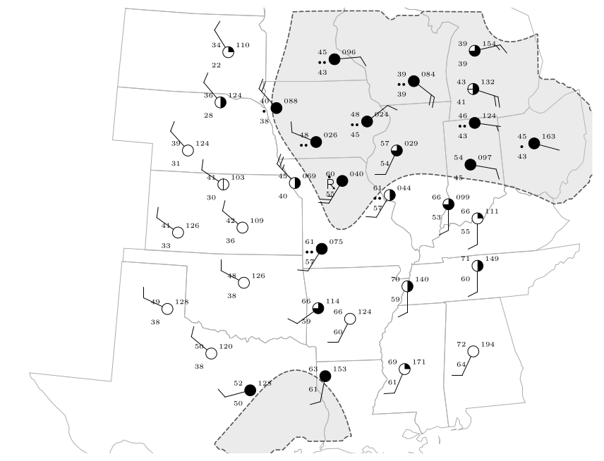
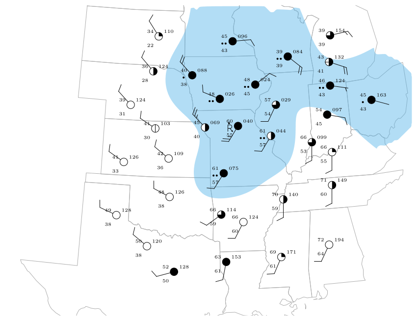
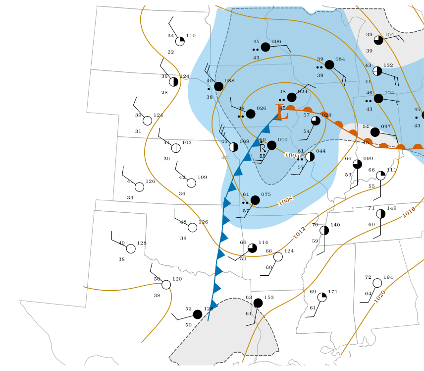

*This chapter answers Map Q14.*

## 29.1 Air masses and fronts

An **air mass** is a very large body of air, hundreds of kilometres across, whose temperature and humidity are much the same throughout. It takes on the character of the surface it has rested on: air that has sat over a cold, dry continent is cold and dry; air from the tropical ocean is warm and humid. A **front** is the boundary between two unlike air masses. You can recognise one by any of the following:

- a sharp change of **temperature**;

- a sharp change of **moisture** (the dew point);

- a sharp change of **wind direction**.

Fronts are classified by how they move.

Warm front

: A warm air mass advances over a cooler one. Drawn as a red line with semicircles pointing the way the front moves.

Cold front

: A cold air mass advances under a warmer one. Drawn as a blue line with triangles pointing the way the front moves.

\

**Figure 29.1.** Cross-sections through a warm front (left) and a cold front (right), with the vertical scale greatly exaggerated. In both the front is a sloping surface along which the warm air rises over the cold air.

|  | **Warm front** | **Cold front** |
|:---|:---|:---|
| Before | pressure falls; cloud thickens from cirrus to nimbostratus; wind backs to south-east | pressure falls; warm, humid, south-westerly wind |
| Passage | steady rain or drizzle; wind veers to south-west; temperature rises | heavy showers, perhaps thunder; wind veers sharply to north-west |
| After | warm, humid air, cloud breaks; pressure steady | colder, drier air; pressure rises; clearing sky |

: What happens as each kind of front passes a station in the Northern Hemisphere.

**Wind veering.** Notice that in both cases the wind *veers*, that is, turns clockwise, as the front passes. Notice how the wind direction shifts at the frontal boundary.

## 29.2 A low with a warm front and a cold front {#p3-sec:fig9}

Figure [29.2](/teaching/atmosphere/p3-ch10_fronts/#p3-fig:fig9) shows a low-pressure centre (L) with a warm front curving east and south from it and a cold front trailing to the south-west. Four stations sample the air round them, which gives a small case in which to learn how to read a front before tackling the whole map.

\

**Figure 29.2.** Station A is north of the warm front, B and C are in the warm sector between the fronts, D is behind the cold front. The dashed orange arrows mark the two crossings studied below: C to D across the cold front, and A to B across the warm front.

| **Stn** | **Temp. ($^{\circ}\mathrm{F}$)** | **Dew pt ($^{\circ}\mathrm{F}$)** | **RH (%)** | **p (hPa)** | **Wind from** | **Sky** |
|:--:|:--:|:--:|:--:|:--:|:---|:---|
| A | 56 | 53 | 90 | 1001.9 | ESE 10 kt | overcast, rain |
| B | 68 | 63 | 84 | 1002.5 | S 10 kt | 2–3/10 |
| C | 70 | 64 | 81 | 1003.0 | SSW 10 kt | 5/10 |
| D | 50 | 38 | 63 | 1004.1 | WNW 20 kt | clear |

: The four stations of Figure [29.2](/teaching/atmosphere/p3-ch10_fronts/#p3-fig:fig9).

1.  **The warm sector (B and C).** The air between the fronts is warm (68 and 70 $^{\circ}\mathrm{F}$) and humid (dew points 63 and 64 $^{\circ}\mathrm{F}$, relative humidity above 80 %), and the wind is from the south.

2.  **Behind the cold front (D).** The air is cooler (50 $^{\circ}\mathrm{F}$), much drier (dew point 38 $^{\circ}\mathrm{F}$, RH 63 %), the sky is clear and the wind has swung to the west-north-west.

3.  **Crossing the cold front, C to D.** The temperature falls 20 $^{\circ}\mathrm{F}$, the dew point falls 26 $^{\circ}\mathrm{F}$, the wind turns from south-south-west (193$^{\circ}$) to west-north-west (292$^{\circ}$): clockwise by about $100\ensuremath{^{\circ}}$. The pressure rises and the cloud clears.

4.  **Crossing the warm front, A to B.** The temperature rises 12 $^{\circ}\mathrm{F}$, the dew point 10 $^{\circ}\mathrm{F}$, and the wind turns from east-south-east (113$^{\circ}$) to south (177$^{\circ}$): clockwise by about $64\ensuremath{^{\circ}}$. The sky changes from overcast and raining to almost clear.

What the four stations teach

A front is marked by *simultaneous* changes of temperature, moisture and wind. At **both** fronts the wind **veers** (turns clockwise). The cold front brings the bigger changes in temperature and dew point; the warm front brings the continuous rain.

## 29.3 Question 14: the full analysis {#p3-sec:fig10}

\

**Figure 29.3.** The 34 stations with all their values: temperature, dew point, pressure, weather, sky cover and wind. They are listed in Appendix [C.2](/teaching/atmosphere/app-p3/#p3-app:stations).

The question

Using the map of Figure [29.3](/teaching/atmosphere/p3-ch10_fronts/#p3-fig:fig10): draw isobars at 4 mb intervals (e.g. 1004, 1008, 1012 mb); label the low-pressure centre with an “L”; draw the warm and cold fronts; outline the area where cloud cover exceeds 75 %; shade the areas receiving precipitation.

Figure [29.3](/teaching/atmosphere/p3-ch10_fronts/#p3-fig:fig10) shows the same 34 stations as Figure [28.1](/teaching/atmosphere/p3-ch09_streamlines/#p3-fig:fig8), but with all the numbers: temperature, dew point, pressure and weather, as well as the sky cover and the wind. The recommended order is the order of the bullets; each step helps the next.

### 29.3.1 Step 0: read the pressures

Decode every pressure with the rule of Chapter [27](/teaching/atmosphere/p3-ch08_station/#p3-ch:station) (a three-digit number below 500 gets 10 in front, otherwise 9), and write the full value next to each station.

\

**Figure 29.4.** Step 0: the decoded sea-level pressures (hPa) at the 34 stations. The lowest values, 1002.4 and 1002.6, are in Iowa and Illinois (stations 8 and 9); the highest, 1019.4, is in Alabama (station 34).

### 29.3.2 Step 1: isobars every 4 mb

**The isobars are 1004, 1008, 1012, 1016 and 1020 mb.** (The lowest pressure is 1002.4, so there is no 1000 mb isobar. The highest, 1019.4 in Alabama, falls just short of 1020; the 1020 isobar lies a little beyond it, where the trend continues, and may be left out.)

**Method: interpolating.**

1.  Look at two neighbouring stations and ask whether a multiple of 4 lies between their pressures.

2.  If it does, find where it falls on the straight line between them *in proportion*.

3.  Mark that point. Do it for every pair of neighbours.

4.  Join the points of equal value with a smooth curve. Do the same for the next value.

Worked example: where does 1008 mb cross between stations 18 and 19?

Station 18 reads 1004.4 hPa and its neighbour station 19 reads 1009.9 hPa. The pressure changes by $1009.9-1004.4=5.5$ hPa between them, and 1008 is $1008-1004.4=3.6$ hPa above the first station: $$\text{fraction of the distance}=\frac{3.6}{5.5}=0.65 .$$ The 1008 mb isobar crosses the line joining the stations 65 % of the way from station 18 towards station 19.

\

| **Stations** | **Pressures (hPa)** | **Isobar** | **Calculation**     | **Fraction** |
|:-------------|:--------------------|:-----------|:--------------------|:-------------|
| 9 and 5      | 1002.6, 1008.8      | 1004       | $(1004-1002.6)/6.2$ | 23 %         |
| 9 and 5      | 1002.6, 1008.8      | 1008       | $(1008-1002.6)/6.2$ | 87 %         |
| 16 and 5     | 1006.9, 1008.8      | 1008       | $(1008-1006.9)/1.9$ | 58 %         |
| 20 and 24    | 1011.1, 1014.9      | 1012       | $(1012-1011.1)/3.8$ | 24 %         |

: More interpolations to practise on.

Rules for drawing isobars

- Isobars are smooth curves. Each connects points of exactly the same pressure.

- Isobars **never cross** and never branch.

- They never end inside the map: they either close into a loop (round a low or a high) or leave the map edge.

- The pressure rises or falls in steps of 4 mb from one isobar to the next; if the next isobar is much further away the gradient is gentle there.

- Label each isobar with its value.

\

**Figure 29.5.** Step 1: isobars at 4 mb intervals through the station pressures. The 1004 mb isobar closes round the lowest pressures; the 1008 and 1012 mb isobars follow it outwards; 1016 and 1020 mb lie to the east and south-east. (The curves here were drawn as a smooth surface through all 34 pressures.)

### 29.3.3 Step 2: the L

The low-pressure centre is where the isobars close round the lowest pressure. The two lowest pressures on the map are 1002.4 hPa (station 8, northern Illinois) and 1002.6 hPa (station 9, Iowa). The 1004 mb isobar encloses them, together with stations 13 and 17 (1002.9 and 1004.0). Write the **L** between stations 8 and 9, near the centre of the closed isobar, at about 1002 hPa.

Answer: the L

The L goes in northern Illinois and eastern Iowa, between stations 8 and 9, in the middle of the innermost isobar. It is also the centre of the swirl of streamlines you drew in Question 13.

### 29.3.4 Step 3: the fronts

A front lies where the temperature, the dew point and the wind direction change rapidly. Compare pairs of neighbouring stations: if two neighbours differ strongly in all three, a front runs between them.

\

**Figure 29.6.** Step 3: air temperature ($^{\circ}\mathrm{F}$) at each station, coloured from blue (cold, 32 $^{\circ}\mathrm{F}$) to red (warm, 72 $^{\circ}\mathrm{F}$). The warm air fills the south-east and a tongue reaches towards the low: the warm sector. Cold air covers the north-west. The cold front (blue, triangles) separates them in the west; the warm front (red, semicircles) in the east.

\

**The cold front.** West of the low, the stations behind the front are cool (42 to 52 $^{\circ}\mathrm{F}$), drier (dew points 36 to 50 $^{\circ}\mathrm{F}$) and have winds from the west to north-west; those ahead are warm (60 to 66 $^{\circ}\mathrm{F}$), humid (dew points 55 to 61 $^{\circ}\mathrm{F}$) and have winds from the south-south-west to south-west. The pairs 16–17, 22–23, 25–28 and 31–32 straddle it, with temperature jumps of 11 to 19 $^{\circ}\mathrm{F}$. The front runs from the low towards the south-south-west, down through Missouri, Arkansas and east Texas.

**The warm front.** East of the low, the stations north of the front are cool (46 to 54 $^{\circ}\mathrm{F}$) with winds from the north-east or east; those south of it are warm (57 to 66 $^{\circ}\mathrm{F}$) with winds from the south. The pairs 8–13, 14–19 and 10–20 straddle it, with temperature jumps of 9 to 20 $^{\circ}\mathrm{F}$and the wind turning from east or north-east to south. The front runs east from the low through Indiana and Ohio.

Answer: the fronts

A **cold front** (blue, with triangles pointing east, the way it moves) from the L towards the south-south-west to Texas; a **warm front** (red, with semicircles pointing north-east) from the L eastwards through Indiana and Ohio. The warm sector, the wedge of warm air between them, lies to the south-east.

### 29.3.5 Step 4: cloud cover above 75 %

Cloud cover above 75 % means the stations drawn with a three-quarters, nine-tenths or completely filled circle. Looking at the sky circles: stations 2, 5, 6, 8, 9, 10, 11, 14, 17, 23, 31 and 32 are completely overcast; stations 3, 13, 19 and 28 have 7 to 8 tenths. Draw a line round the group, including the area between them. The result is a broad area wrapped round the low and extending along the cold front to the south-west.

\

Step 4: the area where the cloud cover exceeds 75 % (dashed outline and grey tint). It wraps round the low on its north and east sides and tails away to the south-west along the cold front.

### 29.3.6 Step 5: the precipitation

Shade round every station that reports precipitation: the weather symbol is a dot or two dots (rain), or the thunderstorm symbol with a dot. These are stations 2, 5, 6, 8, 9, 10, 11, 17, 18 and 23: a band to the north and east of the low, along the warm front, and a narrow band along the cold front in Missouri.

\

Step 5: the areas receiving precipitation (blue shading) at the ten stations that report rain or thunderstorms.

\

**Figure 29.9.** Question 14 complete: isobars every 4 mb (orange), the low (L), the cold front (blue triangles) and the warm front (red semicircles), the area with more than 75 % cloud (dashed outline) and the precipitation (blue shading), over the 34 stations. The state outlines are real boundaries. The fronts are an interpretation, drawn from the temperature, dew-point and wind contrasts.

## 29.4 Reading the finished picture

The map is a text-book mid-latitude depression.

- The low is over Iowa and northern Illinois, at about 1002 hPa.

- The **warm sector** is the tongue of warm, humid air in the south and east, between the two fronts: temperatures in the 60s and 70s $^{\circ}\mathrm{F}$ and dew points of 55 to 64 $^{\circ}\mathrm{F}$.

- The cold air in the north-west is dry (dew points of 22 to 38 $^{\circ}\mathrm{F}$) and mostly clear.

- The cloud and rain are on the fronts and near the low, where the air is being lifted.

- The winds circle the low anticlockwise (Chapter [28](/teaching/atmosphere/p3-ch09_streamlines/#p3-ch:stream)) and cross the isobars towards low pressure (Chapter [26](/teaching/atmosphere/p3-ch07_friction/#p3-ch:fric)).

Worked example: is the wind consistent with the isobars?

Between stations 9 (1002.6 hPa) and 5 (1008.8 hPa), about 216 km apart, the pressure changes by 6.2 hPa. The geostrophic wind for that gradient at 41.5$^{\circ}$N ($f=9.7\times10^{-5}$ s$^{-1}$) is $$V_g=\frac{1}{\rho f}\frac{\Delta p}{\Delta n}=\frac{620}{1.2\times9.7\times10^{-5}\times2.16\times10^{5}}=25\ \ensuremath{\mathrm{m\,s^{-1}}}\approx48\ \text{knots}.$$ The observed surface winds are 10 to 25 knots. That is about what friction does: it slows the surface wind to a half or two thirds of the geostrophic value and turns it across the isobars (Chapter [26](/teaching/atmosphere/p3-ch07_friction/#p3-ch:fric)).

## 29.5 Questions that come up

A question that comes up

**Where exactly should I put the front?**\
There is no single right answer: a front analysis is an interpretation. Put the line along the zone where the temperature, dew point and wind change fastest, bend it to follow the stations, and begin it at the low. Check that the stations on the cold side are colder and drier than those on the warm side.

A question that comes up

**Why do the isobars bend sharply where a front crosses them?**\
Because the wind changes direction at a front, and the wind follows the isobars, the isobars must change direction there too. A front lies along a trough of low pressure, with the isobars forming a V pointing away from the low.

A question that comes up

**Which stations count as “cloud above 75 %”?**\
Those whose circle is filled to at least three quarters: 7–8 tenths, 9 tenths (filled with a gap) or overcast. Stations with half or less are outside the outline.

## 29.6 Try it yourself: Practice Set 29

Practice Set 29: fronts and isobars

1.  Stations X (1011.1 hPa) and Y (1014.9 hPa) are neighbours. Where does the 1012 mb isobar cross the line between them?

2.  A station reports a temperature of 61 $^{\circ}\mathrm{F}$, a dew point of 57 $^{\circ}\mathrm{F}$ and a south-south-west wind of 10 knots. A neighbour to its west reports 42 $^{\circ}\mathrm{F}$, 36 $^{\circ}\mathrm{F}$ and a north-west wind. What kind of front lies between them?

3.  Station P is 30 $^{\circ}\mathrm{F}$ with dew point 28 $^{\circ}\mathrm{F}$, east wind, overcast and snow. Station Q to the south is 41 $^{\circ}\mathrm{F}$ with dew point 38 $^{\circ}\mathrm{F}$ and south-east wind. Is a warm or cold front likely to lie between them? Why?

4.  Why is there no 1000 mb isobar on Figure [29.3](/teaching/atmosphere/p3-ch10_fronts/#p3-fig:fig10)?

Answers to Practice Set 29

1.  $(1012-1011.1)/(1014.9-1011.1)=0.9/3.8=0.24$: 24 % of the way from X to Y.

2.  A **cold front**: the temperature falls 19 $^{\circ}\mathrm{F}$, the dew point 21 $^{\circ}\mathrm{F}$, and the wind turns clockwise from south-south-west to north-west as you cross it from east to west.

3.  A **warm front**: the warmer, moister air (41 $^{\circ}\mathrm{F}$, 38 $^{\circ}\mathrm{F}$) lies to the south with a south-east wind, riding over the colder air with east wind to the north, where it is snowing. The wind turns clockwise from east to south-east.

4.  No station reports a pressure as low as 1000 hPa (the lowest is 1002.4), and an isobar should only be drawn where the data support it.

