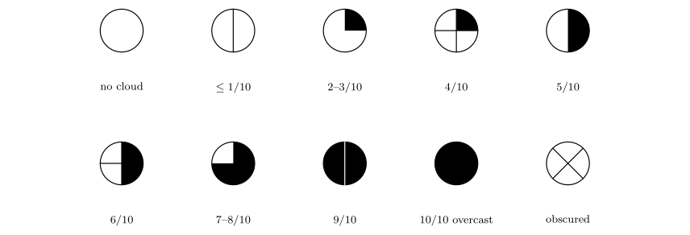
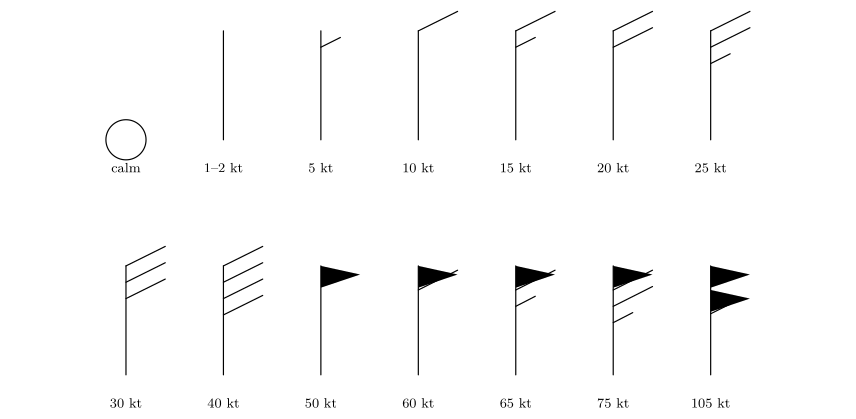
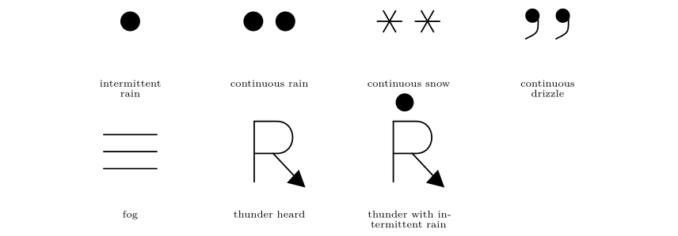
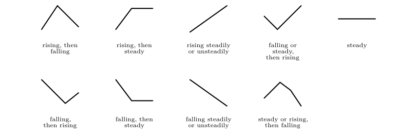

## C.1 Formulas {#p3-app:formulas}

| **Quantity** | **Formula** | **Where, and what for** |
|:---|:---|:---|
| Saturation vapour pressure | $e_s(T)=6.112\exp\!\left[\dfrac{17.67\,T}{T+243.5}\right]$ hPa ($T$ in $^{\circ}\mathrm{C}$) | the table, dew point |
| Saturation mixing ratio | $w_s=\dfrac{622\,e_s}{p-e_s}$ $\mathrm{g\,kg^{-1}}$, with $p=995.5$ hPa | the table |
| Mixing ratio from RH | $w=w_s\times\mathrm{RH}/100$ | Eq. ([21.4](/teaching/atmosphere/p3-ch02_moisture/#p3-eq:wrh)); Moisture Q3, Q6 |
| Relative humidity | $\mathrm{RH}=100\,w/w_s=100\,e/e_s$ | Eq. ([21.3](/teaching/atmosphere/p3-ch02_moisture/#p3-eq:rh)); Moisture Q1 |
| Vapour pressure from $w$ | $e=\dfrac{w\,p}{622+w}$ | Eq. ([21.2](/teaching/atmosphere/p3-ch02_moisture/#p3-eq:we)); dew point (formula) |
| Dew point | $T_d=\dfrac{243.5\,\ln(e/6.112)}{17.67-\ln(e/6.112)}$ | Moisture Q5, Q6 |
| Rule of thumb | $\mathrm{RH}\approx100-5\,(T-T_d)$ | Eq. ([22.1](/teaching/atmosphere/p3-ch03_dewpoint/#p3-eq:thumb)); checks |
| Cloud base | $z\approx125\,(T-T_d)$ m | Eq. ([22.3](/teaching/atmosphere/p3-ch03_dewpoint/#p3-eq:cloudbase)); cloud height |
| Condensed water | $w-w_s(T)$ | Eq. ([22.2](/teaching/atmosphere/p3-ch03_dewpoint/#p3-eq:condensed)); below dew point |
| Hypsometric equation | $\Delta z=\dfrac{R_d\,\overline{T}}{g}\ln\dfrac{p_1}{p_2}$ | Eq. ([24.1](/teaching/atmosphere/p3-ch05_surfaces/#p3-eq:hyps)); Motion Q1–Q6 |
| Pressure gradient force | $-\dfrac{1}{\rho}\dfrac{\Delta p}{\Delta n}=-g\dfrac{\Delta z}{\Delta n}$ (on a pressure surface) | Eq. ([23.1](/teaching/atmosphere/p3-ch04_forces/#p3-eq:pgf)); Chapters [23](/teaching/atmosphere/p3-ch04_forces/#p3-ch:forces)–[26](/teaching/atmosphere/p3-ch07_friction/#p3-ch:fric) |
| Coriolis parameter | $f=2\Omega\sin\varphi$, $\Omega=7.292\times10^{-5}\,\mathrm{s^{-1}}$ | Motion Q7 |
| Coriolis force | $fV$ per unit mass | Motion Q8 |
| Geostrophic wind | $V_g=\dfrac{1}{\rho f}\dfrac{\Delta p}{\Delta n}=\dfrac{g}{f}\dfrac{\Delta z}{\Delta n}$ | Eq. ([25.1](/teaching/atmosphere/p3-ch06_geostrophic/#p3-eq:geo)); Motion Q6, Q7 |
| Wind with friction | $\alpha=\arctan(k/f)$, $V=V_g\cos\alpha$ | Eq. ([26.1](/teaching/atmosphere/p3-ch07_friction/#p3-eq:friction)); Motion Q9–Q11 |
| Temperature | $T(\ensuremath{^{\circ}\mathrm{C}})=\tfrac59[T(\ensuremath{^{\circ}\mathrm{F}})-32]$ | Eq. ([27.1](/teaching/atmosphere/p3-ch08_station/#p3-eq:ftoc)); Map Q12 |
| Pressure code | 3 digits: decimal before last; prefix 10 if $<500$, 9 if $\ge500$ | Map Q12 |
| Knots | 1 kt $=0.514\ensuremath{\mathrm{m\,s^{-1}}}=1.85$ km h$^{-1}$ | Map Q12 |
| Interpolation | fraction $=\dfrac{v_{\mathrm{wanted}}-v_1}{v_2-v_1}$ | Map Q14 |

: The relationships used in this part.

**Constants.** $g=9.81$ m s$^{-2}$; $R_d=287$ J kg$^{-1}$ K$^{-1}$; $\rho\approx1.2$ kg m$^{-3}$ near the ground; $\Omega=7.292\times10^{-5}$ s$^{-1}$; Earth’s radius 6371 km.

## C.2 The 34 stations of Figures 8 and 10 {#p3-app:stations}

Temperatures and dew points are in $^{\circ}\mathrm{F}$; the pressure is the three-digit code and the decoded value in hPa; cloud cover is in percent (the filled fraction of the circle); the wind is the direction it comes **from** and its speed in knots (counted from the barbs, so approximate). Positions are good to about 10 km. A dash means that no value is available (station 9 has no dew point).

| **\#** | **Position** | **Temp.** | **Dew** | **Code** | **hPa** | **Sky** | **Wind** | **Weather** |
|---:|:---|---:|---:|---:|---:|---:|:---|:---|
| **\#** | **Position** | **Temp.** | **Dew** | **Code** | **hPa** | **Sky** | **Wind** | **Weather** |
|  | 44.6°N, 98.4°W | 34 | 22 | 110 | 1011.0 | 25 | NNW 10 |  |
| 2 | 44.3°N, 92.9°W | 45 | 43 | 096 | 1009.6 | 100 | E 10 | rain (continuous) |
| 3 | 44.3°N, 85.6°W | 39 | 39 | 154 | 1015.4 | 75 | ENE 15 |  |
| 4 | 42.7°N, 98.7°W | 36 | 28 | 124 | 1012.4 | 50 | NW 10 |  |
| 5 | 42.5°N, 95.9°W | 40 | 38 | 088 | 1008.8 | 100 | NW 20 | rain (intermittent) |
| 6 | 43.4°N, 88.8°W | 39 | 39 | 084 | 1008.4 | 100 | SE 20 | rain (continuous) |
| 7 | 42.9°N, 85.8°W | 43 | 41 | 132 | 1013.2 | 60 | ESE 20 |  |
| 8 | 42.0°N, 91.3°W | 48 | 45 | 024 | 1002.4 | 100 | NE 10 | rain (continuous) |
| 9 | 41.2°N, 93.9°W | 48 | – | 026 | 1002.6 | 100 | WNW 10 | rain (continuous) |
| 10 | 41.6°N, 86.0°W | 46 | 43 | 124 | 1012.4 | 100 | E 5 | rain (continuous) |
| 11 | 40.6°N, 83.1°W | 45 | 43 | 163 | 1016.3 | 100 | ESE 2 | rain (intermittent) |
| 12 | 40.8°N, 100.3°W | 39 | 31 | 124 | 1012.4 | 0 | NW 10 |  |
| 13 | 40.8°N, 89.9°W | 57 | 54 | 029 | 1002.9 | 75 | SSW 10 |  |
| 14 | 40.1°N, 86.4°W | 54 | 45 | 097 | 1009.7 | 100 | E 10 |  |
| 15 | 39.6°N, 98.5°W | 41 | 30 | 103 | 1010.3 | 10 | NW 10 |  |
| 16 | 39.7°N, 95.0°W | 45 | 40 | 069 | 1006.9 | 50 | NW 25 |  |
| 17 | 39.8°N, 92.7°W | 60 | 55 | 040 | 1004.0 | 100 | SSW 25 | thunder, rain |
| 18 | 39.1°N, 90.4°W | 61 | 57 | 044 | 1004.4 | 50 | SSW 10 | rain (continuous) |
| 19 | 38.7°N, 87.6°W | 66 | 53 | 099 | 1009.9 | 75 | S 10 |  |
| 20 | 38.0°N, 86.3°W | 66 | 55 | 111 | 1011.1 | 25 | S 10 |  |
| 21 | 37.7°N, 100.5°W | 41 | 33 | 126 | 1012.6 | 0 | NW 10 |  |
| 22 | 38.0°N, 97.5°W | 42 | 36 | 109 | 1010.9 | 0 | NW 10 |  |
| 23 | 37.2°N, 93.7°W | 61 | 57 | 075 | 1007.5 | 100 | SSW 10 | rain (continuous) |
| 24 | 36.3°N, 86.5°W | 71 | 60 | 149 | 1014.9 | 50 | S 10 |  |
| 25 | 36.0°N, 97.3°W | 48 | 38 | 126 | 1012.6 | 0 | WNW 10 |  |
| 26 | 35.7°N, 89.8°W | 70 | 59 | 140 | 1014.0 | 50 | S 10 |  |
| 27 | 34.9°N, 100.8°W | 49 | 38 | 128 | 1012.8 | 0 | WNW 10 |  |
| 28 | 35.0°N, 93.9°W | 66 | 59 | 114 | 1011.4 | 75 | SW 10 |  |
| 29 | 34.6°N, 92.5°W | 66 | 60 | 124 | 1012.4 | 0 | SSW 10 |  |
| 30 | 33.3°N, 98.7°W | 50 | 38 | 120 | 1012.0 | 0 | NW 10 |  |
| 31 | 31.9°N, 97.0°W | 52 | 50 | 128 | 1012.8 | 100 | WSW 10 |  |
| 32 | 32.5°N, 93.7°W | 63 | 61 | 153 | 1015.3 | 100 | S 10 |  |
| 33 | 32.6°N, 90.2°W | 69 | 61 | 171 | 1017.1 | 25 | SSW 10 |  |
| 34 | 33.1°N, 87.0°W | 72 | 64 | 194 | 1019.4 | 0 | SSW 10 |  |

The map figures in this part are drawn from this table.

## C.3 Derivations for the curious {#p3-app:derivations}

Nothing in this appendix is needed to answer the questions, but each result is used in the chapters. They are short.

### C.3.1 Mixing ratio and vapour pressure

Treat the dry air and the water vapour as ideal gases at the same temperature $T$ and volume. Their densities are $\rho_d=(p-e)/(R_dT)$ and $\rho_v=e/(R_vT)$, where $p$ is the total pressure, $e$ the vapour pressure and $R_d$, $R_v$ the gas constants of dry air and of water vapour. The mixing ratio is $$w=\frac{\rho_v}{\rho_d}=\frac{R_d}{R_v}\,\frac{e}{p-e}=\varepsilon\,\frac{e}{p-e},\qquad \varepsilon=\frac{R_d}{R_v}=\frac{18.02}{28.96}=0.622 .$$ Multiplied by 1000 this is the $\mathrm{g\,kg^{-1}}$ of Table [21.1](/teaching/atmosphere/p3-ch02_moisture/#p3-tab:table1): $w=622\,e/(p-e)$.

### C.3.2 Saturation vapour pressure

The Clausius–Clapeyron equation relates the change of the saturation vapour pressure of water to temperature: $$\frac{d e_s}{dT}=\frac{L_v\,e_s}{R_v\,T^{2}},$$ where $L_v=2.5\times10^{6}$ J kg$^{-1}$ is the latent heat of vaporisation. At 15 $^{\circ}\mathrm{C}$ this gives $\frac{1}{e_s}\frac{de_s}{dT}=6.9\,\%\ \mathrm{K^{-1}}$, which is why the curve of Figure [21.1](/teaching/atmosphere/p3-ch02_moisture/#p3-fig:es) is steep and bends upward. Integrating with a constant $L_v$ gives an exponential in $-1/T$; fitting the result over the range of the atmosphere gives the convenient empirical form $$e_s(T)=6.112\exp\!\left[\frac{17.67\,T}{T+243.5}\right]\ \mathrm{hPa}\qquad (T\ \text{in }\ensuremath{^{\circ}\mathrm{C}}),$$ which reproduces the values of Table [21.1](/teaching/atmosphere/p3-ch02_moisture/#p3-tab:table1) to better than 0.2 % between $-20$ and 40 $^{\circ}\mathrm{C}$.

### C.3.3 The dew point

The dew point is the temperature at which the saturation vapour pressure equals the actual vapour pressure $e$. Setting $e_s(T_d)=e$ in the empirical form and solving for $T_d$ gives, with $x=\ln(e/6.112)$, $$T_d=\frac{243.5\,x}{17.67-x}.$$ For the sample of Question 6, $w=21.78$ $\mathrm{g\,kg^{-1}}$, $p=995.5$ hPa: $e=21.78\times995.5/(622+21.78)=33.68$ hPa, $x=1.7066$, $T_d=26.03$ $^{\circ}\mathrm{C}$.

### C.3.4 Cloud base from the dew point

A rising unsaturated parcel cools at the dry adiabatic rate $\Gamma_d=g/c_p=9.8$ K km$^{-1}$. Its dew point falls more slowly, because the vapour pressure falls with the pressure: about 1.8 K km$^{-1}$. The gap $T-T_d$ therefore closes at $9.8-1.8=8$ K km$^{-1}$, so the parcel saturates after rising $(T-T_d)/8$ km $\approx125\,(T-T_d)$ m.

### C.3.5 The hypsometric equation

The vertical balance (hydrostatic balance) says that pressure falls with height by the weight of the air: $dp=-\rho g\,dz$. Using the ideal gas law $\rho=p/(R_dT)$, $$dz=-\frac{R_dT}{g}\frac{dp}{p}.$$ Integrating from $p_1$ (lower) to $p_2$ (upper) with the mean temperature $\overline{T}$ of the layer, $$z_2-z_1=\frac{R_d\overline{T}}{g}\ln\frac{p_1}{p_2}.$$ Thickness is proportional to the mean temperature: that is why pressure surfaces rise over warm air.

### C.3.6 The pressure gradient force on a pressure surface

At a fixed height the horizontal pressure gradient force per unit mass is $-\frac{1}{\rho}\frac{\partial p}{\partial n}$. On a surface of constant pressure, the height varies with position, and the hydrostatic relation $\partial p/\partial z=-\rho g$ converts the horizontal pressure gradient at fixed height into a height gradient along the surface: $$-\frac{1}{\rho}\left(\frac{\partial p}{\partial n}\right)_z=-g\left(\frac{\partial z}{\partial n}\right)_p .$$ The density has disappeared: the force depends only on the slope of the pressure surface. This is why questions about the slope of the surfaces are questions about the force.

### C.3.7 The geostrophic wind

For a wind $V$ blowing along the isobars, the pressure gradient force $g\,\Delta z/\Delta n$ and the Coriolis force $fV$ act at right angles to the wind and to each other’s line, in opposite directions. Setting them equal, $$fV_g=g\frac{\Delta z}{\Delta n}\quad\Longrightarrow\quad V_g=\frac{g}{f}\frac{\Delta z}{\Delta n}.$$ In terms of pressure: $V_g=\Delta p/(\rho f\,\Delta n)$.

### C.3.8 The steady wind with friction

Take $x$ east, $y$ north, a pressure gradient force $(P_x,P_y)$, Coriolis acceleration $(fv,-fu)$ and a linear drag $(-ku,-kv)$. In a steady state the three add to zero: $$P_x+fv-ku=0,\qquad P_y-fu-kv=0 .$$ Solving the pair for $u$ and $v$, $$u=\frac{kP_x+fP_y}{k^2+f^2},\qquad v=\frac{kP_y-fP_x}{k^2+f^2}.$$ For the low on the north side and isobars running east–west ($P_x=0$, $P_y=P>0$) this gives $u=fP/(k^2+f^2)$ and $v=kP/(k^2+f^2)$: a wind with a component towards the low. The angle to the isobars satisfies $\tan\alpha=v/u=k/f$ and the speed is $\sqrt{u^2+v^2}=P/\sqrt{k^2+f^2}=V_g\cos\alpha$, with $V_g=P/f$. For $k=0$ this is the geostrophic wind.

### C.3.9 Pressure at a height between two reported levels

In Question 4 the pressure at 9000 m was estimated from the reported levels. Between two levels with pressures $p_a$ and $p_b$ at heights $z_a$ and $z_b$, the pressure was interpolated linearly in $\ln p$: $$\ln p=\ln p_a+(\ln p_b-\ln p_a)\frac{z-z_a}{z_b-z_a},$$ which is the exact result for an isothermal layer. Above the highest level an isothermal extension $p=p_{300}\exp[-g(z-z_{300})/(R_dT)]$ was used.

## C.4 Weather symbols: quick reference {#p3-app:symbols}

The symbols used on the maps. Cover the right-hand descriptions and test yourself.

\

Sky cover: no cloud, $\le1/10$, 2–3/10, 4/10, 5/10, 6/10, 7–8/10, 9/10, 10/10 (overcast), obscured.

\

Wind barbs (staff pointing north, from the north): calm, 1–2, 5, 10, 15, 20, 25, 30, 40, 50, 60, 65, 75 and 105 knots.

\

Present weather: intermittent rain, continuous rain, continuous snow, continuous drizzle, fog, thunder heard, thunder with intermittent rain.

\

Barometric tendency over the past three hours.

## C.5 About the figures, the data and further reading {#p3-app:about}

### C.5.1 How the figures were made

Every figure in this part was drawn for it and is vector graphics: the curves and glasses, the force diagrams and the weather maps are all drawn in the document itself with TikZ and pgfplots, so they stay sharp at any size.

- The **saturation curves** are computed from the formulas of Appendix [C.1](/teaching/atmosphere/app-p3/#p3-app:formulas); the dots are the values of Table [21.1](/teaching/atmosphere/p3-ch02_moisture/#p3-tab:table1).

- The **geostrophic adjustment** (Figures in Chapter [25](/teaching/atmosphere/p3-ch06_geostrophic/#p3-ch:geo)) is the numerical solution of the equations of motion of a parcel released at rest between two height lines, with a gentle damping that relaxes the velocity towards the geostrophic wind.

- The **four circulation systems** (Chapter [26](/teaching/atmosphere/p3-ch07_friction/#p3-ch:fric)) are computed from the steady force balance of Appendix [C.3](/teaching/atmosphere/app-p3/#p3-app:derivations), with friction equal to 0.6 times the Coriolis force.

- The **map**: state outlines are boundaries from Natural Earth (public domain), drawn in the Lambert conformal conic projection, fitted so that the stations fall on the right states. The 34 stations are listed in Appendix [C.2](/teaching/atmosphere/app-p3/#p3-app:stations).

- The **isobars** are contours of a smooth thin-plate-spline surface through the 34 station pressures; the **cloud and rain areas** are contours of distance-weighted averages of the station cover and rain reports; the **streamlines** follow a smoothed wind field made from the 34 barbs. The **fronts** were placed by hand, from the temperature, dew-point and wind contrasts, as an analyst would.

### C.5.2 Limits to bear in mind

- Station values were read from a plotted teaching map: wind speeds are estimated by counting barbs, and a few cloud-cover values could differ by one tenth.

- The geostrophic-wind estimates between Saskatoon and Monterrey use only two places and rounded heights. They show the right behaviour (increase of wind with height) but not exact winds.

- The fronts and the isobars are *analyses*: reasonable analysts can draw them slightly differently. What matters is that every rule is respected (isobars never cross, fronts follow the contrasts of temperature, moisture and wind).

### C.5.3 Further reading

- Ahrens and Henson (2022): the standard introduction; the station model, humidity and the forces on the wind are all treated at this level.

- Stull (2017): a free textbook that includes the hypsometric equation, the geostrophic wind and station models with worked examples.

- Wallace and Hobbs (2006): thermodynamics of moist air, the balance of forces, and fronts and cyclones.

- Holton and Hakim (2013): the geostrophic wind, thermal wind and friction at a more advanced level.

- Bolton (1980): the saturation vapour pressure formula used here.

- World Meteorological Organization (2019): the definition of the station model and its codes.

Ahrens, C.D. and Henson, R. (2022) Meteorology today: An introduction to weather, climate, and the environment, 13th ed. Cengage Learning, Boston, MA.

Bolton, D. (1980) The computation of equivalent potential temperature. Monthly Weather Review 108, 1046–1053. [https://doi.org/10.1175/1520-0493(1980)108\<1046:TCOEPT\>2.0.CO;2](https://doi.org/10.1175/1520-0493(1980)108<1046:TCOEPT>2.0.CO;2)

Holton, J.R. and Hakim, G.J. (2013) An introduction to dynamic meteorology, 5th ed. Academic Press, Amsterdam.

Stull, R. (2017) [Practical meteorology: An algebra-based survey of atmospheric science](https://www.eoas.ubc.ca/books/Practical_Meteorology/). University of British Columbia, Vancouver.

Wallace, J.M. and Hobbs, P.V. (2006) Atmospheric science: An introductory survey, 2nd ed. Elsevier Academic Press, Amsterdam.

World Meteorological Organization (2019) Manual on codes, volume I.1: International codes (WMO-No. 306). WMO, Geneva.

