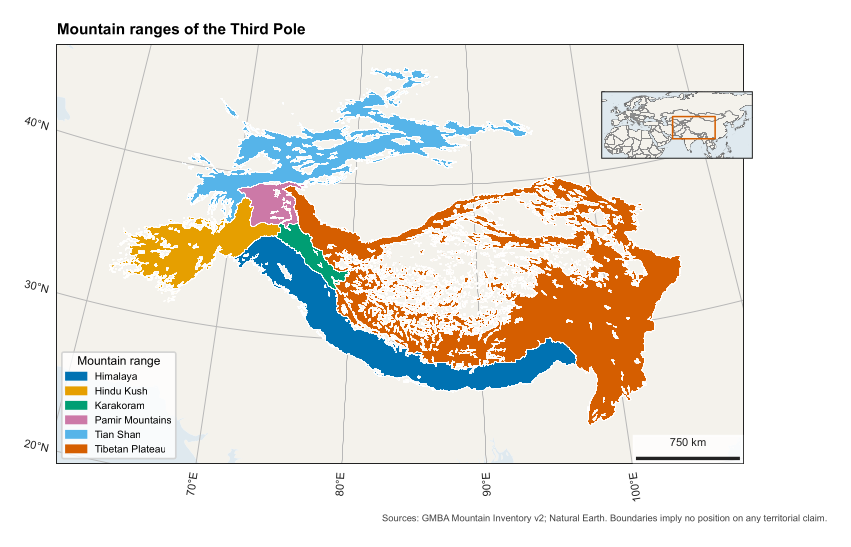
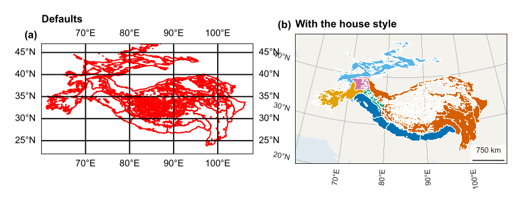

A publishable map answers three questions at a glance: what is shown, where it is, and whether it can be trusted. Each part below serves one of these. Figure [1.1](/teaching/maps/anatomy/#fig:anatomy) has them all, and later chapters show the code for each.

\

**Figure 1.1.** A complete map. Its code is in `src/make_figures.py`, function `anatomy()`.

| Part | What it does | In code |
|:---|:---|:---|
| Map frame | Holds the data, and its border is called the neatline | `map_axes()` |
| Thematic layer | The subject itself: polygons, points or a raster | `add_geometries()`, `imshow()` |
| Base layer | Quiet land and sea that give context without competing | `map_axes(land=True)` |
| Graticule | Lines of latitude and longitude, with labels, that show location and projection | `map_axes(grid=True)` |
| Scale bar | Turns map distance into ground distance | `scale_bar()` |
| Legend | Explains colours and symbols | `ax.legend()` |
| Locator inset | A small overview showing where the map sits | `locator()` |
| Title or caption | States the subject; journals usually want it in the caption | `set_title()`, LaTeX |
| Credit | Names sources, as licences often require | `credit()` |
| Projection note | Lets a reader judge distortion | Caption, `finish_map()` |
| Record | A file stating sources and projection, for repeating the work | `finish_map()` |

##### North arrows.

We usually leave them out. On a conic projection, north differs across the map, so a single arrow is wrong in most places, and the graticule already shows direction. Use an arrow only on a large-scale map with no graticule.

##### Hierarchy.

The eye should reach the data first and the furniture last. So base layers are pale, grid lines thin and grey, and text small. If your scale bar is what stands out, it is too heavy.

\

The same data with defaults (a), and with the house style (b). Panel (a) distorts shape and hides the data behind its grid.

