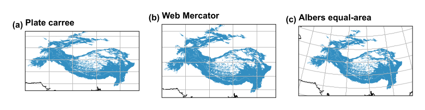

A flat map cannot keep every property of the globe. It can keep areas (equal-area), local shapes (conformal), or distances along some lines, but not all at once. Choose by what your map is used for.

\

The same region in three projections.

| Your map | Good choice | Code |
|:---|:---|:---|
| Region at mid latitudes | Albers equal-area conic, with parallels at about a sixth and five-sixths of the height | `carto.albers(lon, lat1, lat2)` |
| A city or small area | The national grid or a UTM zone | `ccrs.OSGB()`, `ccrs.UTM(42)` |
| The world | Equal Earth, which keeps area | `ccrs.EqualEarth()` |
| Web tiles | Web Mercator, for navigation only | `ccrs.Mercator.GOOGLE` |

## 3.1 Never measure area in degrees

A degree of longitude shrinks towards the poles, so any area taken from degrees is wrong. Table [3.1](/teaching/maps/projections/#tab:area) shows how far out each approach is, compared with Equal Earth, using the `shared-geodata` regions.

| How area is computed | Karakoram (km$^2$) | Error | Tian Shan (km$^2$) | Error |
|:---|---:|---:|---:|---:|
| Geographic degrees treated as flat, at the equator’s scale | 91,702 | +23% | 756,672 | +35% |
| Web Mercator | 112,467 | +51% | 1,022,497 | +83% |
| Albers equal-area (ours) | 74,614 | +0% | 560,184 | +0% |
| Equal Earth | 74,614 | +0% | 560,184 | +0% |

: Table 3.1. Area of two ranges by four routes.

Web Mercator inflates area most at high latitudes, which is why it should never be used for measuring. The routine is to reproject, and then measure:

``` {.python language="Python"}
km2 = g.to_crs("ESRI:54034").area / 1e6      # cylindrical equal-area, in square metres
```

## 3.2 Our helper

**From the code:** `research_helpers/carto.py, albers(), lines 50--53`

``` {startFrom="50"}
def albers(central_lon, parallel_1, parallel_2, central_lat=None):
    """Equal-area conic, the usual choice for mid-latitude regions wider than they are tall."""
    lat = (parallel_1 + parallel_2) / 2 if central_lat is None else central_lat
    return ccrs.AlbersEqualArea(central_longitude=central_lon, central_latitude=lat, standard_parallels=(parallel_1, parallel_2))
```

## 3.3 Scale bars and distortion

A scale bar is only exactly true where a projection has no distortion: along the standard parallels of a conic map. On a small map of a large region, say this in the caption. On a world map, leave the bar out, since no single scale holds. `finish_map()` accepts a sentence explaining why a map has no bar.

