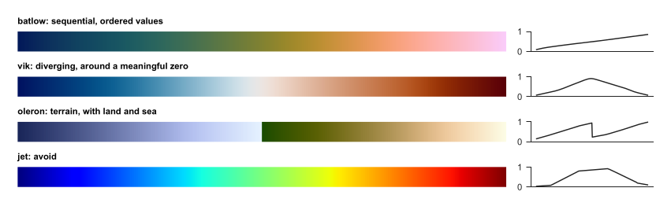
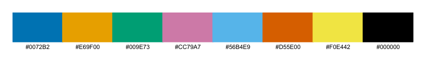

## 4.1 Match the colour map to the data

| Data | Colour map | Name in `carto` |
|:---|:---|:---|
| Ordered values, such as snow days | Sequential: one steady change in lightness | `SEQUENTIAL` (batlow) |
| Values around a meaningful zero, such as anomalies | Diverging: two hues meeting at a neutral colour | `DIVERGING` (vik) |
| Categories, such as land cover | Qualitative: distinct colours | `QUALITATIVE` (Okabe-Ito) |

\

Colour maps (left) with their lightness (right). Batlow rises fairly steadily. Jet rises and falls, creating false edges in smooth data, and fails for many colour-blind readers.

\

The qualitative palette, chosen to stay distinct for common colour-vision deficiencies.

## 4.2 Rules

1.  Centre a diverging map on the meaningful value, with `vmin=-lim, vmax=lim`.

2.  Fix limits across panels you want compared. Otherwise, the same colour means different values.

3.  Stretch by percentiles for display, and say so, because a few bright pixels would otherwise wash out the rest:

    ``` {.python language="Python"}
    lo, hi = np.nanpercentile(a, [2, 98])
    ```

4.  Never let colour alone carry meaning: add labels or hatching where you can.

5.  Print or view in greyscale once, to test the map.

## 4.3 Over imagery

Satellite images are busy, so plain labels get lost. `outlined()` adds a dark edge to text, and `mark()` draws numbered white circles, which read on any background. Explain the numbers in the caption or a table. This also suits print, since long place names no longer cover the data. **From the code:** `research_helpers/carto.py, mark(), lines 102--107`

``` {startFrom="102"}
def mark(ax, points, transform=None, size=7):
    """Numbered markers with a halo, readable over any image. points is a list of (number, x, y); a caption or key explains them."""
    transform = transform or ccrs.PlateCarree()
    for n, x, y in points:
        ax.text(x, y, str(n), transform=transform, ha="center", va="center", fontsize=size, fontweight="bold", color="black", zorder=20,
                bbox=dict(boxstyle="circle,pad=0.25", facecolor="white", edgecolor="black", linewidth=0.5))
```

**From the code:** `research_helpers/carto.py, outlined(), lines 110--112`

``` {startFrom="110"}
def outlined(ax, x, y, text, transform=None, size=7, color="white"):
    """A place label with an outline, for use over imagery."""
    return ax.text(x, y, text, transform=transform or ccrs.PlateCarree(), fontsize=size, color=color, zorder=19, path_effects=[pe.withStroke(linewidth=1.8, foreground="black")])
```

