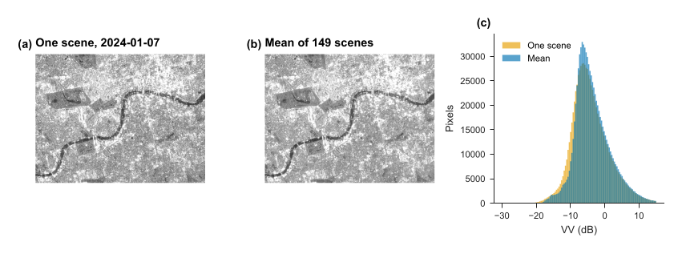
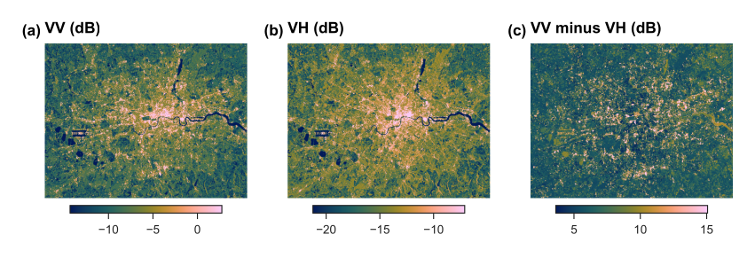
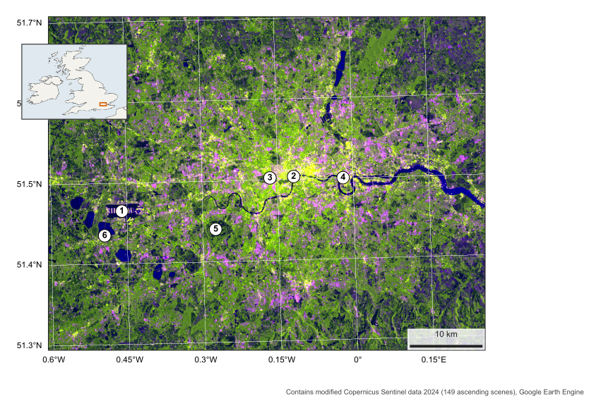

## 2.1 What the satellite measures

Sentinel-1 sends microwave pulses at a wavelength of about 5.5 cm and records what returns. It supplies its own signal, so it works at night and sees through cloud. The picture therefore shows how surfaces send energy back, which is different from colour. Three things control the return: how rough a surface is at the scale of the wavelength, its geometry, and how wet it is.

| Surface | Why it looks as it does |
|:---|:---|
| Calm water | A smooth mirror reflects the pulse away, so it looks dark |
| Vegetation | Leaves and branches scatter in many directions, so it looks moderate, with strong VH |
| Buildings | Walls and ground form corners that send the pulse straight back, so they look very bright |

## 2.2 The numbers

The image holds backscatter, $\sigma^0$, usually in decibels: $$
\sigma^0_{\mathrm{dB}} = 10\log_{10}\sigma^0_{\mathrm{linear}}
$$ So 10 dB more is ten times the power, and 3 dB is about double. Polarisation is written as sent and received: VV goes out and returns vertically, whereas VH goes out vertically and returns horizontally. Volume scattering in vegetation changes polarisation, so VH responds strongly to it.

## 2.3 Step 1: choose the scenes

We take all ascending Interferometric Wide scenes over London in 2024: 149 of them. Keeping one pass direction matters, because a building looks different from each side. **From the code:** `src/sarlib.py, s1(), lines 17--23`

``` {startFrom="17"}
def s1(region, start, end, orbit=None):
    """Sentinel-1 ground range scenes in dual polarisation; values are already calibrated backscatter in dB."""
    c = (ee.ImageCollection("COPERNICUS/S1_GRD").filterBounds(region).filterDate(start, end)
         .filter(ee.Filter.eq("instrumentMode", "IW"))
         .filter(ee.Filter.listContains("transmitterReceiverPolarisation", "VV"))
         .filter(ee.Filter.listContains("transmitterReceiverPolarisation", "VH")))
    return c.filter(ee.Filter.eq("orbitProperties_pass", orbit)) if orbit else c
```

## 2.4 Step 2: average in the right units

Decibels are logarithms, so averaging them understates bright targets. We convert to linear power, average, and convert back: **From the code:** `src/sarlib.py, mean_db(), lines 30--32`

``` {startFrom="30"}
def mean_db(collection, band):
    """Average in linear power and return to dB, because averaging decibels understates bright targets."""
    return collection.select(band).map(to_linear).mean().log10().multiply(10).rename(band)
```

## 2.5 Step 3: see why averaging is needed

Radar images have a grain called speckle, which arises when returns from many small scatterers within a pixel interfere. It is not noise in the usual sense, since it would repeat exactly from an identical view, but it hides detail. Over the most uniform 300 m patch in this view, chosen by the code, the spread of VV falls from 2.05 dB in one scene (2024-01-07) to 0.78 dB in the mean of the year (Figure [2.1](/teaching/sar/reading-radar-london/#fig:speckle)).

<a id="fig:speckle"></a>

\

**Figure 2.1.** Central London: one scene (a), the mean of the year (b), and the distribution of values (c).

## 2.6 Step 4: build a false-colour image

No single band shows everything (Figure [2.2](/teaching/sar/reading-radar-london/#fig:bands)), so we put three in the display channels: VV as red, VH as green, and VV minus VH as blue.

<a id="fig:bands"></a>

\

**Figure 2.2.** The three bands, each stretched between its 2nd and 98th percentiles.

## 2.7 Reading the map

<a id="fig:london"></a>

\

**Figure 2.3.** London in radar, 2024. VV as red, VH as green, VV minus VH as blue. Numbers are explained in Table [2.1](/teaching/sar/reading-radar-london/#tab:places). British National Grid.

| Place                            | VV (dB) | VH (dB) | VV minus VH |
|:---------------------------------|--------:|--------:|------------:|
| Heathrow Airport                 |     5.7 |    -0.7 |         6.4 |
| River Thames, central London     |   -14.8 |   -20.5 |         5.8 |
| Hyde Park                        |    -8.1 |   -14.2 |         6.2 |
| Canary Wharf                     |     8.8 |     1.9 |         6.9 |
| Richmond Park                    |   -12.8 |   -19.1 |         6.3 |
| Reservoir south-west of Heathrow |   -17.8 |   -26.7 |         8.9 |

: Table 2.1. Measured values, averaged over a small circle at each numbered place in Figure [2.3](/teaching/sar/reading-radar-london/#fig:london).

Look at the map in this order:

1.  **Water (2, 6).** The Thames and the reservoirs are the darkest features. The river’s width changes on the map partly because a narrow channel can be mixed in one pixel with its bright banks and bridges.

2.  **The dense centre (4).** Canary Wharf is extremely bright, because towers form strong corners. Its value is one of the highest in the table.

3.  **Green space (3, 5).** Hyde Park and Richmond Park stand out as dark green holes in the city. Both polarisations are low, since grass is fairly smooth at this wavelength.

4.  **Airport (1).** Heathrow’s runways are dark stripes, smooth like water, surrounded by bright buildings.

**A caution:** the mean at a marked place depends on exactly where the circle falls, and at the river it can include bridge and bank returns.

