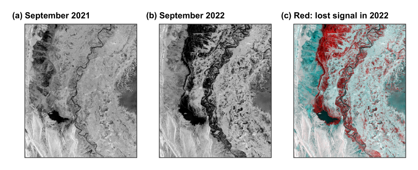
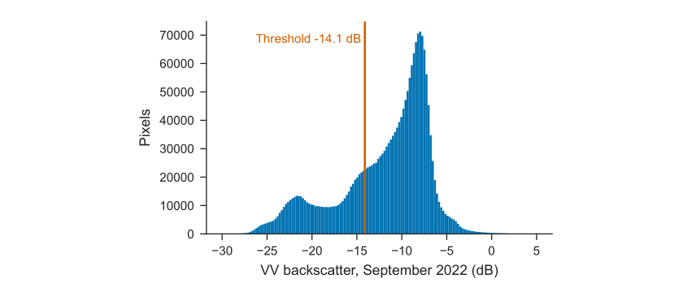
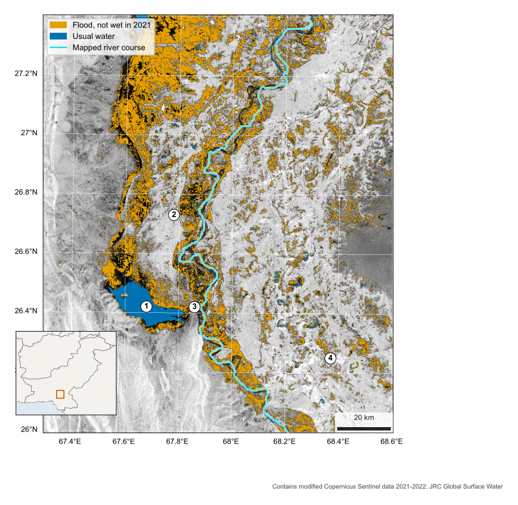

## 3.1 The question

In 2022 severe floods covered large parts of Pakistan. Cloud often blocks optical satellites during such events, while radar keeps seeing. Open floodwater is smooth, so it turns dark. We therefore look for land that was not dark in a normal year and turned dark during the flood. The area here runs from Manchar Lake along the Indus.

## 3.2 Step 1: a before and an after

We take the mean VV over the same weeks of two years, 25 August to 15 September in 2021 (12 scenes) and 2022 (12 scenes), so the season is alike. VV is the usual choice for open water, because it separates smooth water well from rougher land.

<a id="fig:sindhba"></a>

\

**Figure 3.1.** September 2021 (a), September 2022 (b), and a colour combination (c) in which a surface that lost signal in 2022 appears red. UTM 42N.

## 3.3 Step 2: choose a threshold from the data

Water and land form two groups in the histogram, so we need the value that best separates them. Otsu’s method tries every value $t$, and keeps the one that maximises the variance between the two groups: $$
\sigma_b^2(t) = w_0(t)\,w_1(t)\,\bigl[\mu_0(t)-\mu_1(t)\bigr]^2
$$ where $w$ is the share of pixels in each group and $\mu$ its mean. Here it gives -14.1 dB (Figure [3.2](/teaching/sar/mapping-a-flood-sindh/#fig:hist)). **From the code:** `src/sarlib.py, otsu(), lines 61--69`

``` {startFrom="61"}
def otsu(values, bins=256):
    """The threshold that best separates two groups: it maximises the variance between them (Otsu, 1979)."""
    v = values[np.isfinite(values)]
    count, edges = np.histogram(v, bins=bins)
    mids = (edges[:-1] + edges[1:]) / 2
    w = np.cumsum(count).astype(float)
    m = np.cumsum(count * mids)
    between = (m[-1] * w / w[-1] - m) ** 2 / (w * (w[-1] - w) + 1e-9) * w[-1]
    return float(mids[np.argmax(between)])
```

<a id="fig:hist"></a>

\

**Figure 3.2.** Backscatter in 2022, with the threshold.

## 3.4 Step 3: separate flood from usual water

Three rules define flood: below the threshold in 2022, above it in 2021, and water less than 50% of the time in the JRC Global Surface Water record. **From the code:** `src/02_sindh_flood.py, lines 25--28`

``` {startFrom="25"}
thr = otsu(after)
wet_after, wet_before = after < thr, before < thr
flood = wet_after & ~wet_before & (occ < 50)
permanent = wet_after & (occ >= 50)
```

## 3.5 Reading the map

<a id="fig:flood"></a>

\

**Figure 3.3.** Water in Sindh, September 2022, over VV backscatter. 1 Manchar Lake, 2 Dadu, 3 Sehwan, 4 Nawabshah. UTM 42N.

| What to look for | How to read it |
|:---|:---|
| Around Manchar Lake (1) | The usual lake is blue. The orange beyond it is new water spread along the foot of the western hills |
| Along the Indus | A wide orange band follows the river, with the usual channel in blue within it |
| Round Dadu (2) | Bright, higher ground stands out between flooded land, so settlement is a visible island |
| Round Sehwan (3) | Hills pinch the valley here, and the flood narrows |
| West, lower left | Bright ridges facing the satellite are the hills. They are terrain, not buildings |

## 3.6 Results

The map shows about 3,458 km$^2$ of flood within the 20,415 km$^2$ scene, and 348 km$^2$ of usual water. Moving the threshold by 2 dB either way gives 3,145 and 3,345 km$^2$, so the choice matters less than the limits below.

## 3.7 What this cannot tell you

- **Not validated.** This is a teaching estimate, and it has not been compared with optical images or field reports.

- **Rice and wet soil.** Flooded fields and irrigated land in September can look like flood. This is likely in scattered patches, especially in the east.

- **Hidden water.** Water beneath trees or crops, or among buildings, may be missed because those surfaces stay bright.

- **Three weeks in one image.** A mean covers several passes, so it shows water present for much of the period, and not one moment.

- **Black areas.** Dark in both years, these may be standing water or smooth sand. They are not counted as flood.

